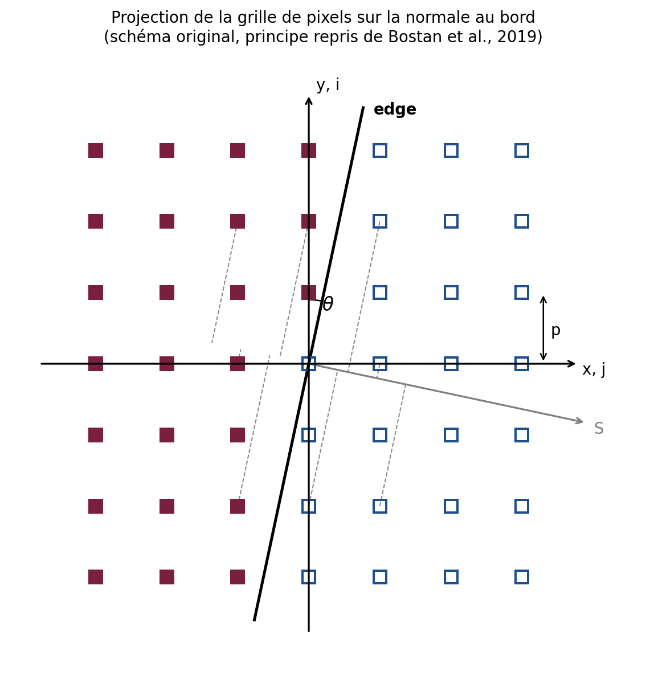

# Référence technique — eoqual-measure

Détail de chaque mesure : principe, architecture, implémentation, limites
connues, historique des corrections, bibliographie. Pour le catalogue
résumé et l'installation, voir `README.md` ; pour la provenance du code
et l'audit des licences, `THIRD_PARTY_LICENSES.md`.

- [Partie I — MTF par bord incliné](#partie-i--mtf-par-bord-incliné-eoqualmeasuremtfslanted_edge)
- [Partie II — Variance du bruit](#partie-ii--variance-du-bruit-eoqualmeasurenoise)
- [Partie III — Strehl et énergie encerclée](#partie-iii--strehl-et-énergie-encerclée-eoqualmeasurepsf)

Les chemins de fichiers cités dans la partie I sont relatifs à
`src/eoqual/measure/mtf/slanted_edge/` sauf mention contraire ; ceux de la
partie II, à `src/eoqual/measure/`. Les sections « Limites connues »
conservent l'historique des corrections : pièges de la méthode
rencontrés pendant le développement et la façon dont ils sont évités.

---

## Partie I — MTF par bord incliné (`eoqual.measure.mtf.slanted_edge`)

Estimation de l'orientation et de la MTF (Modulation Transfer Function)
d'un système d'imagerie à partir d'une mire à bord incliné, avec
plusieurs algorithmes indépendants comparables entre eux à chaque
étape.

**Statut** : opérationnel, validé sur cas synthétiques (bords propres,
bruités, angles variés, PSF gaussienne connue). À valider par
simulation plus poussée avant un usage métrologique de production.

---

### Contexte et objectifs

Ce pipeline répond à un besoin exprimé dès l'origine du projet : une
brique logicielle d'estimation de la FTM par méthode bord de plage,
**fortement modulaire**, permettant de remplacer aisément une
implémentation élémentaire par une autre (détection de bord,
construction d'ESF, calcul de MTF) ou de laisser le choix à
l'utilisateur — c'est exactement le principe directeur de
l'architecture décrit en §2.1 (template method + comparateur), qui
permet à `EdgeOrientationComparator`/`MTFComparator` d'exécuter et de
comparer plusieurs implémentations interchangeables sur la même donnée.

Deux axes identifiés dès le départ restent des **pistes non explorées**
à ce stade (voir §12) : l'exploitation de bords naturels sur cibles
urbaines (plutôt que des mires dédiées), et les études de sensibilité
systématiques (angle, bruit, comparaison d'algorithmes) que
l'architecture actuelle permet de mener mais qui n'ont pas encore été
conduites de façon exhaustive.

---

### Sommaire

1. [Fondements théoriques](#1-fondements-théoriques)
2. [Architecture logicielle](#2-architecture-logicielle)
3. [Module d'orientation](#3-module-dorientation)
4. [Module de MTF](#4-module-de-mtf)
5. [Support Bayer](#5-support-bayer)
6. [Visualisation](#6-visualisation)
7. [Orchestration (`cli.py`)](#7-orchestration-mainpy)
8. [Guide d'utilisation](#8-guide-dutilisation)
9. [Limites connues et historique des corrections](#9-limites-connues-et-historique-des-corrections)
10. [Bibliographie](#10-bibliographie)
11. [Annexe — formulaire de référence](#11-annexe--formulaire-de-référence)
12. [Perspectives et pistes non explorées](#12-perspectives-et-pistes-non-explorées)

---

### 1. Fondements théoriques

#### 1.1 Principe de la méthode du bord incliné

Un objectif/capteur dégrade une scène idéale par sa **PSF** (Point
Spread Function). Pour un bord noir/blanc parfait (marche de Heaviside)
observé à travers ce système, l'image obtenue est l'**ESF** (Edge
Spread Function) : la convolution de la marche par la PSF, intégrée
selon la direction du bord.

La **LSF** (Line Spread Function) est la dérivée de l'ESF selon la
direction perpendiculaire au bord :

$$
\text{LSF}(x) = \frac{d}{dx}\text{ESF}(x)
$$

La **MTF** est le module de la transformée de Fourier de la LSF,
normalisée à 1 en fréquence nulle :

$$
\text{MTF}(f) = \frac{|\mathcal{F}[\text{LSF}](f)|}{|\mathcal{F}[\text{LSF}](0)|}
$$

**Pourquoi incliner le bord ?** Un bord parfaitement vertical n'est
échantillonné qu'à la résolution native du capteur (1 échantillon par
pixel et par ligne). En inclinant le bord d'un petit angle θ, chaque
ligne de l'image voit le bord à une position sous-pixel légèrement
différente de la précédente. En recombinant toutes les lignes, on
reconstruit un profil d'ESF **sur-échantillonné**, à une résolution
effective de `1/sin(θ)` échantillons par pixel — c'est tout l'intérêt
de la méthode, normalisée par la méthode "edge SFR" de l'ISO 12233
[[ISO12233]](#10-bibliographie) et popularisée dans son usage pratique
par Burns [[Burns2000]](#10-bibliographie).

#### 1.2 Le problème de périodicité de la FFT

Un point central, à l'origine de plusieurs choix d'implémentation de ce
pipeline : une ligne de bord brute est un **échelon**, pas un signal
périodique. La FFT traite pourtant implicitement tout signal comme
périodique — elle recolle silencieusement la fin du signal à son début,
créant une **discontinuité artificielle** à la jointure. Le spectre
d'un échelon périodisé de cette façon contient donc des harmoniques
paires *et* impaires, sans que les paires aient de raison d'être
négligeables.

Un vrai **créneau à 50 % de rapport cyclique**, en revanche, vérifie la
symétrie demi-onde :

$$
f(x + T/2) = -f(x)
$$

Le développement en série de Fourier d'un signal à symétrie demi-onde
n'a, par construction, **que des harmoniques impaires** :

$$
a_{2m} = b_{2m} = 0 \quad \forall m
$$

Deux stratégies, toutes deux implémentées dans ce pipeline, permettent
d'exploiter cette propriété :

- **Mirroring** (`orientation/fourier.py`, `estimators/spatial.py`,
  `estimators/spectral.py`) : construire explicitement un signal à symétrie
  demi-onde en concaténant le profil avec une transformation
  photométrique miroir (`distance_to_white`, `distance_to_black`), de
  largeur double de l'original. La FFT de ce signal double n'a alors
  d'énergie significative que sur les harmoniques impaires — le rapport
  énergie-impaire/énergie-paire devient une métrique de qualité directe
  de cette hypothèse.
- **Fenêtrage** (`estimators/spectral_correlation.py`) : atténuer le signal
  vers 0 à ses extrémités (fenêtre de Hanning) avant la FFT, ce qui
  supprime la discontinuité de périodisation sans construire de
  représentation doublée. Plus léger, mais utilise moins de données par
  construction (pas de doublement) et ne bénéficie pas de la garantie
  stricte "harmoniques paires nulles".

#### 1.3 Correction d'angle

Le bord étant incliné d'un angle θ, la fréquence mesurée le long des
lignes de balayage est **compressée** par rapport à la fréquence réelle
perpendiculaire au bord (direction physiquement pertinente pour la MTF
d'un capteur). La convention ISO 12233, suivie uniformément dans tout
ce pipeline, est de corriger l'axe des **fréquences**, pas l'amplitude
de la MTF :

$$
f_{\text{corrigée}} = \frac{f_{\text{mesurée}}}{\cos\theta}
$$

C'est le champ `frequency_corrected` de `MTFResult`, distinct de
`frequency` (brute). Appliquer cette correction sur la MTF elle-même
(`mtf /= cos(θ)`), comme on le voit parfois, n'est pas la même
opération mathématiquement ; ce pipeline n'adopte pas cette convention
(voir §9).

#### 1.4 Théorème du décalage (shift theorem)

Utilisé abondamment pour l'estimation de pente et le calcul de MTF
spectral : décaler un signal de `d` échantillons multiplie son k-ième
coefficient de Fourier par un facteur de phase pure :

$$
\mathcal{F}[f(x-d)](k) = \mathcal{F}[f(x)](k) \cdot e^{-2\pi i k d / N}
$$

Deux lignes du bord, séparées de `Δy` lignes, sont (approximativement)
la même ESF décalée de `dx·Δy` colonnes, où `dx` est la pente
(colonnes/ligne). La différence de phase mesurée entre leurs spectres,
à une fréquence donnée, donne directement une estimation de `dx` :

$$
dx = -\frac{\Delta\varphi_k \cdot N}{2\pi \cdot k \cdot \Delta y}
$$

C'est le cœur de `fourier_utils.estimate_slope_multiharmonic` (moyenné
sur plusieurs harmoniques basses et plusieurs paires de lignes) et de
`SpectralCorrelationMTFEstimator` (corrélation de phase fréquence par
fréquence).

#### 1.5 Correction d'ouverture pixel (sinc)

Le photosite du capteur intègre la lumière sur toute sa surface — il se
comporte comme un filtre passe-bas de réponse
[[Boreman2001]](#10-bibliographie) :

$$
\text{MTF}_{\text{pixel}}(f) = \left|\frac{\sin(\pi f \cdot p)}{\pi f \cdot p}\right| = |\text{sinc}(f \cdot p)|
$$

où `p` est le pas physique du pixel (`pixel_pitch`). Diviser la MTF
mesurée par ce terme (`MTFCorrections.pixel_aperture`) déconvolue cet
effet d'intégration, isolant la MTF de l'optique seule.

#### 1.6 Biais de dérivation numérique

Une dérivée par différences centrées (`np.gradient`, pas `Δx`) n'a pas
la réponse en fréquence idéale `H_{\text{idéal}}(f) = 2\pi i f` d'une
dérivation exacte, mais :

$$
H(f) = \frac{\sin(2\pi f \Delta x)}{\Delta x}
\quad\Longrightarrow\quad
\frac{H(f)}{H_{\text{idéal}}(f)} = \text{sinc}(2f\Delta x)
$$

Diviser par ce facteur (`MTFCorrections.derivative`) corrige ce biais —
**uniquement pertinent** quand la LSF vient effectivement d'une
dérivation numérique (voir §9, correction appliquée par erreur à des
dérivées analytiques dans une version antérieure).

---

### 2. Architecture logicielle

#### 2.1 Principe directeur : template method + comparateur

Chaque famille d'algorithmes (orientation, MTF) partage :

- une **classe de base abstraite** (`EdgeOrientationDetector`,
  `SlantedEdgeMTFEstimator`) qui prend en charge tout ce qui est commun
  (canonicalisation, conversions de repère, contrat de sortie) et
  délègue le calcul propre à chaque algorithme à une méthode abstraite ;
- un **comparateur** (`EdgeOrientationComparator`, `MTFComparator`) qui
  exécute plusieurs implémentations sur la même entrée et collecte
  leurs résultats dans un dictionnaire, sans jamais interrompre la
  comparaison si l'une échoue (l'erreur est capturée et rapportée dans
  `details["error"]`).

Certaines implémentations (`EsfLsfMTFEstimator`,
`SpectralCorrelationMTFEstimator`) ont une méthodologie de calcul de
pente entièrement différente du socle commun et **surchargent
`estimate()` en entier**, plutôt que de forcer leur logique dans le
canevas partagé — un choix explicite, documenté dans chaque classe.

#### 2.2 Graphe de dépendances (fichiers)

```
Couche 0 (aucune dépendance interne)
  preprocess.py   fourier_utils.py   estimators/esf_models.py   (eoqual-core : eoqual.core.bayer, eoqual.core.edge)

Couche 1
  orientation/base.py  →  preprocess.py
  estimators/base.py    →  preprocess.py, fourier_utils.py, orientation/fourier.py

Couche 2
  orientation/gradient.py, orientation/pca.py, orientation/fourier.py
                        →  orientation/base.py (+ fourier_utils.py pour fourier)
  estimators/spatial.py, estimators/spectral.py, estimators/spectral_correlation.py, estimators/esf_lsf.py
                        →  estimators/base.py (+ fourier_utils.py, estimators/esf_models.py)

Couche 3
  visualization.py       →  orientation/base.py, estimators/base.py (types uniquement)
  bootstrap.py        →  estimators/base.py
  chromatic.py →  eoqual.core.bayer, orientation/base.py (types uniquement)

Couche 4
  cli.py               →  tout (dont bootstrap.py, chromatic.py)
  sensitivity.py  →  orientation/base.py, estimators/base.py, preprocess.py
```

Aucun cycle d'import réel (vérifié par analyse statique du graphe AST).
Deux imports différés existent, tous deux nécessaires pour casser un
vrai cycle : dans `EdgeOrientationComparator.__init__` (import de
`gradient_orientation`/`pca_orientation`/`fourier_orientation`) et dans
`MTFComparator.__init__` (import de `spatial_mtf`/`spectral_mtf`/
`estimators/esf_lsf`/`estimators/spectral_correlation`) — ces modules importent tous
la classe de base qu'ils étendent, donc un import de niveau module
créerait un cycle.

#### 2.3 Convention de repère

Toute image est ramenée à un **repère canonique** avant traitement
(`SlantedEdgePreprocessor.preprocess`, voir §3.1) : bord proche de la
verticale (balayage ligne par ligne cohérent), région sombre à gauche.
Chaque estimateur travaille dans ce repère puis reconvertit son
résultat (angle, positions) vers le repère de l'image originale avant
de le renvoyer — l'appelant n'a jamais à se soucier de la
transposition/inversion interne.

#### 2.4 Convention de fréquence MTF

Toutes les fréquences (`MTFResult.frequency`,
`MTFResult.frequency_corrected`) sont exprimées en **cycles par pixel
physique du capteur**, 0.5 = fréquence de Nyquist. Le paramètre
`pixel_pitch`, commun aux quatre méthodes de MTF (`SlantedEdgeMTFEstimator`,
voir §4.1), convertit la fréquence "brute" (cycles par échantillon du
tableau fourni) vers cette convention physique :

$$
f_{\text{physique}} = f_{\text{brute}} \times \text{pixel\_pitch}
$$

`pixel_pitch = 1.0` (défaut) pour une image en niveaux de gris pleine
résolution ; `pixel_pitch = 0.5` pour un plan Bayer sous-échantillonné
(voir §5). Cette convention uniforme est ce qui rend les quatre
méthodes directement superposables sur un même graphique, quelle que
soit leur résolution native de travail.

---

### 3. Module d'orientation

Estime l'angle d'inclinaison du bord par plusieurs algorithmes
indépendants, chacun produisant en plus de l'angle une **position
sous-pixel du bord par ligne** (`edge_rows`/`edge_columns`) et une
**métrique de qualité testant l'hypothèse propre à l'algorithme** — pas
une métrique arbitraire.

#### 3.1 `preprocess.py` — canonicalisation générique

`SlantedEdgePreprocessor.preprocess(image)` :

1. Détecte si le bord est majoritairement horizontal (comparaison de
   l'énergie des gradients de Sobel horizontal/vertical) ; transpose si
   besoin.
2. Détecte le côté sombre (moyenne des `percentile`% de colonnes
   extrêmes) ; retourne l'image horizontalement si besoin.
3. Estime les niveaux noir/blanc de référence par moyenne robuste
   (percentile) des colonnes extrêmes.

Retourne un `PreprocessingResult` (image canonicalisée, niveaux noir/
blanc, indicateurs `was_transposed`/`was_flipped`).

#### 3.2 `orientation/base.py` — socle générique

- **`FrameCanonicalizer`** : enveloppe autour du préprocesseur, plus
  les fonctions de conversion angle/positions vers le repère d'origine
  (défait flip puis transpose).
- **`OrientationResult`** : type de résultat commun — `algorithm`,
  `angle_deg` (replié dans [-90°, 90°], convention `atan2(Δligne,
  Δcolonne)`), `is_horizontal`, `was_transposed`/`was_flipped`,
  `edge_rows`/`edge_columns`, `quality_metric_name`/`quality_metric_value`,
  `details`.
- **`EdgeOrientationDetector`** (ABC) : template method. `analyse()`
  canonicalise, appelle `_estimate_canonical()` (abstraite), reconvertit
  le résultat. Fournit aussi des utilitaires partagés : repli d'angle,
  seuillage robuste de magnitude de gradient, régression linéaire
  position-par-ligne → angle.
- **`EdgeOrientationComparator`** : exécute plusieurs détecteurs,
  défaut = `{gradient, pca, fourier}`.

#### 3.3 `orientation/gradient.py` — `GradientOrientationDetector`

**Hypothèse testée** : chaque ligne a un maximum local net de
`|d(intensité)/d(colonne)|` au niveau du bord.

**Algorithme** : dérivée par différences centrées de chaque ligne ;
position du maximum de `|gradient|` ; interpolation parabolique à 3
points autour du maximum pour la position sous-pixel ; régression
linéaire des positions sur toutes les lignes → angle.

**Métrique** (`peak_sharpness`) : courbure de la parabole normalisée
par la hauteur du pic — grande pour un maximum net et non ambigu,
petite pour un profil plat ou bruité.

Pas de paramètre constructeur (comportement fixe).

#### 3.4 `orientation/pca.py` — `PCAOrientationDetector`

**Hypothèse testée** : les pixels de fort gradient sont alignés sur une
droite fine (le bord).

**Algorithme** :
1. Seuillage robuste (percentile parmi les valeurs non nulles
   uniquement — évite qu'un bord fin sélectionne toute l'image, voir
   §9) des pixels de fort gradient (Sobel).
2. **Première passe** : PCA sur le nuage de points brut → angle et
   `eigenvalue_ratio` (métrique, calculée sur ce nuage non filtré pour
   rester un diagnostic honnête des candidats bruts).
3. **RANSAC** : de nombreuses droites candidates tirées de paires de
   points aléatoires ; conservation de celle avec le plus de points à
   l'intérieur de `ransac_tolerance` [[FischlerBolles1981]](#10-bibliographie)
   — nécessaire pour les images bruitées où les points de bruit peuvent
   être majoritaires (voir §9).
4. **Seconde passe** : PCA sur les seuls inliers RANSAC → angle final
   (cohérent avec les positions par ligne, voir §9) et centroïde pondéré
   par ligne → `edge_rows`/`edge_columns` ("projection").

**Paramètres constructeur** :

| Paramètre | Défaut | Rôle |
|---|---|---|
| `gradient_percentile` | 90.0 | Seuil de sélection des pixels de fort gradient |
| `ransac_tolerance` | 2.0 | Distance perpendiculaire max. (px) pour un inlier |
| `ransac_iterations` | 300 | Nombre de droites candidates testées |
| `canonicalization_percentile` | 10.0 | Transmis au préprocesseur |

#### 3.5 `orientation/fourier.py` — `FourierOrientationDetector`

**Hypothèse testée** : la représentation symétrique (mirroring, §1.2)
a une énergie négligeable sur ses harmoniques paires.

**Deux méthodes internes, sélectionnables via `angle_source`** :

- **`"fundamental"`** (défaut) : phase de l'harmonique k=1 de la
  représentation symétrique → position absolue par ligne (calibrée +
  `unwrap` à travers les lignes), puis régression linéaire → angle.
  C'est la seule des deux qui produit des positions par ligne — donc
  toujours calculée, quel que soit `angle_source`, car nécessaire au
  tracé comparatif.
- **`"multiharmonic"`** : différence de phase entre paires de lignes
  glissantes, moyennée sur plusieurs harmoniques impaires basses
  (`fourier_utils.estimate_slope_multiharmonic`) — statistiquement plus
  robuste (plus de données moyennées) mais ne donne qu'un angle global.

**Métrique** (`odd_even_ratio`) : rapport de l'énergie des harmoniques
impaires sur celle des paires — test direct de l'hypothèse de symétrie
demi-onde.

**Paramètres constructeur** :

| Paramètre | Défaut | Rôle |
|---|---|---|
| `canonicalization_percentile` | 10.0 | Transmis au préprocesseur |
| `angle_source` | `"fundamental"` | `"fundamental"` ou `"multiharmonic"` |
| `low_freq_ratio` | 0.2 | Fraction des harmoniques basses (mode multiharmonic) |
| `block_gap` | 2 | Écart en lignes entre paires comparées (mode multiharmonic) |

#### 3.6 `fourier_utils.py` — utilitaires partagés

- `reference_spectrum(size)` : spectre analytique d'un échelon idéal
  aux harmoniques impaires, `(-1)^{1+k}/((1+2k)\pi)`.
- `estimate_slope_multiharmonic(rect, low_freq_ratio, block_gap)` :
  implémentation partagée par `FourierOrientationDetector` (mode
  multiharmonic) et `SlantedEdgeMTFEstimator` (socle commun spatial/
  spectral) — évite la duplication de cette logique entre estimation
  d'angle et estimation de MTF.

---

### 4. Module de MTF

Quatre méthodes indépendantes, comparables via `MTFComparator`, toutes
produisant un `MTFResult` (`method`, `mtf`, `frequency`,
`frequency_corrected`, `dx`, `theta_rad`, `oversample_factor`,
`details`).

#### 4.1 `estimators/base.py` — socle générique

- **`SlantedEdgeMTFEstimator`** (ABC) : template method partagé par
  `SpatialMTFEstimator`/`SpectralMTFEstimator` (les deux méthodes qui
  utilisent la représentation symétrique + `estimate_slope_multiharmonic`).
  `estimate(frame, oversample_factor)` : construit la représentation
  symétrique (délègue à `FourierOrientationDetector._build_symmetric_representation`),
  estime `(dx, theta)`, appelle `_compute_mtf()` (abstraite), applique
  `pixel_pitch` puis la correction d'angle sur la fréquence.
- **`MTFComparator`** : défaut = `{spatial, spectral, esf_lsf,
  spectral_correlation}`.

**Paramètres de la classe de base** (hérités par toutes les méthodes) :

| Paramètre | Défaut | Rôle |
|---|---|---|
| `low_freq_ratio` | 0.2 | Utilisé par spatial/spectral (estimation de pente partagée) |
| `block_gap` | 2 | Idem |
| `pixel_pitch` | 1.0 | Conversion cycles/échantillon → cycles/pixel physique (§2.4) — commun aux 4 méthodes |

#### 4.2 `estimators/spatial.py` — `SpatialMTFEstimator`

**Principe** : dé-interlacement spatial. Chaque pixel de la
représentation symétrique est replacé selon sa position "effective" le
long du bord (`interlace_1d`, tenant compte du décalage `dx`), les
points sont triés puis interpolés sur une grille régulière et
anti-symétrisés (`regularise_signal`, force l'anti-symétrie attendue
d'un bord idéal). FFT du signal 1D résultant, divisée par le spectre
analytique de référence.

**Avantage** : un seul signal très sur-échantillonné (autant de points
que de pixels dans la ROI) → bon rapport signal/bruit sur la forme du
bord. **Inconvénient** : sensible à la qualité de l'interpolation,
suppose `dx` parfaitement linéaire sur toute la hauteur de la ROI.

Pas de paramètre propre au-delà de ceux hérités de la classe de base.

#### 4.3 `estimators/spectral.py` — `SpectralMTFEstimator`

**Principe** : résolution d'un système linéaire par moindres carrés,
fréquence par fréquence, combinant 1, 2 ou 4 répliques spectrales
(selon `oversample_factor`) pondérées par le spectre de référence
analytique — permet de reconstruire la MTF au-delà de Nyquist en
dés-aliasant les répliques.

**Avantage** : exploite directement la redondance entre toutes les
lignes pour chaque fréquence, sans interpolation spatiale.
**Inconvénient** : plus coûteux (une résolution par fréquence).

Pas de paramètre propre au-delà de ceux hérités.

#### 4.4 `estimators/esf_lsf.py` + `estimators/esf_models.py` — `EsfLsfMTFEstimator`

Méthodologie entièrement différente de spatial/spectral : détection de
bord ligne par ligne (pas de mirroring), construction d'ESF par
projection géométrique, LSF selon un modèle choisi indépendamment.
Surcharge `estimate()` en entier.

**Étapes découplées** :

1. **`ParametricEdgeDetector`** (`mode`) : localise le bord de chaque
   ligne — `"sigmoid"` (fit sur l'intensité) ou `"gaussian"` (fit sur le
   gradient).
2. **`GeometricESFBuilder`** : régression linéaire (angle affiné) ;
   projection de chaque pixel sur la **normale au bord** (référence
   **fixe** = droite ajustée évaluée à la ligne centrale, pas la
   position bruitée par ligne — voir §9) — le même principe que la
   méthode de Kohm [[Kohm2004]](#10-bibliographie) (projection des
   coordonnées de pixel sur la normale à l'arête, utilisée pour la MTF
   embarquée d'OrbView-3) ; moyenne par bin avec rejet
   des bins peu peuplés (`esf_min_samples_per_bin`) ; lissage
   Savitzky-Golay optionnel (`esf_smoothing`, désactivé par défaut, voir
   §9). Construite **une seule fois**, indépendamment du modèle de fit
   choisi ensuite.

   

   *Schéma original (pas une reproduction) illustrant le principe de
   projection : chaque pixel de coordonnées `(x, y)` est projeté sur
   l'axe `S`, perpendiculaire au bord d'angle θ — c'est cette
   projection que calcule `GeometricESFBuilder` (formule au §9.6).
   Principe repris de Bostan et al.
   [[Bostan2019]](#10-bibliographie), qui en donne une version plus
   complète (avec construction de l'ESF sous-jacente).*
3. **Modèle de fit ESF → LSF** (`esf_model`, `ESF_FIT_MODELS`) :
   - `"numeric"` : dérivation numérique directe (`MTFComputer.compute_lsf`,
     voir options ci-dessous, dont un mode de dérivation par filtre de
     Savitzky-Golay [[SavitzkyGolay1964]](#10-bibliographie)).
   - `"sigmoid"` : fit d'une sigmoïde (`estimators.esf_models.sigmoid`), dérivée
     analytique. **Mise en garde** : biais de forme aux hautes
     fréquences si la vraie PSF n'est pas tanh-shaped (voir §9) — pas le
     défaut pour cette raison.
   - `"pchip"` (**défaut**) : interpolation spline cubique monotone
     [[FritschCarlson1980]](#10-bibliographie), aucune forme imposée,
     recentrage sous-pixel par rampe de phase FFT.
   - `"tikhonov"` : régularisation de Tikhonov d'ordre 2 (pénalisation
     de courbure) pondérée par la précision de chaque bin de l'ESF
     (`ESFData.bin_count`), avec sélection automatique du paramètre de
     régularisation λ par courbe en L -- inspiré de
     [[Xie2018]](#10-bibliographie), qui pose le problème comme une
     estimation d'ESF mal posée face au bruit. **Fidélité** : l'article
     original n'étant pas accessible (payant), c'est une formulation de
     Tikhonov standard (équivalente à un smoothing spline /
     Whittaker-Henderson) construite pour répondre au même problème
     avec les mêmes ingrédients qu'ils décrivent (régularisation,
     poids de précision, courbe en L) -- pas un portage de leurs
     équations exactes. La sélection de λ lisse (Savitzky-Golay) les
     courbes log-résidu/log-rugosité avant d'en calculer la courbure, et
     teste une grille densifiée à 80 valeurs (voir §9.13 pour le
     problème corrigé et la limite résiduelle non résolue). Voir
     `fit_esf_tikhonov` pour la formulation complète.

   **Note sur la fonction de Fermi** : une fonction de Fermi-Dirac
   (`1/(1+e^{-(x-x_0)/T})`) est mathématiquement la même famille que
   `"sigmoid"` (tanh) à reparamétrisation près --
   `\tanh(z) = 2\cdot\text{Fermi}(2z) - 1` -- donc leurs dérivées (LSF)
   sont proportionnelles. L'ajuster donnerait la même MTF (vérifié
   numériquement : écart < 1e-4, de l'ordre du bruit d'ajustement) et
   hériterait du même biais de forme que `"sigmoid"` (voir ci-dessus) :
   pas ajoutée comme option séparée pour cette raison.
4. **`compute_fwhm`** / **`compute_rer`** : deux résumés scalaires
   indépendants de la MTF, exposés dans `details["fwhm"]`/`details["rer"]`.
   - `compute_fwhm` : largeur à mi-hauteur de la LSF.
   - `compute_rer` (RER, Relative Edge Response) :
     `ESF(centre+0.5) - ESF(centre-0.5)`, sur l'ESF normalisée [0,1] --
     un des trois paramètres de la GIQE (General Image Quality
     Equation) utilisée pour prédire le NIIRS en télédétection
     [[Harrington2015]](#10-bibliographie). Calcul direct sur l'ESF,
     sans FFT ni fenêtrage -- insensible aux artefacts de troncature/
     fenêtrage qui ont faussé plusieurs estimations de MTF pendant le
     développement (voir §9). Calculé sur l'ESF partagée
     (`GeometricESFBuilder`), donc valable quel que soit `esf_model`.
5. **Corrections** : `MTFCorrections.derivative` (biais `np.gradient`,
   **uniquement si `esf_model="numeric"`**, voir §9) puis
   `MTFCorrections.pixel_aperture` (aperture pixel, systématique).

**Paramètres constructeur** :

| Paramètre | Défaut | Rôle |
|---|---|---|
| `mode` | `"sigmoid"` | Localisation du bord par ligne (`ParametricEdgeDetector`) |
| `esf_model` | `"pchip"` | Modèle ESF→LSF : `"numeric"`, `"sigmoid"`, `"pchip"` |
| `pixel_pitch` | 1.0 | §2.4 |
| `fit_window` | 5 | Demi-largeur de fenêtre du détecteur de bord |
| `esf_half_width` | 20.0 | Demi-largeur (px) de la bande d'ESF |
| `esf_oversample` | 5 | Échantillons d'ESF par pixel capteur, ou `"auto"` (§12.3bis) |
| `esf_binning_mode` | `"omni"` | `"omni"` (bin fixe) ou `"iso_cos"` (bin ×cos(θ), §12.3bis) |
| `outlier_threshold` | 5.0 | Rejet des lignes déviant de la médiane (px) |
| `esf_min_samples_per_bin` | 5 | Rejet des bins d'ESF peu peuplés |
| `esf_smoothing` | `False` | Lissage Savitzky-Golay de l'ESF |
| `lsf_points` | 1000 | Résolution de grille LSF (`"sigmoid"`/`"pchip"`) |
| `lsf_derivative_method` | `"gradient"` | `"gradient"` ou `"savgol_deriv"` (`"numeric"` seul.) |
| `lsf_filter_type` | `"tukey"` | `"tukey"`, `"savgol"`, `"gaussian"`, `"none"` (`"numeric"` seul.) |
| `lsf_window_length` | 15 | Longueur de fenêtre Savitzky-Golay/gaussienne |
| `lsf_polyorder` | 3 | Ordre du polynôme Savitzky-Golay |
| `lsf_tukey_alpha` | 0.15 | Paramètre α de la fenêtre de Tukey |
| `tikhonov_lambda` | `"auto"` | λ de régularisation (`esf_model="tikhonov"`), ou valeur fixée |
| `tikhonov_lambda_grid` | 80 valeurs, [1e-6, 1e3] | Grille de λ testée si `"auto"` (§9.13) |

#### 4.5 `estimators/spectral_correlation.py` — `SpectralCorrelationMTFEstimator`

**Principe** : corrélation de phase à une composante, fréquence par
fréquence, sans représentation symétrique ni spectre de référence.
Pour chaque fréquence `f_k`, projection (moindres carrés à une
composante) du spectre mesuré de chaque ligne sur la rampe de phase
théorique `exp(-2πi f_k · décalage_ligne)` — récupère directement
l'amplitude complexe du système à cette fréquence.

**Estimation de pente propre** (pas `estimate_slope_multiharmonic`) :
fenêtre de Hanning sur chaque ligne avant FFT (réponse alternative au
problème de non-périodicité, §1.2), paires de lignes **non
chevauchantes**.

**Deux pièges de la forme naïve évités** (voir §9 pour le détail des
validations numériques) :
1. LSF calculée par différenciation de chaque ligne avant corrélation
   (corréler le spectre du bord brut, non différencié, sous-estime la
   MTF d'un facteur ~30).
2. Fenêtrage Hanning de la LSF avant FFT (anti-dépassement MTF > 1).

**Limite assumée** : pas de dés-aliasing au-delà de Nyquist ;
`oversample_factor` accepté pour l'interface mais sans effet.

**Paramètres constructeur** :

| Paramètre | Défaut | Rôle |
|---|---|---|
| `apply_hanning` | `True` | Fenêtrage Hanning pour l'estimation de pente |
| `line_spacing` | 2 | Écart entre paires de lignes (pente) |
| `low_frequency_ratio` | 0.2 | Fraction des fréquences basses (pente) |
| `pixel_pitch` | 1.0 | §2.4 |

---

### 5. Support Bayer

**`eoqual.core.bayer`** (eoqual-core) : `extract_bayer_planes(image, pattern)` sépare une
mosaïque RAW 2D en plans `R`, `G1`, `G2`, `B`, `G` (moyenne G1/G2), pour les
motifs `RGGB` (défaut), `BGGR`, `GRBG` et `GBRG` (CLI : `--bayer-pattern`).
Exemple, motif `RGGB` :

```
R  G1
G2 B
```

Chaque plan a une résolution moitié dans chaque dimension. Traité par
le pipeline exactement comme une image en niveaux de gris, à condition
de régler `pixel_pitch = BAYER_SAMPLING_FACTOR = 0.5` sur les quatre
estimateurs de MTF (un échantillon du plan = 2 pixels physiques du
capteur, §2.4) — c'est exactement ce que fait `cli.py` via
`--image-format`.

L'orientation (angle) n'a pas besoin de cette conversion : elle est
sans dimension, chaque plan est traité tel quel.

---

### 6. Visualisation

**`visualization.py`** — `SlantedEdgeVisualizer` (méthodes statiques,
aucun état) :

- `plot_image` : mire brute (heatmap Plotly).
- `print_orientation_summary` / `plot_orientation_comparison` : tableau
  texte + superposition des positions sous-pixel des 3 algorithmes
  d'orientation sur l'image.
- `print_mtf_summary` / `plot_mtf_comparison` : tableau texte (angle,
  `dx`, MTF échantillonnée à quelques fréquences) + courbes MTF
  superposées, avec repères verticaux fₑ/4 et fₑ/2, légende ancrée en
  haut à droite du tracé.
- `plot_esf_lsf` : ESF et LSF côte à côte (deux sous-graphiques), pour
  un `MTFResult` qui les expose dans `details` -- seuls les
  estimateurs `esf_lsf_*` le font (`spatial`/`spectral`/
  `spectral_correlation` ne construisent pas d'ESF explicite, voir §4).
  Lève une erreur claire si appelée sur un résultat qui n'en a pas,
  plutôt que d'échouer silencieusement.

Toutes les figures sont des fichiers HTML Plotly autonomes (interactifs
— zoom, survol).

**`bootstrap.py`** — intervalles de confiance sur une courbe de MTF
par ré-échantillonnage des lignes de la ROI (bootstrap), indépendant du
harnais de sensibilité (§8.9, §12.1) : celui-ci répond à "quel est le
biais systématique d'une méthode sur de nombreuses images de vérité
connue ?", `bootstrap.py` répond à "quelle confiance accorder à
*cette* mesure, sur *cette* image ?" -- utile en usage normal, une seule
image réelle, sans vérité terrain. `bootstrap_mtf(estimator, frame,
n_bootstrap=30, ...)` fonctionne avec n'importe lequel des quatre
estimateurs de MTF (même interface `estimate(frame, oversample_factor)`
pour tous, aucun cas particulier nécessaire) ; `plot_bootstrap_mtf`
trace la moyenne ± intervalle de confiance (bande remplie), une courbe
par méthode.

Chaque ligne de la ROI est traitée comme une mesure indépendante et
bruitée du même bord (exactement l'hypothèse sur laquelle repose la
méthode elle-même), ré-échantillonnée avec remise à chaque tirage.
Attention au coût avec `esf_model="tikhonov"` (déjà coûteux par
construction, voir §4.4) : réduire `n_bootstrap` en conséquence.

**`chromatic.py`** — décalage sous-pixel latéral entre plans
Bayer (aberration chromatique), à partir de `OrientationResult` déjà
calculés indépendamment sur chaque plan (aucun nouveau calcul
d'orientation). Chaque plan étant sous-échantillonné à une position
différente de la grille pleine résolution (`eoqual.core.bayer.bayer_offsets("RGGB")`),
`compute_chromatic_shifts` ramène la droite de bord de chaque plan dans
ce repère commun (la pente reste inchangée par ce changement d'échelle
uniforme ; seule l'ordonnée à l'origine se décale) et calcule l'écart
entre plans à une ligne de référence commune. Le plan `"G"` (moyenne de
G1 et G2, voir `eoqual.core.bayer.extract_bayer_planes`) a un décalage de grille
**approximatif** (`(0.5, 0.5)`, la moyenne des deux positions
physiques réelles de G1 et G2) -- utiliser `"G1"`/`"G2"` directement
pour une position exacte. Branché dans `cli.py` (`process_zone`) :
calculé automatiquement pour toute zone Bayer à plusieurs plans, avec
le même algorithme d'orientation sur chacun (`--chromatic-algorithm`,
défaut `"fourier"` -- mélanger des algorithmes différents entre plans
introduirait un biais propre à chacun dans la mesure, pas seulement
l'aberration chromatique elle-même).

**Validation** : décalage chromatique latéral injecté artificiellement
dans une mosaïque Bayer synthétique (R décalé de +0.6 px, B de -0.3 px
par rapport à G) et retrouvé à mieux que 0.002 px près par
`compute_chromatic_shifts`, à la fois en test unitaire et via `cli.py`
de bout en bout.

---

### 7. Orchestration (`cli.py`)

Ne contient aucun calcul ni tracé — uniquement l'enchaînement :

```
main()
 └─ pour chaque (image, zone_label) :
     process_zone()
      ├─ load_image()            # gray ou mosaïque Bayer brute
      ├─ get_analysis_planes()   # 1 plan (gray) ou 1-3 plans (Bayer)
      └─ pour chaque plan :
          process_plane()
           ├─ EdgeOrientationComparator → affichage + tracé
           └─ MTFComparator (pixel_pitch = sampling_factor du plan)
                                  → affichage + collecte pour tracé combiné
 └─ tracé MTF combiné, toutes zones/plans/méthodes confondus
```

Une **zone** = une image (un fichier). Un **plan** = une sous-image
(toujours 1 pour `gray`, jusqu'à 3 pour `bayer`).

---

### 8. Guide d'utilisation

#### 8.1 Installation / dépendances

Socle : `numpy`, `scipy`, `opencv-python` (`cv2`), `imageio`, `rich`
(voir `pyproject.toml`). Extra `plot` (`plotly`) pour `visualization.py`,
`bootstrap.plot_bootstrap_mtf`, `SyntheticSlantedEdge.plot` et la CLI ;
extra `study` (`pandas` + `plotly`) pour `sensitivity.py`.

#### 8.2 Usage en ligne de commande

```bash
eoqual-measure-mtf mire.png
eoqual-measure-mtf mire_H0.png mire_H1.png mire_V0.png --zone-labels H0 H1 V0
eoqual-measure-mtf mire_raw.tiff --image-format bayer --bayer-pattern GRBG
eoqual-measure-mtf mire.png --oversample-factor 2 --fourier-angle-source multiharmonic
```

#### 8.3 Paramètres CLI — positionnels

| Argument | Rôle |
|---|---|
| `images` | Un ou plusieurs chemins d'image, un par zone |

#### 8.4 Paramètres CLI — généraux

| Option | Défaut | Rôle |
|---|---|---|
| `--zone-labels` | noms de fichiers | Un label par image |
| `--image-format` | `gray` | `gray`, `bayer`, `bayer-r`, `bayer-g`, `bayer-b` (`rggb*` : alias) |
| `--bayer-pattern` | `RGGB` | `RGGB`, `BGGR`, `GRBG`, `GBRG` (formats `bayer*`) |
| `--show-mire` | désactivé | Trace aussi la mire brute de chaque plan |
| `--no-plot` | désactivé | Ne produit aucun graphique (texte seul) |

#### 8.5 Paramètres CLI — orientation

| Option | Défaut | Rôle |
|---|---|---|
| `--gradient-percentile` | 90.0 | Seuil de sélection des pixels de fort gradient (Gradient, PCA) |
| `--canonicalization-percentile` | 10.0 | Percentile pour l'estimation des niveaux noir/blanc |
| `--fourier-angle-source` | `fundamental` | `fundamental` ou `multiharmonic` (Fourier) |
| `--fourier-low-freq-ratio` | 0.2 | Fraction des harmoniques basses (Fourier, mode multiharmonic) |
| `--fourier-block-gap` | 2 | Écart en lignes entre paires (Fourier, mode multiharmonic) |

#### 8.6 Paramètres CLI — MTF, communs

| Option | Défaut | Rôle |
|---|---|---|
| `--oversample-factor` | 4 | 1, 2 ou 4 — facteur de sur-échantillonnage (spatial/spectral) |
| `--mtf-low-freq-ratio` | 0.2 | Fraction des harmoniques basses pour l'estimation de pente (spatial/spectral) |
| `--mtf-block-gap` | 2 | Écart en lignes entre paires (spatial/spectral) |
| `--no-angle-correction` | désactivé | Rapporte/trace la MTF selon la fréquence brute, pas corrigée par cos(θ) |

#### 8.7 Paramètres CLI — ESF/LSF

| Option | Défaut | Rôle |
|---|---|---|
| `--esf-lsf-mode` | `sigmoid` | Localisation du bord par ligne : `sigmoid` ou `gaussian` |
| `--esf-lsf-esf-model` | `pchip` | Modèle ESF→LSF : `numeric`, `sigmoid`, `pchip` |
| `--esf-lsf-derivative-method` | `gradient` | `gradient` ou `savgol_deriv` (si `esf_model=numeric`) |
| `--esf-lsf-filter-type` | `tukey` | `tukey`, `savgol`, `gaussian`, `none` (si `esf_model=numeric`) |
| `--esf-lsf-window-length` | 15 | Longueur de fenêtre Savitzky-Golay/gaussienne |
| `--esf-lsf-polyorder` | 3 | Ordre du polynôme Savitzky-Golay |

#### 8.8 Paramètres CLI — corrélation spectrale

| Option | Défaut | Rôle |
|---|---|---|
| `--no-spectral-correlation-hanning` | désactivé | Désactive le fenêtrage Hanning de l'estimation de pente |
| `--spectral-correlation-line-spacing` | 2 | Écart entre paires de lignes non chevauchantes |
| `--spectral-correlation-low-freq-ratio` | 0.2 | Fraction des fréquences basses pour l'estimation de pente |

#### 8.9 Utilisation programmatique (sans CLI)

```python
import imageio.v2 as imageio
from eoqual.measure.mtf.slanted_edge import (
    EdgeOrientationComparator,
    MTFComparator,
    SlantedEdgePreprocessor,
)

image = imageio.imread("mire.png").astype(float)

# Orientation
orientation_results = EdgeOrientationComparator().compare(image)
for name, result in orientation_results.items():
    print(name, result.angle_deg, result.quality_metric_value)

# MTF
frame = SlantedEdgePreprocessor().preprocess(image)
mtf_results = MTFComparator().compare(frame, oversample_factor=4)
for name, result in mtf_results.items():
    print(name, result.value_at(0.25))  # MTF interpolée à f=0.25 c/px

# Raccourci : un estimateur, un résultat
from eoqual.measure import measure_mtf
res = measure_mtf(image, "esf_lsf", esf_model="tikhonov")
res.value_at(0.5), res.frequency_at(0.5)   # MTF@Nyquist, MTF50
```

#### 8.10 Interprétation des métriques de qualité (orientation)

| Algorithme | Métrique | Signification |
|---|---|---|
| Gradient | `peak_sharpness` | Grand = maximum de gradient net et net par ligne |
| PCA | `eigenvalue_ratio` | Grand = points bien alignés sur une droite fine |
| Fourier | `odd_even_ratio` | Grand = symétrie demi-onde bien vérifiée |

Une valeur faible signale que l'hypothèse propre à l'algorithme est
mise à mal (bruit, mauvais cadrage, bord non net) — comparer aux autres
algorithmes plutôt que de se fier à un seul.

#### 8.11 Interprétation du tracé MTF

Toutes les courbes doivent être lues jusqu'à la fréquence où la vraie
MTF s'approche de 0 (souvent 0.25–0.35 c/px selon la netteté du
système) : au-delà, la courbe reflète le **plancher de bruit** de la
mesure, pas un signal réel — une oscillation aléatoire proche de 0 y
est normale et attendue, quelle que soit la méthode (voir §9.3).

---

### 9. Limites connues et historique des corrections

Cette section documente les problèmes réellement rencontrés et
corrigés pendant le développement — utile pour comprendre certains
choix de conception qui semblent contre-intuitifs au premier abord.

#### 9.1 Seuillage par percentile sur magnitude de gradient

`np.percentile(magnitude, p)` dégénère à 0 dès que plus de `100-p`%
des pixels sont exactement plats (bord fin non flouté) — sélectionne
alors toute l'image au lieu du seul bord. Corrigé en restreignant le
percentile aux valeurs strictement non nulles
(`EdgeOrientationDetector._robust_threshold`).

#### 9.2 Biais PCA sur image bruitée (centroïde par ligne)

Le centroïde pondéré par ligne (PCA) moyenne *tous* les pixels
au-dessus du seuil de gradient — sur une zone bruitée, le bruit crée
plus de pixels au-dessus du seuil que le vrai bord, biaisant la
position de façon *systématique* (pas juste bruitée). Un simple
filtrage par MAD était insuffisant (majorité d'aberrants). Corrigé par
RANSAC (§3.4). **Bug corrélé** : l'angle rapporté était initialement
calculé sur le nuage de points *brut* (avant RANSAC) tandis que les
positions utilisaient déjà les inliers — incohérence positions propres/
angle biaisé. Corrigé en ajustant l'angle sur les mêmes inliers que les
positions.

#### 9.3 Bruit de mesure près de la fréquence de Nyquist

Phénomène **normal**, pas un bug : la MTF vraie décroît vers 0 alors
que le bruit de mesure ne décroît pas au même rythme — au-delà d'une
certaine fréquence, le rapport signal/bruit de l'estimation se dégrade
et la courbe reflète le plancher de bruit, quelle que soit la méthode.

#### 9.4 `oversample_factor=1` cassait la méthode spectrale

Boucle itérant jusqu'à `n_cols//2` alors que le spectre de référence
n'a que `n_cols//4` éléments pour ce facteur — `IndexError`
systématique. Corrigé en bornant la boucle à `min(n_cols//2,
ref_spec.size)` (comportement inchangé pour 2 et 4).

#### 9.5 Confusion largeur/période dans la localisation par phase

`_locate_edge_from_phase` confondait la largeur d'origine `n_cols` avec
la période réelle du signal mirroré `T = 2·n_cols` — positions
sous-pixel systématiquement divisées par 2. Corrigé.

#### 9.6 Projection géométrique ESF (référence par ligne vs fixe)

Une première formule de projection géométrique utilisait la position de bord *par ligne* (bruitée) directement dans le
calcul de distance à la droite — ne se simplifie pas correctement
(dérivation analytique) et réinjecte quasiment l'indice de ligne brut
dans la distance projetée (plage observée ±39 au lieu de ±20 attendue).
Corrigé en utilisant une référence *fixe* (droite ajustée, évaluée à la
ligne centrale) ; la position par ligne ne sert plus qu'à choisir la
fenêtre de colonnes.

#### 9.7 Sur-lissage de l'ESF (Savitzky-Golay)

Le lissage Savitzky-Golay de l'ESF (fenêtre adaptative
`min(31, n/5)`) dégradait nettement la MTF haute fréquence (0.32 →
0.066 à f=0.25 c/px, vérifié numériquement). Désactivé par défaut
(`esf_smoothing=False`).

#### 9.8 Biais de forme du modèle sigmoïde (ESF)

La dérivée d'une sigmoïde (`sech²`) a des queues spectrales décroissant
plus lentement qu'une PSF gaussienne — surestimation systématique de la
MTF haute fréquence si la vraie PSF n'est pas tanh-shaped, *même sans
bruit* (0.153 vs 0.077 théorique à f=0.3 c/px, PSF gaussienne connue,
σ=1.2 px, aucun bruit ajouté). `pchip` (aucune forme imposée) ne montre
pas ce biais (0.098 dans le même test) — c'est pourquoi c'est le modèle
par défaut, pas `sigmoid`. **Bug corrélé** : la correction de biais de
dérivation numérique (`MTFCorrections.derivative`) était appliquée
même aux dérivées analytiques (`sigmoid`, `pchip`), qui n'en ont pas
besoin — effet mesuré négligeable dans ce cas précis, mais corrigé par
principe (appliquée uniquement si `esf_model="numeric"`).

#### 9.9 Dépassement MTF > 1 (corrélation spectrale)

Sur une image bruitée, absence de fenêtrage de la LSF avant FFT →
fuite spectrale déstabilisant la corrélation de phase et sa
normalisation par la valeur en f=0 (dépassement ~4% observé). Corrigé
par fenêtrage de Hann (dépassement résiduel < 0.6% sur 5 tirages
bruités testés).

#### 9.10 Sous-évaluation de la MTF (corrélation spectrale, forme naïve)

La forme naïve de la corrélation spectrale corrèle le spectre
du bord *brut* (ESF, non différencié) plutôt que de la LSF — hérite de
la décroissance en 1/k du spectre d'un échelon, sous-évaluation ~30×
vérifiée numériquement contre une MTF théorique connue. Corrigé en
différenciant chaque ligne avant corrélation.

#### 9.11 Convention de correction d'angle

Diviser la MTF par
`cos(angle)` plutôt que la fréquence — non conforme à la convention ISO
12233 suivie dans le reste du pipeline (§1.3). Jamais adoptée.

#### 9.12 FWHM faussée par un rebond isolé loin du pic

Une première version de `compute_fwhm` prenait le premier et le
dernier point au-dessus du demi-maximum sur tout le domaine de la LSF,
plutôt que la première traversée de part et d'autre du pic. Un rebond
de bruit isolé, même loin du pic et sans rapport avec sa largeur
réelle, faussait alors complètement la mesure. Observé numériquement
avec `esf_model="tikhonov"` sur un cas très bruité : un unique point
parasite à +21 px du pic donnait une FWHM de 22 px au lieu des ~2-3 px
attendus. Corrigé pour rechercher la première traversée du seuil de
part et d'autre du pic (avec interpolation sous-pixel) -- la définition
standard de la FWHM. Validé : au bruit nul, `"tikhonov"` donne
maintenant une FWHM de 2.820 px contre 2.826 px théorique (PSF
gaussienne σ=1.2 px) ; `"numeric"`/`"pchip"` donnent au contraire des
FWHM anormalement petites (~0.3-0.4 px) sur le même cas, révélant que
leur LSF dérivée brute porte un pic à l'échelle d'un seul bin, non
représentatif de la largeur physique -- un indice supplémentaire, au
passage, de la valeur du lissage par régularisation de `"tikhonov"`.

#### 9.13 Sélection de λ instable sur la courbe en L (Tikhonov)

`fit_esf_tikhonov` (`tikhonov_lambda="auto"`, §4.4) sélectionne λ au
"coin" de la courbe en L, repéré par la courbure de
`log(résidu pondéré)` vs `log(rugosité de f)` — un calcul qui dérive
*deux fois de suite* (`np.gradient` appliqué deux fois) une courbe
échantillonnée sur seulement 40 valeurs de λ (défaut initial). C'est
une instabilité numérique différente de celle du §1.6 (qui porte sur le
biais *systématique* en `sinc` d'une dérivation simple, pas sur
l'amplification de bruit d'une dérivée seconde) : ici, une double
dérivée numérique appliquée à une courbe faiblement échantillonnée
amplifie fortement la moindre irrégularité d'échantillonnage, au point
de déplacer le maximum de courbure détecté. Observé concrètement : sur deux bords synthétiques à angles
très proches (-4° et -5°, même PSF gaussienne σ=1.2 px, sans bruit), la
courbure brute sélectionnait des λ dans un rapport ~24× (14 contre
345) — donnant, au premier angle, une LSF visiblement dentelée et une
FWHM de 0.58 px au lieu des ~2.826 px théoriques (reproduit
numériquement lors de l'intégration de ce correctif).

**Corrigé** en deux temps : grille de λ densifiée (80 valeurs
log-espacées entre 1e-6 et 1e3, au lieu de 40) et lissage
Savitzky-Golay (fenêtre impaire ≤ 11, ordre 3) de `log_res`/`log_rough`
*avant* de calculer la courbure, plutôt que de dériver deux fois le
signal brut. Sur le cas -4°/-5° ci-dessus, ce correctif ramène le
second angle à une FWHM de 2.829 px (quasi exacte), mais le premier
reste sous-régularisé (0.58 px) — le lissage stabilise la détection
sans la rendre fiable pour tout angle.

**Limite connue, non résolue.** Quand la courbe en L est lisse, sans
coin net (cas rencontré en pratique, pas rare), la détection par
courbure peut encore sélectionner un λ insuffisant. Vérifié
numériquement : sur des bords synthétiques à angles proches (-1° à
-20°, PSF gaussienne identique), la FWHM récupérée en mode `"auto"`
varie entre ~0.5 et ~2.9 px pour une valeur théorique de 2.826 px — y
compris avec un λ **fixe** (essayé 50.0), certains angles restent mal
régularisés : la fragilité n'est donc pas uniquement une question de
grille ou de lissage de la sélection automatique. Des pistes plus
robustes (critère de discordance de Morozov, validation croisée
généralisée — GCV) n'ont pas été implémentées. **En pratique** : si un
résultat `esf_model="tikhonov"` semble implausible, inspecter
`details["fwhm"]` et essayer plusieurs valeurs fixes de
`tikhonov_lambda` plutôt que de faire confiance à `"auto"` sans
vérification.

#### 9.14 Normalisation de la MTF (ESF/LSF)

La MTF de l'estimateur ESF/LSF était normalisée par son maximum sur les
seules fréquences positives, donc en pratique par sa valeur au premier
bin `1/(N·dx)` plutôt qu'en fréquence nulle : surestimation d'environ
0.7 à 1.3 % sur toute la courbe pour les mires de test, et dispersion
bootstrap gonflée, la valeur au premier bin étant plus bruitée que le
saut de l'ESF. Corrigé dans `eoqual.core.edge.lsf_to_mtf` (normalisation
par la composante continue) : MTF ESF/LSF −0.7 à −1.3 %, écart-type
bootstrap moyen −25 à −37 % sur les mires de test ; les estimateurs
spatial, spectral et corrélation spectrale ne sont pas concernés.

---

### 10. Bibliographie

Références directement liées aux méthodes implémentées dans ce
pipeline (norme, algorithmes, méthodes numériques) — pas une revue de
littérature exhaustive du domaine MTF.

- **[ISO12233]** ISO 12233:2017, *Photography — Electronic still
  picture imaging — Resolution and spatial frequency responses*,
  International Organization for Standardization, 2017. La norme de
  référence pour la mesure de SFR/MTF par bord incliné ("edge SFR") sur
  laquelle repose l'ensemble de ce pipeline (§1.1, §1.3).

- **[Burns2000]** P. D. Burns, "Slanted-Edge MTF for Digital Camera and
  Scanner Analysis," *Proc. IS&T PICS Conference*, pp. 135–138, 2000.
  Référence pratique historique de la méthode du bord incliné pour
  l'imagerie numérique (algorithme d'entrelacement, dérivation par
  différences finies `[-0.5, 0, 0.5]`, effets du bruit et de la
  longueur d'enregistrement) — la base conceptuelle de
  `estimators/spatial.py`/`estimators/spectral.py` (§4.2, §4.3).

- **[Boreman2001]** G. D. Boreman, *Modulation Transfer Function in
  Optical and Electro-Optical Systems*, SPIE Tutorial Texts in Optical
  Engineering, Vol. TT52, SPIE Press, 2001. Référence générale sur la
  MTF, l'ESF/LSF, et les effets d'échantillonnage/aperture d'un capteur
  (§1.5, correction sinc d'aperture pixel).

- **[FischlerBolles1981]** M. A. Fischler, R. C. Bolles, "Random Sample
  Consensus: A Paradigm for Model Fitting with Applications to Image
  Analysis and Automated Cartography," *Communications of the ACM*,
  24(6), pp. 381–395, 1981. Algorithme RANSAC, utilisé par
  `PCAOrientationDetector` pour rejeter les points de bruit majoritaires
  avant l'ajustement de la droite de bord (§3.4, §9.2).

- **[FritschCarlson1980]** F. N. Fritsch, R. E. Carlson, "Monotone
  Piecewise Cubic Interpolation," *SIAM Journal on Numerical Analysis*,
  17(2), pp. 238–246, 1980. Base de l'interpolation PCHIP
  (`scipy.interpolate.PchipInterpolator`) utilisée par
  `fit_esf_pchip` (§4.4), modèle par défaut de `EsfLsfMTFEstimator`.

- **[SavitzkyGolay1964]** A. Savitzky, M. J. E. Golay, "Smoothing and
  Differentiation of Data by Simplified Least Squares Procedures,"
  *Analytical Chemistry*, 36(8), pp. 1627–1639, 1964. Filtre utilisé en
  option pour le lissage et/ou la dérivation de l'ESF/LSF
  (`lsf_derivative_method="savgol_deriv"`, `lsf_filter_type="savgol"`,
  §4.4) ainsi que pour le lissage optionnel de l'ESF
  (`GeometricESFBuilder`, §4.4, désactivé par défaut — voir §9.7).

- **[Harrington2015]** L. Harrington, D. Blanchard, J. Salacain, S.
  Smith, P. Amanik, "General Image Quality Equation: GIQE Version 5,"
  National Geospatial-Intelligence Agency, Fort Belvoir, VA, USA, Tech.
  Report, 2015. Définit le RER (Relative Edge Response) comme l'un des
  trois paramètres de la GIQE, utilisée en télédétection pour prédire
  le NIIRS — base de `compute_rer` (§4.4).

- **[ViallefontRobinet2018]** F. Viallefont-Robinet, D. Helder, R.
  Fraisse, A. Newbury, F. van den Bergh, D. Lee, S. Saunier,
  "Comparison of MTF measurements using edge method: towards reference
  data set," *Optics Express*, 26(26), pp. 33625–33648, 2018. Étude
  comparative multi-équipes (CNES/ONERA, SDSU, Airbus DS, DigitalGlobe,
  CSIR, KARI, Telespazio) de plusieurs implémentations de la méthode du
  bord incliné sur un même jeu de données de référence — directement
  dans l'esprit de ce pipeline (comparer plusieurs implémentations sur
  la même entrée, §2.1). Décrit notamment la méthode KARI, qui rogne
  l'ESF sur-échantillonnée selon un point de rupture ("knee point")
  détecté sur la dérivée seconde de la LSF, pour limiter l'impact du
  bruit et de la non-uniformité de la ROI — une piste non implémentée
  ici (voir §12).

- **[Kohm2004]** K. Kohm, "Modulation Transfer Function Measurement
  Method and Results for the Orbview-3 High Resolution Imaging
  Satellite," *Proc. ISPRS*, Istanbul, Turkey, pp. 12–23, 2004. Mesure
  MTF en orbite par méthode du bord incliné, sur bords dédiés et
  naturels ; introduit la projection des coordonnées de pixel sur la
  normale à l'arête, reprise par `GeometricESFBuilder` (§4.4).

- **[Bostan2019]** G. Bostan, P. E. Sterian, T. Necsoiu, A. P. Bobei,
  C. D. Sarafoleanu, "The slanted-edge method application in testing
  the optical resolution of a vision system," *Journal of
  Optoelectronics and Advanced Materials*, 21(1-2), pp. 22–34, 2019.
  Illustration détaillée de la géométrie de projection de la grille de
  pixels sur la normale au bord (angle θ, pas `p·cos(θ)`/`p·sin(θ)`) —
  base du schéma original du §4.4 (figure non reproduite, sous droits ;
  redessinée pour cette documentation).

- **[VanZwanenberg2019]** O. van Zwanenberg, S. Triantaphillidou, R.
  Jenkin, A. Psarrou, "Edge Detection Techniques for Quantifying
  Spatial Imaging System Performance and Image Quality," *Proc.
  IEEE/CVF CVPR Workshops (NTIRE)*, Long Beach, CA, 2019. Sélection et
  extraction automatique de bords exploitables dans des scènes
  naturelles (pas de mire dédiée) pour y appliquer la méthode ISO
  12233 — piste identifiée mais non implémentée pour l'usage sur cibles
  urbaines (voir §12).

- **[Wu2022]** Y. Wu, W. Xu, Y. Piao, W. Yue, "Analysis of Edge Method
  Accuracy and Practical Multidirectional Modulation Transfer Function
  Measurement," *Applied Sciences*, 12(24), 12748, 2022 (accès libre).
  Analyse quantitative de l'effet de l'angle, du suréchantillonnage, de
  la ROI, du contraste et du bruit sur la précision de la méthode du
  bord incliné, en s'appuyant sur le jeu de données de comparaison de
  [[ViallefontRobinet2018]](#10-bibliographie). Base du binning
  adaptatif à l'angle (`binning_mode="iso_cos"`,
  `oversample="auto"`) ajouté à `GeometricESFBuilder` (§4.4, §12.3bis).

- **[Xie2018]** X. Xie, H. Fan, A. Wang, N. Zou, Y. Zhang, "Regularized
  slanted-edge method for measuring the modulation transfer function of
  imaging systems," *Applied Optics*, 57(22), pp. 6552–6558, 2018.
  Pose l'estimation de l'ESF comme un problème mal posé face au bruit
  et le résout par régularisation de Tikhonov + poids de précision
  variables (méthode vérifiée pour bruits gaussien, gamma et Rayleigh,
  +0.01–9.02% de précision, 4.33% en moyenne). Article non consulté
  (accès payant) : `fit_esf_tikhonov` reprend le même principe général
  (Tikhonov, poids de précision, courbe en L) via une formulation
  standard construite indépendamment -- voir la mise en garde de
  fidélité au §4.4.

---

### 11. Annexe — formulaire de référence

| Grandeur | Formule | Où |
|---|---|---|
| Symétrie demi-onde | `f(x+T/2) = -f(x)` | §1.2 |
| Correction d'angle (fréquence) | `f_corr = f / cos(θ)` | §1.3 |
| Théorème du décalage | `F[f(x-d)](k) = F[f](k)·e^{-2πikd/N}` | §1.4 |
| Pente par différence de phase | `dx = -Δφ_k·N / (2π·k·Δy)` | §1.4 |
| MTF aperture pixel | `MTF_pixel(f) = |sinc(f·p)|` | §1.5 |
| Biais dérivée numérique (`np.gradient`) | `H(f)/H_idéal(f) = sinc(2f·Δx)` | §1.6 |
| Conversion fréquence physique | `f_phys = f_brut × pixel_pitch` | §2.4 |
| Facteur d'échantillonnage Bayer RGGB | `pixel_pitch = 0.5` | §5 |

---

### 12. Perspectives et pistes non explorées

Cette section recense les pistes identifiées mais non implémentées à
ce stade.

#### 12.1 Études de sensibilité systématiques

Trois études sont visées : effet de l'angle, effet du bruit,
comparaison des algorithmes. **L'outillage est branché sur le
générateur de mires du paquet**
(`eoqual/measure/synthetic/slanted_edge.py::SyntheticSlantedEdge`) :

- **`sensitivity.py`** : `SensitivityStudy`, `SensitivityGrid`,
  `plot_sensitivity`, `plot_heatmap` -- le harnais générique (balayage
  angle × bruit, répétitions Monte-Carlo, agrégation biais/écart-type/
  temps/échecs). Le contrat du générateur a été généralisé pour que
  celui-ci fournisse lui-même sa fonction de MTF théorique
  (`edge.mtf_theoretical`), plutôt que de supposer une PSF gaussienne
  fixe -- fonctionne donc aussi pour les PSF lorentzienne et pillbox
  supportées par `SyntheticSlantedEdge`.
- **`examples/mtf_sensitivity_study.py`** : script complet, prêt à l'emploi,
  branché sur `SyntheticSlantedEdge` (`python examples/mtf_sensitivity_study.py
  --quick` pour un essai rapide, sans arguments pour la grille complète
  -- 11 angles × 6 niveaux de bruit × 10 répétitions par défaut).

Effets couverts :
- **Effet de l'angle du bord** et **effet du bruit** sur la précision
  de l'angle et de la MTF estimés, avec répétitions Monte-Carlo par
  point pour séparer biais systématique (moyenne de l'erreur vs vérité
  terrain connue) et sensibilité au bruit (écart-type).
- **Comparaison des algorithmes d'estimation d'angle et de MTF** :
  temps de calcul et taux d'échec chronométrés/capturés pour chaque
  essai en plus de l'erreur. La comparaison de complexité (nombre de
  paramètres, lignes de code) reste qualitative, à documenter
  séparément.

Deux points de vigilance identifiés en construisant le harnais :
- **Convention d'angle** : `SyntheticSlantedEdge` paramètre le bord par
  son inclinaison depuis une direction de référence
  (`orientation="vertical"` ou `"horizontal"`), pas directement dans la
  convention des estimateurs (`atan2(delta_ligne, delta_colonne)`,
  §3.2). Vérifié empiriquement (voir `examples/mtf_sensitivity_study.py::
  angle_conversion_for`) : `"vertical"` -> `angle_estimé = angle_deg -
  90` (replié) ; `"horizontal"` -> `angle_estimé = -angle_deg`.
  L'oublier donne un "biais" de ~90° qui n'a rien à voir avec la
  précision réelle des estimateurs.
- **Coût de `esf_lsf_tikhonov`** : exclu par défaut de
  `examples/mtf_sensitivity_study.py` (résolution d'un système linéaire par
  valeur de λ testée, ~40 par image) -- `--with-tikhonov` pour
  l'inclure, au prix d'un temps de calcul nettement plus élevé sur une
  grande grille.

#### 12.2 Bords naturels / cibles urbaines

Le pipeline actuel suppose une mire dédiée à bord unique et net,
correctement cadrée. Pour une utilisation sur cibles urbaines/scènes
naturelles (moins de contraintes d'acquisition que les mires dédiées,
utile pour des passages proches du nadir), il faudrait une étape
préalable de **détection/sélection automatique de bords exploitables**
dans une scène quelconque -- non implémentée ici -- voir
[[VanZwanenberg2019]](#10-bibliographie) et
[[Kohm2004]](#10-bibliographie) (qui traite déjà les deux cas, bords
dédiés et naturels).

#### 12.3 Rognage adaptatif de l'ESF (méthode KARI)

[[ViallefontRobinet2018]](#10-bibliographie) décrit une méthode qui
rogne l'ESF sur-échantillonnée à un point de rupture ("knee point")
détecté sur la dérivée seconde de la LSF, plutôt qu'à une demi-largeur
fixe (`esf_half_width`, §4.4) -- pourrait améliorer la robustesse au
bruit et à la non-uniformité de la ROI. Non implémenté.

#### 12.3bis Binning adaptatif à l'angle (implémenté)

[[Wu2022]](#10-bibliographie), qui s'appuie sur le jeu de données de
comparaison de [[ViallefontRobinet2018]](#10-bibliographie), montre
numériquement que deux choix affectent sensiblement la qualité de la
MTF aux moyennes/hautes fréquences :
- la largeur de bin de l'ESF -- fixe (`"omni"`) ou réduite par
  `cos(theta)` (`"iso_cos"`, meilleure convergence d'après cette étude) ;
- le suréchantillonnage -- fixe ou adaptatif à l'angle mesuré
  (`OSR_optimal = 1/tan(theta)`, borné à [2, 10]).

Les deux sont maintenant disponibles sur `GeometricESFBuilder`/
`EsfLsfMTFEstimator` (`binning_mode`, `oversample="auto"` -- voir §4.4),
avec `"omni"` et un `oversample` fixe conservés comme défaut
(comportement historique inchangé). Vérifié numériquement (bord
synthétique, PSF gaussienne σ=1.2 px, angles -3° et -15°) : `"iso_cos"`
réduit légèrement la sur-estimation de MTF aux hautes fréquences par
rapport à `"omni"`, dans le sens attendu par Wu et al., mais l'écart
observé reste modeste sur ces cas de test -- à confirmer sur une gamme
d'angles et de bruits plus large (voir §12.1).

**Métrique GIQE non ajoutée : "overshoot H".** Le "H" de la GIQE
[[Harrington2015]](#10-bibliographie) mesure le ringing introduit par
un filtre de *sharpening* appliqué en traitement sol -- ce n'est pas
une propriété du bord lui-même, mais un artefact de post-traitement.
Ce pipeline ne modélise aucune étape de sharpening ; calculer "H" sur
une image brute non traitée serait trompeur (toujours proche de sa
valeur neutre, sans rapport avec la définition GIQE). Non ajouté pour
cette raison, contrairement à RER et FWHM (§4.4) qui sont eux des
propriétés directes du bord mesuré.

#### 12.3ter Régularisation de Tikhonov de l'ESF (implémenté)

[[Xie2018]](#10-bibliographie) pose l'estimation de l'ESF comme un
problème mal posé face au bruit et le résout par régularisation de
Tikhonov + poids de précision variables (Gaussien, gamma, Rayleigh :
+0.01–9.02% de précision, 4.33% en moyenne). Ajouté comme quatrième
`esf_model` (`"tikhonov"`, voir §4.4) -- une formulation de Tikhonov
standard construite indépendamment (article non consulté, accès
payant), pas un portage de leurs équations. Vérifié numériquement (bord
synthétique, PSF gaussienne σ=1.2 px) : compétitif avec `"pchip"`/
`"numeric"` en MTF à tous les niveaux de bruit testés, et nettement
meilleur sur la FWHM au bruit nul (2.820 px contre 2.826 px théorique,
voir §9.12) -- révélant au passage un défaut de `compute_fwhm` corrigé
à cette occasion. **Robustesse de la sélection automatique de λ**
affinée depuis (grille densifiée + lissage des courbes avant calcul de
courbure, voir §9.13) -- une fragilité résiduelle documentée, non
résolue, subsiste néanmoins pour certains angles.

#### 12.4 MTF 2D (PSF séparable)

Ce pipeline calcule uniquement une MTF **1D**, dans la direction
perpendiculaire au bord. Une extension possible : construire une PSF 2D synthétique par produit
extérieur de la LSF 1D avec elle-même (`np.outer`), sous l'hypothèse
que la PSF est **séparable** (résolution identique dans les deux
directions) -- une approximation courante mais pas toujours valide pour
un système optique réel. La MTF 2D s'obtiendrait alors par FFT 2D de
cette PSF synthétique. Non implémenté ; utile seulement pour une
visualisation qualitative de la réponse fréquentielle dans toutes les
directions, pas pour une mesure indépendante.

#### 12.5 Deux points de vigilance

Deux affirmations courantes sur la méthode méritent d'être nuancées à la lumière des validations
numériques de ce pipeline (§9) :

- **"`dist = col - edge_pos_fit` est déjà la projection orthogonale"**
  -- valable seulement pour un angle faible. La vraie distance
  point-droite est `(col - edge_pos_fit)·cos(θ)` (une différence de
  colonnes pondérée, pas la différence brute) -- exactement l'erreur
  identifiée et corrigée dans `GeometricESFBuilder` (§9.6). Un simple
  `dist = col - edge_pos_fit` sans ce facteur `cos(θ)` sur-estime la
  largeur effective de l'ESF pour un angle non négligeable.
- **"La correction sinc n'est plus nécessaire si la LSF vient d'une
  dérivée analytique"** -- vrai pour le biais de dérivation numérique
  (`MTFCorrections.derivative`, correction correctement rendue
  conditionnelle à `esf_model="numeric"`, §9.8), mais insuffisant comme
  justification générale : un modèle analytique mal choisi (ex.
  sigmoïde/tanh sur une vraie PSF gaussienne) introduit un **biais de
  forme** indépendant de toute correction sinc, non mentionné dans le
  document source, mais mesuré numériquement dans ce pipeline
  (~2× de sur-estimation à f=0.3 c/px, voir §9.8). La recommandation de
  ce document ("si vous voyez une sur-estimation aux hautes fréquences,
  réintroduisez la correction sinc") aurait masqué le symptôme sans en
  traiter la cause.

---

*Document généré pour accompagner le pipeline `orientation/base.py` /
`estimators/base.py` et modules associés. À mettre à jour si de nouveaux
algorithmes ou corrections sont ajoutés.*

---

## Partie II — Variance du bruit (`eoqual.measure.noise`)

Module `eoqual/measure/noise/variance.py` : estimation de la variance du bruit radiométrique
dans des images 2D (télédétection métrique/infra-métrique), sur des zones
supposées homogènes détectées automatiquement selon plusieurs stratégies.

### Sommaire

- [Principe général](#principe-général)
- [Méthodes disponibles](#méthodes-disponibles)
  - [flat_patches](#flat_patches)
  - [wavelets](#wavelets)
  - [skimage_estimate_sigma](#skimage_estimate_sigma)
  - [ponomarenko](#ponomarenko)
  - [adaptive_segmentation](#adaptive_segmentation)
  - [pca_estimate](#pca_estimate)
- [Biais résiduel des méthodes par sélection de patchs](#biais-résiduel-des-méthodes-par-sélection-de-patchs)
- [Barres d'erreur et images multiples](#barres-derreur-et-images-multiples)
- [Taille des zones homogènes : un paramètre réglable](#taille-des-zones-homogènes--un-paramètre-réglable)
- [Deux modes bien séparés : validation synthétique vs mesure sur images réelles](#deux-modes-bien-séparés--validation-synthétique-vs-mesure-sur-images-réelles)
- [Non-linéarité aux extrêmes de luminance](#non-linéarité-aux-extrêmes-de-luminance)
- [Toutes les méthodes superposées sur la courbe bruit-luminance](#toutes-les-méthodes-superposées-sur-la-courbe-bruit-luminance)
- [Utilisation](#utilisation)
- [Script d'intercomparaison (`examples/noise_intercomparison.py`)](#script-dintercomparaison-examplesnoise_intercomparisonpy)
- [Mode Bayer : mesure par bande (R, G, B)](#mode-bayer--mesure-par-bande-r-g-b)
- [Recommandations de choix de méthode](#recommandations-de-choix-de-méthode)
- [Limites connues et pistes non retenues](#limites-connues-et-pistes-non-retenues)

### Principe général

Toutes les méthodes reposent sur la même idée : repérer des zones de l'image
où le signal radiométrique varie peu (pas de contours, pas de texture fine),
puis attribuer l'essentiel de la variabilité résiduelle mesurée dans ces
zones au bruit du capteur plutôt qu'au terrain.

Deux biais doivent être maîtrisés :

1. **Biais de sélection** : si le critère qui sert à choisir les zones
   "homogènes" est la variance elle-même (ex. trier des patchs par variance
   croissante et garder les plus faibles), on favorise statistiquement les
   patchs dont le bruit s'est annulé par hasard. La variance du bruit est
   alors **sous-estimée**, d'autant plus que les patchs sont petits.
2. **Confusion signal/bruit** : une zone homogène en télédétection n'est
   presque jamais parfaitement plate (relief, éclairement, BRDF). Un
   gradient basse fréquence non retiré ("détrend") gonfle artificiellement
   la variance mesurée et peut biaiser à la fois la sélection des zones et
   le calcul final.

Les méthodes ci-dessous adoptent des stratégies différentes pour limiter ces
deux biais.

### Méthodes disponibles

#### `flat_patches`

Découpe l'image en patchs carrés non chevauchants, sélectionne les plus
"plats" selon un critère de flatness **indépendant** de la variance calculée
(norme du gradient local par défaut), puis calcule la variance sur le
**résidu** après ajustement d'un plan par moindres carrés (détrend).

| Paramètre | Type | Défaut | Description |
|---|---|---|---|
| `patch_size` | `int` | `8` | Taille des patchs carrés (px). |
| `percentile` | `float` | `10.0` | % des patchs les plus plats conservés. |
| `detrend` | `bool` | `True` | Soustraire un plan avant calcul de variance. |
| `flatness_criterion` | `str` | `'gradient'` | `'gradient'` ou `'variance'`. |

**Avantages** : simple, rapide.
**Limites** : grille rigide (peut couper des objets en résolution métrique) ;
reste sensible au biais de sélection si `flatness_criterion='variance'`.

#### `wavelets`

Estimateur de Donoho-Johnstone : la variance est déduite de la médiane des
coefficients d'ondelettes de détail (sous-bande haute fréquence, niveau 1,
ondelette `db1`), robuste car peu sensible aux contours forts (médiane).

Pas de paramètre requis. Rapide, donne une variance **globale unique** pour
toute l'image (ne capture pas un bruit dépendant du signal).

#### `skimage_estimate_sigma`

Même principe (Donoho-Johnstone) via l'implémentation de référence
`skimage.restoration.estimate_sigma`. Sert de méthode de comparaison /
validation croisée avec `wavelets`.

#### `ponomarenko`

Analyse l'énergie des coefficients DCT hautes fréquences de blocs se
chevauchant, en ne conservant par bin de luminance que les blocs les moins
texturés (percentile bas de l'énergie basses fréquences `V_low`). Permet de
caractériser un **bruit dépendant du signal** (Poisson + lecture) en
découpant l'image en `num_bins` classes de luminance.

Structure de la méthode, d'après la littérature : DCT 2D de blocs, le
bruit blanc se répartissant uniformément sur tous les coefficients alors
que le signal d'une scène naturelle se concentre en basses fréquences
(Ponomarenko et al., 2007) ; partition du plan DCT par la diagonale
`i + j` (basses fréquences `0 < i + j ≤ T`, hautes fréquences `i + j > T`,
ici `T = block_size`), sélection de la fraction `percentil` des blocs de
plus faible énergie basse fréquence, répétition par classe de luminance
pour obtenir une courbe de bruit (Colom & Buades, 2013). Seule
l'agrégation est propre à cette implémentation : moyenne de l'énergie
haute fréquence par bloc, puis médiane sur les blocs retenus (voir la
docstring de `NoiseVariance._estimate_noise_ponomarenko`).

- N. Ponomarenko, V. Lukin, M. Zriakhov, A. Kaarna, J. Astola, « An
  automatic approach to lossy compression of AVIRIS images », *Proc.
  IEEE IGARSS*, 2007.
- M. Colom, A. Buades, « Analysis and Extension of the Ponomarenko et al.
  Method, Estimating a Noise Curve from a Single Image », *Image
  Processing On Line*, 3, pp. 173–197, 2013.

| Paramètre | Type | Défaut | Description |
|---|---|---|---|
| `num_bins` | `int` | `1` | Nombre de classes de luminance. |
| `block_size` | `int` | `8` | Taille des blocs carrés (px). |
| `overlap` | `int` | `8` | Pas (px) entre deux blocs successifs (`overlap = block_size` ⇒ pavage sans recouvrement). |
| `percentil` | `float` | `0.05` | Fraction des blocs les moins texturés gardés par bin. |

**Classes de luminance** : les blocs sont répartis en `num_bins` classes
d'**effectifs égaux** (quantiles de la luminance moyenne des blocs), comme
dans la variante de Colom & Buades (IPOL 2013) : chaque classe dispose du
même nombre de blocs candidats, donc d'une précision comparable. La DCT
est calculée en float64.

**Sortie** : listes (une valeur par bin) plutôt qu'un scalaire unique.
Utilisez `num_bins > 1` puis ajustez une régression `variance ~ f(moyenne)`
sur les points obtenus pour caractériser la relation bruit-signal.

> ⚠️ Le nom historique `'ponoramenko'` (faute de frappe) a été corrigé en
> `'ponomarenko'` dans cette version, en cohérence avec la docstring de
> `estimate_noise` et le `Literal` `NoiseMeasurementMethods`.

#### `adaptive_segmentation`

Segmente l'image en superpixels via **SLIC** (`skimage.segmentation.slic`)
plutôt que d'utiliser une grille régulière : les zones d'analyse épousent
les contours radiométriques réels, ce qui limite le mélange de plusieurs
matériaux dans une même zone — problème fréquent en résolution métrique où
un bloc 8×8 px peut déjà couvrir plusieurs objets au sol.

Un plan est ajusté et soustrait dans chaque segment (détrend), puis seuls
les segments les plus homogènes (variance résiduelle la plus faible) sont
conservés pour le calcul final.

| Paramètre | Type | Défaut | Description |
|---|---|---|---|
| `n_segments` | `int` | `200` | Nombre de superpixels visés. |
| `compactness` | `float` | `0.1` | Compacité SLIC (faible = épouse mieux les contours). |
| `detrend` | `bool` | `True` | Soustraire un plan par segment. |
| `min_segment_size` | `int` | `30` | Taille minimale (px) d'un segment retenu. |
| `homogeneity_percentile` | `float` | `20.0` | % des segments les plus homogènes conservés. |

**Avantages** : forme des zones adaptative, robuste au contenu de la scène.
**Limites** : plus coûteux en calcul ; dépend de la qualité de la
segmentation SLIC (paramètres `n_segments`/`compactness` à ajuster selon la
résolution et la texture de la scène).

#### `pca_estimate`

Estimateur robuste inspiré des méthodes par patchs faiblement texturés
(Pyatykh et al. ; Chen et al., *"An Efficient Statistical Method for Image
Noise Level Estimation"*). Principe :

1. Extraction de patchs carrés (fenêtre glissante), détrendés (plan
   soustrait) pour ne pas confondre gradient radiométrique et bruit.
2. Sélection **en un seul passage** des patchs les moins texturés selon la
   norme du gradient local (même critère que `flat_patches`), calculée sur
   le patch brut, donc indépendante de la variance ensuite calculée.
3. Calcul de la matrice de covariance sur ce sous-ensemble fixe ; dans une
   zone homogène, ses valeurs propres les plus faibles convergent vers la
   variance du bruit — la médiane de la moitié inférieure des valeurs
   propres est utilisée comme estimateur robuste.

| Paramètre | Type | Défaut | Description |
|---|---|---|---|
| `patch_size` | `int` | `7` | Taille des patchs carrés utilisés pour la covariance. |
| `stride` | `int` | `2` | Pas d'échantillonnage des patchs. |
| `percentile` | `float` | `20.0` | % des patchs les moins texturés conservés pour la covariance. |
| `detrend` | `bool` | `True` | Soustraire un plan par moindres carrés à chaque patch avant covariance. |

> ⚠️ **Historique** : une première version de cette méthode sélectionnait
> les patchs par un seuil sur leur propre variance, réévalué à chaque
> itération à partir de l'estimation courante du bruit. Ce schéma
> auto-référencé reproduisait — en l'amplifiant à chaque itération — le
> biais de tri décrit pour `flat_patches` : sur une image de bruit blanc pur
> (variance réelle connue), l'estimation dérivait de −6 % après 1 itération
> à −70 % après 5 itérations. La version actuelle sélectionne les patchs en
> un seul passage, sur un critère indépendant, ce qui élimine cette dérive
> progressive (voir aussi la section [Biais résiduel](#biais-résiduel-des-méthodes-par-sélection-de-patchs)
> ci-dessous, qui s'applique à cette méthode comme à `flat_patches`).

**Avantages** : pas de seuil de platitude fixé a priori sur la variance ;
robuste à la texture fine résiduelle grâce à la médiane.
**Limites** : implémentation simplifiée (pas de reproduction stricte de
l'article) ; sensible au choix de `patch_size` (un patch trop petit rend la
covariance instable) ; coût de calcul non négligeable (gradient + covariance
par patch).

### Biais résiduel des méthodes par sélection de patchs

Le biais de tri décrit en introduction (sélectionner sur la variance
elle-même) est corrigé dans `flat_patches`, `adaptive_segmentation` et
`pca_estimate` : leur critère de sélection (gradient local, ou variance
résiduelle après détrend pour la segmentation) est calculé indépendamment de
la grandeur ensuite moyennée.

Un **biais résiduel plus subtil** demeure néanmoins, propre à toute méthode
qui *sélectionne* des patchs/segments avant de moyenner : sur une zone
**réellement dépourvue de texture** (aucune variation de signal, seulement du
bruit), le critère de sélection lui-même (norme du gradient local) n'a plus
rien de réel à discriminer — il ne mesure plus que la rugosité de la
réalisation de bruit locale. Choisir les patchs au gradient le plus faible
revient alors, indirectement, à choisir les réalisations de bruit les plus
"calmes", ce qui sous-estime la variance.

Vérifié empiriquement : bruit blanc gaussien de variance connue = 25, image
512 × 512, moyenne de 5 tirages (`seed` 0 à 4), paramètres par défaut. Scène
mixte : damier de pavés de 64 px alternativement plats (120 DN) et texturés ;
texture : bruit blanc gaussien lissé (`gaussian_filter`, σ = 1 px) ramené à un
écart-type de 30 DN autour de 120 DN (`default_rng(3)`).

| Scène | `flat_patches` | `pca_estimate` | `ponomarenko` | `wavelets` | `skimage_estimate_sigma` | `adaptive_segmentation` |
|---|---|---|---|---|---|---|
| 100 % plate (aucune texture réelle nulle part) | 17.9 (−29 %) | 17.0 (−32 %, avec calibration) | 25.1 (0 %) | 25.0 (0 %) | 24.9 (−1 %) | 23.8 (−5 %) |
| Damier zones plates / zones texturées (cas réaliste) | 19.0 (−24 %) | 20.0 (−20 %, avec calibration) | 24.5 (−2 %) | 41.2 (+65 %) | 33.6 (+34 %) | 144.0 (+476 %) |
| 100 % texturée | 334.6 (+1238 %) | 31.4 (+25 %) | 32.1 (+29 %) | 73.7 (+195 %) | 45.1 (+80 %) | 829.9 (+3219 %) |

Dans le deuxième cas — plus proche d'une scène réelle où existent de vraies
zones homogènes et de vraies zones texturées — le biais des méthodes par
patchs reste significatif (~-20 à -25 %) mais les méthodes globales par
ondelettes (`wavelets`, `skimage_estimate_sigma`) surestiment au contraire
nettement : leur hypothèse implicite (les coefficients de détail sont
majoritairement du bruit) s'effondre dès qu'une fraction significative de
l'image est texturée, d'autant plus que la texture est forte et fine.
`adaptive_segmentation` est la plus fragile dès que la scène est texturée.
`ponomarenko`, grâce à la séparation fréquentielle DCT basses/hautes
fréquences par bloc, reste le plus robuste dans les deux premiers cas. Sur
une scène **entièrement** texturée, aucune méthode n'est fiable (au mieux
+25 %) : il faut des zones réellement homogènes quelque part dans l'image
(ou dans une autre image du même capteur).

**Implication pratique** :

- Pour une estimation fiable, privilégiez `ponomarenko` quand la scène
  contient un mélange de zones homogènes et texturées (cas typique en
  télédétection).
- Si vous utilisez `flat_patches`/`pca_estimate`/`adaptive_segmentation`,
  validez toujours sur un échantillon où la vraie variance est connue (bruit
  synthétique injecté, cf. `examples/noise_intercomparison.py`), et envisagez d'augmenter `patch_size`
  (réduit le poids relatif du bruit dans le calcul du gradient) ou de
  diminuer `percentile`/`homogeneity_percentile` (ne garder que les patchs
  les plus confidemment plats, quitte à réduire le nombre d'échantillons).
- Ce biais résiduel n'a pas de solution universelle simple ; une correction
  rigoureuse nécessiterait un facteur de correction calibré (type
  Marchenko-Pastur pour `pca_estimate`) qui dépasse le cadre de cette
  implémentation.

#### Cas particulier : faut-il conserver `pca_estimate` ?

`pca_estimate` cumulait, dans sa version initiale, un problème de précision
(biais de sélection auto-référencé, cf. avertissement dans sa docstring) et
un problème de performance (boucle Python non vectorisée, ~6 s sur une image
512×512 contre ~0.1-0.7 s pour les autres méthodes). Le biais de sélection
en spirale est corrigé (sélection en un seul passage). La vectorisation
complète (`sliding_window_view`, détrend et gradient par patch en opérations
matricielles) apporte un gain de vitesse d'environ ×60 à ×100 (voir mesures
dans le tableau ci-dessus, colonne temps). Une correction de biais par
auto-étalonnage Monte-Carlo (`calibrate_bias`, activée par défaut) réduit
légèrement le biais résiduel restant (ex. −35 % → −32 % sur bruit pur),
mais ne le corrige pas complètement : la part dominante de ce biais provient
de la sélection elle-même (le critère "gradient faible" reste partiellement
corrélé à la variance sur une zone dépourvue de vraie texture), pas
seulement de l'échantillonnage fini de la covariance.

**Verdict** : la méthode est maintenant rapide et ne pose plus de problème
de performance, mais elle n'apporte pas d'avantage de précision par rapport
à `ponomarenko` ou `flat_patches` dans les scénarios testés. Elle est
conservée comme option exploratoire/expérimentale (utile pour comparer des
approches, ou si son comportement s'avère meilleur sur vos données réelles
spécifiques — la scène joue un rôle, cf. tableau), mais **`ponomarenko` reste
la méthode recommandée par défaut** quand la précision compte.

### Barres d'erreur et images multiples

**Principe** : construire une barre d'erreur en comparant plusieurs images
n'a de sens statistique que si ces images proviennent de la **même
statistique de bruit** — typiquement le même système d'acquisition/capteur.
Dans ce cas, fournir plusieurs images n'est pas une répétition de mesure au
sens classique, mais un moyen d'**enrichir l'échantillon** : plus d'images
donnent plus de chances de trouver des zones homogènes, et plus de zones
homogènes donnent une estimation plus précise et une barre d'erreur plus
fiable.

Les mesures élémentaires (patchs, blocs ou segments homogènes détectés
individuellement par chaque méthode, ou répétitions par tuile pour les
méthodes globales) sont donc **cumulées sur toutes les images fournies**
avant calcul de la variance finale et de sa barre d'erreur — un seul
rapport, pas un par image :

| Méthode | Échantillons utilisés (cumulés sur toutes les images) |
|---|---|
| `flat_patches` | Variance résiduelle de chaque patch plat individuellement retenu. |
| `adaptive_segmentation` | Variance résiduelle de chaque segment homogène individuellement retenu. |
| `ponomarenko` | Estimation individuelle par bloc, par bin de luminance — cumulée sur toutes les images pour ce bin (les bornes de bin sont calculées par image, donc supposées comparables d'une image à l'autre : hypothèse raisonnable pour un même capteur). |
| `pca_estimate` | Ré-échantillonnage bootstrap du sous-ensemble de patchs faiblement texturés, par image, puis échantillons cumulés. |
| `wavelets`, `skimage_estimate_sigma` | Estimateur répété sur une grille de tuiles de chaque image, échantillons cumulés. |

Le **nombre de zones homogènes détectées** (cumulé sur toutes les images)
est rapporté pour chaque méthode dans le tableau récapitulatif, et affiché
sur chaque barre du graphique (`n=...`), ainsi que pour chaque bin de la
courbe bruit-luminance.

```python
variance, mean, samples = nv.estimate_noise(image, 'flat_patches', return_samples=True)
# Pour plusieurs images du même capteur : cumuler les échantillons avant
# de recalculer variance/écart-type (voir run_comparison de examples/noise_intercomparison.py).
```

### Taille des zones homogènes : un paramètre réglable

Oui, la taille de zone recherchée est un paramètre explicite pour la
plupart des méthodes par patchs/blocs :

| Méthode | Paramètre contrôlant la taille de zone | Contrôle |
|---|---|---|
| `flat_patches` | `patch_size` (px, côté du carré) | Direct |
| `ponomarenko` | `block_size` (px, côté du carré) | Direct |
| `pca_estimate` | `patch_size` (px, côté du carré) | Direct |
| `adaptive_segmentation` | `target_zone_size` (aire visée en px²) | **Direct** (nouveau) — calcule automatiquement `n_segments = aire_image / target_zone_size` |

Pour `adaptive_segmentation`, la taille de zone n'était auparavant réglable
que **indirectement** via `n_segments` (nombre total de superpixels visé,
sans rapport explicite à une taille). Un paramètre `target_zone_size` a été
ajouté : le fournir (en pixels²) calcule automatiquement `n_segments` en
conséquence et prend le pas sur `n_segments` si les deux sont fournis.

```python
# Vise des zones d'environ 20x20 px (400 px²)
nv.estimate_noise(image, 'adaptive_segmentation', {'target_zone_size': 400})
```

**Compromis à connaître** : une zone plus grande donne une variance plus
stable (moins bruitée par l'échantillonnage) mais risque davantage de
mélanger deux matériaux/objets différents (surtout en résolution métrique) ;
une zone plus petite est plus sûre de rester homogène mais donne une
variance individuelle plus dispersée (voir la discussion sur le biais
résiduel plus haut, qui s'aggrave aussi avec des patchs trop petits).

### Deux modes bien séparés : validation synthétique vs mesure sur images réelles

**Le point de vigilance** : injecter du bruit synthétique sur une image
réelle qui contient déjà du bruit capteur inconnu fausse la comparaison à
la référence (la variance mesurée = bruit préexistant + bruit injecté, mais
la référence affichée ne représenterait que le bruit injecté). `examples/noise_intercomparison.py`
distingue donc structurellement deux modes, sans état intermédiaire ambigu :

1. **Sans `--images`** : une image synthétique "propre" est générée en
   mémoire (aucun bruit préexistant possible par construction) et un bruit
   de variance connue y est injecté à la volée — pas besoin d'écrire quoi
   que ce soit sur disque, l'image de départ étant garantie propre à chaque
   exécution.
2. **Avec `--images chemin1 chemin2 ...`** : **aucun bruit n'est ajouté par
   défaut**. Le script mesure directement le bruit déjà présent dans vos
   images. Si vous avez un besoin explicite d'ajouter un bruit de test
   par-dessus (ex. évaluer la sensibilité des méthodes à un niveau de bruit
   connu, en plus du bruit capteur inconnu), passez `--sigma2` ou `--a`/`--b`
   explicitement : un avertissement s'affiche alors pour rappeler que la
   variance mesurée inclut les deux composantes.

```bash
# Validation sur image synthétique (bruit connu, injecté à la volée)
python examples/noise_intercomparison.py --sigma2 25.0 --a 0.08 --b 5.0

# Mesure directe sur vos images (aucun bruit ajouté, comportement par défaut)
python examples/noise_intercomparison.py --images photo1.tif photo2.tif

# Vos images + bruit de test explicite par-dessus (avertissement affiché)
python examples/noise_intercomparison.py --images photo1.tif --sigma2 25.0
```

`--bit_depth` (ex. 8, 16) reste disponible en mode validation synthétique
pour quantifier/écrêter l'image bruitée générée, et reproduire ainsi les
effets de saturation/quantification d'un capteur réel de façon contrôlée
(voir section suivante).

### Non-linéarité aux extrêmes de luminance

**Constat d'expérience confirmé par la simulation** : la relation
bruit-luminance σ²(I) = a·I + b n'est généralement valide que sur une plage
intermédiaire. En basse luminance, le pas de quantification du capteur
devient non négligeable devant l'écart-type du bruit ; en haute luminance,
l'écrêtage/saturation **comprime artificiellement** la variance mesurée (les
valeurs saturées sont plafonnées à une constante, donc leur variance
résiduelle chute).

`--bit_depth 8` (ou 16) sur `examples/noise_intercomparison.py` reproduit directement ce phénomène en
quantifiant et écrêtant l'image bruitée générée sur `[0, 2^bit_depth - 1]`,
comme un capteur réel (mode validation synthétique uniquement). L'image propre
par défaut du script (`generate_clean_image`, 85 à 180 DN) n'atteint pas la
saturation : pour l'observer, il faut une scène couvrant toute la dynamique.
Exemple : rampe horizontale de 5 à 255 DN (512 × 512, plus une ondulation
verticale de 3 DN), a=0.3, b=5 injectés, capteur 8 bits, `ponomarenko` avec
`num_bins=12`, moyenne de 5 tirages :

```python
yy, xx = np.indices((512, 512))
rampe = (5 + 250 * xx / 511 + 3 * np.sin(yy / 40)).astype(np.float32)
est = estimate_noise(add_noise(rampe, a=0.3, b=5.0, seed=0, bit_depth=8),
                     "ponomarenko", num_bins=12)
```

| Luminance | Variance mesurée | Modèle linéaire attendu |
|---|---|---|
| ~201 | 64.3 | 65.3 (cohérent) |
| ~222 | 67.0 | 71.6 (déjà en retrait) |
| ~252 (proche saturation) | **25.5** | 80.5 (écart net — écrêtage) |

**Deux mécanismes pour en tenir compte**, disponibles dans `examples/noise_intercomparison.py` :

1. **`--trim_low_pct` / `--trim_high_pct`** : excluent les bins de luminance
   les plus extrêmes (en % de la plage observée) du calcul de la régression
   affine, tout en les affichant sur le graphique (marqueurs gris distincts)
   pour visualiser l'écart. La droite ajustée reflète alors la plage "bien
   comportée" du capteur, sans être tirée par les artefacts de saturation.
   Sur l'exemple ci-dessus, un ajustement sur les 12 bins donne a=0.19 et
   b=13.9 (faussé par le bin saturé) ; en excluant le premier et le dernier
   bin, a=0.28 et b=6.5 ; les deux premiers et les deux derniers, a=0.29 et
   b=5.8 (vs 0.3 et 5 injectés).
2. **`--fit_degree N`** (N=2 quadratique, N=3 cubique, etc.) : ajoute une
   régression polynomiale de degré N (calculée sur tous les bins, y compris
   les extrêmes) superposée à la droite affine, pour visualiser explicitement
   la courbure plutôt que de simplement l'exclure. Non affichée par défaut
   (N=1, affine seule).

```bash
python examples/noise_intercomparison.py --bit_depth 8 --a 0.3 --b 5.0 --num_bins 12 --trim_low_pct 15 --trim_high_pct 15 --fit_degree 2
```

**Recommandation pratique** : sur des images réelles, repérez d'abord la
plage de luminance où le capteur n'est ni proche du plancher de bruit
(quelques valeurs au-dessus du bruit de lecture) ni proche de la saturation
(typiquement les 5-15 % supérieurs de la dynamique), et limitez le
`trim_low_pct`/`trim_high_pct` (ou directement la plage d'entrée) à cette
zone pour obtenir un modèle a/b fiable, tout en gardant les bins extrêmes
affichés pour documenter le comportement réel du capteur sur toute sa
dynamique.

### Toutes les méthodes superposées sur la courbe bruit-luminance

La courbe bruit-luminance n'affiche plus seulement `ponomarenko` : toutes
les méthodes qui produisent des estimations élémentaires par patch/segment/
tuile (`flat_patches`, `adaptive_segmentation`, `wavelets`,
`skimage_estimate_sigma`, en plus de `ponomarenko`) exposent désormais la
luminance moyenne associée à chaque échantillon. Ces échantillons sont
regroupés dans des **bins de luminance communs** (calculés sur la
distribution des pixels des images fournies, percentiles 1-99) et
superposés sur le même graphique, avec une couleur par méthode.

Intérêt pratique : si les points des différentes méthodes suivent la même
tendance générale (même si chacune a son propre biais de niveau, déjà
documenté plus haut), c'est un indice que la relation bruit-luminance
observée est réelle et pas un artefact d'une seule méthode. Un fort
désaccord entre méthodes à une luminance donnée doit au contraire inciter
à la prudence à cette luminance précise.

`pca_estimate` est une exception : son estimateur repose sur la covariance
de l'ensemble des patchs retenus, pas sur une variance individuelle par
patch — il n'y a donc pas de notion naturelle de "variance à telle
luminance" pour cette méthode. Elle apparaît comme un point unique (à la
luminance moyenne de ses patchs retenus) plutôt que comme une courbe.

La régression (affine, et polynôme de degré supérieur si `--fit_degree` >
1) n'est calculée et tracée que sur une **méthode de référence**
(`ponomarenko` par défaut — la plus adaptée à ce type d'analyse car elle
stratifie nativement par luminance), pour ne pas surcharger le graphique de
plusieurs droites. Les autres méthodes servent de comparaison visuelle.

### Utilisation

API fonctionnelle (résultat nommé, recommandée) :

```python
from eoqual.measure.noise import estimate_noise, list_noise_methods

list_noise_methods()                        # méthodes et paramètres
est = estimate_noise(image, "ponomarenko", num_bins=8)
est.variance, est.mean, est.sigma           # une valeur par classe de luminance
est.samples, est.luminances                 # mesures élémentaires (barres d'erreur)
```

API historique (tuples), conservée :

```python
import numpy as np
from eoqual.measure.noise import NoiseVariance

image = ...  # NDArray[np.float32], image 2D en niveaux de gris

nv = NoiseVariance(image)

# Liste des méthodes et de leurs paramètres
print(nv.get_available_methods())

# Estimation avec une méthode donnée
variance, mean = nv.estimate_noise(
    image,
    estimator='adaptive_segmentation',
    params={'n_segments': 300, 'homogeneity_percentile': 15.0},
)
```

### Script d'intercomparaison (`examples/noise_intercomparison.py`)

Le script `examples/noise_intercomparison.py` fonctionne en deux modes (voir section
[Deux modes bien séparés](#deux-modes-bien-séparés--validation-synthétique-vs-mesure-sur-images-réelles)
ci-dessus). Dans les deux cas, quand plusieurs images sont utilisées, les
échantillons sont **cumulés** dans un seul tableau de bord `plotly` (voir
section [Barres d'erreur et images multiples](#barres-derreur-et-images-multiples)) :

1. **Panneau de comparaison globale** : toutes les méthodes de
   `NoiseVariance` sont appliquées à chaque image, avec **barres d'erreur**
   et **nombre de zones homogènes détectées** cumulés.
2. **Courbe bruit-luminance** σ²(I) = `a`·I + `b` : la méthode
   `ponomarenko` est appliquée à chaque image avec `--num_bins` classes de
   luminance ; les blocs de chaque bin sont cumulés, avec barre d'erreur et
   nombre de zones par bin, et une régression affine pondérée — avec
   exclusion optionnelle des extrêmes de luminance (voir section
   [Non-linéarité aux extrêmes de luminance](#non-linéarité-aux-extrêmes-de-luminance)).

```bash
# Validation sur image synthétique
python examples/noise_intercomparison.py --sigma2 25.0 --a 0.08 --b 5.0 --num_bins 10 --trim_low_pct 10 --trim_high_pct 10

# Mesure directe sur vos images (aucun bruit ajouté)
python examples/noise_intercomparison.py --images mon_image.tif --num_bins 10
```

> Note : le mode validation reste une injection de bruit synthétique sur
> image synthétique (pas de multi-temporel, pas de site de calibration, à
> la demande). Sur des images réelles en mesure directe, il n'y a pas de
> "vérité terrain" à comparer — l'intérêt est de mesurer le bruit réellement
> présent, avec barres d'erreur, plutôt que de valider une précision absolue.

### Mode Bayer : mesure par bande (R, G, B)

**Motivation** : sur une image issue directement du capteur (mosaïque
Bayer non démosaïquée), le bruit n'est en général **pas identique** sur
les trois composantes couleur — gains analogiques différents par canal,
sensibilité spectrale du filtre, etc. Mesurer la variance sur l'image
mosaïquée telle quelle (en la traitant comme une image en niveaux de
gris) mélangerait les statistiques des trois canaux et fausserait le
résultat. Le mode `--bayer` sépare d'abord l'image par canal, puis
applique **indépendamment** le pipeline complet d'intercomparaison à
chaque bande.

**Principe** :

1. L'image mosaïquée (un seul plan, motif 2×2 répété) est séparée en
   trois plans R, G, B par sous-échantillonnage selon leur position dans
   le motif — chaque plan résultant a une résolution moitié (H/2, W/2) de
   l'image d'origine. Les deux pixels verts du motif (G1, G2) sont
   combinés par simple moyenne en une seule bande G.
2. Chaque bande est ensuite traitée exactement comme une image en niveaux
   de gris par le pipeline existant : `run_comparison` (toutes les
   méthodes de `NoiseVariance`) et `run_noise_vs_luminance` (courbe
   bruit-luminance, méthode de référence `ponomarenko`).
3. Un **SNR par bande** est calculé à partir de l'intensité moyenne du
   signal et de l'écart-type de bruit donné par la méthode de référence :
   `SNR = moyenne(signal) / écart-type(bruit)`, reporté en linéaire et en
   décibels (`20·log10(SNR)`).

Quatre motifs de mosaïque sont supportés via `--bayer_pattern` : `RGGB`
(défaut), `BGGR`, `GRBG`, `GBRG`.

```bash
# Images Bayer mosaïquées (un seul plan par fichier, motif RGGB)
python examples/noise_intercomparison.py --images capteur1.tif capteur2.tif --bayer

# Autre motif de mosaïque, plus de bins pour la courbe bruit-luminance
python examples/noise_intercomparison.py --images raw.tif --bayer --bayer_pattern GRBG --num_bins 12
```

**Sorties** : un fichier HTML par bande (`comparaison_bruit_R.html`,
`_G.html`, `_B.html` avec le préfixe par défaut, ou `{--output}_R.html`
etc. si `--output` est fourni), chacun identique en structure au tableau
de bord du mode niveaux de gris, avec en plus le SNR de la bande affiché
dans le titre. Un tableau récapitulatif du SNR des trois bandes est
également imprimé en console à la fin de l'exécution.

**Limitations actuelles** :

- Le mode `--bayer` nécessite `--images` : il n'existe pas (encore)
  d'équivalent Bayer du mode validation synthétique (génération d'une
  mosaïque propre + injection de bruit connu par bande). Si `--sigma2`,
  `--a` ou `--b` sont fournis en même temps que `--bayer`, ils sont
  ignorés et un avertissement le rappelle — seule la mesure directe du
  bruit déjà présent est effectuée.
- L'entrée doit être le plan mosaïqué brut (un seul canal), pas une image
  déjà démosaïquée. Si un fichier à 3 canaux est fourni en mode `--bayer`,
  un avertissement s'affiche et seul le premier canal est utilisé — le
  motif Bayer d'origine ne peut alors plus être reconstitué correctement.
- G1 et G2 sont moyennés directement pixel à pixel malgré leur léger
  décalage spatial (une demi-diagonale de pixel) : approximation
  raisonnable pour une statistique de bruit sur zones homogènes, mais qui
  ne conserverait pas une information de position fine si un usage futur
  en avait besoin (voir pistes d'amélioration).

### Pistes d'amélioration supplémentaires

- **Correction de biais analytique plutôt que Monte-Carlo** pour
  `pca_estimate` : la loi de Marchenko-Pastur permet en théorie un facteur
  de correction en forme close (fonction de d/N), ce qui éviterait la
  simulation à chaque appel — gain de temps marginal mais plus élégant.
- **Régression robuste** pour la courbe bruit-luminance (Huber ou moindres
  carrés pondérés) plutôt qu'une régression linéaire simple : les points par
  bin n'ont pas tous la même incertitude (bins avec peu de blocs), ce
  qu'une régression pondérée par le nombre d'échantillons par bin
  représenterait mieux.
- **Barres d'erreur sur la courbe bruit-luminance**, en alignant les bins
  entre répétitions (bins de luminance fixes communs à toutes les images/
  recadrages plutôt que des bins recalculés à chaque appel de `ponomarenko`).
- **Parallélisation** (`joblib`/`multiprocessing`) : désormais que le script
  accepte plusieurs images, chaque répétition est indépendante et pourrait
  être traitée en parallèle pour accélérer le protocole complet.
- **Cross-canal**, si vos images sont multispectrales : exploiter la
  redondance entre bandes voisines pourrait encore réduire le biais résiduel
  des méthodes par patchs, en augmentant le nombre d'échantillons
  disponibles sans dupliquer le même bruit spatial.
- **Mode Bayer synthétique** : étendre le mode validation (bruit de
  variance connue injecté) à une mosaïque Bayer générée en mémoire, pour
  pouvoir valider la précision du SNR par bande comme c'est déjà possible
  pour le mode niveaux de gris.
- **G1/G2 séparés** en option pour le mode Bayer, plutôt que moyennés
  systématiquement, pour les cas où le très léger décalage spatial entre
  les deux pixels verts du motif importerait (ex. étude fine d'un
  gradient de gain intra-canal G1 vs G2).
- **Validation sur données réelles de capteur** (hors sites de calibration
  au sens classique) : si vous disposez d'images de trame noire ("dark
  frames") ou de plusieurs vignettes du même capteur à luminance contrôlée
  en laboratoire, elles fourniraient une vérité terrain plus réaliste que le
  bruit synthétique pour recalibrer les méthodes sur votre capteur
  spécifique.

### Recommandations de choix de méthode

| Besoin | Méthode conseillée |
|---|---|
| Estimation rapide, image globalement homogène | `wavelets` ou `skimage_estimate_sigma` |
| Caractériser un bruit dépendant du signal (σ² = a·I + b) | `ponomarenko` avec `num_bins > 1` |
| Scène très hétérogène, résolution métrique, objets nombreux | `adaptive_segmentation` |
| Robustesse sans réglage fin de seuil de platitude | `pca_estimate` |
| Référence / méthode historique du projet | `flat_patches` |

En pratique, il est recommandé de **croiser au moins deux méthodes** de
familles différentes (ex. `ponomarenko` + `adaptive_segmentation`) : un
écart important entre elles est souvent le signe d'un bruit hétéroscédastique
mal capturé par les méthodes globales, ou d'une scène trop texturée pour
les méthodes par patchs fixes.

### Limites connues et pistes non retenues

- **Pas de multi-temporel** : aucune méthode ne suppose la disponibilité de
  deux acquisitions de la même zone (approche pourtant classique et souvent
  la plus fiable en calibration radiométrique satellite), à la demande.
- **Pas de sites de calibration** : aucune méthode ne s'appuie sur des zones
  réputées homogènes connues a priori (désert, glace, océan), à la demande.
- **Cross-canal** non implémenté (pas de position tranchée demandée) : pour
  une image multispectrale, la redondance entre bandes voisines pourrait
  encore réduire le biais d'estimation ; à envisager en évolution future si
  les données le permettent.
- **Pas d'injection de bruit synthétique en mode Bayer** : le mode
  `--bayer` ne mesure que le bruit déjà présent dans vos images (voir
  section [Mode Bayer](#mode-bayer--mesure-par-bande-r-g-b)) ; il n'existe
  pas encore d'équivalent Bayer du mode validation synthétique du reste du
  script.

---

## Partie III — Strehl et énergie encerclée (`eoqual.measure.psf`)

### 1. Objet

Qualité d'une PSF observée sur une source ponctuelle isolée (étoile,
collimateur de banc) : rapport de Strehl (pic de la PSF rapporté à celui
de la tache d'Airy de même pupille et même échantillonnage) et énergie
encerclée EE(r) (fraction de l'énergie dans un disque de rayon r).

### 2. Chaîne de calcul (`measure_psf`)

1. **Fond** : médiane d'une couronne au bord de l'imagette (largeur 1/10
   du petit côté, au moins 2 px), ou valeur fournie, ou aucun retrait.
2. **Centroïde** : barycentre des valeurs positives dans un disque de
   rayon 3 λ/D (5 px sans échantillonnage connu) autour du maximum,
   itéré.
3. **Recentrage** : translation sous-pixel de Fourier
   (`eoqual.core.fourier.translate`) qui amène le centroïde au centre
   géométrique `(n - 1) / 2`, là où est centrée la référence d'Airy.
   Sans recentrage, le pic échantillonné dépend de la position du centre
   dans le pixel.
4. **Normalisation** à la somme 1 (énergie contenue dans l'imagette).
5. **Énergie encerclée** (`eoqual.core.psf.encircled_energy`), r50, r80.
6. **Strehl** si `sampling` (pixels par λ/D) est fourni : référence
   `eoqual.core.psf.airy_psf` sur la même grille, **soumise au même retrait
   de fond et à la même normalisation que la PSF** ; puis rapport des
   pics. EE au premier anneau noir (1.22 λ/D).

### 3. Pourquoi traiter la référence comme la PSF

Le fond estimé sur la couronne contient aussi les ailes de la PSF ; le
retirer ôte de l'énergie à la PSF, que la normalisation reporte sur le
pic. Avec une référence d'Airy normalisée sans ce traitement, le Strehl
était surestimé de +0.5 à +1 % sur des PSF synthétiques sans bruit. En
appliquant à la référence la même estimation de fond (même couronne) et
la même normalisation, l'écart retombe à ±0.2 %.

### 4. Validation

`eoqual.measure.synthetic.SyntheticPSF` : PSF de Fraunhofer d'une pupille
circulaire portant des aberrations de Zernike connues (défocalisation,
astigmatisme, coma, sphérique ; vagues rms, normalisation de Noll),
décalage sous-pixel, bruit de photon, fond, bruit de lecture. Le Strehl
exact est le rapport des pics de la même simulation avec et sans
aberration ; il suit l'approximation de Maréchal `exp(-(2πσ)²)` pour
σ ≲ 0.1 vague.

| Cas (4 px par λ/D sauf mention) | Strehl exact | Mesuré | Écart |
|---|---|---|---|
| parfait | 1.0000 | 1.0015 | +0.15 % |
| parfait, décalé (0.37, −1.4) px | 1.0000 | 1.0017 | +0.17 % |
| défocalisation 0.05 vague | 0.9048 | 0.9061 | +0.15 % |
| coma 0.07 + astigmatisme 0.04, décalé | 0.7725 | 0.7719 | −0.07 % |
| défocalisation 0.05, 10⁶ photons, fond 20, lecture 5 | 0.9048 | 0.9047 | −0.01 % |
| défocalisation 0.05, 10⁵ photons, fond 50, lecture 10 | 0.9048 | 0.9124 | +0.84 % |
| sphérique 0.06, 2 px par λ/D (Nyquist) | 0.8654 | 0.8664 | +0.12 % |
| défocalisation 0.15 vague | 0.3723 | 0.3730 | +0.19 % |

Le résidu de +0.15 % sans bruit vient de la discrétisation de la pupille
simulée (128 px) face à l'Airy analytique ; à faible flux, le bruit sur le
pic domine.

### 5. Limites

- **Échantillonnage** : sous 2 px par λ/D, le pic est sous-échantillonné
  et le Strehl n'a plus de sens (avertissement émis).
- **Intégration sur le pixel** non modélisée : la référence est une Airy
  échantillonnée ponctuellement. Négligeable à 4 px par λ/D, de l'ordre
  du pourcent à Nyquist.
- **Champ fini** : EE est normalisée à l'énergie de l'imagette ; l'énergie
  hors champ la relève légèrement (0.853 au lieu de 0.838 au premier
  anneau noir pour 129 px à 4 px par λ/D). Prendre une imagette d'au
  moins une trentaine de λ/D de côté pour une EE absolue.
- **Pupille** circulaire non obturée pour la référence ; une obturation
  centrale ou des araignées demandent une référence adaptée (à ajouter à
  `eoqual.core.psf`).
- **Bande spectrale** : la référence est monochromatique ; pour une
  bande large, `sampling` doit être pris à la longueur d'onde effective.

### 6. Références

- V. N. Mahajan, « Strehl ratio for primary aberrations: some analytical
  results for circular and annular pupils », *JOSA* 72(9), 1982,
  p. 1258-1266.
- R. J. Noll, « Zernike polynomials and atmospheric turbulence », *JOSA*
  66(3), 1976, p. 207-211.
- M. Born, E. Wolf, *Principles of Optics*, Cambridge University Press
  (tache d'Airy, énergie encerclée).
