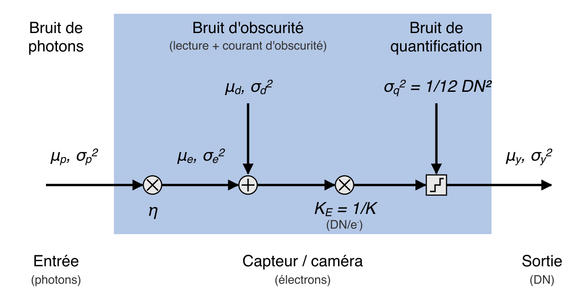

# Référence technique — eoqual-measure

Détail de chaque mesure : principe, architecture, implémentation, limites
connues, historique des corrections, bibliographie. Pour le catalogue
résumé et l'installation, voir `README.md` ; pour la provenance du code
et l'audit des licences, `THIRD_PARTY_LICENSES.md`.

- [Partie I — MTF par bord incliné](#partie-i--mtf-par-bord-incliné-eoqualmeasuremtfslanted_edge)
- [Partie II — Variance du bruit](#partie-ii--variance-du-bruit-eoqualmeasurenoise)
- [Partie III — Strehl et énergie encerclée](#partie-iii--strehl-et-énergie-encerclée-eoqualmeasurepsf)
- [Partie IV — Mesures radiométriques](#partie-iv--mesures-radiométriques-eoqualmeasureradiometry-noisespectrum-contrast)
- [Partie V — Simulateur de capteur](#partie-v--simulateur-de-capteur-eoqualmeasuresynthetic)

Les chemins de fichiers cités dans la partie I sont relatifs à
`src/eoqual/measure/mtf/slanted_edge/` sauf mention contraire ; ceux de la
parties II, IV et V, à `src/eoqual/measure/`. Les parties IV et V
(mesures radiométriques et simulateur) suivent un plan propre : objet,
principe, mise en œuvre, validation, limites, et leurs historiques en
annexe. Les sections « Limites connues »
conservent l'historique des corrections : pièges de la méthode
rencontrés pendant le développement et la façon dont ils sont évités.

---

## Partie I — MTF par bord incliné (`eoqual.measure.mtf.slanted_edge`)

Estimation de l'orientation et de la MTF (Modulation Transfer Function)
d'un système d'imagerie à partir d'une mire à bord incliné, avec
plusieurs algorithmes indépendants comparables entre eux à chaque
étape.

**Statut** : opérationnel, validé sur cas synthétiques (bords propres,
bruités, angles variés, PSF gaussienne connue). À valider par
simulation plus poussée avant un usage métrologique de production.

---

### Contexte et objectifs

Ce pipeline répond à un besoin exprimé dès l'origine du projet : une
brique logicielle d'estimation de la FTM par méthode bord de plage,
**fortement modulaire**, permettant de remplacer aisément une
implémentation élémentaire par une autre (détection de bord,
construction d'ESF, calcul de MTF) ou de laisser le choix à
l'utilisateur — c'est exactement le principe directeur de
l'architecture décrit en §2.1 (template method + comparateur), qui
permet à `EdgeOrientationComparator`/`MTFComparator` d'exécuter et de
comparer plusieurs implémentations interchangeables sur la même donnée.

Deux axes identifiés dès le départ restent des **pistes non explorées**
à ce stade (voir §12) : l'exploitation de bords naturels sur cibles
urbaines (plutôt que des mires dédiées), et les études de sensibilité
systématiques (angle, bruit, comparaison d'algorithmes) que
l'architecture actuelle permet de mener mais qui n'ont pas encore été
conduites de façon exhaustive.

---

### Sommaire

1. [Fondements théoriques](#1-fondements-théoriques)
2. [Architecture logicielle](#2-architecture-logicielle)
3. [Module d'orientation](#3-module-dorientation)
4. [Module de MTF](#4-module-de-mtf)
5. [Support Bayer](#5-support-bayer)
6. [Visualisation](#6-visualisation)
7. [Orchestration (`cli.py`)](#7-orchestration-clipy)
8. [Guide d'utilisation](#8-guide-dutilisation)
9. [Limites connues et historique des corrections](#9-limites-connues-et-historique-des-corrections)
10. [Bibliographie](#10-bibliographie)
11. [Annexe — formulaire de référence](#11-annexe--formulaire-de-référence)
12. [Perspectives et pistes non explorées](#12-perspectives-et-pistes-non-explorées)

---

### 1. Fondements théoriques

#### 1.1 Principe de la méthode du bord incliné

Un objectif/capteur dégrade une scène idéale par sa **PSF** (Point
Spread Function). Pour un bord noir/blanc parfait (marche de Heaviside)
observé à travers ce système, l'image obtenue est l'**ESF** (Edge
Spread Function) : la convolution de la marche par la PSF, intégrée
selon la direction du bord.

La **LSF** (Line Spread Function) est la dérivée de l'ESF selon la
direction perpendiculaire au bord :

$$
\text{LSF}(x) = \frac{d}{dx}\text{ESF}(x)
$$

La **MTF** est le module de la transformée de Fourier de la LSF,
normalisée à 1 en fréquence nulle :

$$
\text{MTF}(f) = \frac{|\mathcal{F}[\text{LSF}](f)|}{|\mathcal{F}[\text{LSF}](0)|}
$$

**Pourquoi incliner le bord ?** Un bord parfaitement vertical n'est
échantillonné qu'à la résolution native du capteur (1 échantillon par
pixel et par ligne). En inclinant le bord d'un petit angle θ, chaque
ligne de l'image voit le bord à une position sous-pixel légèrement
différente de la précédente. En recombinant toutes les lignes, on
reconstruit un profil d'ESF **sur-échantillonné**, à une résolution
effective de `1/sin(θ)` échantillons par pixel — c'est tout l'intérêt
de la méthode, normalisée par la méthode "edge SFR" de l'ISO 12233
[[ISO12233]](#10-bibliographie) et popularisée dans son usage pratique
par Burns [[Burns2000]](#10-bibliographie).

#### 1.2 Le problème de périodicité de la FFT

Un point central, à l'origine de plusieurs choix d'implémentation de ce
pipeline : une ligne de bord brute est un **échelon**, pas un signal
périodique. La FFT traite pourtant implicitement tout signal comme
périodique — elle recolle silencieusement la fin du signal à son début,
créant une **discontinuité artificielle** à la jointure. Le spectre
d'un échelon périodisé de cette façon contient donc des harmoniques
paires *et* impaires, sans que les paires aient de raison d'être
négligeables.

Un vrai **créneau à 50 % de rapport cyclique**, en revanche, vérifie la
symétrie demi-onde :

$$
f(x + T/2) = -f(x)
$$

Le développement en série de Fourier d'un signal à symétrie demi-onde
n'a, par construction, **que des harmoniques impaires** :

$$
a_{2m} = b_{2m} = 0 \quad \forall m
$$

Deux stratégies, toutes deux implémentées dans ce pipeline, permettent
d'exploiter cette propriété :

- **Mirroring** (`orientation/fourier.py`, `estimators/spatial.py`,
  `estimators/spectral.py`) : construire explicitement un signal à symétrie
  demi-onde en concaténant le profil avec une transformation
  photométrique miroir (`distance_to_white`, `distance_to_black`), de
  largeur double de l'original. La FFT de ce signal double n'a alors
  d'énergie significative que sur les harmoniques impaires — le rapport
  énergie-impaire/énergie-paire devient une métrique de qualité directe
  de cette hypothèse.
- **Fenêtrage** (`estimators/spectral_correlation.py`) : atténuer le signal
  vers 0 à ses extrémités (fenêtre de Hanning) avant la FFT, ce qui
  supprime la discontinuité de périodisation sans construire de
  représentation doublée. Plus léger, mais utilise moins de données par
  construction (pas de doublement) et ne bénéficie pas de la garantie
  stricte "harmoniques paires nulles".

#### 1.3 Correction d'angle

Le bord étant incliné d'un angle θ, la fréquence mesurée le long des
lignes de balayage est **compressée** par rapport à la fréquence réelle
perpendiculaire au bord (direction physiquement pertinente pour la MTF
d'un capteur). La convention ISO 12233, suivie uniformément dans tout
ce pipeline, est de corriger l'axe des **fréquences**, pas l'amplitude
de la MTF :

$$
f_{\text{corrigée}} = \frac{f_{\text{mesurée}}}{\cos\theta}
$$

C'est le champ `frequency_corrected` de `MTFResult`, distinct de
`frequency` (brute). Appliquer cette correction sur la MTF elle-même
(`mtf /= cos(θ)`), comme on le voit parfois, n'est pas la même
opération mathématiquement ; ce pipeline n'adopte pas cette convention
(voir §9).

#### 1.4 Théorème du décalage (shift theorem)

Utilisé abondamment pour l'estimation de pente et le calcul de MTF
spectral : décaler un signal de `d` échantillons multiplie son k-ième
coefficient de Fourier par un facteur de phase pure :

$$
\mathcal{F}[f(x-d)](k) = \mathcal{F}[f(x)](k) \cdot e^{-2\pi i k d / N}
$$

Deux lignes du bord, séparées de `Δy` lignes, sont (approximativement)
la même ESF décalée de `dx·Δy` colonnes, où `dx` est la pente
(colonnes/ligne). La différence de phase mesurée entre leurs spectres,
à une fréquence donnée, donne directement une estimation de `dx` :

$$
dx = -\frac{\Delta\varphi_k \cdot N}{2\pi \cdot k \cdot \Delta y}
$$

C'est le cœur de `fourier_utils.estimate_slope_multiharmonic` (moyenné
sur plusieurs harmoniques basses et plusieurs paires de lignes) et de
`SpectralCorrelationMTFEstimator` (corrélation de phase fréquence par
fréquence).

#### 1.5 Correction d'ouverture pixel (sinc)

Le photosite du capteur intègre la lumière sur toute sa surface — il se
comporte comme un filtre passe-bas de réponse
[[Boreman2001]](#10-bibliographie) :

$$
\text{MTF}_{\text{pixel}}(f) = \left|\frac{\sin(\pi f \cdot p)}{\pi f \cdot p}\right| = |\text{sinc}(f \cdot p)|
$$

où `p` est le pas physique du pixel (`pixel_pitch`). Diviser la MTF
mesurée par ce terme (`MTFCorrections.pixel_aperture`) déconvolue cet
effet d'intégration, isolant la MTF de l'optique seule.

#### 1.6 Biais de dérivation numérique

Une dérivée par différences centrées (`np.gradient`, pas `Δx`) n'a pas
la réponse en fréquence idéale `H_{\text{idéal}}(f) = 2\pi i f` d'une
dérivation exacte, mais :

$$
H(f) = \frac{\sin(2\pi f \Delta x)}{\Delta x}
\quad\Longrightarrow\quad
\frac{H(f)}{H_{\text{idéal}}(f)} = \text{sinc}(2f\Delta x)
$$

Diviser par ce facteur (`MTFCorrections.derivative`) corrige ce biais —
**uniquement pertinent** quand la LSF vient effectivement d'une
dérivation numérique (voir §9, correction appliquée par erreur à des
dérivées analytiques dans une version antérieure).

---

### 2. Architecture logicielle

#### 2.1 Principe directeur : template method + comparateur

Chaque famille d'algorithmes (orientation, MTF) partage :

- une **classe de base abstraite** (`EdgeOrientationDetector`,
  `SlantedEdgeMTFEstimator`) qui prend en charge tout ce qui est commun
  (canonicalisation, conversions de repère, contrat de sortie) et
  délègue le calcul propre à chaque algorithme à une méthode abstraite ;
- un **comparateur** (`EdgeOrientationComparator`, `MTFComparator`) qui
  exécute plusieurs implémentations sur la même entrée et collecte
  leurs résultats dans un dictionnaire, sans jamais interrompre la
  comparaison si l'une échoue (l'erreur est capturée et rapportée dans
  `details["error"]`).

Certaines implémentations (`EsfLsfMTFEstimator`,
`SpectralCorrelationMTFEstimator`) ont une méthodologie de calcul de
pente entièrement différente du socle commun et **surchargent
`estimate()` en entier**, plutôt que de forcer leur logique dans le
canevas partagé — un choix explicite, documenté dans chaque classe.

#### 2.2 Graphe de dépendances (fichiers)

```
Couche 0 (aucune dépendance interne)
  preprocess.py   fourier_utils.py   estimators/esf_models.py   (eoqual-core : eoqual.core.bayer, eoqual.core.edge)

Couche 1
  orientation/base.py  →  preprocess.py
  estimators/base.py    →  preprocess.py, fourier_utils.py, orientation/fourier.py

Couche 2
  orientation/gradient.py, orientation/pca.py, orientation/fourier.py
                        →  orientation/base.py (+ fourier_utils.py pour fourier)
  estimators/spatial.py, estimators/spectral.py, estimators/spectral_correlation.py, estimators/esf_lsf.py
                        →  estimators/base.py (+ fourier_utils.py, estimators/esf_models.py)

Couche 3
  visualization.py       →  orientation/base.py, estimators/base.py (types uniquement)
  bootstrap.py        →  estimators/base.py
  chromatic.py →  eoqual.core.bayer, orientation/base.py (types uniquement)

Couche 4
  cli.py               →  tout (dont bootstrap.py, chromatic.py)
  sensitivity.py  →  orientation/base.py, estimators/base.py, preprocess.py
```

Aucun cycle d'import réel (vérifié par analyse statique du graphe AST).
Deux imports différés existent, tous deux nécessaires pour casser un
vrai cycle : dans `EdgeOrientationComparator.__init__` (import de
`gradient_orientation`/`pca_orientation`/`fourier_orientation`) et dans
`MTFComparator.__init__` (import de `spatial_mtf`/`spectral_mtf`/
`estimators/esf_lsf`/`estimators/spectral_correlation`) — ces modules importent tous
la classe de base qu'ils étendent, donc un import de niveau module
créerait un cycle.

#### 2.3 Convention de repère

Toute image est ramenée à un **repère canonique** avant traitement
(`SlantedEdgePreprocessor.preprocess`, voir §3.1) : bord proche de la
verticale (balayage ligne par ligne cohérent), région sombre à gauche.
Chaque estimateur travaille dans ce repère puis reconvertit son
résultat (angle, positions) vers le repère de l'image originale avant
de le renvoyer — l'appelant n'a jamais à se soucier de la
transposition/inversion interne.

#### 2.4 Convention de fréquence MTF

Toutes les fréquences (`MTFResult.frequency`,
`MTFResult.frequency_corrected`) sont exprimées en **cycles par pixel
physique du capteur**, 0.5 = fréquence de Nyquist. Le paramètre
`pixel_pitch`, commun aux quatre méthodes de MTF (`SlantedEdgeMTFEstimator`,
voir §4.1), convertit la fréquence "brute" (cycles par échantillon du
tableau fourni) vers cette convention physique :

$$
f_{\text{physique}} = f_{\text{brute}} \times \text{pixel\_pitch}
$$

`pixel_pitch = 1.0` (défaut) pour une image en niveaux de gris pleine
résolution ; `pixel_pitch = 0.5` pour un plan Bayer sous-échantillonné
(voir §5). Cette convention uniforme est ce qui rend les quatre
méthodes directement superposables sur un même graphique, quelle que
soit leur résolution native de travail.

---

### 3. Module d'orientation

Estime l'angle d'inclinaison du bord par plusieurs algorithmes
indépendants, chacun produisant en plus de l'angle une **position
sous-pixel du bord par ligne** (`edge_rows`/`edge_columns`) et une
**métrique de qualité testant l'hypothèse propre à l'algorithme** — pas
une métrique arbitraire.

#### 3.1 `preprocess.py` — canonicalisation générique

`SlantedEdgePreprocessor.preprocess(image)` :

1. Détecte si le bord est majoritairement horizontal (comparaison de
   l'énergie des gradients de Sobel horizontal/vertical) ; transpose si
   besoin.
2. Détecte le côté sombre (moyenne des `percentile`% de colonnes
   extrêmes) ; retourne l'image horizontalement si besoin.
3. Estime les niveaux noir/blanc de référence par moyenne robuste
   (percentile) des colonnes extrêmes.

Retourne un `PreprocessingResult` (image canonicalisée, niveaux noir/
blanc, indicateurs `was_transposed`/`was_flipped`).

#### 3.2 `orientation/base.py` — socle générique

- **`FrameCanonicalizer`** : enveloppe autour du préprocesseur, plus
  les fonctions de conversion angle/positions vers le repère d'origine
  (défait flip puis transpose).
- **`OrientationResult`** : type de résultat commun — `algorithm`,
  `angle_deg` (replié dans [-90°, 90°], convention `atan2(Δligne,
  Δcolonne)`), `is_horizontal`, `was_transposed`/`was_flipped`,
  `edge_rows`/`edge_columns`, `quality_metric_name`/`quality_metric_value`,
  `details`.
- **`EdgeOrientationDetector`** (ABC) : template method. `analyse()`
  canonicalise, appelle `_estimate_canonical()` (abstraite), reconvertit
  le résultat. Fournit aussi des utilitaires partagés : repli d'angle,
  seuillage robuste de magnitude de gradient, régression linéaire
  position-par-ligne → angle.
- **`EdgeOrientationComparator`** : exécute plusieurs détecteurs,
  défaut = `{gradient, pca, fourier}`.

#### 3.3 `orientation/gradient.py` — `GradientOrientationDetector`

**Hypothèse testée** : chaque ligne a un maximum local net de
`|d(intensité)/d(colonne)|` au niveau du bord.

**Algorithme** : dérivée par différences centrées de chaque ligne ;
position du maximum de `|gradient|` ; interpolation parabolique à 3
points autour du maximum pour la position sous-pixel ; régression
linéaire des positions sur toutes les lignes → angle.

**Métrique** (`peak_sharpness`) : courbure de la parabole normalisée
par la hauteur du pic — grande pour un maximum net et non ambigu,
petite pour un profil plat ou bruité.

Pas de paramètre constructeur (comportement fixe).

#### 3.4 `orientation/pca.py` — `PCAOrientationDetector`

**Hypothèse testée** : les pixels de fort gradient sont alignés sur une
droite fine (le bord).

**Algorithme** :
1. Seuillage robuste (percentile parmi les valeurs non nulles
   uniquement — évite qu'un bord fin sélectionne toute l'image, voir
   §9) des pixels de fort gradient (Sobel).
2. **Première passe** : PCA sur le nuage de points brut → angle et
   `eigenvalue_ratio` (métrique, calculée sur ce nuage non filtré pour
   rester un diagnostic honnête des candidats bruts).
3. **RANSAC** : de nombreuses droites candidates tirées de paires de
   points aléatoires ; conservation de celle avec le plus de points à
   l'intérieur de `ransac_tolerance` [[FischlerBolles1981]](#10-bibliographie)
   — nécessaire pour les images bruitées où les points de bruit peuvent
   être majoritaires (voir §9).
4. **Seconde passe** : PCA sur les seuls inliers RANSAC → angle final
   (cohérent avec les positions par ligne, voir §9) et centroïde pondéré
   par ligne → `edge_rows`/`edge_columns` ("projection").

**Paramètres constructeur** :

| Paramètre | Défaut | Rôle |
|---|---|---|
| `gradient_percentile` | 90.0 | Seuil de sélection des pixels de fort gradient |
| `ransac_tolerance` | 2.0 | Distance perpendiculaire max. (px) pour un inlier |
| `ransac_iterations` | 300 | Nombre de droites candidates testées |
| `canonicalization_percentile` | 10.0 | Transmis au préprocesseur |

#### 3.5 `orientation/fourier.py` — `FourierOrientationDetector`

**Hypothèse testée** : la représentation symétrique (mirroring, §1.2)
a une énergie négligeable sur ses harmoniques paires.

**Deux méthodes internes, sélectionnables via `angle_source`** :

- **`"fundamental"`** (défaut) : phase de l'harmonique k=1 de la
  représentation symétrique → position absolue par ligne (calibrée +
  `unwrap` à travers les lignes), puis régression linéaire → angle.
  C'est la seule des deux qui produit des positions par ligne — donc
  toujours calculée, quel que soit `angle_source`, car nécessaire au
  tracé comparatif.
- **`"multiharmonic"`** : différence de phase entre paires de lignes
  glissantes, moyennée sur plusieurs harmoniques impaires basses
  (`fourier_utils.estimate_slope_multiharmonic`) — statistiquement plus
  robuste (plus de données moyennées) mais ne donne qu'un angle global.

**Métrique** (`odd_even_ratio`) : rapport de l'énergie des harmoniques
impaires sur celle des paires — test direct de l'hypothèse de symétrie
demi-onde.

**Paramètres constructeur** :

| Paramètre | Défaut | Rôle |
|---|---|---|
| `canonicalization_percentile` | 10.0 | Transmis au préprocesseur |
| `angle_source` | `"fundamental"` | `"fundamental"` ou `"multiharmonic"` |
| `low_freq_ratio` | 0.2 | Fraction des harmoniques basses (mode multiharmonic) |
| `block_gap` | 2 | Écart en lignes entre paires comparées (mode multiharmonic) |

#### 3.6 `fourier_utils.py` — utilitaires partagés

- `reference_spectrum(size)` : spectre analytique d'un échelon idéal
  aux harmoniques impaires, `(-1)^{1+k}/((1+2k)\pi)`.
- `estimate_slope_multiharmonic(rect, low_freq_ratio, block_gap)` :
  implémentation partagée par `FourierOrientationDetector` (mode
  multiharmonic) et `SlantedEdgeMTFEstimator` (socle commun spatial/
  spectral) — évite la duplication de cette logique entre estimation
  d'angle et estimation de MTF.

---

### 4. Module de MTF

Quatre méthodes indépendantes, comparables via `MTFComparator`, toutes
produisant un `MTFResult` (`method`, `mtf`, `frequency`,
`frequency_corrected`, `dx`, `theta_rad`, `oversample_factor`,
`details`).

#### 4.1 `estimators/base.py` — socle générique

- **`SlantedEdgeMTFEstimator`** (ABC) : template method partagé par
  `SpatialMTFEstimator`/`SpectralMTFEstimator` (les deux méthodes qui
  utilisent la représentation symétrique + `estimate_slope_multiharmonic`).
  `estimate(frame, oversample_factor)` : construit la représentation
  symétrique (délègue à `FourierOrientationDetector._build_symmetric_representation`),
  estime `(dx, theta)`, appelle `_compute_mtf()` (abstraite), applique
  `pixel_pitch` puis la correction d'angle sur la fréquence.
- **`MTFComparator`** : défaut = `{spatial, spectral, esf_lsf,
  spectral_correlation}`.

**Paramètres de la classe de base** (hérités par toutes les méthodes) :

| Paramètre | Défaut | Rôle |
|---|---|---|
| `low_freq_ratio` | 0.2 | Utilisé par spatial/spectral (estimation de pente partagée) |
| `block_gap` | 2 | Idem |
| `pixel_pitch` | 1.0 | Conversion cycles/échantillon → cycles/pixel physique (§2.4) — commun aux 4 méthodes |

#### 4.2 `estimators/spatial.py` — `SpatialMTFEstimator`

**Principe** : dé-interlacement spatial. Chaque pixel de la
représentation symétrique est replacé selon sa position "effective" le
long du bord (`interlace_1d`, tenant compte du décalage `dx`), les
points sont triés puis interpolés sur une grille régulière et
anti-symétrisés (`regularise_signal`, force l'anti-symétrie attendue
d'un bord idéal). FFT du signal 1D résultant, divisée par le spectre
analytique de référence.

**Avantage** : un seul signal très sur-échantillonné (autant de points
que de pixels dans la ROI) → bon rapport signal/bruit sur la forme du
bord. **Inconvénient** : sensible à la qualité de l'interpolation,
suppose `dx` parfaitement linéaire sur toute la hauteur de la ROI.

Pas de paramètre propre au-delà de ceux hérités de la classe de base.

#### 4.3 `estimators/spectral.py` — `SpectralMTFEstimator`

**Principe** : résolution d'un système linéaire par moindres carrés,
fréquence par fréquence, combinant 1, 2 ou 4 répliques spectrales
(selon `oversample_factor`) pondérées par le spectre de référence
analytique — permet de reconstruire la MTF au-delà de Nyquist en
dés-aliasant les répliques.

**Avantage** : exploite directement la redondance entre toutes les
lignes pour chaque fréquence, sans interpolation spatiale.
**Inconvénient** : plus coûteux (une résolution par fréquence).

Pas de paramètre propre au-delà de ceux hérités.

#### 4.4 `estimators/esf_lsf.py` + `estimators/esf_models.py` — `EsfLsfMTFEstimator`

Méthodologie entièrement différente de spatial/spectral : détection de
bord ligne par ligne (pas de mirroring), construction d'ESF par
projection géométrique, LSF selon un modèle choisi indépendamment.
Surcharge `estimate()` en entier.

**Étapes découplées** :

1. **`ParametricEdgeDetector`** (`mode`) : localise le bord de chaque
   ligne — `"sigmoid"` (fit sur l'intensité) ou `"gaussian"` (fit sur le
   gradient).
2. **`GeometricESFBuilder`** : régression linéaire (angle affiné) ;
   projection de chaque pixel sur la **normale au bord** (référence
   **fixe** = droite ajustée évaluée à la ligne centrale, pas la
   position bruitée par ligne — voir §9) — le même principe que la
   méthode de Kohm [[Kohm2004]](#10-bibliographie) (projection des
   coordonnées de pixel sur la normale à l'arête, utilisée pour la MTF
   embarquée d'OrbView-3) ; moyenne par bin avec rejet
   des bins peu peuplés (`esf_min_samples_per_bin`) ; lissage
   Savitzky-Golay optionnel (`esf_smoothing`, désactivé par défaut, voir
   §9). Construite **une seule fois**, indépendamment du modèle de fit
   choisi ensuite.

   

   *Schéma original (pas une reproduction) illustrant le principe de
   projection : chaque pixel de coordonnées `(x, y)` est projeté sur
   l'axe `S`, perpendiculaire au bord d'angle θ — c'est cette
   projection que calcule `GeometricESFBuilder` (formule au §9.6).
   Principe repris de Bostan et al.
   [[Bostan2019]](#10-bibliographie), qui en donne une version plus
   complète (avec construction de l'ESF sous-jacente).*
3. **Modèle de fit ESF → LSF** (`esf_model`, `ESF_FIT_MODELS`) :
   - `"numeric"` : dérivation numérique directe (`MTFComputer.compute_lsf`,
     voir options ci-dessous, dont un mode de dérivation par filtre de
     Savitzky-Golay [[SavitzkyGolay1964]](#10-bibliographie)).
   - `"sigmoid"` : fit d'une sigmoïde (`estimators.esf_models.sigmoid`), dérivée
     analytique. **Mise en garde** : biais de forme aux hautes
     fréquences si la vraie PSF n'est pas tanh-shaped (voir §9) — pas le
     défaut pour cette raison.
   - `"pchip"` (**défaut**) : interpolation spline cubique monotone
     [[FritschCarlson1980]](#10-bibliographie), aucune forme imposée,
     recentrage sous-pixel par rampe de phase FFT.
   - `"tikhonov"` : régularisation de Tikhonov d'ordre 2 (pénalisation
     de courbure) pondérée par la précision de chaque bin de l'ESF
     (`ESFData.bin_count`), avec sélection automatique du paramètre de
     régularisation λ par courbe en L -- inspiré de
     [[Xie2018]](#10-bibliographie), qui pose le problème comme une
     estimation d'ESF mal posée face au bruit. **Fidélité** : l'article
     original n'étant pas accessible (payant), c'est une formulation de
     Tikhonov standard (équivalente à un smoothing spline /
     Whittaker-Henderson) construite pour répondre au même problème
     avec les mêmes ingrédients qu'ils décrivent (régularisation,
     poids de précision, courbe en L) -- pas un portage de leurs
     équations exactes. La sélection de λ lisse (Savitzky-Golay) les
     courbes log-résidu/log-rugosité avant d'en calculer la courbure, et
     teste une grille densifiée à 80 valeurs (voir §9.13 pour le
     problème corrigé et la limite résiduelle non résolue). Voir
     `fit_esf_tikhonov` pour la formulation complète.

   **Note sur la fonction de Fermi** : une fonction de Fermi-Dirac
   (`1/(1+e^{-(x-x_0)/T})`) est mathématiquement la même famille que
   `"sigmoid"` (tanh) à reparamétrisation près --
   `\tanh(z) = 2\cdot\text{Fermi}(2z) - 1` -- donc leurs dérivées (LSF)
   sont proportionnelles. L'ajuster donnerait la même MTF (vérifié
   numériquement : écart < 1e-4, de l'ordre du bruit d'ajustement) et
   hériterait du même biais de forme que `"sigmoid"` (voir ci-dessus) :
   pas ajoutée comme option séparée pour cette raison.
4. **`compute_fwhm`** / **`compute_rer`** : deux résumés scalaires
   indépendants de la MTF, exposés dans `details["fwhm"]`/`details["rer"]`.
   - `compute_fwhm` : largeur à mi-hauteur de la LSF.
   - `compute_rer` (RER, Relative Edge Response) :
     `ESF(centre+0.5) - ESF(centre-0.5)`, sur l'ESF normalisée [0,1] --
     un des trois paramètres de la GIQE (General Image Quality
     Equation) utilisée pour prédire le NIIRS en télédétection
     [[Harrington2015]](#10-bibliographie). Calcul direct sur l'ESF,
     sans FFT ni fenêtrage -- insensible aux artefacts de troncature/
     fenêtrage qui ont faussé plusieurs estimations de MTF pendant le
     développement (voir §9). Calculé sur l'ESF partagée
     (`GeometricESFBuilder`), donc valable quel que soit `esf_model`.
5. **Corrections** : `MTFCorrections.derivative` (biais `np.gradient`,
   **uniquement si `esf_model="numeric"`**, voir §9) puis
   `MTFCorrections.pixel_aperture` (aperture pixel, systématique).

**Paramètres constructeur** :

| Paramètre | Défaut | Rôle |
|---|---|---|
| `mode` | `"sigmoid"` | Localisation du bord par ligne (`ParametricEdgeDetector`) |
| `esf_model` | `"pchip"` | Modèle ESF→LSF : `"numeric"`, `"sigmoid"`, `"pchip"` |
| `pixel_pitch` | 1.0 | §2.4 |
| `fit_window` | 5 | Demi-largeur de fenêtre du détecteur de bord |
| `esf_half_width` | 20.0 | Demi-largeur (px) de la bande d'ESF |
| `esf_oversample` | 5 | Échantillons d'ESF par pixel capteur, ou `"auto"` (§12.3bis) |
| `esf_binning_mode` | `"omni"` | `"omni"` (bin fixe) ou `"iso_cos"` (bin ×cos(θ), §12.3bis) |
| `outlier_threshold` | 5.0 | Rejet des lignes déviant de la médiane (px) |
| `esf_min_samples_per_bin` | 5 | Rejet des bins d'ESF peu peuplés |
| `esf_smoothing` | `False` | Lissage Savitzky-Golay de l'ESF |
| `lsf_points` | 1000 | Résolution de grille LSF (`"sigmoid"`/`"pchip"`) |
| `lsf_derivative_method` | `"gradient"` | `"gradient"` ou `"savgol_deriv"` (`"numeric"` seul.) |
| `lsf_filter_type` | `"tukey"` | `"tukey"`, `"savgol"`, `"gaussian"`, `"none"` (`"numeric"` seul.) |
| `lsf_window_length` | 15 | Longueur de fenêtre Savitzky-Golay/gaussienne |
| `lsf_polyorder` | 3 | Ordre du polynôme Savitzky-Golay |
| `lsf_tukey_alpha` | 0.15 | Paramètre α de la fenêtre de Tukey |
| `tikhonov_lambda` | `"auto"` | λ de régularisation (`esf_model="tikhonov"`), ou valeur fixée |
| `tikhonov_lambda_grid` | 80 valeurs, [1e-6, 1e3] | Grille de λ testée si `"auto"` (§9.13) |

#### 4.5 `estimators/spectral_correlation.py` — `SpectralCorrelationMTFEstimator`

**Principe** : corrélation de phase à une composante, fréquence par
fréquence, sans représentation symétrique ni spectre de référence.
Pour chaque fréquence `f_k`, projection (moindres carrés à une
composante) du spectre mesuré de chaque ligne sur la rampe de phase
théorique `exp(-2πi f_k · décalage_ligne)` — récupère directement
l'amplitude complexe du système à cette fréquence.

**Estimation de pente propre** (pas `estimate_slope_multiharmonic`) :
fenêtre de Hanning sur chaque ligne avant FFT (réponse alternative au
problème de non-périodicité, §1.2), paires de lignes **non
chevauchantes**.

**Deux pièges de la forme naïve évités** (voir §9 pour le détail des
validations numériques) :
1. LSF calculée par différenciation de chaque ligne avant corrélation
   (corréler le spectre du bord brut, non différencié, sous-estime la
   MTF d'un facteur ~30).
2. Fenêtrage Hanning de la LSF avant FFT (anti-dépassement MTF > 1).

**Limite assumée** : pas de dés-aliasing au-delà de Nyquist ;
`oversample_factor` accepté pour l'interface mais sans effet.

**Paramètres constructeur** :

| Paramètre | Défaut | Rôle |
|---|---|---|
| `apply_hanning` | `True` | Fenêtrage Hanning pour l'estimation de pente |
| `line_spacing` | 2 | Écart entre paires de lignes (pente) |
| `low_frequency_ratio` | 0.2 | Fraction des fréquences basses (pente) |
| `pixel_pitch` | 1.0 | §2.4 |

---

### 5. Support Bayer

**`eoqual.core.bayer`** (eoqual-core) : `extract_bayer_planes(image, pattern)` sépare une
mosaïque RAW 2D en plans `R`, `G1`, `G2`, `B`, `G` (moyenne G1/G2), pour les
motifs `RGGB` (défaut), `BGGR`, `GRBG` et `GBRG` (CLI : `--bayer-pattern`).
Exemple, motif `RGGB` :

```
R  G1
G2 B
```

Chaque plan a une résolution moitié dans chaque dimension. Traité par
le pipeline exactement comme une image en niveaux de gris, à condition
de régler `pixel_pitch = BAYER_SAMPLING_FACTOR = 0.5` sur les quatre
estimateurs de MTF (un échantillon du plan = 2 pixels physiques du
capteur, §2.4) — c'est exactement ce que fait `cli.py` via
`--image-format`.

L'orientation (angle) n'a pas besoin de cette conversion : elle est
sans dimension, chaque plan est traité tel quel.

---

### 6. Visualisation

**`visualization.py`** — `SlantedEdgeVisualizer` (méthodes statiques,
aucun état) :

- `plot_image` : mire brute (heatmap Plotly).
- `print_orientation_summary` / `plot_orientation_comparison` : tableau
  texte + superposition des positions sous-pixel des 3 algorithmes
  d'orientation sur l'image.
- `print_mtf_summary` / `plot_mtf_comparison` : tableau texte (angle,
  `dx`, MTF échantillonnée à quelques fréquences) + courbes MTF
  superposées, avec repères verticaux fₑ/4 et fₑ/2, légende ancrée en
  haut à droite du tracé.
- `plot_esf_lsf` : ESF et LSF côte à côte (deux sous-graphiques), pour
  un `MTFResult` qui les expose dans `details` -- seuls les
  estimateurs `esf_lsf_*` le font (`spatial`/`spectral`/
  `spectral_correlation` ne construisent pas d'ESF explicite, voir §4).
  Lève une erreur claire si appelée sur un résultat qui n'en a pas,
  plutôt que d'échouer silencieusement.

Toutes les figures sont des fichiers HTML Plotly autonomes (interactifs
— zoom, survol).

**`bootstrap.py`** — intervalles de confiance sur une courbe de MTF
par ré-échantillonnage des lignes de la ROI (bootstrap), indépendant du
harnais de sensibilité (§8.9, §12.1) : celui-ci répond à "quel est le
biais systématique d'une méthode sur de nombreuses images de vérité
connue ?", `bootstrap.py` répond à "quelle confiance accorder à
*cette* mesure, sur *cette* image ?" -- utile en usage normal, une seule
image réelle, sans vérité terrain. `bootstrap_mtf(estimator, frame,
n_bootstrap=30, ...)` fonctionne avec n'importe lequel des quatre
estimateurs de MTF (même interface `estimate(frame, oversample_factor)`
pour tous, aucun cas particulier nécessaire) ; `plot_bootstrap_mtf`
trace la moyenne ± intervalle de confiance (bande remplie), une courbe
par méthode.

Chaque ligne de la ROI est traitée comme une mesure indépendante et
bruitée du même bord (exactement l'hypothèse sur laquelle repose la
méthode elle-même), ré-échantillonnée avec remise à chaque tirage.
Attention au coût avec `esf_model="tikhonov"` (déjà coûteux par
construction, voir §4.4) : réduire `n_bootstrap` en conséquence.

**`chromatic.py`** — décalage sous-pixel latéral entre plans
Bayer (aberration chromatique), à partir de `OrientationResult` déjà
calculés indépendamment sur chaque plan (aucun nouveau calcul
d'orientation). Chaque plan étant sous-échantillonné à une position
différente de la grille pleine résolution (`eoqual.core.bayer.bayer_offsets("RGGB")`),
`compute_chromatic_shifts` ramène la droite de bord de chaque plan dans
ce repère commun (la pente reste inchangée par ce changement d'échelle
uniforme ; seule l'ordonnée à l'origine se décale) et calcule l'écart
entre plans à une ligne de référence commune. Le plan `"G"` (moyenne de
G1 et G2, voir `eoqual.core.bayer.extract_bayer_planes`) a un décalage de grille
**approximatif** (`(0.5, 0.5)`, la moyenne des deux positions
physiques réelles de G1 et G2) -- utiliser `"G1"`/`"G2"` directement
pour une position exacte. Branché dans `cli.py` (`process_zone`) :
calculé automatiquement pour toute zone Bayer à plusieurs plans, avec
le même algorithme d'orientation sur chacun (`--chromatic-algorithm`,
défaut `"fourier"` -- mélanger des algorithmes différents entre plans
introduirait un biais propre à chacun dans la mesure, pas seulement
l'aberration chromatique elle-même).

**Validation** : décalage chromatique latéral injecté artificiellement
dans une mosaïque Bayer synthétique (R décalé de +0.6 px, B de -0.3 px
par rapport à G) et retrouvé à mieux que 0.002 px près par
`compute_chromatic_shifts`, à la fois en test unitaire et via `cli.py`
de bout en bout.

---

### 7. Orchestration (`cli.py`)

Ne contient aucun calcul ni tracé — uniquement l'enchaînement :

```
main()
 └─ pour chaque (image, zone_label) :
     process_zone()
      ├─ load_image()            # gray ou mosaïque Bayer brute
      ├─ get_analysis_planes()   # 1 plan (gray) ou 1-3 plans (Bayer)
      └─ pour chaque plan :
          process_plane()
           ├─ EdgeOrientationComparator → affichage + tracé
           └─ MTFComparator (pixel_pitch = sampling_factor du plan)
                                  → affichage + collecte pour tracé combiné
 └─ tracé MTF combiné, toutes zones/plans/méthodes confondus
```

Une **zone** = une image (un fichier). Un **plan** = une sous-image
(toujours 1 pour `gray`, jusqu'à 3 pour `bayer`).

---

### 8. Guide d'utilisation

#### 8.1 Installation / dépendances

Socle : `numpy`, `scipy`, `opencv-python` (`cv2`), `imageio`, `rich`
(voir `pyproject.toml`). Extra `plot` (`plotly`) pour `visualization.py`,
`bootstrap.plot_bootstrap_mtf`, `SyntheticSlantedEdge.plot` et la CLI ;
extra `study` (`pandas` + `plotly`) pour `sensitivity.py`.

#### 8.2 Usage en ligne de commande

```bash
eoqual-measure-mtf mire.png
eoqual-measure-mtf mire_H0.png mire_H1.png mire_V0.png --zone-labels H0 H1 V0
eoqual-measure-mtf mire_raw.tiff --image-format bayer --bayer-pattern GRBG
eoqual-measure-mtf mire.png --oversample-factor 2 --fourier-angle-source multiharmonic
```

#### 8.3 Paramètres CLI — positionnels

| Argument | Rôle |
|---|---|
| `images` | Un ou plusieurs chemins d'image, un par zone |

#### 8.4 Paramètres CLI — généraux

| Option | Défaut | Rôle |
|---|---|---|
| `--zone-labels` | noms de fichiers | Un label par image |
| `--image-format` | `gray` | `gray`, `bayer`, `bayer-r`, `bayer-g`, `bayer-b` (`rggb*` : alias) |
| `--bayer-pattern` | `RGGB` | `RGGB`, `BGGR`, `GRBG`, `GBRG` (formats `bayer*`) |
| `--show-mire` | désactivé | Trace aussi la mire brute de chaque plan |
| `--no-plot` | désactivé | Ne produit aucun graphique (texte seul) |

#### 8.5 Paramètres CLI — orientation

| Option | Défaut | Rôle |
|---|---|---|
| `--gradient-percentile` | 90.0 | Seuil de sélection des pixels de fort gradient (Gradient, PCA) |
| `--canonicalization-percentile` | 10.0 | Percentile pour l'estimation des niveaux noir/blanc |
| `--fourier-angle-source` | `fundamental` | `fundamental` ou `multiharmonic` (Fourier) |
| `--fourier-low-freq-ratio` | 0.2 | Fraction des harmoniques basses (Fourier, mode multiharmonic) |
| `--fourier-block-gap` | 2 | Écart en lignes entre paires (Fourier, mode multiharmonic) |

#### 8.6 Paramètres CLI — MTF, communs

| Option | Défaut | Rôle |
|---|---|---|
| `--oversample-factor` | 4 | 1, 2 ou 4 — facteur de sur-échantillonnage (spatial/spectral) |
| `--mtf-low-freq-ratio` | 0.2 | Fraction des harmoniques basses pour l'estimation de pente (spatial/spectral) |
| `--mtf-block-gap` | 2 | Écart en lignes entre paires (spatial/spectral) |
| `--no-angle-correction` | désactivé | Rapporte/trace la MTF selon la fréquence brute, pas corrigée par cos(θ) |

#### 8.7 Paramètres CLI — ESF/LSF

| Option | Défaut | Rôle |
|---|---|---|
| `--esf-lsf-mode` | `sigmoid` | Localisation du bord par ligne : `sigmoid` ou `gaussian` |
| `--esf-lsf-esf-model` | `pchip` | Modèle ESF→LSF : `numeric`, `sigmoid`, `pchip` |
| `--esf-lsf-derivative-method` | `gradient` | `gradient` ou `savgol_deriv` (si `esf_model=numeric`) |
| `--esf-lsf-filter-type` | `tukey` | `tukey`, `savgol`, `gaussian`, `none` (si `esf_model=numeric`) |
| `--esf-lsf-window-length` | 15 | Longueur de fenêtre Savitzky-Golay/gaussienne |
| `--esf-lsf-polyorder` | 3 | Ordre du polynôme Savitzky-Golay |

#### 8.8 Paramètres CLI — corrélation spectrale

| Option | Défaut | Rôle |
|---|---|---|
| `--no-spectral-correlation-hanning` | désactivé | Désactive le fenêtrage Hanning de l'estimation de pente |
| `--spectral-correlation-line-spacing` | 2 | Écart entre paires de lignes non chevauchantes |
| `--spectral-correlation-low-freq-ratio` | 0.2 | Fraction des fréquences basses pour l'estimation de pente |

#### 8.9 Utilisation programmatique (sans CLI)

```python
import imageio.v2 as imageio
from eoqual.measure.mtf.slanted_edge import (
    EdgeOrientationComparator,
    MTFComparator,
    SlantedEdgePreprocessor,
)

image = imageio.imread("mire.png").astype(float)

# Orientation
orientation_results = EdgeOrientationComparator().compare(image)
for name, result in orientation_results.items():
    print(name, result.angle_deg, result.quality_metric_value)

# MTF
frame = SlantedEdgePreprocessor().preprocess(image)
mtf_results = MTFComparator().compare(frame, oversample_factor=4)
for name, result in mtf_results.items():
    print(name, result.value_at(0.25))  # MTF interpolée à f=0.25 c/px

# Raccourci : un estimateur, un résultat
from eoqual.measure import measure_mtf
res = measure_mtf(image, "esf_lsf", esf_model="tikhonov")
res.value_at(0.5), res.frequency_at(0.5)   # MTF@Nyquist, MTF50
```

#### 8.10 Interprétation des métriques de qualité (orientation)

| Algorithme | Métrique | Signification |
|---|---|---|
| Gradient | `peak_sharpness` | Grand = maximum de gradient net et net par ligne |
| PCA | `eigenvalue_ratio` | Grand = points bien alignés sur une droite fine |
| Fourier | `odd_even_ratio` | Grand = symétrie demi-onde bien vérifiée |

Une valeur faible signale que l'hypothèse propre à l'algorithme est
mise à mal (bruit, mauvais cadrage, bord non net) — comparer aux autres
algorithmes plutôt que de se fier à un seul.

#### 8.11 Interprétation du tracé MTF

Toutes les courbes doivent être lues jusqu'à la fréquence où la vraie
MTF s'approche de 0 (souvent 0.25–0.35 c/px selon la netteté du
système) : au-delà, la courbe reflète le **plancher de bruit** de la
mesure, pas un signal réel — une oscillation aléatoire proche de 0 y
est normale et attendue, quelle que soit la méthode (voir §9.3).

---

### 9. Limites connues et historique des corrections

Cette section documente les problèmes réellement rencontrés et
corrigés pendant le développement — utile pour comprendre certains
choix de conception qui semblent contre-intuitifs au premier abord.

#### 9.1 Seuillage par percentile sur magnitude de gradient

`np.percentile(magnitude, p)` dégénère à 0 dès que plus de `100-p`%
des pixels sont exactement plats (bord fin non flouté) — sélectionne
alors toute l'image au lieu du seul bord. Corrigé en restreignant le
percentile aux valeurs strictement non nulles
(`EdgeOrientationDetector._robust_threshold`).

#### 9.2 Biais PCA sur image bruitée (centroïde par ligne)

Le centroïde pondéré par ligne (PCA) moyenne *tous* les pixels
au-dessus du seuil de gradient — sur une zone bruitée, le bruit crée
plus de pixels au-dessus du seuil que le vrai bord, biaisant la
position de façon *systématique* (pas juste bruitée). Un simple
filtrage par MAD était insuffisant (majorité d'aberrants). Corrigé par
RANSAC (§3.4). **Bug corrélé** : l'angle rapporté était initialement
calculé sur le nuage de points *brut* (avant RANSAC) tandis que les
positions utilisaient déjà les inliers — incohérence positions propres/
angle biaisé. Corrigé en ajustant l'angle sur les mêmes inliers que les
positions.

#### 9.3 Bruit de mesure près de la fréquence de Nyquist

Phénomène **normal**, pas un bug : la MTF vraie décroît vers 0 alors
que le bruit de mesure ne décroît pas au même rythme — au-delà d'une
certaine fréquence, le rapport signal/bruit de l'estimation se dégrade
et la courbe reflète le plancher de bruit, quelle que soit la méthode.

#### 9.4 `oversample_factor=1` cassait la méthode spectrale

Boucle itérant jusqu'à `n_cols//2` alors que le spectre de référence
n'a que `n_cols//4` éléments pour ce facteur — `IndexError`
systématique. Corrigé en bornant la boucle à `min(n_cols//2,
ref_spec.size)` (comportement inchangé pour 2 et 4).

#### 9.5 Confusion largeur/période dans la localisation par phase

`_locate_edge_from_phase` confondait la largeur d'origine `n_cols` avec
la période réelle du signal mirroré `T = 2·n_cols` — positions
sous-pixel systématiquement divisées par 2. Corrigé.

#### 9.6 Projection géométrique ESF (référence par ligne vs fixe)

Une première formule de projection géométrique utilisait la position de bord *par ligne* (bruitée) directement dans le
calcul de distance à la droite — ne se simplifie pas correctement
(dérivation analytique) et réinjecte quasiment l'indice de ligne brut
dans la distance projetée (plage observée ±39 au lieu de ±20 attendue).
Corrigé en utilisant une référence *fixe* (droite ajustée, évaluée à la
ligne centrale) ; la position par ligne ne sert plus qu'à choisir la
fenêtre de colonnes.

#### 9.7 Sur-lissage de l'ESF (Savitzky-Golay)

Le lissage Savitzky-Golay de l'ESF (fenêtre adaptative
`min(31, n/5)`) dégradait nettement la MTF haute fréquence (0.32 →
0.066 à f=0.25 c/px, vérifié numériquement). Désactivé par défaut
(`esf_smoothing=False`).

#### 9.8 Biais de forme du modèle sigmoïde (ESF)

La dérivée d'une sigmoïde (`sech²`) a des queues spectrales décroissant
plus lentement qu'une PSF gaussienne — surestimation systématique de la
MTF haute fréquence si la vraie PSF n'est pas tanh-shaped, *même sans
bruit* (0.153 vs 0.077 théorique à f=0.3 c/px, PSF gaussienne connue,
σ=1.2 px, aucun bruit ajouté). `pchip` (aucune forme imposée) ne montre
pas ce biais (0.098 dans le même test) — c'est pourquoi c'est le modèle
par défaut, pas `sigmoid`. **Bug corrélé** : la correction de biais de
dérivation numérique (`MTFCorrections.derivative`) était appliquée
même aux dérivées analytiques (`sigmoid`, `pchip`), qui n'en ont pas
besoin — effet mesuré négligeable dans ce cas précis, mais corrigé par
principe (appliquée uniquement si `esf_model="numeric"`).

#### 9.9 Dépassement MTF > 1 (corrélation spectrale)

Sur une image bruitée, absence de fenêtrage de la LSF avant FFT →
fuite spectrale déstabilisant la corrélation de phase et sa
normalisation par la valeur en f=0 (dépassement ~4% observé). Corrigé
par fenêtrage de Hann (dépassement résiduel < 0.6% sur 5 tirages
bruités testés).

#### 9.10 Sous-évaluation de la MTF (corrélation spectrale, forme naïve)

La forme naïve de la corrélation spectrale corrèle le spectre
du bord *brut* (ESF, non différencié) plutôt que de la LSF — hérite de
la décroissance en 1/k du spectre d'un échelon, sous-évaluation ~30×
vérifiée numériquement contre une MTF théorique connue. Corrigé en
différenciant chaque ligne avant corrélation.

#### 9.11 Convention de correction d'angle

Diviser la MTF par
`cos(angle)` plutôt que la fréquence — non conforme à la convention ISO
12233 suivie dans le reste du pipeline (§1.3). Jamais adoptée.

#### 9.12 FWHM faussée par un rebond isolé loin du pic

Une première version de `compute_fwhm` prenait le premier et le
dernier point au-dessus du demi-maximum sur tout le domaine de la LSF,
plutôt que la première traversée de part et d'autre du pic. Un rebond
de bruit isolé, même loin du pic et sans rapport avec sa largeur
réelle, faussait alors complètement la mesure. Observé numériquement
avec `esf_model="tikhonov"` sur un cas très bruité : un unique point
parasite à +21 px du pic donnait une FWHM de 22 px au lieu des ~2-3 px
attendus. Corrigé pour rechercher la première traversée du seuil de
part et d'autre du pic (avec interpolation sous-pixel) -- la définition
standard de la FWHM. Validé : au bruit nul, `"tikhonov"` donne
maintenant une FWHM de 2.820 px contre 2.826 px théorique (PSF
gaussienne σ=1.2 px) ; `"numeric"`/`"pchip"` donnent au contraire des
FWHM anormalement petites (~0.3-0.4 px) sur le même cas, révélant que
leur LSF dérivée brute porte un pic à l'échelle d'un seul bin, non
représentatif de la largeur physique -- un indice supplémentaire, au
passage, de la valeur du lissage par régularisation de `"tikhonov"`.

#### 9.13 Sélection de λ instable sur la courbe en L (Tikhonov)

`fit_esf_tikhonov` (`tikhonov_lambda="auto"`, §4.4) sélectionne λ au
"coin" de la courbe en L, repéré par la courbure de
`log(résidu pondéré)` vs `log(rugosité de f)` — un calcul qui dérive
*deux fois de suite* (`np.gradient` appliqué deux fois) une courbe
échantillonnée sur seulement 40 valeurs de λ (défaut initial). C'est
une instabilité numérique différente de celle du §1.6 (qui porte sur le
biais *systématique* en `sinc` d'une dérivation simple, pas sur
l'amplification de bruit d'une dérivée seconde) : ici, une double
dérivée numérique appliquée à une courbe faiblement échantillonnée
amplifie fortement la moindre irrégularité d'échantillonnage, au point
de déplacer le maximum de courbure détecté. Observé concrètement : sur deux bords synthétiques à angles
très proches (-4° et -5°, même PSF gaussienne σ=1.2 px, sans bruit), la
courbure brute sélectionnait des λ dans un rapport ~24× (14 contre
345) — donnant, au premier angle, une LSF visiblement dentelée et une
FWHM de 0.58 px au lieu des ~2.826 px théoriques (reproduit
numériquement lors de l'intégration de ce correctif).

**Corrigé** en deux temps : grille de λ densifiée (80 valeurs
log-espacées entre 1e-6 et 1e3, au lieu de 40) et lissage
Savitzky-Golay (fenêtre impaire ≤ 11, ordre 3) de `log_res`/`log_rough`
*avant* de calculer la courbure, plutôt que de dériver deux fois le
signal brut. Sur le cas -4°/-5° ci-dessus, ce correctif ramène le
second angle à une FWHM de 2.829 px (quasi exacte), mais le premier
reste sous-régularisé (0.58 px) — le lissage stabilise la détection
sans la rendre fiable pour tout angle.

**Limite connue, non résolue.** Quand la courbe en L est lisse, sans
coin net (cas rencontré en pratique, pas rare), la détection par
courbure peut encore sélectionner un λ insuffisant. Vérifié
numériquement : sur des bords synthétiques à angles proches (-1° à
-20°, PSF gaussienne identique), la FWHM récupérée en mode `"auto"`
varie entre ~0.5 et ~2.9 px pour une valeur théorique de 2.826 px — y
compris avec un λ **fixe** (essayé 50.0), certains angles restent mal
régularisés : la fragilité n'est donc pas uniquement une question de
grille ou de lissage de la sélection automatique. Des pistes plus
robustes (critère de discordance de Morozov, validation croisée
généralisée — GCV) n'ont pas été implémentées. **En pratique** : si un
résultat `esf_model="tikhonov"` semble implausible, inspecter
`details["fwhm"]` et essayer plusieurs valeurs fixes de
`tikhonov_lambda` plutôt que de faire confiance à `"auto"` sans
vérification.

#### 9.14 Normalisation de la MTF (ESF/LSF)

La MTF de l'estimateur ESF/LSF était normalisée par son maximum sur les
seules fréquences positives, donc en pratique par sa valeur au premier
bin `1/(N·dx)` plutôt qu'en fréquence nulle : surestimation d'environ
0.7 à 1.3 % sur toute la courbe pour les mires de test, et dispersion
bootstrap gonflée, la valeur au premier bin étant plus bruitée que le
saut de l'ESF. Corrigé dans `eoqual.core.edge.lsf_to_mtf` (normalisation
par la composante continue) : MTF ESF/LSF −0.7 à −1.3 %, écart-type
bootstrap moyen −25 à −37 % sur les mires de test ; les estimateurs
spatial, spectral et corrélation spectrale ne sont pas concernés.

---

### 10. Bibliographie

Références directement liées aux méthodes implémentées dans ce
pipeline (norme, algorithmes, méthodes numériques) — pas une revue de
littérature exhaustive du domaine MTF.

- **[ISO12233]** ISO 12233:2017, *Photography — Electronic still
  picture imaging — Resolution and spatial frequency responses*,
  International Organization for Standardization, 2017. La norme de
  référence pour la mesure de SFR/MTF par bord incliné ("edge SFR") sur
  laquelle repose l'ensemble de ce pipeline (§1.1, §1.3).

- **[Burns2000]** P. D. Burns, "Slanted-Edge MTF for Digital Camera and
  Scanner Analysis," *Proc. IS&T PICS Conference*, pp. 135–138, 2000.
  Référence pratique historique de la méthode du bord incliné pour
  l'imagerie numérique (algorithme d'entrelacement, dérivation par
  différences finies `[-0.5, 0, 0.5]`, effets du bruit et de la
  longueur d'enregistrement) — la base conceptuelle de
  `estimators/spatial.py`/`estimators/spectral.py` (§4.2, §4.3).

- **[Boreman2001]** G. D. Boreman, *Modulation Transfer Function in
  Optical and Electro-Optical Systems*, SPIE Tutorial Texts in Optical
  Engineering, Vol. TT52, SPIE Press, 2001. Référence générale sur la
  MTF, l'ESF/LSF, et les effets d'échantillonnage/aperture d'un capteur
  (§1.5, correction sinc d'aperture pixel).

- **[FischlerBolles1981]** M. A. Fischler, R. C. Bolles, "Random Sample
  Consensus: A Paradigm for Model Fitting with Applications to Image
  Analysis and Automated Cartography," *Communications of the ACM*,
  24(6), pp. 381–395, 1981. Algorithme RANSAC, utilisé par
  `PCAOrientationDetector` pour rejeter les points de bruit majoritaires
  avant l'ajustement de la droite de bord (§3.4, §9.2).

- **[FritschCarlson1980]** F. N. Fritsch, R. E. Carlson, "Monotone
  Piecewise Cubic Interpolation," *SIAM Journal on Numerical Analysis*,
  17(2), pp. 238–246, 1980. Base de l'interpolation PCHIP
  (`scipy.interpolate.PchipInterpolator`) utilisée par
  `fit_esf_pchip` (§4.4), modèle par défaut de `EsfLsfMTFEstimator`.

- **[SavitzkyGolay1964]** A. Savitzky, M. J. E. Golay, "Smoothing and
  Differentiation of Data by Simplified Least Squares Procedures,"
  *Analytical Chemistry*, 36(8), pp. 1627–1639, 1964. Filtre utilisé en
  option pour le lissage et/ou la dérivation de l'ESF/LSF
  (`lsf_derivative_method="savgol_deriv"`, `lsf_filter_type="savgol"`,
  §4.4) ainsi que pour le lissage optionnel de l'ESF
  (`GeometricESFBuilder`, §4.4, désactivé par défaut — voir §9.7).

- **[Harrington2015]** L. Harrington, D. Blanchard, J. Salacain, S.
  Smith, P. Amanik, "General Image Quality Equation: GIQE Version 5,"
  National Geospatial-Intelligence Agency, Fort Belvoir, VA, USA, Tech.
  Report, 2015. Définit le RER (Relative Edge Response) comme l'un des
  trois paramètres de la GIQE, utilisée en télédétection pour prédire
  le NIIRS — base de `compute_rer` (§4.4).

- **[ViallefontRobinet2018]** F. Viallefont-Robinet, D. Helder, R.
  Fraisse, A. Newbury, F. van den Bergh, D. Lee, S. Saunier,
  "Comparison of MTF measurements using edge method: towards reference
  data set," *Optics Express*, 26(26), pp. 33625–33648, 2018. Étude
  comparative multi-équipes (CNES/ONERA, SDSU, Airbus DS, DigitalGlobe,
  CSIR, KARI, Telespazio) de plusieurs implémentations de la méthode du
  bord incliné sur un même jeu de données de référence — directement
  dans l'esprit de ce pipeline (comparer plusieurs implémentations sur
  la même entrée, §2.1). Décrit notamment la méthode KARI, qui rogne
  l'ESF sur-échantillonnée selon un point de rupture ("knee point")
  détecté sur la dérivée seconde de la LSF, pour limiter l'impact du
  bruit et de la non-uniformité de la ROI — une piste non implémentée
  ici (voir §12).

- **[Kohm2004]** K. Kohm, "Modulation Transfer Function Measurement
  Method and Results for the Orbview-3 High Resolution Imaging
  Satellite," *Proc. ISPRS*, Istanbul, Turkey, pp. 12–23, 2004. Mesure
  MTF en orbite par méthode du bord incliné, sur bords dédiés et
  naturels ; introduit la projection des coordonnées de pixel sur la
  normale à l'arête, reprise par `GeometricESFBuilder` (§4.4).

- **[Bostan2019]** G. Bostan, P. E. Sterian, T. Necsoiu, A. P. Bobei,
  C. D. Sarafoleanu, "The slanted-edge method application in testing
  the optical resolution of a vision system," *Journal of
  Optoelectronics and Advanced Materials*, 21(1-2), pp. 22–34, 2019.
  Illustration détaillée de la géométrie de projection de la grille de
  pixels sur la normale au bord (angle θ, pas `p·cos(θ)`/`p·sin(θ)`) —
  base du schéma original du §4.4 (figure non reproduite, sous droits ;
  redessinée pour cette documentation).

- **[VanZwanenberg2019]** O. van Zwanenberg, S. Triantaphillidou, R.
  Jenkin, A. Psarrou, "Edge Detection Techniques for Quantifying
  Spatial Imaging System Performance and Image Quality," *Proc.
  IEEE/CVF CVPR Workshops (NTIRE)*, Long Beach, CA, 2019. Sélection et
  extraction automatique de bords exploitables dans des scènes
  naturelles (pas de mire dédiée) pour y appliquer la méthode ISO
  12233 — piste identifiée mais non implémentée pour l'usage sur cibles
  urbaines (voir §12).

- **[Wu2022]** Y. Wu, W. Xu, Y. Piao, W. Yue, "Analysis of Edge Method
  Accuracy and Practical Multidirectional Modulation Transfer Function
  Measurement," *Applied Sciences*, 12(24), 12748, 2022 (accès libre).
  Analyse quantitative de l'effet de l'angle, du suréchantillonnage, de
  la ROI, du contraste et du bruit sur la précision de la méthode du
  bord incliné, en s'appuyant sur le jeu de données de comparaison de
  [[ViallefontRobinet2018]](#10-bibliographie). Base du binning
  adaptatif à l'angle (`binning_mode="iso_cos"`,
  `oversample="auto"`) ajouté à `GeometricESFBuilder` (§4.4, §12.3bis).

- **[Xie2018]** X. Xie, H. Fan, A. Wang, N. Zou, Y. Zhang, "Regularized
  slanted-edge method for measuring the modulation transfer function of
  imaging systems," *Applied Optics*, 57(22), pp. 6552–6558, 2018.
  Pose l'estimation de l'ESF comme un problème mal posé face au bruit
  et le résout par régularisation de Tikhonov + poids de précision
  variables (méthode vérifiée pour bruits gaussien, gamma et Rayleigh,
  +0.01–9.02% de précision, 4.33% en moyenne). Article non consulté
  (accès payant) : `fit_esf_tikhonov` reprend le même principe général
  (Tikhonov, poids de précision, courbe en L) via une formulation
  standard construite indépendamment -- voir la mise en garde de
  fidélité au §4.4.

---

### 11. Annexe — formulaire de référence

| Grandeur | Formule | Où |
|---|---|---|
| Symétrie demi-onde | `f(x+T/2) = -f(x)` | §1.2 |
| Correction d'angle (fréquence) | `f_corr = f / cos(θ)` | §1.3 |
| Théorème du décalage | `F[f(x-d)](k) = F[f](k)·e^{-2πikd/N}` | §1.4 |
| Pente par différence de phase | `dx = -Δφ_k·N / (2π·k·Δy)` | §1.4 |
| MTF aperture pixel | `MTF_pixel(f) = |sinc(f·p)|` | §1.5 |
| Biais dérivée numérique (`np.gradient`) | `H(f)/H_idéal(f) = sinc(2f·Δx)` | §1.6 |
| Conversion fréquence physique | `f_phys = f_brut × pixel_pitch` | §2.4 |
| Facteur d'échantillonnage Bayer RGGB | `pixel_pitch = 0.5` | §5 |

---

### 12. Perspectives et pistes non explorées

Cette section recense les pistes identifiées mais non implémentées à
ce stade.

#### 12.1 Études de sensibilité systématiques

Trois études sont visées : effet de l'angle, effet du bruit,
comparaison des algorithmes. **L'outillage est branché sur le
générateur de mires du paquet**
(`eoqual/measure/synthetic/slanted_edge.py::SyntheticSlantedEdge`) :

- **`sensitivity.py`** : `SensitivityStudy`, `SensitivityGrid`,
  `plot_sensitivity`, `plot_heatmap` -- le harnais générique (balayage
  angle × bruit, répétitions Monte-Carlo, agrégation biais/écart-type/
  temps/échecs). Le contrat du générateur a été généralisé pour que
  celui-ci fournisse lui-même sa fonction de MTF théorique
  (`edge.mtf_theoretical`), plutôt que de supposer une PSF gaussienne
  fixe -- fonctionne donc aussi pour les PSF lorentzienne et pillbox
  supportées par `SyntheticSlantedEdge`.
- **`examples/mtf_sensitivity_study.py`** : script complet, prêt à l'emploi,
  branché sur `SyntheticSlantedEdge` (`python examples/mtf_sensitivity_study.py
  --quick` pour un essai rapide, sans arguments pour la grille complète
  -- 11 angles × 6 niveaux de bruit × 10 répétitions par défaut).

Effets couverts :
- **Effet de l'angle du bord** et **effet du bruit** sur la précision
  de l'angle et de la MTF estimés, avec répétitions Monte-Carlo par
  point pour séparer biais systématique (moyenne de l'erreur vs vérité
  terrain connue) et sensibilité au bruit (écart-type).
- **Comparaison des algorithmes d'estimation d'angle et de MTF** :
  temps de calcul et taux d'échec chronométrés/capturés pour chaque
  essai en plus de l'erreur. La comparaison de complexité (nombre de
  paramètres, lignes de code) reste qualitative, à documenter
  séparément.

Deux points de vigilance identifiés en construisant le harnais :
- **Convention d'angle** : `SyntheticSlantedEdge` paramètre le bord par
  son inclinaison depuis une direction de référence
  (`orientation="vertical"` ou `"horizontal"`), pas directement dans la
  convention des estimateurs (`atan2(delta_ligne, delta_colonne)`,
  §3.2). Vérifié empiriquement (voir `examples/mtf_sensitivity_study.py::
  angle_conversion_for`) : `"vertical"` -> `angle_estimé = angle_deg -
  90` (replié) ; `"horizontal"` -> `angle_estimé = -angle_deg`.
  L'oublier donne un "biais" de ~90° qui n'a rien à voir avec la
  précision réelle des estimateurs.
- **Coût de `esf_lsf_tikhonov`** : exclu par défaut de
  `examples/mtf_sensitivity_study.py` (résolution d'un système linéaire par
  valeur de λ testée, ~40 par image) -- `--with-tikhonov` pour
  l'inclure, au prix d'un temps de calcul nettement plus élevé sur une
  grande grille.

#### 12.2 Bords naturels / cibles urbaines

Le pipeline actuel suppose une mire dédiée à bord unique et net,
correctement cadrée. Pour une utilisation sur cibles urbaines/scènes
naturelles (moins de contraintes d'acquisition que les mires dédiées,
utile pour des passages proches du nadir), il faudrait une étape
préalable de **détection/sélection automatique de bords exploitables**
dans une scène quelconque -- non implémentée ici -- voir
[[VanZwanenberg2019]](#10-bibliographie) et
[[Kohm2004]](#10-bibliographie) (qui traite déjà les deux cas, bords
dédiés et naturels).

#### 12.3 Rognage adaptatif de l'ESF (méthode KARI)

[[ViallefontRobinet2018]](#10-bibliographie) décrit une méthode qui
rogne l'ESF sur-échantillonnée à un point de rupture ("knee point")
détecté sur la dérivée seconde de la LSF, plutôt qu'à une demi-largeur
fixe (`esf_half_width`, §4.4) -- pourrait améliorer la robustesse au
bruit et à la non-uniformité de la ROI. Non implémenté.

#### 12.3bis Binning adaptatif à l'angle (implémenté)

[[Wu2022]](#10-bibliographie), qui s'appuie sur le jeu de données de
comparaison de [[ViallefontRobinet2018]](#10-bibliographie), montre
numériquement que deux choix affectent sensiblement la qualité de la
MTF aux moyennes/hautes fréquences :
- la largeur de bin de l'ESF -- fixe (`"omni"`) ou réduite par
  `cos(theta)` (`"iso_cos"`, meilleure convergence d'après cette étude) ;
- le suréchantillonnage -- fixe ou adaptatif à l'angle mesuré
  (`OSR_optimal = 1/tan(theta)`, borné à [2, 10]).

Les deux sont maintenant disponibles sur `GeometricESFBuilder`/
`EsfLsfMTFEstimator` (`binning_mode`, `oversample="auto"` -- voir §4.4),
avec `"omni"` et un `oversample` fixe conservés comme défaut
(comportement historique inchangé). Vérifié numériquement (bord
synthétique, PSF gaussienne σ=1.2 px, angles -3° et -15°) : `"iso_cos"`
réduit légèrement la sur-estimation de MTF aux hautes fréquences par
rapport à `"omni"`, dans le sens attendu par Wu et al., mais l'écart
observé reste modeste sur ces cas de test -- à confirmer sur une gamme
d'angles et de bruits plus large (voir §12.1).

**Métrique GIQE non ajoutée : "overshoot H".** Le "H" de la GIQE
[[Harrington2015]](#10-bibliographie) mesure le ringing introduit par
un filtre de *sharpening* appliqué en traitement sol -- ce n'est pas
une propriété du bord lui-même, mais un artefact de post-traitement.
Ce pipeline ne modélise aucune étape de sharpening ; calculer "H" sur
une image brute non traitée serait trompeur (toujours proche de sa
valeur neutre, sans rapport avec la définition GIQE). Non ajouté pour
cette raison, contrairement à RER et FWHM (§4.4) qui sont eux des
propriétés directes du bord mesuré.

#### 12.3ter Régularisation de Tikhonov de l'ESF (implémenté)

[[Xie2018]](#10-bibliographie) pose l'estimation de l'ESF comme un
problème mal posé face au bruit et le résout par régularisation de
Tikhonov + poids de précision variables (Gaussien, gamma, Rayleigh :
+0.01–9.02% de précision, 4.33% en moyenne). Ajouté comme quatrième
`esf_model` (`"tikhonov"`, voir §4.4) -- une formulation de Tikhonov
standard construite indépendamment (article non consulté, accès
payant), pas un portage de leurs équations. Vérifié numériquement (bord
synthétique, PSF gaussienne σ=1.2 px) : compétitif avec `"pchip"`/
`"numeric"` en MTF à tous les niveaux de bruit testés, et nettement
meilleur sur la FWHM au bruit nul (2.820 px contre 2.826 px théorique,
voir §9.12) -- révélant au passage un défaut de `compute_fwhm` corrigé
à cette occasion. **Robustesse de la sélection automatique de λ**
affinée depuis (grille densifiée + lissage des courbes avant calcul de
courbure, voir §9.13) -- une fragilité résiduelle documentée, non
résolue, subsiste néanmoins pour certains angles.

#### 12.4 MTF 2D (PSF séparable)

Ce pipeline calcule uniquement une MTF **1D**, dans la direction
perpendiculaire au bord. Une extension possible : construire une PSF 2D synthétique par produit
extérieur de la LSF 1D avec elle-même (`np.outer`), sous l'hypothèse
que la PSF est **séparable** (résolution identique dans les deux
directions) -- une approximation courante mais pas toujours valide pour
un système optique réel. La MTF 2D s'obtiendrait alors par FFT 2D de
cette PSF synthétique. Non implémenté ; utile seulement pour une
visualisation qualitative de la réponse fréquentielle dans toutes les
directions, pas pour une mesure indépendante.

#### 12.5 Deux points de vigilance

Deux affirmations courantes sur la méthode méritent d'être nuancées à la lumière des validations
numériques de ce pipeline (§9) :

- **"`dist = col - edge_pos_fit` est déjà la projection orthogonale"**
  -- valable seulement pour un angle faible. La vraie distance
  point-droite est `(col - edge_pos_fit)·cos(θ)` (une différence de
  colonnes pondérée, pas la différence brute) -- exactement l'erreur
  identifiée et corrigée dans `GeometricESFBuilder` (§9.6). Un simple
  `dist = col - edge_pos_fit` sans ce facteur `cos(θ)` sur-estime la
  largeur effective de l'ESF pour un angle non négligeable.
- **"La correction sinc n'est plus nécessaire si la LSF vient d'une
  dérivée analytique"** -- vrai pour le biais de dérivation numérique
  (`MTFCorrections.derivative`, correction correctement rendue
  conditionnelle à `esf_model="numeric"`, §9.8), mais insuffisant comme
  justification générale : un modèle analytique mal choisi (ex.
  sigmoïde/tanh sur une vraie PSF gaussienne) introduit un **biais de
  forme** indépendant de toute correction sinc, non mentionné dans le
  document source, mais mesuré numériquement dans ce pipeline
  (~2× de sur-estimation à f=0.3 c/px, voir §9.8). La recommandation de
  ce document ("si vous voyez une sur-estimation aux hautes fréquences,
  réintroduisez la correction sinc") aurait masqué le symptôme sans en
  traiter la cause.

---

*Document généré pour accompagner le pipeline `orientation/base.py` /
`estimators/base.py` et modules associés. À mettre à jour si de nouveaux
algorithmes ou corrections sont ajoutés.*

---

## Partie II — Variance du bruit (`eoqual.measure.noise`)

Module `eoqual/measure/noise/variance.py` : estimation de la variance du bruit radiométrique
dans des images 2D (télédétection métrique/infra-métrique), sur des zones
supposées homogènes détectées automatiquement selon plusieurs stratégies.

### Sommaire

- [Principe général](#principe-général)
- [Méthodes disponibles](#méthodes-disponibles)
  - [flat_patches](#flat_patches)
  - [wavelets](#wavelets)
  - [skimage_estimate_sigma](#skimage_estimate_sigma)
  - [ponomarenko](#ponomarenko)
  - [adaptive_segmentation](#adaptive_segmentation)
  - [pca_estimate](#pca_estimate)
- [Biais résiduel des méthodes par sélection de patchs](#biais-résiduel-des-méthodes-par-sélection-de-patchs)
- [Barres d'erreur et images multiples](#barres-derreur-et-images-multiples)
- [Taille des zones homogènes : un paramètre réglable](#taille-des-zones-homogènes--un-paramètre-réglable)
- [Deux modes bien séparés : validation synthétique vs mesure sur images réelles](#deux-modes-bien-séparés--validation-synthétique-vs-mesure-sur-images-réelles)
- [Non-linéarité aux extrêmes de luminance](#non-linéarité-aux-extrêmes-de-luminance)
- [Toutes les méthodes superposées sur la courbe bruit-luminance](#toutes-les-méthodes-superposées-sur-la-courbe-bruit-luminance)
- [Utilisation](#utilisation)
- [Script d'intercomparaison (`examples/noise_intercomparison.py`)](#script-dintercomparaison-examplesnoise_intercomparisonpy)
- [Mode Bayer : mesure par bande (R, G, B)](#mode-bayer--mesure-par-bande-r-g-b)
- [Recommandations de choix de méthode](#recommandations-de-choix-de-méthode)
- [Limites connues et pistes non retenues](#limites-connues-et-pistes-non-retenues)

### Principe général

Toutes les méthodes reposent sur la même idée : repérer des zones de l'image
où le signal radiométrique varie peu (pas de contours, pas de texture fine),
puis attribuer l'essentiel de la variabilité résiduelle mesurée dans ces
zones au bruit du capteur plutôt qu'au terrain.

Deux biais doivent être maîtrisés :

1. **Biais de sélection** : si le critère qui sert à choisir les zones
   "homogènes" est la variance elle-même (ex. trier des patchs par variance
   croissante et garder les plus faibles), on favorise statistiquement les
   patchs dont le bruit s'est annulé par hasard. La variance du bruit est
   alors **sous-estimée**, d'autant plus que les patchs sont petits.
2. **Confusion signal/bruit** : une zone homogène en télédétection n'est
   presque jamais parfaitement plate (relief, éclairement, BRDF). Un
   gradient basse fréquence non retiré ("détrend") gonfle artificiellement
   la variance mesurée et peut biaiser à la fois la sélection des zones et
   le calcul final.

Les méthodes ci-dessous adoptent des stratégies différentes pour limiter ces
deux biais.

### Méthodes disponibles

#### `flat_patches`

Découpe l'image en patchs carrés non chevauchants, sélectionne les plus
"plats" selon un critère de flatness **indépendant** de la variance calculée
(norme du gradient local par défaut), puis calcule la variance sur le
**résidu** après ajustement d'un plan par moindres carrés (détrend).

| Paramètre | Type | Défaut | Description |
|---|---|---|---|
| `patch_size` | `int` | `8` | Taille des patchs carrés (px). |
| `percentile` | `float` | `10.0` | % des patchs les plus plats conservés. |
| `detrend` | `bool` | `True` | Soustraire un plan avant calcul de variance. |
| `flatness_criterion` | `str` | `'gradient'` | `'gradient'` ou `'variance'`. |

**Avantages** : simple, rapide.
**Limites** : grille rigide (peut couper des objets en résolution métrique) ;
reste sensible au biais de sélection si `flatness_criterion='variance'`.

#### `wavelets`

Estimateur de Donoho-Johnstone : la variance est déduite de la médiane des
coefficients d'ondelettes de détail (sous-bande haute fréquence, niveau 1,
ondelette `db1`), robuste car peu sensible aux contours forts (médiane).

Pas de paramètre requis. Rapide, donne une variance **globale unique** pour
toute l'image (ne capture pas un bruit dépendant du signal).

#### `skimage_estimate_sigma`

Même principe (Donoho-Johnstone) via l'implémentation de référence
`skimage.restoration.estimate_sigma`. Sert de méthode de comparaison /
validation croisée avec `wavelets`.

#### `ponomarenko`

Analyse l'énergie des coefficients DCT hautes fréquences de blocs se
chevauchant, en ne conservant par bin de luminance que les blocs les moins
texturés (percentile bas de l'énergie basses fréquences `V_low`). Permet de
caractériser un **bruit dépendant du signal** (Poisson + lecture) en
découpant l'image en `num_bins` classes de luminance.

Structure de la méthode, d'après la littérature : DCT 2D de blocs, le
bruit blanc se répartissant uniformément sur tous les coefficients alors
que le signal d'une scène naturelle se concentre en basses fréquences
(Ponomarenko et al., 2007) ; partition du plan DCT par la diagonale
`i + j` (basses fréquences `0 < i + j ≤ T`, hautes fréquences `i + j > T`,
ici `T = block_size`), sélection de la fraction `percentil` des blocs de
plus faible énergie basse fréquence, répétition par classe de luminance
pour obtenir une courbe de bruit (Colom & Buades, 2013). Seule
l'agrégation est propre à cette implémentation : moyenne de l'énergie
haute fréquence par bloc, puis médiane sur les blocs retenus (voir la
docstring de `NoiseVariance._estimate_noise_ponomarenko`).

- N. Ponomarenko, V. Lukin, M. Zriakhov, A. Kaarna, J. Astola, « An
  automatic approach to lossy compression of AVIRIS images », *Proc.
  IEEE IGARSS*, 2007.
- M. Colom, A. Buades, « Analysis and Extension of the Ponomarenko et al.
  Method, Estimating a Noise Curve from a Single Image », *Image
  Processing On Line*, 3, pp. 173–197, 2013.

| Paramètre | Type | Défaut | Description |
|---|---|---|---|
| `num_bins` | `int` | `1` | Nombre de classes de luminance. |
| `block_size` | `int` | `8` | Taille des blocs carrés (px). |
| `overlap` | `int` | `8` | Pas (px) entre deux blocs successifs (`overlap = block_size` ⇒ pavage sans recouvrement). |
| `percentil` | `float` | `0.05` | Fraction des blocs les moins texturés gardés par bin. |

**Classes de luminance** : les blocs sont répartis en `num_bins` classes
d'**effectifs égaux** (quantiles de la luminance moyenne des blocs), comme
dans la variante de Colom & Buades (IPOL 2013) : chaque classe dispose du
même nombre de blocs candidats, donc d'une précision comparable. La DCT
est calculée en float64.

**Sortie** : listes (une valeur par bin) plutôt qu'un scalaire unique.
Utilisez `num_bins > 1` puis ajustez une régression `variance ~ f(moyenne)`
sur les points obtenus pour caractériser la relation bruit-signal.

> ⚠️ Le nom historique `'ponoramenko'` (faute de frappe) a été corrigé en
> `'ponomarenko'` dans cette version, en cohérence avec la docstring de
> `estimate_noise` et le `Literal` `NoiseMeasurementMethods`.

#### `adaptive_segmentation`

Segmente l'image en superpixels via **SLIC** (`skimage.segmentation.slic`)
plutôt que d'utiliser une grille régulière : les zones d'analyse épousent
les contours radiométriques réels, ce qui limite le mélange de plusieurs
matériaux dans une même zone — problème fréquent en résolution métrique où
un bloc 8×8 px peut déjà couvrir plusieurs objets au sol.

Un plan est ajusté et soustrait dans chaque segment (détrend), puis seuls
les segments les plus homogènes (variance résiduelle la plus faible) sont
conservés pour le calcul final.

| Paramètre | Type | Défaut | Description |
|---|---|---|---|
| `n_segments` | `int` | `200` | Nombre de superpixels visés. |
| `compactness` | `float` | `0.1` | Compacité SLIC (faible = épouse mieux les contours). |
| `detrend` | `bool` | `True` | Soustraire un plan par segment. |
| `min_segment_size` | `int` | `30` | Taille minimale (px) d'un segment retenu. |
| `homogeneity_percentile` | `float` | `20.0` | % des segments les plus homogènes conservés. |

**Avantages** : forme des zones adaptative, robuste au contenu de la scène.
**Limites** : plus coûteux en calcul ; dépend de la qualité de la
segmentation SLIC (paramètres `n_segments`/`compactness` à ajuster selon la
résolution et la texture de la scène).

#### `pca_estimate`

Estimateur robuste inspiré des méthodes par patchs faiblement texturés
(Pyatykh et al. ; Chen et al., *"An Efficient Statistical Method for Image
Noise Level Estimation"*). Principe :

1. Extraction de patchs carrés (fenêtre glissante), détrendés (plan
   soustrait) pour ne pas confondre gradient radiométrique et bruit.
2. Sélection **en un seul passage** des patchs les moins texturés selon la
   norme du gradient local (même critère que `flat_patches`), calculée sur
   le patch brut, donc indépendante de la variance ensuite calculée.
3. Calcul de la matrice de covariance sur ce sous-ensemble fixe ; dans une
   zone homogène, ses valeurs propres les plus faibles convergent vers la
   variance du bruit — la médiane de la moitié inférieure des valeurs
   propres est utilisée comme estimateur robuste.

| Paramètre | Type | Défaut | Description |
|---|---|---|---|
| `patch_size` | `int` | `7` | Taille des patchs carrés utilisés pour la covariance. |
| `stride` | `int` | `2` | Pas d'échantillonnage des patchs. |
| `percentile` | `float` | `20.0` | % des patchs les moins texturés conservés pour la covariance. |
| `detrend` | `bool` | `True` | Soustraire un plan par moindres carrés à chaque patch avant covariance. |

> ⚠️ **Historique** : une première version de cette méthode sélectionnait
> les patchs par un seuil sur leur propre variance, réévalué à chaque
> itération à partir de l'estimation courante du bruit. Ce schéma
> auto-référencé reproduisait — en l'amplifiant à chaque itération — le
> biais de tri décrit pour `flat_patches` : sur une image de bruit blanc pur
> (variance réelle connue), l'estimation dérivait de −6 % après 1 itération
> à −70 % après 5 itérations. La version actuelle sélectionne les patchs en
> un seul passage, sur un critère indépendant, ce qui élimine cette dérive
> progressive (voir aussi la section [Biais résiduel](#biais-résiduel-des-méthodes-par-sélection-de-patchs)
> ci-dessous, qui s'applique à cette méthode comme à `flat_patches`).

**Avantages** : pas de seuil de platitude fixé a priori sur la variance ;
robuste à la texture fine résiduelle grâce à la médiane.
**Limites** : implémentation simplifiée (pas de reproduction stricte de
l'article) ; sensible au choix de `patch_size` (un patch trop petit rend la
covariance instable) ; coût de calcul non négligeable (gradient + covariance
par patch).

### Biais résiduel des méthodes par sélection de patchs

Le biais de tri décrit en introduction (sélectionner sur la variance
elle-même) est corrigé dans `flat_patches`, `adaptive_segmentation` et
`pca_estimate` : leur critère de sélection (gradient local, ou variance
résiduelle après détrend pour la segmentation) est calculé indépendamment de
la grandeur ensuite moyennée.

Un **biais résiduel plus subtil** demeure néanmoins, propre à toute méthode
qui *sélectionne* des patchs/segments avant de moyenner : sur une zone
**réellement dépourvue de texture** (aucune variation de signal, seulement du
bruit), le critère de sélection lui-même (norme du gradient local) n'a plus
rien de réel à discriminer — il ne mesure plus que la rugosité de la
réalisation de bruit locale. Choisir les patchs au gradient le plus faible
revient alors, indirectement, à choisir les réalisations de bruit les plus
"calmes", ce qui sous-estime la variance.

Vérifié empiriquement : bruit blanc gaussien de variance connue = 25, image
512 × 512, moyenne de 5 tirages (`seed` 0 à 4), paramètres par défaut. Scène
mixte : damier de pavés de 64 px alternativement plats (120 DN) et texturés ;
texture : bruit blanc gaussien lissé (`gaussian_filter`, σ = 1 px) ramené à un
écart-type de 30 DN autour de 120 DN (`default_rng(3)`).

| Scène | `flat_patches` | `pca_estimate` | `ponomarenko` | `wavelets` | `skimage_estimate_sigma` | `adaptive_segmentation` |
|---|---|---|---|---|---|---|
| 100 % plate (aucune texture réelle nulle part) | 17.9 (−29 %) | 17.0 (−32 %, avec calibration) | 25.1 (0 %) | 25.0 (0 %) | 24.9 (−1 %) | 23.8 (−5 %) |
| Damier zones plates / zones texturées (cas réaliste) | 19.0 (−24 %) | 20.0 (−20 %, avec calibration) | 24.5 (−2 %) | 41.2 (+65 %) | 33.6 (+34 %) | 144.0 (+476 %) |
| 100 % texturée | 334.6 (+1238 %) | 31.4 (+25 %) | 32.1 (+29 %) | 73.7 (+195 %) | 45.1 (+80 %) | 829.9 (+3219 %) |

Dans le deuxième cas — plus proche d'une scène réelle où existent de vraies
zones homogènes et de vraies zones texturées — le biais des méthodes par
patchs reste significatif (~-20 à -25 %) mais les méthodes globales par
ondelettes (`wavelets`, `skimage_estimate_sigma`) surestiment au contraire
nettement : leur hypothèse implicite (les coefficients de détail sont
majoritairement du bruit) s'effondre dès qu'une fraction significative de
l'image est texturée, d'autant plus que la texture est forte et fine.
`adaptive_segmentation` est la plus fragile dès que la scène est texturée.
`ponomarenko`, grâce à la séparation fréquentielle DCT basses/hautes
fréquences par bloc, reste le plus robuste dans les deux premiers cas. Sur
une scène **entièrement** texturée, aucune méthode n'est fiable (au mieux
+25 %) : il faut des zones réellement homogènes quelque part dans l'image
(ou dans une autre image du même capteur).

**Implication pratique** :

- Pour une estimation fiable, privilégiez `ponomarenko` quand la scène
  contient un mélange de zones homogènes et texturées (cas typique en
  télédétection).
- Si vous utilisez `flat_patches`/`pca_estimate`/`adaptive_segmentation`,
  validez toujours sur un échantillon où la vraie variance est connue (bruit
  synthétique injecté, cf. `examples/noise_intercomparison.py`), et envisagez d'augmenter `patch_size`
  (réduit le poids relatif du bruit dans le calcul du gradient) ou de
  diminuer `percentile`/`homogeneity_percentile` (ne garder que les patchs
  les plus confidemment plats, quitte à réduire le nombre d'échantillons).
- Ce biais résiduel n'a pas de solution universelle simple ; une correction
  rigoureuse nécessiterait un facteur de correction calibré (type
  Marchenko-Pastur pour `pca_estimate`) qui dépasse le cadre de cette
  implémentation.

#### Cas particulier : faut-il conserver `pca_estimate` ?

`pca_estimate` cumulait, dans sa version initiale, un problème de précision
(biais de sélection auto-référencé, cf. avertissement dans sa docstring) et
un problème de performance (boucle Python non vectorisée, ~6 s sur une image
512×512 contre ~0.1-0.7 s pour les autres méthodes). Le biais de sélection
en spirale est corrigé (sélection en un seul passage). La vectorisation
complète (`sliding_window_view`, détrend et gradient par patch en opérations
matricielles) apporte un gain de vitesse d'environ ×60 à ×100 (voir mesures
dans le tableau ci-dessus, colonne temps). Une correction de biais par
auto-étalonnage Monte-Carlo (`calibrate_bias`, activée par défaut) réduit
légèrement le biais résiduel restant (ex. −35 % → −32 % sur bruit pur),
mais ne le corrige pas complètement : la part dominante de ce biais provient
de la sélection elle-même (le critère "gradient faible" reste partiellement
corrélé à la variance sur une zone dépourvue de vraie texture), pas
seulement de l'échantillonnage fini de la covariance.

**Verdict** : la méthode est maintenant rapide et ne pose plus de problème
de performance, mais elle n'apporte pas d'avantage de précision par rapport
à `ponomarenko` ou `flat_patches` dans les scénarios testés. Elle est
conservée comme option exploratoire/expérimentale (utile pour comparer des
approches, ou si son comportement s'avère meilleur sur vos données réelles
spécifiques — la scène joue un rôle, cf. tableau), mais **`ponomarenko` reste
la méthode recommandée par défaut** quand la précision compte.

### Barres d'erreur et images multiples

**Principe** : construire une barre d'erreur en comparant plusieurs images
n'a de sens statistique que si ces images proviennent de la **même
statistique de bruit** — typiquement le même système d'acquisition/capteur.
Dans ce cas, fournir plusieurs images n'est pas une répétition de mesure au
sens classique, mais un moyen d'**enrichir l'échantillon** : plus d'images
donnent plus de chances de trouver des zones homogènes, et plus de zones
homogènes donnent une estimation plus précise et une barre d'erreur plus
fiable.

Les mesures élémentaires (patchs, blocs ou segments homogènes détectés
individuellement par chaque méthode, ou répétitions par tuile pour les
méthodes globales) sont donc **cumulées sur toutes les images fournies**
avant calcul de la variance finale et de sa barre d'erreur — un seul
rapport, pas un par image :

| Méthode | Échantillons utilisés (cumulés sur toutes les images) |
|---|---|
| `flat_patches` | Variance résiduelle de chaque patch plat individuellement retenu. |
| `adaptive_segmentation` | Variance résiduelle de chaque segment homogène individuellement retenu. |
| `ponomarenko` | Estimation individuelle par bloc, par bin de luminance — cumulée sur toutes les images pour ce bin (les bornes de bin sont calculées par image, donc supposées comparables d'une image à l'autre : hypothèse raisonnable pour un même capteur). |
| `pca_estimate` | Ré-échantillonnage bootstrap du sous-ensemble de patchs faiblement texturés, par image, puis échantillons cumulés. |
| `wavelets`, `skimage_estimate_sigma` | Estimateur répété sur une grille de tuiles de chaque image, échantillons cumulés. |

Le **nombre de zones homogènes détectées** (cumulé sur toutes les images)
est rapporté pour chaque méthode dans le tableau récapitulatif, et affiché
sur chaque barre du graphique (`n=...`), ainsi que pour chaque bin de la
courbe bruit-luminance.

```python
variance, mean, samples = nv.estimate_noise(image, 'flat_patches', return_samples=True)
# Pour plusieurs images du même capteur : cumuler les échantillons avant
# de recalculer variance/écart-type (voir run_comparison de examples/noise_intercomparison.py).
```

### Taille des zones homogènes : un paramètre réglable

Oui, la taille de zone recherchée est un paramètre explicite pour la
plupart des méthodes par patchs/blocs :

| Méthode | Paramètre contrôlant la taille de zone | Contrôle |
|---|---|---|
| `flat_patches` | `patch_size` (px, côté du carré) | Direct |
| `ponomarenko` | `block_size` (px, côté du carré) | Direct |
| `pca_estimate` | `patch_size` (px, côté du carré) | Direct |
| `adaptive_segmentation` | `target_zone_size` (aire visée en px²) | **Direct** (nouveau) — calcule automatiquement `n_segments = aire_image / target_zone_size` |

Pour `adaptive_segmentation`, la taille de zone n'était auparavant réglable
que **indirectement** via `n_segments` (nombre total de superpixels visé,
sans rapport explicite à une taille). Un paramètre `target_zone_size` a été
ajouté : le fournir (en pixels²) calcule automatiquement `n_segments` en
conséquence et prend le pas sur `n_segments` si les deux sont fournis.

```python
# Vise des zones d'environ 20x20 px (400 px²)
nv.estimate_noise(image, 'adaptive_segmentation', {'target_zone_size': 400})
```

**Compromis à connaître** : une zone plus grande donne une variance plus
stable (moins bruitée par l'échantillonnage) mais risque davantage de
mélanger deux matériaux/objets différents (surtout en résolution métrique) ;
une zone plus petite est plus sûre de rester homogène mais donne une
variance individuelle plus dispersée (voir la discussion sur le biais
résiduel plus haut, qui s'aggrave aussi avec des patchs trop petits).

### Deux modes bien séparés : validation synthétique vs mesure sur images réelles

**Le point de vigilance** : injecter du bruit synthétique sur une image
réelle qui contient déjà du bruit capteur inconnu fausse la comparaison à
la référence (la variance mesurée = bruit préexistant + bruit injecté, mais
la référence affichée ne représenterait que le bruit injecté). `examples/noise_intercomparison.py`
distingue donc structurellement deux modes, sans état intermédiaire ambigu :

1. **Sans `--images`** : une image synthétique "propre" est générée en
   mémoire (aucun bruit préexistant possible par construction) et un bruit
   de variance connue y est injecté à la volée — pas besoin d'écrire quoi
   que ce soit sur disque, l'image de départ étant garantie propre à chaque
   exécution.
2. **Avec `--images chemin1 chemin2 ...`** : **aucun bruit n'est ajouté par
   défaut**. Le script mesure directement le bruit déjà présent dans vos
   images. Si vous avez un besoin explicite d'ajouter un bruit de test
   par-dessus (ex. évaluer la sensibilité des méthodes à un niveau de bruit
   connu, en plus du bruit capteur inconnu), passez `--sigma2` ou `--a`/`--b`
   explicitement : un avertissement s'affiche alors pour rappeler que la
   variance mesurée inclut les deux composantes.

```bash
# Validation sur image synthétique (bruit connu, injecté à la volée)
python examples/noise_intercomparison.py --sigma2 25.0 --a 0.08 --b 5.0

# Mesure directe sur vos images (aucun bruit ajouté, comportement par défaut)
python examples/noise_intercomparison.py --images photo1.tif photo2.tif

# Vos images + bruit de test explicite par-dessus (avertissement affiché)
python examples/noise_intercomparison.py --images photo1.tif --sigma2 25.0
```

`--bit_depth` (ex. 8, 16) reste disponible en mode validation synthétique
pour quantifier/écrêter l'image bruitée générée, et reproduire ainsi les
effets de saturation/quantification d'un capteur réel de façon contrôlée
(voir section suivante).

### Non-linéarité aux extrêmes de luminance

**Constat d'expérience confirmé par la simulation** : la relation
bruit-luminance σ²(I) = a·I + b n'est généralement valide que sur une plage
intermédiaire. En basse luminance, le pas de quantification du capteur
devient non négligeable devant l'écart-type du bruit ; en haute luminance,
l'écrêtage/saturation **comprime artificiellement** la variance mesurée (les
valeurs saturées sont plafonnées à une constante, donc leur variance
résiduelle chute).

`--bit_depth 8` (ou 16) sur `examples/noise_intercomparison.py` reproduit directement ce phénomène en
quantifiant et écrêtant l'image bruitée générée sur `[0, 2^bit_depth - 1]`,
comme un capteur réel (mode validation synthétique uniquement). L'image propre
par défaut du script (`generate_clean_image`, 85 à 180 DN) n'atteint pas la
saturation : pour l'observer, il faut une scène couvrant toute la dynamique.
Exemple : rampe horizontale de 5 à 255 DN (512 × 512, plus une ondulation
verticale de 3 DN), a=0.3, b=5 injectés, capteur 8 bits, `ponomarenko` avec
`num_bins=12`, moyenne de 5 tirages :

```python
yy, xx = np.indices((512, 512))
rampe = (5 + 250 * xx / 511 + 3 * np.sin(yy / 40)).astype(np.float32)
est = estimate_noise(add_noise(rampe, a=0.3, b=5.0, seed=0, bit_depth=8),
                     "ponomarenko", num_bins=12)
```

| Luminance | Variance mesurée | Modèle linéaire attendu |
|---|---|---|
| ~201 | 64.3 | 65.3 (cohérent) |
| ~222 | 67.0 | 71.6 (déjà en retrait) |
| ~252 (proche saturation) | **25.5** | 80.5 (écart net — écrêtage) |

**Deux mécanismes pour en tenir compte**, disponibles dans `examples/noise_intercomparison.py` :

1. **`--trim_low_pct` / `--trim_high_pct`** : excluent les bins de luminance
   les plus extrêmes (en % de la plage observée) du calcul de la régression
   affine, tout en les affichant sur le graphique (marqueurs gris distincts)
   pour visualiser l'écart. La droite ajustée reflète alors la plage "bien
   comportée" du capteur, sans être tirée par les artefacts de saturation.
   Sur l'exemple ci-dessus, un ajustement sur les 12 bins donne a=0.19 et
   b=13.9 (faussé par le bin saturé) ; en excluant le premier et le dernier
   bin, a=0.28 et b=6.5 ; les deux premiers et les deux derniers, a=0.29 et
   b=5.8 (vs 0.3 et 5 injectés).
2. **`--fit_degree N`** (N=2 quadratique, N=3 cubique, etc.) : ajoute une
   régression polynomiale de degré N (calculée sur tous les bins, y compris
   les extrêmes) superposée à la droite affine, pour visualiser explicitement
   la courbure plutôt que de simplement l'exclure. Non affichée par défaut
   (N=1, affine seule).

```bash
python examples/noise_intercomparison.py --bit_depth 8 --a 0.3 --b 5.0 --num_bins 12 --trim_low_pct 15 --trim_high_pct 15 --fit_degree 2
```

**Recommandation pratique** : sur des images réelles, repérez d'abord la
plage de luminance où le capteur n'est ni proche du plancher de bruit
(quelques valeurs au-dessus du bruit de lecture) ni proche de la saturation
(typiquement les 5-15 % supérieurs de la dynamique), et limitez le
`trim_low_pct`/`trim_high_pct` (ou directement la plage d'entrée) à cette
zone pour obtenir un modèle a/b fiable, tout en gardant les bins extrêmes
affichés pour documenter le comportement réel du capteur sur toute sa
dynamique.

### Toutes les méthodes superposées sur la courbe bruit-luminance

La courbe bruit-luminance n'affiche plus seulement `ponomarenko` : toutes
les méthodes qui produisent des estimations élémentaires par patch/segment/
tuile (`flat_patches`, `adaptive_segmentation`, `wavelets`,
`skimage_estimate_sigma`, en plus de `ponomarenko`) exposent désormais la
luminance moyenne associée à chaque échantillon. Ces échantillons sont
regroupés dans des **bins de luminance communs** (calculés sur la
distribution des pixels des images fournies, percentiles 1-99) et
superposés sur le même graphique, avec une couleur par méthode.

Intérêt pratique : si les points des différentes méthodes suivent la même
tendance générale (même si chacune a son propre biais de niveau, déjà
documenté plus haut), c'est un indice que la relation bruit-luminance
observée est réelle et pas un artefact d'une seule méthode. Un fort
désaccord entre méthodes à une luminance donnée doit au contraire inciter
à la prudence à cette luminance précise.

`pca_estimate` est une exception : son estimateur repose sur la covariance
de l'ensemble des patchs retenus, pas sur une variance individuelle par
patch — il n'y a donc pas de notion naturelle de "variance à telle
luminance" pour cette méthode. Elle apparaît comme un point unique (à la
luminance moyenne de ses patchs retenus) plutôt que comme une courbe.

La régression (affine, et polynôme de degré supérieur si `--fit_degree` >
1) n'est calculée et tracée que sur une **méthode de référence**
(`ponomarenko` par défaut — la plus adaptée à ce type d'analyse car elle
stratifie nativement par luminance), pour ne pas surcharger le graphique de
plusieurs droites. Les autres méthodes servent de comparaison visuelle.

### Utilisation

API fonctionnelle (résultat nommé, recommandée) :

```python
from eoqual.measure.noise import estimate_noise, list_noise_methods

list_noise_methods()                        # méthodes et paramètres
est = estimate_noise(image, "ponomarenko", num_bins=8)
est.variance, est.mean, est.sigma           # une valeur par classe de luminance
est.samples, est.luminances                 # mesures élémentaires (barres d'erreur)
```

API historique (tuples), conservée :

```python
import numpy as np
from eoqual.measure.noise import NoiseVariance

image = ...  # NDArray[np.float32], image 2D en niveaux de gris

nv = NoiseVariance(image)

# Liste des méthodes et de leurs paramètres
print(nv.get_available_methods())

# Estimation avec une méthode donnée
variance, mean = nv.estimate_noise(
    image,
    estimator='adaptive_segmentation',
    params={'n_segments': 300, 'homogeneity_percentile': 15.0},
)
```

### Script d'intercomparaison (`examples/noise_intercomparison.py`)

Le script `examples/noise_intercomparison.py` fonctionne en deux modes (voir section
[Deux modes bien séparés](#deux-modes-bien-séparés--validation-synthétique-vs-mesure-sur-images-réelles)
ci-dessus). Dans les deux cas, quand plusieurs images sont utilisées, les
échantillons sont **cumulés** dans un seul tableau de bord `plotly` (voir
section [Barres d'erreur et images multiples](#barres-derreur-et-images-multiples)) :

1. **Panneau de comparaison globale** : toutes les méthodes de
   `NoiseVariance` sont appliquées à chaque image, avec **barres d'erreur**
   et **nombre de zones homogènes détectées** cumulés.
2. **Courbe bruit-luminance** σ²(I) = `a`·I + `b` : la méthode
   `ponomarenko` est appliquée à chaque image avec `--num_bins` classes de
   luminance ; les blocs de chaque bin sont cumulés, avec barre d'erreur et
   nombre de zones par bin, et une régression affine pondérée — avec
   exclusion optionnelle des extrêmes de luminance (voir section
   [Non-linéarité aux extrêmes de luminance](#non-linéarité-aux-extrêmes-de-luminance)).

```bash
# Validation sur image synthétique
python examples/noise_intercomparison.py --sigma2 25.0 --a 0.08 --b 5.0 --num_bins 10 --trim_low_pct 10 --trim_high_pct 10

# Mesure directe sur vos images (aucun bruit ajouté)
python examples/noise_intercomparison.py --images mon_image.tif --num_bins 10
```

> Note : le mode validation reste une injection de bruit synthétique sur
> image synthétique (pas de multi-temporel, pas de site de calibration, à
> la demande). Sur des images réelles en mesure directe, il n'y a pas de
> "vérité terrain" à comparer — l'intérêt est de mesurer le bruit réellement
> présent, avec barres d'erreur, plutôt que de valider une précision absolue.

### Mode Bayer : mesure par bande (R, G, B)

**Motivation** : sur une image issue directement du capteur (mosaïque
Bayer non démosaïquée), le bruit n'est en général **pas identique** sur
les trois composantes couleur — gains analogiques différents par canal,
sensibilité spectrale du filtre, etc. Mesurer la variance sur l'image
mosaïquée telle quelle (en la traitant comme une image en niveaux de
gris) mélangerait les statistiques des trois canaux et fausserait le
résultat. Le mode `--bayer` sépare d'abord l'image par canal, puis
applique **indépendamment** le pipeline complet d'intercomparaison à
chaque bande.

**Principe** :

1. L'image mosaïquée (un seul plan, motif 2×2 répété) est séparée en
   trois plans R, G, B par sous-échantillonnage selon leur position dans
   le motif — chaque plan résultant a une résolution moitié (H/2, W/2) de
   l'image d'origine. Les deux pixels verts du motif (G1, G2) sont
   combinés par simple moyenne en une seule bande G.
2. Chaque bande est ensuite traitée exactement comme une image en niveaux
   de gris par le pipeline existant : `run_comparison` (toutes les
   méthodes de `NoiseVariance`) et `run_noise_vs_luminance` (courbe
   bruit-luminance, méthode de référence `ponomarenko`).
3. Un **SNR par bande** est calculé à partir de l'intensité moyenne du
   signal et de l'écart-type de bruit donné par la méthode de référence :
   `SNR = moyenne(signal) / écart-type(bruit)`, reporté en linéaire et en
   décibels (`20·log10(SNR)`).

Quatre motifs de mosaïque sont supportés via `--bayer_pattern` : `RGGB`
(défaut), `BGGR`, `GRBG`, `GBRG`.

```bash
# Images Bayer mosaïquées (un seul plan par fichier, motif RGGB)
python examples/noise_intercomparison.py --images capteur1.tif capteur2.tif --bayer

# Autre motif de mosaïque, plus de bins pour la courbe bruit-luminance
python examples/noise_intercomparison.py --images raw.tif --bayer --bayer_pattern GRBG --num_bins 12
```

**Sorties** : un fichier HTML par bande (`comparaison_bruit_R.html`,
`_G.html`, `_B.html` avec le préfixe par défaut, ou `{--output}_R.html`
etc. si `--output` est fourni), chacun identique en structure au tableau
de bord du mode niveaux de gris, avec en plus le SNR de la bande affiché
dans le titre. Un tableau récapitulatif du SNR des trois bandes est
également imprimé en console à la fin de l'exécution.

**Limitations actuelles** :

- Le mode `--bayer` nécessite `--images` : il n'existe pas (encore)
  d'équivalent Bayer du mode validation synthétique (génération d'une
  mosaïque propre + injection de bruit connu par bande). Si `--sigma2`,
  `--a` ou `--b` sont fournis en même temps que `--bayer`, ils sont
  ignorés et un avertissement le rappelle — seule la mesure directe du
  bruit déjà présent est effectuée.
- L'entrée doit être le plan mosaïqué brut (un seul canal), pas une image
  déjà démosaïquée. Si un fichier à 3 canaux est fourni en mode `--bayer`,
  un avertissement s'affiche et seul le premier canal est utilisé — le
  motif Bayer d'origine ne peut alors plus être reconstitué correctement.
- G1 et G2 sont moyennés directement pixel à pixel malgré leur léger
  décalage spatial (une demi-diagonale de pixel) : approximation
  raisonnable pour une statistique de bruit sur zones homogènes, mais qui
  ne conserverait pas une information de position fine si un usage futur
  en avait besoin (voir pistes d'amélioration).

### Pistes d'amélioration supplémentaires

- **Correction de biais analytique plutôt que Monte-Carlo** pour
  `pca_estimate` : la loi de Marchenko-Pastur permet en théorie un facteur
  de correction en forme close (fonction de d/N), ce qui éviterait la
  simulation à chaque appel — gain de temps marginal mais plus élégant.
- **Régression robuste** pour la courbe bruit-luminance (Huber ou moindres
  carrés pondérés) plutôt qu'une régression linéaire simple : les points par
  bin n'ont pas tous la même incertitude (bins avec peu de blocs), ce
  qu'une régression pondérée par le nombre d'échantillons par bin
  représenterait mieux.
- **Barres d'erreur sur la courbe bruit-luminance**, en alignant les bins
  entre répétitions (bins de luminance fixes communs à toutes les images/
  recadrages plutôt que des bins recalculés à chaque appel de `ponomarenko`).
- **Parallélisation** (`joblib`/`multiprocessing`) : désormais que le script
  accepte plusieurs images, chaque répétition est indépendante et pourrait
  être traitée en parallèle pour accélérer le protocole complet.
- **Cross-canal**, si vos images sont multispectrales : exploiter la
  redondance entre bandes voisines pourrait encore réduire le biais résiduel
  des méthodes par patchs, en augmentant le nombre d'échantillons
  disponibles sans dupliquer le même bruit spatial.
- **Mode Bayer synthétique** : étendre le mode validation (bruit de
  variance connue injecté) à une mosaïque Bayer générée en mémoire, pour
  pouvoir valider la précision du SNR par bande comme c'est déjà possible
  pour le mode niveaux de gris.
- **G1/G2 séparés** en option pour le mode Bayer, plutôt que moyennés
  systématiquement, pour les cas où le très léger décalage spatial entre
  les deux pixels verts du motif importerait (ex. étude fine d'un
  gradient de gain intra-canal G1 vs G2).
- **Validation sur données réelles de capteur** (hors sites de calibration
  au sens classique) : si vous disposez d'images de trame noire ("dark
  frames") ou de plusieurs vignettes du même capteur à luminance contrôlée
  en laboratoire, elles fourniraient une vérité terrain plus réaliste que le
  bruit synthétique pour recalibrer les méthodes sur votre capteur
  spécifique.

### Recommandations de choix de méthode

| Besoin | Méthode conseillée |
|---|---|
| Estimation rapide, image globalement homogène | `wavelets` ou `skimage_estimate_sigma` |
| Caractériser un bruit dépendant du signal (σ² = a·I + b) | `ponomarenko` avec `num_bins > 1` |
| Scène très hétérogène, résolution métrique, objets nombreux | `adaptive_segmentation` |
| Robustesse sans réglage fin de seuil de platitude | `pca_estimate` |
| Référence / méthode historique du projet | `flat_patches` |

En pratique, il est recommandé de **croiser au moins deux méthodes** de
familles différentes (ex. `ponomarenko` + `adaptive_segmentation`) : un
écart important entre elles est souvent le signe d'un bruit hétéroscédastique
mal capturé par les méthodes globales, ou d'une scène trop texturée pour
les méthodes par patchs fixes.

### Limites connues et pistes non retenues

- **Pas de multi-temporel** : aucune méthode ne suppose la disponibilité de
  deux acquisitions de la même zone (approche pourtant classique et souvent
  la plus fiable en calibration radiométrique satellite), à la demande.
- **Pas de sites de calibration** : aucune méthode ne s'appuie sur des zones
  réputées homogènes connues a priori (désert, glace, océan), à la demande.
- **Cross-canal** non implémenté (pas de position tranchée demandée) : pour
  une image multispectrale, la redondance entre bandes voisines pourrait
  encore réduire le biais d'estimation ; à envisager en évolution future si
  les données le permettent.
- **Pas d'injection de bruit synthétique en mode Bayer** : le mode
  `--bayer` ne mesure que le bruit déjà présent dans vos images (voir
  section [Mode Bayer](#mode-bayer--mesure-par-bande-r-g-b)) ; il n'existe
  pas encore d'équivalent Bayer du mode validation synthétique du reste du
  script.

---

## Partie III — Strehl et énergie encerclée (`eoqual.measure.psf`)

### 1. Objet

Qualité d'une PSF observée sur une source ponctuelle isolée (étoile,
collimateur de banc) : rapport de Strehl (pic de la PSF rapporté à celui
de la tache d'Airy de même pupille et même échantillonnage) et énergie
encerclée EE(r) (fraction de l'énergie dans un disque de rayon r).

### 2. Chaîne de calcul (`measure_psf`)

1. **Fond** : médiane d'une couronne au bord de l'imagette (largeur 1/10
   du petit côté, au moins 2 px), ou valeur fournie, ou aucun retrait.
2. **Centroïde** : barycentre des valeurs positives dans un disque de
   rayon 3 λ/D (5 px sans échantillonnage connu) autour du maximum,
   itéré.
3. **Recentrage** : translation sous-pixel de Fourier
   (`eoqual.core.fourier.translate`) qui amène le centroïde au centre
   géométrique `(n - 1) / 2`, là où est centrée la référence d'Airy.
   Sans recentrage, le pic échantillonné dépend de la position du centre
   dans le pixel.
4. **Normalisation** à la somme 1 (énergie contenue dans l'imagette).
5. **Énergie encerclée** (`eoqual.core.psf.encircled_energy`), r50, r80.
6. **Strehl** si `sampling` (pixels par λ/D) est fourni : référence
   `eoqual.core.psf.airy_psf` sur la même grille, **soumise au même retrait
   de fond et à la même normalisation que la PSF** ; puis rapport des
   pics. EE au premier anneau noir (1.22 λ/D).

### 3. Pourquoi traiter la référence comme la PSF

Le fond estimé sur la couronne contient aussi les ailes de la PSF ; le
retirer ôte de l'énergie à la PSF, que la normalisation reporte sur le
pic. Avec une référence d'Airy normalisée sans ce traitement, le Strehl
était surestimé de +0.5 à +1 % sur des PSF synthétiques sans bruit. En
appliquant à la référence la même estimation de fond (même couronne) et
la même normalisation, l'écart retombe à ±0.2 %.

### 4. Validation

`eoqual.measure.synthetic.SyntheticPSF` : PSF de Fraunhofer d'une pupille
circulaire portant des aberrations de Zernike connues (défocalisation,
astigmatisme, coma, sphérique ; vagues rms, normalisation de Noll),
décalage sous-pixel, bruit de photon, fond, bruit de lecture. Le Strehl
exact est le rapport des pics de la même simulation avec et sans
aberration ; il suit l'approximation de Maréchal `exp(-(2πσ)²)` pour
σ ≲ 0.1 vague.

| Cas (4 px par λ/D sauf mention) | Strehl exact | Mesuré | Écart |
|---|---|---|---|
| parfait | 1.0000 | 1.0015 | +0.15 % |
| parfait, décalé (0.37, −1.4) px | 1.0000 | 1.0017 | +0.17 % |
| défocalisation 0.05 vague | 0.9048 | 0.9061 | +0.15 % |
| coma 0.07 + astigmatisme 0.04, décalé | 0.7725 | 0.7719 | −0.07 % |
| défocalisation 0.05, 10⁶ photons, fond 20, lecture 5 | 0.9048 | 0.9047 | −0.01 % |
| défocalisation 0.05, 10⁵ photons, fond 50, lecture 10 | 0.9048 | 0.9124 | +0.84 % |
| sphérique 0.06, 2 px par λ/D (Nyquist) | 0.8654 | 0.8664 | +0.12 % |
| défocalisation 0.15 vague | 0.3723 | 0.3730 | +0.19 % |

Le résidu de +0.15 % sans bruit vient de la discrétisation de la pupille
simulée (128 px) face à l'Airy analytique ; à faible flux, le bruit sur le
pic domine.

### 5. Limites

- **Échantillonnage** : sous 2 px par λ/D, le pic est sous-échantillonné
  et le Strehl n'a plus de sens (avertissement émis).
- **Intégration sur le pixel** non modélisée : la référence est une Airy
  échantillonnée ponctuellement. Négligeable à 4 px par λ/D, de l'ordre
  du pourcent à Nyquist.
- **Champ fini** : EE est normalisée à l'énergie de l'imagette ; l'énergie
  hors champ la relève légèrement (0.853 au lieu de 0.838 au premier
  anneau noir pour 129 px à 4 px par λ/D). Prendre une imagette d'au
  moins une trentaine de λ/D de côté pour une EE absolue.
- **Pupille** circulaire non obturée pour la référence ; une obturation
  centrale ou des araignées demandent une référence adaptée (à ajouter à
  `eoqual.core.psf`).
- **Bande spectrale** : la référence est monochromatique ; pour une
  bande large, `sampling` doit être pris à la longueur d'onde effective.

### 6. Références

- V. N. Mahajan, « Strehl ratio for primary aberrations: some analytical
  results for circular and annular pupils », *JOSA* 72(9), 1982,
  p. 1258-1266.
- R. J. Noll, « Zernike polynomials and atmospheric turbulence », *JOSA*
  66(3), 1976, p. 207-211.
- M. Born, E. Wolf, *Principles of Optics*, Cambridge University Press
  (tache d'Airy, énergie encerclée).

---

## Partie IV — Mesures radiométriques (`eoqual.measure.radiometry`, `noise.spectrum`, `contrast`)

Obscurité et courant d'obscurité, bruit temporel et courbe de transfert photonique, PRNU,
linéarité, pixels défectueux et télégraphiques, convertisseur, bruit temporel d'un push broom
et SNR, bruit spatial et d'égalisation, spectre du bruit et bruits structurés, contraste sur
bruit. **En cours de développement** : mesures validées sur simulation, pas encore
qualifiées sur données réelles.

Dans cette partie, les renvois « §n » et « chapitre n » désignent ses propres chapitres,
et les annexes A à E lui sont propres ; le simulateur est la partie V.

### 1. Introduction

#### 1.1 Objet

Cette partie réunit des **métriques de bruit et de défauts radiométriques**
d'imageurs (capteurs matriciels, barrettes push broom, whisk broom) :
offset et bruit à signal nul, bruit temporel, gain et bruit de lecture,
courant d'obscurité, non-uniformités de réponse, linéarité, pixels
défectueux, bruits structurés, convertisseur, contraste sur bruit. Elles
portent sur des **acquisitions contrôlées** (obscurité, champs uniformes,
piles temporelles, mires, scènes uniformes en vol), suivant la séparation
*measure* / *metrics* d'EOQual. L'étalonnage absolu (conversion en
luminance, réponse spectrale) est hors périmètre.

Chaque métrique est une fonction qui prend des tableaux NumPy et renvoie
un résultat typé (dataclass) portant ses **incertitudes-types**. Toutes ont
été validées contre un simulateur de capteur à vérité connue, décrit dans
la partie V. Elles sont **en cours de développement** : validées sur
données simulées, elles ne sont pas encore qualifiées sur données réelles
(plan de tests : `examples/PLAN_TESTS_DONNEES_REELLES.md`).

#### 1.2 Familles de métriques

- **Obscurité** : `dark_frame` (offset, DSNU, bruit à signal nul,
  stationnarité), `dark_current` (courant, sa dispersion, pixels chauds,
  loi en température).
- **Bruit temporel et transfert photonique** : `temporal_noise`,
  `photon_transfer_curve` (gain K, bruit de lecture, saturation,
  linéarité), `snr_model`.
- **Non-uniformités** : `prnu` (non-uniformité de réponse, vignettage),
  `spatial_noise` (bruit spatial fixe, colonnage, bandes),
  `equalization_noise` (résidu après égalisation).
- **Linéarité** : `linearity` (erreur EMVA, courbure commune et par
  pixel).
- **Défauts de pixels** : `defective_pixels` (bloqués, morts, chauds,
  bruyants, réponse aberrante), `rts_pixels` (pixels télégraphiques).
- **Bruits corrélés et structurés** : `noise_power_spectrum`,
  `structured_noise` (motifs périodiques, bruit de ligne et de colonne).
- **Convertisseur** : `adc_histogram` (DNL, INL, codes manquants).
- **En vol, sur scène** : `pushbroom_temporal_noise` (modèle de bruit
  d'un push broom sur scènes peu texturées).
- **Sur mire** : `cnr_target` (contraste sur bruit).

#### 1.3 Tableau de synthèse

✔ : prévu pour ce type de capteur ; ✱ : utilisable dans un cas
particulier (indiqué) ; — : sans objet. *Sol* : banc de caractérisation ;
*vol* : images acquises en orbite.

| Métrique | Matriciel | Push broom | Whisk broom | Données d'entrée | Contexte | Chapitre |
|---|---|---|---|---|---|---|
| `dark_frame` | ✔ | ✔ bloc de lignes | — | pile ou bloc d'obscurité | sol, vol (lignes d'obscurité) | 3 |
| `temporal_noise` | ✔ | — | — | paire ou pile de champs uniformes | sol | 3 |
| `photon_transfer_curve` | ✔ | — | — | paires à plusieurs niveaux + obscurité | sol | 3 |
| `dark_current` | ✔ | ✱ bloc remis en (M, 1, W) | — | obscurité à plusieurs temps de pose (et températures) | sol | 4 |
| `prnu` | ✔ | ✱ via `spatial_noise` | — | champs uniformes + obscurité | sol | 5 |
| `linearity` | ✔ | — | — | expositions connues + obscurité | sol | 6 |
| `defective_pixels` | ✔ | — | — | obscurité, champs uniformes, résultat de `dark_current` | sol | 7 |
| `rts_pixels` | ✔ | ✱ bloc remis en (M, 1, W) | — | longue pile temporelle | sol | 8 |
| `adc_histogram` | ✔ | ✔ | ✔ | fond lisse ou rampe | sol | 9 |
| `pushbroom_temporal_noise` | — | ✔ | — | scènes peu texturées, plusieurs niveaux | vol | 10 |
| `snr_model` | ✔ (PTC) | ✔ (push broom) | ✔ | modèle σ² = a·μ + b | sol, vol | 10 |
| `spatial_noise` | ✔ pile | ✔ zone uniforme | ✔ bandes, aller/retour | champ ou zone uniforme | sol, vol | 11 |
| `equalization_noise` | — | ✔ | — | zone uniforme égalisée | sol, vol | 11 |
| `noise_power_spectrum` | ✔ | ✔ image | ✔ image | zones uniformes, produits traités | sol, vol | 12 |
| `structured_noise` | ✔ pile | ✱ image seule | ✱ image seule | obscurité, champs uniformes | sol | 12 |
| `cnr_target` | ✔ | ✔ | ✔ | mire à deux plages | sol, vol | 13 |

Sorties principales : voir l'objet de chaque chapitre. Un même résultat
sert souvent d'entrée à une autre métrique : `DarkFrameResult` (obscurité
de `temporal_noise`, `ptc`, `prnu`, `linearity`, `pushbroom_temporal_noise`),
`DarkCurrentResult` (pixels chauds de `defective_pixels`), `DefectMap.any`
(paramètre `exclude` de `prnu`, `linearity`, `rts_pixels`), tout résultat
portant `a`, `b`, `cov` (`snr_model`).

#### 1.4 Parcours types

**Caractérisation au sol d'un capteur matriciel** (démarche EMVA 1288) :

1. `dark_frame` sur une pile d'obscurité : offset, b, DSNU ; vérifier la
   stationnarité ;
2. `dark_current` sur des obscurités à plusieurs temps de pose : courant,
   pixels chauds, gain poissonnien ;
3. `photon_transfer_curve` sur des paires de champs uniformes : gain K,
   bruit de lecture, saturation ;
4. `defective_pixels`, puis `prnu` et `linearity` en excluant les pixels
   défectueux ;
5. selon les besoins : `structured_noise` (motifs, bruit de ligne),
   `rts_pixels`, `adc_histogram`.

**Recette d'une barrette push broom au sol** : `dark_frame` en
`layout="pushbroom"`, `spatial_noise` sur une zone uniforme (colonnage),
égalisation par la chaîne de traitement, puis `equalization_noise` (FPN
résiduel BF et HF).

**Suivi en vol d'un push broom** : `pushbroom_temporal_noise` sur des
scènes peu texturées (désert, neige, océan), avec b tiré de lignes
d'obscurité, puis `snr_model` aux niveaux spécifiés ; `spatial_noise` et
`equalization_noise` sur scènes uniformes ; vérifier l'indicateur
`texture_suspected`.

**Whisk broom** : `spatial_noise` en `layout="whiskbroom"` (bandes par
détecteur, différence aller/retour).

**Produits traités** : `noise_power_spectrum` (forme du bruit après
dématriçage, rééchantillonnage ou compression), `cnr_target` sur mire.

#### 1.5 Conventions

- **Unités** : les métriques travaillent en DN ; un résultat en e⁻
  suppose le gain K (e⁻/DN) connu ou mesuré.
- **Modèle de bruit** : σ²(μ) = a·μ + b, μ signal corrigé de l'obscurité,
  a = 1/K, b variance à signal nul (bruit de lecture et quantification,
  §2.2).
- **Incertitudes** : chaque grandeur `x` est accompagnée de `u_x`,
  incertitude-type (1 σ) due au bruit des données. Les dispersions
  spatiales (DSNU, PRNU…) sont celles de la carte *réalisée* du capteur
  mesuré, corrigées du bruit temporel résiduel.
- **Validation** : chaque métrique est comparée à la vérité du simulateur
  avec des tolérances de 5 u, sur plusieurs cas, et pour 30 graines ; le
  détail est en annexe B.
- **Entrées** : piles (K, H, W), blocs push broom (M, W) (lignes le long
  de la trace, détecteurs en travers), images whisk broom
  (balayages × k détecteurs, W).

#### 1.6 Organisation du document

Le chapitre 2 expose les fondements communs ; les chapitres 3 à 13
présentent une métrique (ou une famille) chacun, selon le même plan :
objet, principe, mise en œuvre (fonctions, exemple, recommandations),
validation (résultats types et domaine de validité), limites. Les annexes
réunissent l'historique des corrections (A), la liste détaillée des tests
(B), le formulaire (C), les perspectives (D) et la bibliographie (E). Les
chemins de fichiers sont relatifs à `src/eoqual/measure/`.

---

### 2. Fondements communs

Ce chapitre réunit ce que toutes les métriques partagent : le modèle de pixel, les sources de
bruit, la séparation du temporel et du spatial, l'incertitude des estimateurs et la
décomposition ligne / colonne / pixel. Le simulateur qui produit les données de validation est
décrit à part, dans la partie V.

#### 2.1 Le modèle linéaire d'un pixel (EMVA 1288)

La norme EMVA 1288 (chap. 2) réduit le capteur à un pixel qui convertit un
nombre moyen de photons μ_p, reçus pendant la pose, en un signal numérique
y (DN) :



*Modèle linéaire d'un pixel (d'après EMVA 1288, chap. 2, et la figure de
K. Douglass). Chaque source de bruit entre à son étage : bruit de photons
à l'entrée (σ_p² = μ_p, poissonnien), bruit d'obscurité en électrons
(lecture et courant d'obscurité, §2.2), bruit de quantification au
convertisseur. La moyenne et la variance se propagent d'étage en étage
jusqu'au signal μ_y, σ_y² en DN.*

Hypothèses du **capteur idéal** :

1. le nombre de photons collectés est proportionnel au produit de
   l'éclairement E (W/m²) et du temps de pose t_exp ;
2. le capteur est linéaire : y croît linéairement avec le nombre de
   photons ;
3. toutes les sources de bruit sont stationnaires, dans le temps et dans
   l'espace (cette hypothèse est levée ici pour les motifs fixes, §2.5) ;
4. seul le rendement quantique η dépend de la longueur d'onde ;
5. seul le courant d'obscurité dépend de la température.

Moyenne du signal :

μ_y = μ_y,dark + K_E · η · μ_p

où K_E est le **gain système** en DN/e⁻ (convention EMVA).

> **Convention de ce projet** : K désigne le gain de conversion en
> **e⁻/DN** (convention de Janesick, plus courante en caractérisation
> spatiale). Donc K_E = 1/K, et la pente du modèle de bruit vaut a = 1/K.

#### 2.2 Sources de bruit temporel

**Bruit de photons.** Les arrivées de photons suivent un processus de
Poisson : la variance du nombre de photons égale sa moyenne, σ_p² = μ_p.
Chaque photon est converti avec la probabilité η. Un processus de Poisson
aminci par un tirage de Bernoulli reste poissonnien : le nombre
d'électrons suit Poisson(η·μ_p), donc σ_e² = μ_e. Le bruit de photons est
un **bruit de comptage en électrons**. Sa variance en DN vaut
σ_e²/K² = μ_e/K² = μ/K, avec μ = μ_e/K le signal en DN : c'est l'origine
du terme a·μ.

**Courant d'obscurité.** Des électrons sont générés thermiquement dans le
silicium, indépendamment de la lumière, au taux I_d (e⁻/s/pixel). Pendant
t_exp, on en collecte d_e = I_d·t_exp en moyenne, et leur nombre est lui
aussi poissonnien (bruit d'obscurité, variance d_e). I_d dépend fortement
de la température. En règle pratique, il double tous les 7 à 8 °C. Plus
précisément, I_d ∝ T³·exp(−E_g / (2kT)), avec E_g la largeur de bande
interdite du silicium. Ordres de grandeur : 0,01 à 0,1 e⁻/s pour un
capteur refroidi par effet Peltier, quasi nul pour un capteur
cryogénique. Simulé à partir de S1.

**Bruit de lecture.** Il regroupe les bruits de la conversion
charge → tension (amplificateur de sortie surtout) et de la chaîne
analogique jusqu'au convertisseur. On le modélise par un bruit gaussien
additif σ_lect, en e⁻, indépendant du signal. Le **bruit de remise à zéro**
(kTC, σ = √(kTC)/q au nœud de détection) est en principe supprimé par le
double échantillonnage corrélé. S'il ne l'est pas, il s'ajoute au bruit de
lecture.

**Bruit de quantification.** Le convertisseur arrondit le signal au code
entier le plus proche. Si le signal varie de plus d'environ un demi-pas
autour du code (σ ≳ 0,5 DN), l'erreur d'arrondi est quasi uniforme sur
[−½, ½] et indépendante du signal : sa variance vaut Δ²/12, soit 1/12 DN²
pour un pas Δ = 1 DN. En dessous de ce seuil, l'erreur dépend du signal et
le modèle additif ne tient plus (partie V, §7).

**Variance totale.** Les sources étant indépendantes, les variances
s'ajoutent. En DN, et en notant μ = (μ_e)/K le signal au-dessus de l'offset :

σ_y² = (σ_lect² + σ_d²)/K² + σ_q² + μ/K = **b + a·μ**

avec a = 1/K et b = σ_y,dark² = (σ_lect² + σ_d²)/K² + 1/12. C'est la
**courbe de transfert photonique** (PTC) : la variance temporelle est
affine en le signal, de pente 1/K. Mesurer cette pente donne le gain sans
aucune référence radiométrique (Janesick 2007). En S0, σ_d = 0.

#### 2.3 Écrêtages : puits et convertisseur

Deux limites hautes coexistent :

- la **capacité du puits** (full well), en e⁻. Au-delà, les charges ne
  sont plus collectées (et débordent vers les voisins, ou *blooming*, non
  simulé). Le signal plafonne à offset + FW/K ;
- le **code maximal** du convertisseur, 2ⁿ − 1 DN.

La première atteinte détermine la saturation. Dans les deux cas, la
variance s'effondre près du plafond : la PTC s'infléchit puis chute, d'où
l'exclusion des niveaux proches de la saturation dans l'ajustement (cf.
eoqual-measure, « Non-linéarité aux extrêmes de luminance »). En bas, le
convertisseur écrête à 0, ce que l'offset évite en pratique.

#### 2.4 Offset

Un offset positif (offset, *bias*, *baseline*) est ajouté avant le
convertisseur pour que le bruit autour de zéro ne soit pas replié par
l'écrêtage bas. Il ne dépend pas du temps de pose. Il peut dériver d'une
pose à l'autre, ce que corrigent les colonnes d'overscan (S1).

#### 2.5 Non-uniformités spatiales (bruit spatial fixe)

Le bruit spatial fixe est constant d'une pose à l'autre. On ne peut donc
pas le réduire en moyennant des images, mais on peut le corriger.

- **DSNU** (*Dark Signal Non-Uniformity*) : dispersion de l'offset (et, à
  partir de S1, du courant d'obscurité) d'un pixel à l'autre. Effet
  **additif**.
- **PRNU** (*Photo Response Non-Uniformity*) : dispersion du gain (η et
  conversion) d'un pixel à l'autre. Effet **multiplicatif sur le signal**
  (et seulement sur lui, pas sur l'offset). Le bruit spatial qu'elle
  produit croît linéairement avec le signal, alors que le bruit de photons
  croît en √μ. La PRNU domine donc à fort signal.
- **Transmission optique** (vignettage, poussières, S4) : multiplie la
  lumière avant le capteur. Elle est indiscernable de la PRNU dans un
  champ uniforme, mais se sépare par son échelle spatiale (vignettage
  lisse, poussières en anneaux de quelques pour cent).

**Structure ligne / colonne.** Les architectures réelles produisent des
défauts par colonne (amplificateur ou convertisseur de colonne d'un CMOS,
défaut de registre d'un CCD) et par ligne. On modélise une carte m comme

m_ij = p_ij + r_i + c_j

avec p (pixel), r (ligne) et c (colonne) indépendantes, centrées,
d'écarts-types σ_p, σ_r et σ_c. La variance spatiale totale vaut
σ_p² + σ_r² + σ_c². La moyenne de la ligne i vaut r_i + (moyenne des p
de la ligne), si bien que la variance des moyennes de lignes vaut
σ_r² + σ_p²/W. Il faut retirer ce biais en σ_p²/W pour retrouver σ_r (et
de même σ_c² + σ_p²/H pour les colonnes). C'est la base de la
décomposition de `dark_frame`, `spatial_noise` et `prnu`.

**Séparer le spatial du temporel.** La moyenne temporelle de K poses
d'un pixel contient sa valeur fixe plus un résidu temporel de variance
σ_temp²/K. La variance spatiale de la carte moyenne vaut donc

s²(moyenne) = σ_spatial² + σ_temp²/K

d'où σ_spatial² = s²(moyenne) − σ_temp²/K (EMVA 1288, chap. 8). La
différence de deux poses, x₁ − x₂, élimine au contraire tout motif fixe :
var(x₁ − x₂)/2 = σ_temp².

#### 2.6 Incertitude des estimateurs

Ces résultats fixent les tolérances des tests et, plus tard, les barres
d'erreur des mesures.

- **Moyenne** de n échantillons indépendants de variance σ² : écart-type
  σ/√n.
- **Variance empirique** (estimateur en 1/(n − 1)) d'échantillons
  gaussiens : Var(s²) = 2σ⁴/(n − 1), soit une incertitude relative de
  √(2/(n − 1)). Pour un bruit de Poisson de moyenne μ, l'aplatissement
  en excès vaut 1/μ ; la correction est négligeable dès quelques dizaines
  d'électrons.
- **Moyenne sur N pixels de variances temporelles calculées sur K
  poses** : incertitude relative de √(2/((K − 1)·N)).
- **Écart-type estimé** : incertitude relative d'environ 1/√(2(n − 1)).

#### 2.7 Décomposition ligne / colonne / pixel

Outil commun de `dark_frame`, `spatial_noise` et `prnu` (`eoqual.measure.radiometry.decomposition`).

Modèle d'une carte (§2.5) : M_ij = m + r_i + c_j + p_ij + e_ij,
avec e un résidu temporel de variance v connue. On définit :

- R_i = moyenne de la ligne i, C_j = moyenne de la colonne j ;
- P_ij = M_ij − R_i − C_j + moyenne(M), le résidu doublement centré.

Pour des termes indépendants de variance σ², on a
E[var(P)] = σ²·(H − 1)(W − 1)/(HW). Le terme p + e s'estime donc sans
biais par

s²_pe = var(P) · HW / ((H − 1)(W − 1)).

Les moyennes de lignes contiennent le résidu pixel moyenné sur W
colonnes : E[var(R)] = var(r) + (σ²_pe/W)·(H − 1)/H. D'où :

- σ_r² = var(R) − (s²_pe/W)·(H − 1)/H ;
- σ_c² = var(C) − (s²_pe/H)·(W − 1)/W ;
- σ_p² = s²_pe − v ;
- σ_tot² = var(M) − v.

Les variances spatiales sont en 1/n et les écarts-types sont ceux des
composantes *réalisées* de la carte, ce qui est la convention du
simulateur. Une estimation peut être négative quand la composante est
nulle ou noyée dans le bruit : l'écart-type est alors ramené à 0, et la
variance brute reste disponible (`row_var`…) pour les études de biais.

Incertitude d'une composante ligne : les termes dominants sont la
covariance croisée 2·cov(r, p̄_i), d'écart-type 2σ_r·√(s²_pe/W)/√H, et la
dispersion de var(p̄_i), d'écart-type √(2/H)·s²_pe/W. On en déduit
u(σ_r) ≈ √(somme des carrés) / (2σ_r). Même chose pour les colonnes, en
échangeant H et W.

Pour un push broom (une seule ligne moyenne de W détecteurs), lignes et
colonnes sont indiscernables : seule la dispersion totale entre détecteurs
est accessible.

---

### 3. Obscurité, bruit temporel et courbe de transfert photonique

#### 3.1 Objet

Chaîne de caractérisation au sol d'un capteur matriciel : offset et DSNU
sur l'obscurité (`dark_frame`), bruit temporel sur champs uniformes
(`temporal_noise`), puis gain, bruit de lecture, saturation et linéarité
par la courbe de transfert photonique (`photon_transfer_curve`).

Ces trois mesures partagent le même principe : **séparer le temporel du spatial** sur des acquisitions
contrôlées (obscurité, champs uniformes) en exploitant la répétition des
poses, au lieu d'estimer le bruit dans une seule image comme le fait
`noise_variance` (partie II).

Chaque résultat est **typé** (dataclass) et porte ses **incertitudes-types**,
calculées analytiquement. Elles servent à la fois de barres d'erreur et de
tolérances de validation.

| Mesure | Entrée | Sorties principales |
|---|---|---|
| `measure_dark_frame` | pile d'obscurité (K, H, W), ou bloc push broom (M, W) | carte d'offset, b = σ²(0), DSNU et décomposition, stationnarité |
| `measure_temporal_noise` | paire ou pile de champs uniformes | σ²_temp, signal corrigé de l'obscurité |
| `measure_ptc` | une paire par niveau + obscurité | K (e⁻/DN), σ_lect (e⁻), saturation, linéarité, χ² |

**Statut** : validées contre le simulateur S0 (`tests/test_dark_frame.py`,
`tests/test_temporal_noise.py`, `tests/test_ptc.py`, 28 tests ; robustes
sur 50 graines). Module : `eoqual.measure.radiometry.{dark,
temporal, ptc}`.

#### 3.2 Principe

La décomposition ligne / colonne / pixel de la DSNU utilise l'outil commun du §2.7.

##### 3.2.1 Pile d'obscurité

Une pose d'obscurité y_k(i, j), k = 1…K, contient l'offset fixe o_ij
(offset moyen + DSNU) et le bruit temporel de variance b (§2.2) :

y_k = o + e_k,  E[e_k] = 0,  Var[e_k] = b.

- La moyenne temporelle ô = (1/K) Σ y_k estime la carte o, avec un résidu
  de variance b/K par pixel.
- La variance temporelle (1/(K − 1)) Σ (y_k − ô)², moyennée sur les
  N pixels, estime b avec une incertitude relative de √(2/((K − 1)·N)).
- La variance spatiale de ô vaut s²(o) + b/K. La DSNU s'en déduit par
  DSNU² = var_spatiale(ô) − b̂/K (EMVA 1288, chap. 8).

**Incertitude de la DSNU.** On estime la dispersion de la carte
*réalisée* o, et non celle d'une population de capteurs. Notons
D = var(ô) − v̂, avec v = b/K. Les termes aléatoires sont la covariance
croisée 2·cov(o, e), de variance 4·S·v/N où S = var(o), la variance
propre du résidu (2v²/N) et l'erreur sur v̂ (2v²/((K − 1)N)). D'où

Var(D) ≈ [4·S·v + 2v²·(1 + 1/(K − 1))] / N,  u(DSNU) = √Var(D) / (2·DSNU).

##### 3.2.2 Stationnarité

La moyenne spatiale de la pose k, f_k = moyenne_ij y_k, a pour variance
b/N si le bruit est indépendant d'un pixel à l'autre : les motifs fixes
sont les mêmes dans toutes les poses et disparaissent des écarts entre
f_k. On en tire deux contrôles :

- le **rapport de stationnarité** var(f) / (b̂/N), proche de 1 à
  √(2/(K − 1)) près pour une pile stationnaire. Il croît en cas de dérive
  thermique, de bruit commun à toute l'image ou de bruit de ligne, ces
  deux derniers étant corrélés entre pixels ;
- la **pente de dérive**, par régression linéaire de f_k sur k. Son
  incertitude-type vaut √(b/N / Σ(k − k̄)²).

Ce contrôle signale une dérive thermique pendant l'acquisition, qui fausserait la DSNU.

##### 3.2.3 Bruit temporel sur champ uniforme

- **Paire** : x₁ − x₂ ne contient plus aucun motif fixe (offset, DSNU,
  PRNU) et a pour variance 2σ²_temp. D'où σ²_temp = var(x₁ − x₂)/2, avec
  une incertitude relative de √(2/(N − 1)). Retirer la moyenne de la
  différence rend l'estimateur insensible à un écart de niveau **additif**
  entre les deux poses (dérive d'offset).
- **Pile** (K ≥ 3) : moyenne spatiale des variances temporelles par
  pixel, d'incertitude relative √(2/((K − 1)·N)).

Une fluctuation de la source entre poses, **proportionnelle** au signal
(x₂ = (1 + ε)·x₁), laisse un résidu ε·x₁. Une fois la moyenne de la
différence retirée, il n'en reste que la partie spatiale (PRNU, scène) :
var(x₁ − x₂)/2 ≈ σ²_temp + ε²·var_spatiale(x₁)/2. À 3 000 DN avec 1 % de
PRNU (var_spatiale ≈ 1 900 DN²) et ε = 1 %, le biais vaut environ 0,1 DN²,
soit 0,01 % de σ² ≈ 1 000 DN² : il est négligeable. Il devient sensible
pour une scène non uniforme ou une forte PRNU : avec ε = 5 % et 3 % de
PRNU, il dépasse 1 % de σ².

##### 3.2.4 Courbe de transfert photonique

À chaque niveau i, on calcule μ_i = moyenne − offset moyen et σ_i² par
paire. Sur la plage linéaire, σ²(μ) = a·μ + b (§2.2), d'où :

- **gain** K = 1/a (e⁻/DN), avec u(K) = u(a)/a² ;
- **bruit de lecture** σ_lect = K·√(b − 1/12) (e⁻), où le terme de
  quantification est retiré (option). Son incertitude se propage avec la
  covariance de (a, b) : J = (−√(b − q)/a², 1/(2a·√(b − q))),
  u² = J·cov·Jᵀ.

**Ajustement pondéré.** On pondère par w_i = 1/u_i², avec
u_i = σ_i²·√(2/(N − 1)) (paire). Les incertitudes croissent avec le
niveau : un ajustement non pondéré serait dominé par les forts signaux et
contraindrait mal b. Le point d'obscurité (μ = 0, σ² = b̂) est ajouté par
défaut, car c'est lui qui fixe b. Le χ² réduit, de loi χ²_ν/ν avec
ν = n − 2, vaut 1 ± √(2/ν) si le modèle affine et les incertitudes sont
corrects. Il sert à contrôler le modèle.

**Saturation.** EMVA 1288 définit le point de saturation comme le signal
où la variance est maximale. L'écrêtage (puits ou convertisseur) réduit
la variance *avant* que la moyenne n'atteigne le plafond. Pour un signal
poissonnien ≈ normal écrêté à FW, la variance de min(X, FW) culmine vers
μ_e ≈ FW − 2,8·√FW (5 784 e⁻ pour FW = 6 000 e⁻), et son pic est plat : elle
reste à 1 % du maximum de FW − 3,8√FW à FW − 2,2√FW. Le point mesuré est
donc intrinsèquement imprécis, d'environ ±1σ. Une fois la saturation
détectée (maximum de variance avant le dernier niveau), l'ajustement se
limite aux signaux ≤ 70 % de ce point, comme le recommande EMVA 1288. Si le
code de saturation est connu, un niveau qui contient plus de 10⁻⁴
d'échantillons à ce code est aussi exclu.

**Linéarité.** Si l'exposition x_i de chaque niveau est connue (temps de
pose, photons), on ajuste μ = s·x + c sur les niveaux retenus. On calcule
les écarts relatifs δ_i = (μ_i − ajustement)/ajustement, en %, puis
l'erreur de linéarité (max δ − min δ)/2. C'est la définition d'EMVA 1288,
sur la plage de l'ajustement de la PTC (simplification : EMVA utilise la
plage de 5 à 95 % de la saturation).

#### 3.3 Mise en œuvre

```
eoqual/measure/radiometry/
├── __init__.py        API publique
├── _stack.py          contrôle et mise en forme des piles (K, H, W), blocs push broom
├── decomposition.py   decompose_spatial → SpatialDecomposition (réutilisé par spatial_noise, prnu)
├── dark.py            measure_dark_frame → DarkFrameResult
├── temporal.py        measure_temporal_noise → TemporalNoiseResult
└── ptc.py             measure_ptc → PTCResult (s'appuie sur dark et temporal)
```

Dépendances internes : `ptc` → `temporal` → `dark` → `decomposition`. Les
mesures ne connaissent pas le simulateur : elles prennent des tableaux, et
c'est le test qui confronte le résultat à `acq.truth`.

Dans le registre (`config.py`), la PTC s'appuie sur `temporal_noise`
(paires d'images) et `dark_frame`, et non sur `noise_variance`.

##### 3.3.1 `measure_dark_frame(frames, *, layout="stack")`

1. Mise en forme : pile (K, H, W), K ≥ 2. En `layout="pushbroom"`, un bloc
   (M, W) devient (M, 1, W) : chaque ligne est une pose, chaque colonne un
   détecteur.
2. `offset_map` = moyenne temporelle, `temporal_variance_map` = variance
   en 1/(K − 1), b̂ = moyenne de la carte de variance.
3. `decompose_spatial(offset_map, noise_variance=b̂/K)` donne la DSNU et sa
   décomposition, avec u(DSNU) par la formule du §3.2.1.
4. Stationnarité : moyennes des poses, pente par moindres carrés sur
   l'indice centré, rapport var(f)/(b̂/N).

##### 3.3.2 `measure_temporal_noise(frames, *, dark=None, method="auto")`

- `"auto"` choisit la paire pour K = 2 et la pile au-delà.
- `dark` (scalaire, carte (H, W) ou `DarkFrameResult`) ne sert qu'au
  niveau : signal = moyenne − offset moyen. La variance n'est pas
  corrigée de b, qui fait partie de σ²(μ).
- Une pile passée à la place de `dark` est refusée, pour éviter la
  confusion avec une carte d'offset.

##### 3.3.3 `measure_ptc(flats, dark, *, exposures, saturation_dn, ...)`

1. `dark` : pile (mesurée par `measure_dark_frame`) ou résultat déjà
   calculé.
2. Pour chaque niveau : `measure_temporal_noise(..., dark=dark_result)`,
   puis la fraction d'échantillons au code de saturation.
3. Tri par signal, détection du maximum de variance, sélection des niveaux
   (≤ `fit_fraction` × saturation, fraction saturée ≤
   `max_saturated_fraction`).
4. Ajout du point d'obscurité (`include_dark=True`).
5. Moindres carrés pondérés y = a·x + b : covariance (XᵀWX)⁻¹ non
   renormalisée par le χ², car les incertitudes sont connues. Le χ²
   réduit est rendu séparément.
6. Grandeurs dérivées (§3.2.4) et erreur de linéarité si `exposures` est
   fourni.

Au moins trois points retenus sont exigés (obscurité comprise).

##### Exemple et recommandations

**Chaîne complète sur le simulateur :**

```python
import numpy as np
from eoqual.measure.synthetic import MatrixSensor, SensorParams
from eoqual.measure.radiometry import (
    measure_dark_frame, measure_temporal_noise, measure_ptc)

sensor = MatrixSensor(SensorParams(seed=1))
truth = sensor.truth

# 1. Obscurité : 32 poses
dark = measure_dark_frame(sensor.dark(n_frames=32, seed=1).frames)
print(f"offset {dark.mean_offset:.3f} ± {dark.u_mean_offset:.3f} DN")
print(f"b      {dark.temporal_variance:.3f} ± {dark.u_temporal_variance:.3f} DN²  (vrai {truth.b:.3f})")
print(f"DSNU   {dark.dsnu:.3f} ± {dark.u_dsnu:.3f} DN  (vrai {truth.dsnu_rms:.3f})")
print("colonnes", dark.decomposition.col, "lignes", dark.decomposition.row)
print("stationnarité", dark.stationarity_ratio, "dérive", dark.drift_per_frame)

# 2. Bruit temporel à un niveau
pair = sensor.expose(truth.photons_for_signal(1000.0), n_frames=2, seed=2).frames
tn = measure_temporal_noise(pair, dark=dark)
print(f"signal {tn.signal:.1f} DN, σ² {tn.temporal_variance:.1f} ± {tn.u_temporal_variance:.1f} DN²")

# 3. PTC : une paire par niveau, jusqu'au-delà de la saturation
levels = [50, 150, 400, 800, 1500, 2200, 3000, 3600, 3900, 4100, 4500]
photons = [truth.photons_for_signal(s) for s in levels]
flats = [sensor.expose(p, n_frames=2, seed=10 + i).frames for i, p in enumerate(photons)]
ptc = measure_ptc(flats, dark, exposures=photons, saturation_dn=truth.saturation_dn)
print(f"K = {ptc.gain:.4f} ± {ptc.u_gain:.4f} e⁻/DN (vrai {truth.gain})")
print(f"σ_lect = {ptc.read_noise_e:.3f} ± {ptc.u_read_noise_e:.3f} e⁻")
print(f"saturation {ptc.saturation_signal_dn:.0f} DN = {ptc.saturation_e:.0f} e⁻")
print(f"χ² réduit {ptc.reduced_chi2:.2f}, linéarité {ptc.linearity_error:.3f} %")
print("niveaux retenus", ptc.used)
```

**Données réelles** : mêmes appels sur des tableaux (K, H, W) lus par
ailleurs (FITS, TIFF…). Recommandations tirées du §2 :

- assez de poses d'obscurité pour que b̂/K soit petit devant la DSNU
  (K ≥ 16) ;
- vérifier `stationarity_ratio` avant d'interpréter la DSNU ;
- pour la PTC, une dizaine de niveaux répartis sur toute la plage, dont
  quelques-uns au-delà de la saturation (pour la détecter), et des
  niveaux resserrés près du plafond si le point de saturation importe ;
- `exposures` = temps de pose si la source est stable ;
- un `reduced_chi2` loin de 1 signale une non-linéarité ou un bruit non
  modélisé (bruit de ligne, source instable).

**Push broom** : `measure_dark_frame(lines, layout="pushbroom")` avec
`lines` de forme (M, W) ; `offset_map` est alors la ligne moyenne (1, W).

#### 3.4 Validation

Toutes les tolérances découlent des incertitudes-types rendues par les
mesures (5 u), plus une marge de 0,5 % de b pour la validité du terme de
quantification 1/12. Les capteurs de test changent avec
`EOQUAL_TEST_SEED` : la série passe pour 50 décalages de graine.

Résultat type (graine 7, DSNU marquée, 64 poses) :

| Grandeur | Mesurée | Vraie |
|---|---|---|
| b (DN²) | 2,8586 ± 0,0020 | 2,8611 |
| DSNU (DN) | 1,3761 ± 0,0008 | 1,3755 |
| σ_r / σ_c / σ_p (DN) | 0,425 / 0,841 / 1,003 | 0,427 / 0,838 / 1,003 |
| K (e⁻/DN), PTC à 11 niveaux | 2,9997 ± 0,0070 | 3 |
| σ_lect (e⁻) | 4,997 ± 0,012 | 5 |

L'écart sur b (−0,09 %, soit 1,2 u) reste dans l'approximation du terme
de quantification.

Liste des tests : annexe B, §B.3.

#### 3.5 Limites

- *Bruit corrélé entre pixels* (bruit de ligne, S3) : les incertitudes
  supposent des pixels indépendants et sont alors sous-estimées. Le
  rapport de stationnarité le signale pour l'obscurité.
- *Pixels chauds* (S1) : ils gonflent la DSNU et b. Des statistiques
  robustes (médiane, écrêtage sigma) sont prévues en option avec S1.
- *Source instable* : la paire n'est pas corrigée d'une fluctuation
  multiplicative ε entre poses. Le biais ε²·var_spatiale/2 est négligeable
  sur champ uniforme, sauf forte PRNU (§3.2.3, vérifié par
  `test_pair_source_fluctuation_bias`).
- *Saturation* : point imprécis d'environ ±√FW par nature (§3.2.4) ; la
  précision dépend de l'espacement des niveaux près du plafond.
- *Linéarité* : estimée sur la plage de l'ajustement de la PTC, non sur
  5–95 % de la saturation comme dans EMVA 1288.
- *Quantification* : la correction de 1/12 n'est valable que si
  σ₀ ≳ 0,5 DN (partie V, §7).

---

### 4. Courant d'obscurité

#### 4.1 Objet

Mesure du courant d'obscurité par pixel à partir de piles d'obscurité à
plusieurs temps de pose : moyenne, dispersion (DSNU du courant), pixels
chauds, gain déduit du caractère poissonnien et, avec plusieurs
températures, loi en température.

**Statut** : validée contre le simulateur S1 (`tests/test_dark_current.py`,
7 tests ; robustes sur 30 graines). Module :
`eoqual.measure.radiometry.dark:measure_dark_current`.

#### 4.2 Principe

##### 4.2.1 Régression par pixel

Pour une pile de K_i poses au temps t_i, la moyenne m_i(p) d'un pixel p
vaut o(p) + I(p)·t_i, avec un bruit de variance v_i(p)/K_i. La moyenne
temporelle de la pose ne contient pas que le bruit de lecture : v_i(p) =
b + I(p)·t_i/K, car le bruit d'obscurité est poissonnien. Par moindres
carrés ordinaires sur les n_t temps :

Î = Σ (t_i − t̄)(m_i − m̄) / S_xx,  S_xx = Σ (t_i − t̄)²,

Var(Î) = Σ (t_i − t̄)²·v_i/K_i / S_xx².

Les moindres carrés ordinaires restent sans biais quand les variances
sont inégales, et la formule de Var(Î) tient compte de ces différences.

**Pixels saturés.** Une pose où le pixel atteint le code de saturation est
retirée de *son* ajustement (moindres carrés pondérés par un masque,
vectorisés). Un pixel ajusté sur au moins deux temps distincts reste
valide, et un pixel qui sature dans l'obscurité est chaud par définition.

##### 4.2.2 Courant moyen, dispersion, pixels chauds

- **Pixels chauds** : Î > f_hot × médiane et Î − médiane > z_hot·u(Î)
  (défauts : 10 et 5), ou saturation dans au moins une pose. La médiane,
  calculée sur les pixels non saturés, est insensible aux pixels chauds.
- **Pixels ordinaires** : valides et non chauds. Courant moyen Ī et
  incertitude √(Σ Var(Î))/N ; dispersion corrigée du bruit de la
  régression, DSNU_I² = var(Î) − mean(Var(Î)), d'incertitude donnée par
  la formule du §3.2.1, avec v = mean(Var(Î)).

##### 4.2.3 Gain par le caractère poissonnien

Sur les pixels ordinaires, la variance temporelle moyenne vaut, en DN²,
v(t) = b + (Ī_e·t)/K², avec Ī_e = K·Ī le courant en e⁻/s. Sa pente en
fonction de t vaut donc Ī/K, et

K = Ī / (dv/dt).

C'est une PTC d'obscurité : le gain est mesuré **sans lumière**, ce qui
contrôle à la fois le caractère poissonnien du courant et la PTC
(chapitre 3). L'ajustement de v(t) est pondéré par u(v_i) =
v_i·√(2/((K_i − 1)N)), et l'incertitude de K combine celles de Ī et de la
pente.

##### 4.2.4 Loi en température

Pour chaque température qui compte au moins deux temps de pose distincts,
on calcule le courant moyen des pixels ordinaires I(T). La loi
I = I₀·(T/T₀)³·exp(−(E_g/2k)(1/T − 1/T₀)) se linéarise :

ln I − 3·ln(T/T₀) = ln I₀ − (E_g/2k)·(1/T − 1/T₀).

On fait une régression pondérée par (I/u_I)², avec T₀ la température
médiane, puis on résout exactement I(T₀ + ΔT) = 2·I(T₀) pour obtenir la
température de doublement.

#### 4.3 Mise en œuvre

**`measure_dark_current(stacks, exposure_times, *, temperatures=None, gain=None, saturation_dn=None, hot_factor=10, hot_sigma=5)`**

1. Groupement par température. La température de référence est la plus
   représentée (à égalité, la plus basse) parmi celles qui ont au moins
   deux temps de pose distincts.
2. Pour chaque groupe, `_fit_group` : moyennes et variances par pixel et
   par pose, masque de non-saturation, régression masquée, Var(Î),
   médiane, pixels chauds.
3. Référence : courant moyen, médiane, DSNU, gain poissonnien.
4. Plusieurs groupes : `TemperatureFit` (E_g, I₀, ΔT de doublement).

Résultat : `DarkCurrentResult`. `current_map` (DN/s), `current_noise`,
`offset_map` (ordonnée à l'origine) et `valid` sont des cartes ;
`current_map` vaut NaN pour les pixels non ajustables.

##### Exemple et recommandations

```python
from eoqual.measure.synthetic import MatrixSensor, SensorParams
from eoqual.measure.radiometry import measure_dark_current

s = MatrixSensor(SensorParams(seed=1, dark_current=2.0, dark_nonuniformity=0.3,
                              hot_pixel_fraction=1e-3))
t = s.truth
times = [1.0, 10.0, 30.0, 60.0, 100.0]
temps = [20.0] * 5 + [10.0, 10.0, 30.0, 30.0]
all_times = times + [10.0, 100.0, 10.0, 100.0]
stacks = [s.dark(n_frames=16, seed=i, exposure_time=te, temperature=T).frames
          for i, (te, T) in enumerate(zip(all_times, temps))]

r = measure_dark_current(stacks, all_times, temperatures=temps, saturation_dn=t.saturation_dn)
print(f"courant {r.mean_current:.5f} ± {r.u_mean_current:.5f} DN/s = {r.mean_current_e:.3f} e⁻/s")
print(f"DSNU du courant {r.dsnu_relative:.1%}, {r.n_hot} pixels chauds")
print(f"gain poissonnien {r.poisson_gain:.4f} ± {r.u_poisson_gain:.4f} e⁻/DN")
f = r.temperature_fit
print(f"E_g = {f.bandgap:.4f} ± {f.u_bandgap:.4f} eV, doublement {f.doubling_temperature:.2f} K")
```

Recommandations, tirées du guide CCD d'astropy et de la théorie :

- **temps de pose** : le plus long doit donner une charge d'obscurité
  supérieure au bruit de lecture, soit t > σ_lect/I_d. Sinon la carte
  mesure le bruit et non le courant. Plusieurs poses par temps réduisent
  u(Î) en 1/√K ;
- **plage de temps étendue** : S_xx croît avec la dispersion des t_i, et
  u(Î) diminue en conséquence ;
- **température stable** pendant chaque pile (contrôle :
  `measure_dark_frame(...).drift_per_frame`) ;
- la **lueur d'amplificateur** produit une zone de forts courants près de
  son coin, comptée parmi les pixels chauds : la masquer si l'on veut ne
  compter que les défauts ponctuels.

#### 4.4 Validation

Résultat type (256 × 256, I_d = 2 e⁻/s, s = 0,3, 0,1 % de pixels chauds,
16 poses à 1, 10, 30, 60, 100 s, et 10 / 30 °C) :

| Grandeur | Mesurée | Vraie |
|---|---|---|
| courant moyen (DN/s) | 0,665388 ± 0,000049 | 0,665429 |
| DSNU (DN/s) | 0,205590 ± 0,000049 | 0,205632 |
| pixels chauds | 66 détectés, 0 faux | 66 |
| gain poissonnien (e⁻/DN) | 2,9986 ± 0,0033 | 3 |
| E_g (eV) | 1,11990 ± 0,00010 | 1,12 |
| doublement à 20 °C (K) | 8,2887 | 8,2880 |

Liste des tests : annexe B, §B.4.

#### 4.5 Limites

- *Loi en température* : un seul mécanisme (E_g/2). Un courant de
  diffusion (E_g) ou des pixels chauds d'énergie d'activation différente
  demandent un modèle à deux termes, et l'ajustement porte sur le courant
  moyen, pas pixel par pixel.
- *Linéarité en t* supposée : un courant qui dépend du signal accumulé,
  ou une rémanence, n'est pas modélisé.
- *Variations d'offset entre piles* : l'ordonnée à l'origine absorbe un
  offset constant, mais une dérive entre les piles de temps différents
  biaise la pente. Corriger par l'overscan, ou intercaler les poses.
- *Pixels chauds* : le critère multiplicatif suppose une médiane > 0. À
  courant quasi nul (capteur cryogénique), seul le critère statistique
  (z_hot·u) a un sens ; le régler en conséquence.

---

### 5. Non-uniformité de réponse (PRNU)

#### 5.1 Objet

Carte de réponse relative d'un capteur matriciel, PRNU totale, séparation
basses / hautes fréquences (vignettage et PRNU propre) et décomposition
ligne / colonne / pixel.

**Statut** : validée contre les simulateurs S0 et S4
(`tests/test_prnu_linearity_defects.py`, 3 tests de PRNU et un test
commun avec la linéarité ; robustes sur 30 graines). Module :
`eoqual.measure.radiometry.nonuniformity:measure_prnu`.

#### 5.2 Principe

**Carte de réponse.** Pour une pile de K champs uniformes et une carte
d'obscurité estimée sur K_d poses :

m(p) = moyenne_temporelle(flat) − ô(p) = μ·T(p)·g(p) + ε(p),

où T est la transmission, g le gain relatif et ε un résidu de variance
v = σ²_temp/K + b/K_d. La réponse relative vaut r = m/μ̄. Avec plusieurs
niveaux, on combine les cartes relatives avec des poids μ²/v, inverses de
leur variance relative, et le résidu combiné a pour variance relative
1/Σ(μ²/v).

**PRNU.** PRNU² = var(r) − v_rel, avec l'incertitude du §3.2.1. C'est la dispersion de T·g, transmission comprise. Méthode EMVA
1288, avec au moins deux niveaux : σ²_s(μ) = var(m) − v = PRNU²·μ², ajusté
en passant par l'origine (moindres carrés pondérés par 1/u(σ²_s)²).

**Basses et hautes fréquences.** On ajuste à r une surface lisse S, polynôme
de Legendre 2D de degré total d (4 par défaut), ce qui donne :

- BF = écart-type relatif de S : vignettage, éclairement non uniforme ;
- HF = √(var(r/S) − v_rel/S̄²) : PRNU propre, avec les poussières, dont
  l'échelle (quelques pixels) dépasse ce que peut suivre une surface
  lisse ;
- décomposition ligne / colonne / pixel **de r/S** (§2.7). Faite
  sur r, elle compterait le vignettage dans les profils moyens : la
  composante colonne mesurée valait 0,016 au lieu de 0,0042 (annexe A, §A.5).

La surface absorbe la part de basse fréquence des profils aléatoires de
lignes et de colonnes, soit environ (d + 1)/W de leur variance : environ
−2 % mesuré sur la composante colonne pour d = 4 et W = 256.

**Non-linéarité commune.** Elle comprime aussi le contraste entre pixels :
pour e' = e(1 − βe/FW), la PRNU apparente au signal linéaire x vaut
PRNU₀·(1 − 2cx)/(1 − cx), avec c = βK/FW. Le test le vérifie : rapport
mesuré 0,919 pour 0,919 prédit, entre 500 et 3 500 DN. En revanche,
l'égalisation relative (§6.2) n'en garde qu'un résidu du second
ordre.

#### 5.3 Mise en œuvre

**`measure_prnu(flats, dark, *, exclude=None, smooth_degree=4)`** :
`flats` est une pile ou une séquence de piles, `dark` une pile ou un
`DarkFrameResult`. `exclude` masque des pixels (par exemple
`map_defective_pixels(...).any`) ; ils valent NaN dans `response_map` et
sont ignorés dans tous les calculs.

```python
from eoqual.measure.synthetic import MatrixSensor, SensorParams
from eoqual.measure.radiometry import measure_dark_frame, measure_prnu

s = MatrixSensor(SensorParams(seed=3, prnu_pixel=0.01, prnu_row=0.002, prnu_col=0.004, vignetting=0.1))
t = s.truth
dark = measure_dark_frame(s.dark(n_frames=32, seed=1).frames)
flats = [s.expose(t.photons_for_signal(L), n_frames=16, seed=10 + i).frames
         for i, L in enumerate([500, 1500, 3000])]
r = measure_prnu(flats, dark)
print(f"PRNU {r.prnu:.4%} (EMVA {r.prnu_emva:.4%}), BF {r.low_frequency:.3%}, HF {r.high_frequency:.3%}")
print("colonnes", r.decomposition.col, "lignes", r.decomposition.row, "pixels", r.decomposition.pixel)
```

#### 5.4 Validation

Résultat type (PRNU pixel 1 %, ligne 0,2 %, colonne 0,4 %, vignettage
10 %, 3 niveaux de 16 poses) :

| Grandeur | Mesurée | Vraie |
|---|---|---|
| PRNU totale | 0,024572 ± 0,000008 | 0,024578 |
| PRNU EMVA | 0,024573 | 0,024578 |
| BF (vignettage) | 0,021973 | 0,021982 |
| HF | 0,010994 ± 0,000008 | 0,010990 |
| colonne / ligne / pixel | 0,00414 / 0,00215 / 0,009956 | 0,00422 / 0,00215 / 0,009960 |

Liste des tests : annexe B, §B.5.

#### 5.5 Limites

- La surface polynomiale ne suit ni les poussières ni les structures de
  quelques pixels, qui restent dans la HF. Un éclairement non uniforme de
  la source est indiscernable du vignettage.

---

### 6. Linéarité

#### 6.1 Objet

Erreur de linéarité EMVA 1288, courbure commune de la réponse et
dispersion de cette courbure entre pixels, à partir d'expositions connues.

**Statut** : validée contre le simulateur S4
(`tests/test_prnu_linearity_defects.py`, 4 tests ; robustes sur 30
graines). Module :
`eoqual.measure.radiometry.linearity:measure_linearity`.

#### 6.2 Principe

**Pourquoi une référence d'exposition.** Une égalisation relative (gains
calculés à un niveau, appliqués à un autre, la moyenne des pixels servant
de cible) rapporte chaque pixel à ses voisins. Une non-linéarité
**commune** à tous les pixels déforme la cible comme les pixels, et
disparaît au premier ordre. Seule une exposition connue (temps de pose
avec une source stable, niveaux de référence) la révèle. Le test le
chiffre : 8,75 % de compression au plus fort niveau, mais un résidu
d'égalisation inférieur à 0,1 % (§5.2).

**Erreur de linéarité (EMVA 1288).** Sur les expositions dont le signal
moyen est compris entre 5 % et 95 % du maximum non saturé, on ajuste la
droite μ = s·x + c (pondérée par 1/u(μ)²) ; δ_i = (μ_i − ajustement)/
ajustement, et LE = (max δ − min δ)/2, en %.

**Courbure commune.** On ajuste μ = c + s·x + q·x² sur la même plage, et
on exprime la courbure par κ = q/s² (DN⁻¹), indépendante de l'unité
d'exposition. Pour e' = e(1 − βe/FW), κ = −βK/FW exactement : la moyenne
E[e'] = μ − β(μ² + μ)/FW est quadratique.

**Courbure par pixel.** Même ajustement par pixel (projection par
moindres carrés, vectorisée), κ_p = q_p/s_p², indépendante du gain du
pixel. La dispersion se corrige du bruit par la méthode delta, avec la
covariance de (s, q) :

Var(κ) = Var(q)/s⁴ + 4q²·Var(s)/s⁶ − 4q·Cov(q, s)/s⁵,

où Cov(s, q) = P·diag(v_i/K_i)·Pᵀ, et P est la matrice de projection. Le
terme croisé change de signe avec q (annexe A, §A.6).

#### 6.3 Mise en œuvre

**`measure_linearity(stacks, exposures, dark, *, saturation_dn=None, fit_range=(0.05, 0.95), exclude=None)`**.
Au moins trois expositions distinctes. Une exposition est exclue si plus
de 10⁻⁴ de ses échantillons sont saturés.

```python
import numpy as np
from eoqual.measure.synthetic import MatrixSensor, SensorParams
from eoqual.measure.radiometry import measure_dark_frame, measure_linearity

s = MatrixSensor(SensorParams(seed=4, nonlinearity=0.1, nonlinearity_dispersion=0.02, full_well=12000.0))
t = s.truth
dark = measure_dark_frame(s.dark(n_frames=16, seed=1).frames)
expo = np.linspace(0.05, 1.1, 14)                         # temps de pose relatifs
stacks = [s.expose(e * t.photons_for_signal(3800.0), n_frames=8, seed=10 + i).frames
          for i, e in enumerate(expo)]
r = measure_linearity(stacks, expo, dark, saturation_dn=t.saturation_dn)
print(f"LE {r.linearity_error:.2f} %, κ = {r.curvature:.3e} ± {r.u_curvature:.1e} DN⁻¹ "
      f"(vrai {-0.1 * t.gain / 12000:.3e}), dispersion {r.curvature_dispersion:.3e}")
```

#### 6.4 Validation

Résultats types (14 expositions de 8 poses, FW = 12 000 e⁻) :

| β, s_β | LE | κ mesuré / vrai (DN⁻¹) | dispersion mesurée / vraie |
|---|---|---|---|
| 0, 0 | 0,003 % | 8·10⁻⁹ ± 1·10⁻⁸ / 0 | 0 / 0 |
| 0,1, 0,02 | 5,15 % | −2,498·10⁻⁵ / −2,500·10⁻⁵ | 5,005·10⁻⁶ / 4,997·10⁻⁶ |
| −0,05, 0,01 | 2,02 % | 1,252·10⁻⁵ / 1,250·10⁻⁵ | 2,497·10⁻⁶ / 2,499·10⁻⁶ |

Liste des tests : annexe B, §B.6.

#### 6.5 Limites

- Modèle quadratique : une réponse à deux pentes ou un coude près de la
  saturation n'est décrit que par la LE.
- La source doit être stable : une dérive de la source entre expositions
  se confond avec une non-linéarité. L'intercaler ou la surveiller.

---

### 7. Pixels défectueux

#### 7.1 Objet

Classification des pixels défectueux : bloqués, morts, chauds, bruyants,
à réponse aberrante. Le résultat est une carte de codes réutilisable
(exclusion dans les autres mesures, correction par interpolation).

**Statut** : validée contre les simulateurs S1 et S4
(`tests/test_prnu_linearity_defects.py`, 3 tests ; robustes sur 30
graines). Module :
`eoqual.measure.radiometry.defects:map_defective_pixels`.

#### 7.2 Principe

| Classe (bit) | Critère | Fausse alarme |
|---|---|---|
| bloqué (1) | s² < χ²_{K−1}⁻¹(p_FA)/(K − 1) × σ²_réf dans **toutes** les piles | p_FA par pile |
| mort (2) | réponse / médiane locale 5 × 5 < 0,1 | — |
| chaud (4) | repris de `measure_dark_current` (critère multiplicatif et statistique sur la pente, pixels saturés) | chapitre 4 |
| bruyant (8) | s²_obscurité > χ²_{K−1}⁻¹(1 − p_FA)/(K − 1) × variance attendue | p_FA par pixel |
| réponse (16) | \|réponse / médiane locale − 1\| > 6 écarts-types robustes (MAD) | ≈ 2·10⁻⁹ par pixel |

**Exclusions.** Un pixel chaud n'est ni bloqué, ni mort, ni bruyant, ni à
réponse aberrante. Sur une pose longue, il sature et sort un code
constant, avec une réponse apparente « flat − obscurité » nulle : 34 faux
bloqués et 1 faux mort sans cette règle.

**Variance attendue.** Un pixel ordinaire dont le courant d'obscurité est
élevé (queue log-normale) a une variance poissonnienne plus grande ;
comparé à la médiane des variances, il passerait pour bruyant (16 cas
sur 65 536 sans correction). Avec `dark_current` et `dark_exposure_time`,
la variance attendue est donc b + a·I(p)·t, avec a = 1/K poissonnien. b
s'obtient en résolvant médiane(s²_p / (b + a·d_p)) = médiane(χ²_{K−1})/
(K − 1), chaque pixel normalisé par sa propre variance attendue.

**Biais de la médiane.** La médiane d'une variance empirique vaut
médiane(χ²_{K−1})/(K − 1) fois sa moyenne, soit 0,956 pour K = 16. Une
référence prise à la médiane brute est trop basse de 4,4 %, ce qui, au
quantile 10⁻⁶, multiplie les fausses alarmes par environ 3,5. Les
références sont corrigées de ce facteur.

**Médiane locale.** Une fenêtre de 5 × 5 suit le vignettage et les
anneaux de poussière, ce qui ne retient que des pixels isolés. Avec une
fenêtre de 15, 7 pixels d'anneaux de poussière étaient signalés à tort.

#### 7.3 Mise en œuvre

**`map_defective_pixels(dark, flats, *, dark_current=None, dark_exposure_time=None, false_alarm=1e-6, dead_fraction=0.1, response_sigma=6, window=5)`**.
Il faut au moins 3 poses par pile ; la réponse est calculée sur le flat le
plus lumineux.

```python
from eoqual.measure.synthetic import MatrixSensor, SensorParams
from eoqual.measure.radiometry import map_defective_pixels, measure_dark_current

s = MatrixSensor(SensorParams(seed=5, dark_current=2.0, dark_nonuniformity=0.3, hot_pixel_fraction=1e-3,
                              dead_pixel_fraction=1e-3, stuck_pixel_fraction=5e-4, vignetting=0.15, n_dust=4))
t = s.truth
dark = s.dark(n_frames=16, seed=1, exposure_time=30.0).frames
flats = [s.expose(t.photons_for_signal(L), n_frames=16, seed=10 + i, exposure_time=30.0).frames
         for i, L in enumerate([1000.0, 3000.0])]
dc = measure_dark_current([s.dark(n_frames=16, seed=20 + i, exposure_time=te).frames
                           for i, te in enumerate([1.0, 30.0, 100.0])], [1.0, 30.0, 100.0],
                          saturation_dn=t.saturation_dn)
m = map_defective_pixels(dark, flats, dark_current=dc, dark_exposure_time=30.0)
print(m.counts())                 # {'stuck': …, 'dead': …, 'hot': …, 'noisy': …, 'response': …}
mask = m.any                      # à passer en `exclude` à measure_prnu, measure_linearity
```

#### 7.4 Validation

Sur 3 capteurs (0,1 % de chauds, 0,1 % de morts, 0,05 % de bloqués,
vignettage 15 %, 4 poussières) : bloqués 99/99, morts 198/198 et chauds
197/198 détectés, 0 fausse détection dans toutes les classes. Le pixel
chaud manqué a un facteur effectif sous le critère de 10 × la médiane.
Taux de fausses alarmes « bruyant » au défaut p_FA = 10⁻⁶ : 5 sur 40
cartes, pour 2,6 nominales.

Liste des tests : annexe B, §B.7.

#### 7.5 Limites

- *Pixels télégraphiques* : détectés comme bruyants s'ils augmentent la
  variance, mais sans analyse de leurs niveaux (fiche `rts_pixels`, P3).
- *Grappes de défauts* : la médiane 5 × 5 suppose des défauts isolés ; une
  colonne ou une grappe défectueuse de plus de quelques pixels n'est pas
  classée comme telle.

---

### 8. Pixels télégraphiques

#### 8.1 Objet

Détection des pixels à bruit télégraphique (RTS) dans une longue pile
temporelle, et mesure de leurs niveaux, de l'amplitude du saut et des
probabilités de bascule.

**Statut** : validée contre le simulateur S4 (`tests/test_p3_measures.py`,
3 tests ; robustes sur 30 graines). Module :
`eoqual.measure.radiometry.defects:find_rts_pixels`.

#### 8.2 Principe

1. **Présélection** : variance temporelle supérieure au quantile 1 − p du
   χ²_{K−1}/(K − 1) de la variance de référence (médiane corrigée de son
   biais, chapitre 7). Un saut A ajoute environ A²·π(1 − π) à la variance,
   π étant la fraction de temps à l'état haut.
2. **Deux niveaux ou un seul** : par pixel candidat, mélange de deux
   gaussiennes de même variance, ajusté par EM (vectorisé), comparé à une
   gaussienne seule par ΔBIC = 2(ln L₂ − ln L₁) − 2·ln K, puisque le
   mélange a deux paramètres de plus. Un pixel est retenu si ΔBIC > 10,
   soit une « preuve forte ».
3. **États et bascules** : décodage de Viterbi d'une chaîne de Markov à
   deux états gaussiens, puis réestimation des probabilités de bascule à
   partir des états décodés (apprentissage de Viterbi, 5 itérations,
   initialisé par seuillage au milieu des niveaux). Un simple seuillage
   compterait comme bascule chaque franchissement du seuil par le bruit.

#### 8.3 Mise en œuvre

```python
from eoqual.measure.synthetic import MatrixSensor, SensorParams
from eoqual.measure.radiometry import find_rts_pixels

s = MatrixSensor(SensorParams(shape=(128, 128), seed=1, rts_fraction=3e-3,
                              rts_amplitude=(2.0, 10.0), rts_rate=(0.02, 0.2)))
r = find_rts_pixels(s.dark(n_frames=2000, seed=1).frames)
print(r.index.size, "pixels ;", r.amplitude[:3], r.p_up[:3], r.p_down[:3])
```

Recommandations : une pile de quelques centaines à quelques milliers de
poses, assez longue pour observer des dizaines de bascules par pixel ;
exclure au préalable les pixels chauds et bloqués (`exclude`).

#### 8.4 Validation

Résultat type (128 × 128, 0,3 % de pixels RTS, A de 2 à 10 DN, soit 1,2 à
5,9 σ, p de 0,02 à 0,2, 2 000 poses) : 45 détectés sur 49, aucun faux. Les
4 manqués ont un saut de 1,3 à 1,7 σ. L'erreur d'amplitude est d'au plus
0,31 DN. L'erreur relative sur p_↑ est de 5,6 % (médiane) pour A ≥ 4 σ ;
pour A < 4 σ, p_↑ est **sous-estimé** de 14,5 %, car le décodage de Viterbi
lisse les séjours courts que le bruit rend ambigus.

Liste des tests : annexe B, §B.8.

#### 8.5 Limites

- Deux niveaux seulement ; un pixel à plusieurs pièges (trois niveaux ou
  plus) est vu comme un mélange à deux niveaux mal ajusté.
- Bascules sous-estimées pour les sauts faibles (§8.4) ; durées de séjour
  supposées géométriques (Markov).

---

### 9. Convertisseur : DNL, INL, codes manquants

#### 9.1 Objet

Non-linéarité différentielle (DNL), non-linéarité intégrale (INL) et
codes manquants, par la méthode de l'histogramme.

**Statut** : validée contre le simulateur S4 (`tests/test_p3_measures.py`,
4 tests ; robustes sur 30 graines). Module :
`eoqual.measure.radiometry.adc:adc_histogram`.

#### 9.2 Principe

Si la tension d'entrée a une densité f lisse à l'échelle du pas, le
nombre d'occurrences du code c vaut n_c ≈ N·f(c)·w_c. D'où
DNL_c = n_c/n̂_c − 1, où n̂_c est la densité attendue, d'incertitude de
Poisson 1/√n̂_c. Deux façons d'estimer n̂ :

- **`density="uniform"`** (IEEE Std 1241) : entrée uniformément répartie,
  par exemple une rampe beaucoup plus large que le bruit. Sur le plateau
  de l'histogramme, f est constante et n̂ = (Σ n_c)/(nombre de codes),
  exactement, puisque Σ w = nombre de codes. Le plateau est rogné d'une
  largeur de transition de chaque côté, mesurée de 10 % à 90 % du
  plateau. L'**INL** est alors exacte : somme cumulée de la DNL,
  rapportée à la droite des extrémités. Son incertitude est un pont
  brownien d'écart-type ≤ √(n/(4n̂)) au milieu de la plage.
- **`density="local"`** : densité lisse quelconque. n̂_c est estimé par une
  **régression locale quadratique** de l'histogramme, avec des poids
  gaussiens d'écart-type σ (16 codes) et **sans le code ni ses voisins
  immédiats**. Une moyenne pondérée simple serait biaisée de σ²·f″/2 là
  où la densité est courbée. Les codes où les régressions de largeurs σ
  et σ/2 diffèrent de plus de 3 fois leur bruit (densité trop courbée,
  queues) sont écartés de la DNL. Un bord écrêté (code extrême
  anormalement peuplé) est écarté sur 4σ codes. Incertitude :
  u² = (1 + Σk²)/n̂, avec k le noyau de la régression. La DNL des voisins
  n'y contribue presque pas, car la somme des largeurs de codes contigus
  se télescope. L'INL n'est connue qu'à l'échelle de σ : ses variations
  plus lentes sont absorbées par la densité estimée.

**Codes manquants** : aucune occurrence pour n̂ ≥ 50, alors que la
probabilité d'un zéro fortuit vaut e^{−n̂} ≈ 2·10⁻²². En mode local, ils
sont cherchés sur tous les codes peuplés, y compris ceux écartés de la
DNL.

#### 9.3 Mise en œuvre

```python
import numpy as np
from eoqual.measure.synthetic import MatrixSensor, SensorParams
from eoqual.measure.radiometry import adc_histogram

s = MatrixSensor(SensorParams(shape=(256, 256), seed=2, bit_depth=10, adc_dnl=0.15, adc_missing_codes=4,
                              read_noise=30.0, conversion_gain=1.0, offset=50.0,
                              dsnu_pixel=0.0, dsnu_col=0.0, prnu_pixel=0.0, prnu_col=0.0))
t = s.truth
ramp = np.linspace(50, 900, 256)[None, :].repeat(256, axis=0)       # rampe : densité uniforme
frames = s.expose(t.photons_for_signal(1.0) * ramp, n_frames=64, seed=1).frames
r = adc_histogram(frames, bit_depth=10, density="uniform")
print(f"DNL efficace {r.dnl_rms:.3f} LSB, max {r.dnl_max:.2f} ; codes manquants {r.missing.tolist()}")
print(f"INL de {r.inl.min():.2f} à {r.inl.max():.2f} LSB sur les codes {r.codes.min()}–{r.codes.max()}")
```

#### 9.4 Validation

Résultats types (10 bits, s_DNL = 0,15, 4 codes manquants, bruit de
30 DN) :

| Mode | Codes | z : moyenne / écart-type | DNL efficace mesurée / vraie | INL |
|---|---|---|---|---|
| local, sans écrêtage (16 poses) | 91–927 | −0,003 / 1,018 | 0,219 / 0,218 | — |
| local, avec écrêtage | 141–958 | 0,010 / 1,073 | 0,219 / 0,220 | — |
| uniforme (128 poses) | 230–763 | 0,011 / 0,968 | — | erreur max 0,14 LSB pour une amplitude de 1,48 |

Liste des tests : annexe B, §B.9.

#### 9.5 Limites

- *Densité* : le mode `"local"` suppose une densité d'entrée lisse à l'échelle de la
  régression ; il ne donne pas l'INL au-delà de cette échelle. L'INL demande une
  entrée uniforme (`"uniform"`).
- *Écrêtage* : un bord écrêté est écarté automatiquement, mais un écrêtage massif
  réduit la plage analysable.
- *Quantité de données* : l'incertitude de l'INL croît comme √(n/n̂) ; il faut des
  centaines à des milliers d'occurrences par code.

---

### 10. Bruit temporel d'un push broom et SNR

#### 10.1 Objet

Caractérisation **en vol** du bruit temporel d'une barrette push broom, à
partir d'images de scènes peu texturées (`pushbroom_temporal_noise`), puis
SNR aux niveaux spécifiés à partir de tout modèle σ² = a·μ + b
(`snr_model`).

En vol, on ne dispose ni de paires de poses identiques ni de champs
uniformes parfaits : le bruit temporel doit se mesurer dans les images
elles-mêmes, sur des scènes aussi uniformes que possible. La difficulté
est de **séparer le bruit de la texture de la scène**, qui gonfle la
variance. C'est le même problème que celui de `noise_variance`
d'eoqual-measure sur une image quelconque, mais la géométrie du push broom
l'allège :

- le long de la trace, chaque colonne est vue par un seul détecteur. Son
  offset et son gain sont constants, et le bruit change à chaque ligne ;
- en travers, la scène est continue d'un détecteur au voisin, alors que le
  bruit est indépendant.

Objectifs :

- estimer a et b du modèle σ² = a·μ + b, avec des incertitudes ;
- **détecter** quand la scène viole les hypothèses, plutôt que de rendre
  silencieusement une valeur biaisée ;
- en déduire le SNR à des niveaux spécifiés (L_min, L_ref, L_max…), avec
  son incertitude.

**Statut** : validées contre le simulateur S2
(`tests/test_pushbroom_noise.py`, `tests/test_snr.py`, 17 tests ; robustes
sur 30 graines) et étude de biais reproductible
(`examples/pushbroom_texture_bias_study.py`). Module :
`eoqual.measure.radiometry.{pushbroom, snr}`.

#### 10.2 Principe

##### 10.2.1 Filtre de différence séparable

Soit x(i, j) l'image corrigée de l'obscurité (i le long de la trace, j en
travers). On applique un noyau de différence d'ordre p_∥ le long de la
trace et d'ordre p_⊥ en travers, sur des groupes **disjoints** de
détecteurs voisins (paires pour p_⊥ = 1, triplets pour p_⊥ = 2) :

| Ordre | Noyau normé (Σk² = 1) | Annule |
|---|---|---|
| 0 | [1] | — |
| 1 | [1, −1]/√2 | constante |
| 2 | [1, −2, 1]/√6 | constante et pente |

- **Le long de la trace**, l'ordre 2 élimine l'offset du détecteur (une
  constante) ainsi que le niveau et la pente locaux de la scène sur le
  segment.
- **En travers**, la différence élimine la part de la scène commune aux
  détecteurs du groupe. Le résidu de gain (g_j − g_{j+1})·scène est
  d'ordre PRNU × texture, négligeable.
- Le noyau étant normé, un bruit blanc de variance σ² garde la variance
  σ² au travers du filtre. La variance mesurée correspond à la moyenne des
  variances des détecteurs du groupe, pondérée par k². Comme σ²(μ) est
  affine, elle vaut a·μ̄ + b, avec μ̄ le niveau moyen du groupe.

Les groupes étant disjoints, leurs sorties sont indépendantes. Le long de
la trace, en revanche, les valeurs filtrées successives sont corrélées.

##### 10.2.2 Statistique d'un segment

Sur un segment de L lignes, le filtre d'ordre p_∥ donne n = L − p_∥
valeurs f_t. On estime σ² par s² = mean(f_t²), sans retirer de moyenne :
celle-ci est nulle par construction sous l'hypothèse de bruit pur.

Les f_t forment un processus à moyenne mobile, d'autocorrélation
ρ_k = Σ_i k_i k_{i+k}. Par exemple, pour [1, −2, 1]/√6 :
ρ₁ = −2/3, ρ₂ = 1/6. Pour un processus gaussien :

Var(s²) = (2σ⁴/n) · Σ_{k=−∞}^{+∞} ρ_k²,  d'où ν = n / Σ ρ_k²

où ν est le nombre de degrés de liberté effectifs : ν = n/1,5 pour
l'ordre 1, n/(1 + 2(4/9 + 1/36)) = n/1,944 pour l'ordre 2. C'est ν qui
fixe les poids de l'ajustement. Le test `test_null_statistics` le vérifie
sur la dispersion des s² simulés.

##### 10.2.3 Pourquoi la texture passe, et le rôle de l'optique

La variance filtrée vaut σ²_bruit + ∫ P_scène(f)·|H(f)|² df, où H est la
réponse du filtre : |H|² = 4 sin²(πf)/2 pour l'ordre 1, et
16 sin⁴(πf)/6 pour l'ordre 2, dans chaque direction. Le filtre est un
passe-haut. Il atténue la scène d'autant mieux que celle-ci concentre sa
puissance aux basses fréquences et que l'ordre est élevé.

- Une texture fBm de spectre 2D en 1/f^β garde, pour β ≈ 2, une puissance
  notable jusqu'à Nyquist. Une partie de la scène est alors
  **indiscernable du bruit** dans une seule image, quel que soit le
  filtre.
- L'**optique** sauve la mesure sur un imageur réel : la scène est
  multipliée par FTM², alors que le bruit, ajouté après l'optique, ne
  l'est pas. Avec FTM(Nyquist) ≈ 0,17 (σ_psf = 0,6 px), la puissance de
  la scène à Nyquist est divisée par ~35.

##### 10.2.4 Diagnostic de cohérence

Sur les mêmes segments et les mêmes groupes de détecteurs, on calcule
aussi la variance avec l'autre ordre le long de la trace (1 ↔ 2). Sous
l'hypothèse de bruit pur, les deux estimateurs ont la même espérance σ².
Une texture résiduelle passe différemment par les deux filtres (|H|²
différents), d'où un rapport

R = mean(s²_contrôle) / mean(s²_choisi)

qui vaut 1 pour du bruit pur. Son incertitude se calcule par la méthode
delta sur les couples (x_s, y_s) des segments :

u(R) = sd(x − R·y) / (√n · ȳ).

Les deux estimateurs étant calculés sur les mêmes données, ils sont très
corrélés, et u(R) est petit (≈ 0,07 % ici). L'indicateur
`texture_suspected` est levé quand |R − 1| > 5·u(R). Le filtre de
contrôle garde volontairement la même pondération des détecteurs que le
filtre choisi : sinon, des variances inégales entre détecteurs écartent R
de 1 sans aucune texture (−0,3 % mesuré pour des variances de 1 à 2,25).

##### 10.2.5 Autocorrélation et rejet de segments (option)

Sous bruit pur, l'autocorrélation empirique au retard 1 des f_t a pour
espérance ≈ ρ₁ et pour variance la formule de Bartlett,
w₁₁/n = Σ_{k≥1} (ρ_{k+1} + ρ_{k−1} − 2ρ₁ρ_k)² / n (écart-type 0,100 pour
l'ordre 2 et n = 30, conforme à la simulation). Une texture la décale vers
le haut. On pourrait donc rejeter les segments dont l'autocorrélation
dépasse ρ₁ + 3 écarts-types.

Ce rejet est **désactivé par défaut**, pour deux raisons :

1. sur un bruit filtré (corrélé), l'autocorrélation et s² ne sont pas
   indépendantes (corrélation ≈ −0,45 mesurée). L'argument de Basu,
   valable pour un échantillon i.i.d., ne s'applique pas. Le rejet garde
   préférentiellement les segments à forte variance et biaise σ² de
   +0,5 % sur bruit pur ;
2. une texture assez faible pour passer le test, mais assez forte pour
   biaiser σ², est la situation courante : l'autocorrélation a peu de
   puissance de détection, contrairement au diagnostic de cohérence.

##### 10.2.6 Ajustement σ²(μ)

Chaque segment donne un couple (μ_s, s²_s) de variance 2σ⁴(μ_s)/ν. On
ajuste σ² = a·μ + b par moindres carrés pondérés itératifs, avec des
**poids tirés du modèle**, w_s = ν / (2·(a·μ_s + b)²). Pondérer par la
variance mesurée, 1/s⁴, favoriserait les segments de faible s² et biaiserait
le résultat vers le bas. Cinq itérations suffisent ; un plancher (5 % de
la médiane des s²) protège les itérations initiales d'un modèle négatif.
La covariance (XᵀWX)⁻¹ donne u(a) et u(b). Le χ² réduit contrôle le
modèle.

b est mal contraint par des scènes de 200 à 3 000 DN (±15 %). Si une
obscurité est disponible, on l'impose (`b=dark.temporal_variance`) et
seul a est ajusté.

##### 10.2.7 SNR et propagation

SNR(μ) = μ / σ(μ), σ(μ) = √(a·μ + b). La jacobienne de σ par rapport à
(a, b) vaut J = (μ/(2σ), 1/(2σ)), d'où u(σ)² = J·cov·Jᵀ et
u(SNR) = SNR · u(σ)/σ. La covariance négative entre a et b (pente et
ordonnée à l'origine) réduit u(σ) par rapport à une propagation qui
l'ignorerait. Si b est imposé, il est tenu pour exact (cov 1 × 1 sur a).

#### 10.3 Mise en œuvre

```
eoqual/measure/radiometry/
├── pushbroom.py   measure_pushbroom_noise → PushbroomNoiseResult
│                  KERNELS, kernel_autocorrelation, effective_dof, rho1_null
└── snr.py         snr_at_levels → SNRResult ; protocole NoiseModel (a, b, cov)
```

`snr_at_levels` ne dépend d'aucune mesure. Il accepte tout objet qui porte
`a`, `b` et `cov` : `PTCResult`, `PushbroomNoiseResult`, ou un modèle
externe.

##### 10.3.1 `measure_pushbroom_noise(images, *, dark, segment_length=32, along_order=2, across_order=2, rho_threshold=None, b=None)`

1. Contrôle des images (M, W), même W ; offset par détecteur tiré de
   `dark` (scalaire, profil (W,) ou (1, W), `DarkFrameResult`).
2. Pour chaque image : soustraction de l'offset, groupement des
   détecteurs (W // g groupes de g = 1, 2 ou 3), découpage en segments de
   L lignes, filtre en travers puis le long de la trace. Par segment ×
   groupe : niveau moyen, s² choisi, s² de contrôle, autocorrélation.
3. Sélection : signal > 0 (et autocorrélation sous le seuil si
   demandé).
4. Ajustement pondéré itératif (§10.2.6), avec ν = `effective_dof(n, p_∥)`.
5. Rapport de cohérence et son incertitude (§10.2.4).

Coût : quelques opérations vectorisées par image ; 5 images de
1 024 × 513 en ≈ 20 ms.

##### 10.3.2 `snr_at_levels(model, levels, *, gain=None)`

Niveaux en DN (ou en e⁻ avec `gain`, qui est alors tenu pour exact) ;
refus des niveaux ≤ 0 et d'un modèle négatif.

##### Exemple et recommandations

```python
from eoqual.measure.synthetic import PushbroomSensor, SensorParams, natural_scene, pattern_rng
from eoqual.measure.radiometry import (
    measure_dark_frame, measure_pushbroom_noise, snr_at_levels)

pb = PushbroomSensor(SensorParams(shape=(1, 513), seed=21, dsnu_pixel=0.0, dsnu_col=0.8,
                                  prnu_pixel=0.0, prnu_col=0.01))
t = pb.truth
dark = measure_dark_frame(pb.dark(n_lines=1000, seed=1).image, layout="pushbroom")

images = []
for i, level in enumerate([200, 600, 1200, 2000, 3000]):
    scene = natural_scene((1024, 513), t.photons_for_signal(level), pattern_rng(i, "scene"),
                          contrast=0.03, beta=3.0, psf_sigma=0.6,
                          gradient_along=0.1, gradient_across=0.05)
    images.append(pb.expose(scene.photons, seed=100 + i).image)

r = measure_pushbroom_noise(images, dark=dark, b=dark.temporal_variance)
print(f"a = {r.a:.5f} ± {r.u_a:.5f} (vrai {t.a:.5f}), K = {1 / r.a:.3f} e⁻/DN")
print(f"cohérence {r.consistency:.4f} ± {r.u_consistency:.4f}, texture suspectée : {r.texture_suspected}")
mu, var, u = r.binned(8)              # points de tracé σ²(μ)

snr = snr_at_levels(r, [100.0, 1000.0, 3000.0])
for L, s, us in zip(snr.levels, snr.snr, snr.u_snr):
    print(f"SNR({L:.0f} DN) = {s:.2f} ± {us:.2f}")
```

Recommandations :

- **choisir des zones peu texturées** (désert, neige, océan) et vérifier
  `texture_suspected` avant toute exploitation ;
- **imposer b** à partir d'une obscurité dès qu'elle existe (lignes de
  calibration, océan de nuit) ;
- garder le filtre par défaut [2, 2]. [2, 1] est un peu plus précis sur une
  scène lisse (groupes plus nombreux) mais plus sensible à la texture.
  [2, 0] (détecteur par détecteur) n'est sûr que sur une scène uniforme ;
- plusieurs images à des niveaux différents sont nécessaires pour
  contraindre a. Le niveau de chaque segment suffit, sans avoir besoin de
  niveaux annoncés.

#### 10.4 Validation

**Domaine de validité** (`examples/pushbroom_texture_bias_study.py`) : biais de a
en unités de u(a) (≈ 0,2 % de a), pour 5 images de 1 024 × 513 à 200–3 000
DN, gradient 10 % le long et 5 % en travers, PRNU entre détecteurs de 1 %.

| β | c | σ_psf | (a − 1/K)/u [2,2] | (a − 1/K)/u [2,1] | (a − 1/K)/u [1,1] | (a − 1/K)/u [2,0] | cohérence [2,2] |
|---|---|---|---|---|---|---|---|
| 3.0 | 0% | 0.0 | -0.3 | -0.1 | -0.3 | -0.1 | -1.4 u |
| 3.0 | 3% | 0.0 | -1.2 | +0.5 | +1.3 | +1.9 | +2.4 u |
| 3.0 | 3% | 0.6 | +0.7 | -0.4 | -0.5 | -0.1 | -0.6 u |
| 3.0 | 10% | 0.6 | -0.7 | +0.4 | +2.6 | +6.8 | +3.5 u |
| 2.5 | 10% | 0.6 | +7.6 | +18.1 | +42.4 | +80.5 | +25.6 u ⚠ |
| 2.0 | 3% | 0.6 | +6.2 | +14.7 | +31.5 | +58.1 | +22.2 u ⚠ |
| 2.0 | 3% | 1.0 | -0.3 | +0.6 | +5.5 | +13.2 | +3.4 u |
| 2.0 | 10% | 0.6 | +64.3 | +124.5 | +221.8 | +347.9 | +130.1 u ⚠ |
| 2.0 | 10% | 0.0 | +320.4 | +400.9 | +475.7 | +596.7 | +94.9 u ⚠ |

Lecture :

- le filtre [2, 2] est le plus robuste : il reste sans biais pour une
  texture lisse (β = 3) jusqu'à 10 % de contraste, et pour une texture
  rugueuse (β = 2) de 3 % si l'optique est assez floue (σ_psf = 1 px) ;
- **dans tous les cas où [2, 2] est biaisé de plus de 5 u, l'alerte est
  levée** (⚠), et elle ne l'est jamais à tort dans ce tableau ;
- un biais résiduel est toujours **positif** : la texture ajoute de la
  variance.

Liste des tests : annexe B, §B.10.

#### 10.5 Limites

- *Texture rugueuse non floutée* : la mesure est biaisée (§10.2.3), ce que
  l'alerte signale sans le corriger.
- *Bruit de ligne* (commun à tous les détecteurs d'une ligne, S3) : la
  différence en travers l'élimine. C'est donc le bruit **non corrélé**
  entre détecteurs qui est mesuré, et le bruit de ligne demandera une
  mesure propre (`structured_noise`).
- *Bruit corrélé entre détecteurs voisins* (diaphotie, électronique
  partagée) : il réduit la variance de la différence. La mesure le sous-
  estime alors sans le détecter.
- *Saturation* : les segments proches de la saturation ne sont pas exclus
  automatiquement (contrairement à la PTC). Garder des scènes sous ~70 %
  de la saturation.
- *Incertitudes* : elles reposent sur l'hypothèse gaussienne
  (Var(s²) = 2σ⁴/ν), vérifiée à 5 % près sur le simulateur.

---

### 11. Bruit spatial fixe et bruit d'égalisation

#### 11.1 Objet

Mesure du bruit spatial fixe (FPN) d'un champ uniforme, avec sa
décomposition et ses éventuelles bandes périodiques (`spatial_noise`).
Mesure du FPN **résiduel** après égalisation d'un push broom, séparé en
basses et hautes fréquences (`equalization_noise`).

- **Avant égalisation**, le bruit spatial fixe mesure la non-uniformité
  du capteur : DSNU et PRNU (§2.5), colonnage d'un push broom,
  bandes d'un whisk broom (période égale au nombre de détecteurs balayés)
  ou d'une lecture multiplexée.
- **Après égalisation** (correction des offsets et des gains de chaque
  détecteur), il reste un résidu qui qualifie la correction elle-même.
  Il comprend le bruit des coefficients, issu du bruit temporel des
  acquisitions de calibration, et les erreurs systématiques (vignettage
  mal corrigé, dérive des gains). Les deux se distinguent par leur échelle
  spatiale : HF détecteur à détecteur pour le premier, BF pour les
  secondes.

Les deux mesures reposent sur le même principe que `dark_frame`. La carte
moyenne (ou la ligne moyenne) contient un résidu temporel connu, qu'il
faut retirer **composante par composante**.

**Statut** : validées contre les simulateurs S0 et S2
(`tests/test_spatial_noise.py`, `tests/test_equalization_noise.py`,
17 tests ; robustes sur 30 graines ; incertitudes vérifiées par
Monte-Carlo). Module : `eoqual.measure.radiometry.{spatial,
equalization}`.

#### 11.2 Principe

##### 11.2.1 Bruit spatial d'une pile ou d'une zone push broom

- **Pile** (K, H, W) : carte moyenne m̄, résidu temporel v = σ²_temp/K
  par pixel ; σ²_spatial = var(m̄) − v. La décomposition ligne / colonne /
  pixel est celle du §2.7.
- **Zone push broom** (M, W) : ligne moyenne sur M lignes (un détecteur
  par colonne), v = σ²_temp/M. Le bruit temporel est estimé par la
  différence de lignes successives, σ²_temp = mean((x_{i+1} − x_i)²)/2.
  Une variation lente de la scène le long de la trace n'y contribue qu'au
  second ordre, contrairement à la variance le long de la colonne.
- **Obscurité retirée** : soustraire une carte d'offset estimée sur K_d
  poses ajoute son propre résidu b/K_d, qui est propagé dans v. Le bruit
  spatial mesuré est alors celui du signal seul, μ·PRNU (PRNU apparente =
  σ_spatial/μ).

L'incertitude, par rapport à la carte réalisée, suit la formule du
§3.2.1.

##### 11.2.2 Bandes périodiques

Pour un profil p_j = m + q_{j mod k} + r_j (bandes q de période k, résidu
r de variance σ_r², n = W/k colonnes par phase) :

- moyennes de phase Q_φ = moyenne des p_j, j ≡ φ (mod k) ;
- E[var(Q)] = σ_q² + (σ_r²/n)·(k − 1)/k ;
- σ_r² s'estime sans biais par la variance intra-phase,
  Σ (p_j − Q_φ)² / (k·(n − 1)).

d'où σ_q² = var(Q) − (s²_intra/n)·(k − 1)/k. Le résidu r contient la
dispersion propre des détecteurs (et le bruit temporel moyenné). Le σ_q
mesuré est donc celui de la structure *périodique* : les moyennes de
phase de la PRNU réalisée en font partie, puisqu'elles sont fixes.

##### 11.2.3 Whisk broom

Avec `layout="whiskbroom"` et `period=k` (nombre de détecteurs), l'image
(n_balayages·k, W) est analysée par lignes :

- profil des moyennes de lignes ;
- bruit temporel le long des lignes, σ²_temp = mean((x_{j+1} − x_j)²)/2 ;
- bruit spatial du profil corrigé de σ²_temp/W ;
- bandes de période k sur le profil (§11.2.2) ;
- **différence aller/retour**, la moyenne des lignes retour moins celle
  des lignes aller. La dispersion entre détecteurs s'y annule, puisque les
  mêmes détecteurs servent dans les deux sens. Son incertitude est tirée
  de la dispersion résiduelle du profil, une fois retirés la moyenne de
  chaque détecteur et l'effet aller/retour.

Validation (`tests/test_p3_measures.py::test_whiskbroom_spatial_noise`,
10 détecteurs, 60 balayages, offset retour de 0,8 DN et gain retour de
0,2 %) : différence mesurée 3,87 ± 0,08 DN pour 3,80, bandes 14,76 pour
14,74 DN, bruit spatial 14,89 pour 14,87 DN.

##### 11.2.4 Séparation BF / HF d'un profil égalisé

La ligne moyenne p (W,) est lissée par une gaussienne d'écart-type σ_g
(bords en miroir) : BF = h ∗ p, HF = p − BF. La coupure f_c est la
fréquence où le gain de h vaut 1/2 :

exp(−2π²σ_g²f_c²) = 1/2  ⇔  σ_g = √(ln 2 / 2) / (π·f_c),

soit σ_g = 6,0 détecteurs pour f_c = 1/32 (défaut).

Le résidu temporel ε de la ligne moyenne est blanc, de variance v. Un
filtre de réponse impulsionnelle g en transmet la variance v·Σg². D'où :

- σ²_BF = var(BF) − v·Σh² ;
- σ²_HF = var(HF) − v·Σ(δ − h)².

Σh² + Σ(δ − h)² < 1 : la différence correspond à la covariance négative
des deux sorties. Pour σ_g = 6, Σh² ≈ 0,047 et Σ(δ − h)² ≈ 0,914.

##### 11.2.5 Incertitude d'une composante filtrée

Pour une composante estimée par S = var(g ∗ p) − v·Σg², avec un motif de
variance S dans la bande de g :

Var(Ŝ) ≈ [4·S·v + 2v²·Σ_k (g⋆g)_k² + 2(v·Σg²)²/M] / W

- le **terme croisé** 4·S·v/W ne dépend pas de la transmission du filtre :
  c'est la covariance entre le motif et le bruit, dont seule compte la
  part dans la bande du motif ;
- le **terme propre** du bruit filtré tient compte de sa corrélation par
  l'autocorrélation de g. Traiter les W valeurs filtrées comme
  indépendantes sous-estime u(BF) d'un facteur ~6 (annexe A, §A.11) ;
- le dernier terme vient de l'erreur sur v̂.

Pour g = δ, on retrouve la formule de la DSNU (§3.2.1).

##### 11.2.6 Spectre de la ligne moyenne

On calcule le périodogramme unilatéral de la ligne moyenne centrée,
normalisé pour que Σ S(f)·Δf = var(p) (égalité de Parseval, exacte, et
fréquence de Nyquist comptée une fois). Un bruit blanc de variance σ² a
un spectre plat de niveau 2σ². Une erreur de gain sinusoïdale apparaît
comme un pic à sa fréquence. C'est la version 1D du NPS (fiche
`noise_power_spectrum`).

#### 11.3 Mise en œuvre

```
eoqual/measure/radiometry/
├── spatial.py        measure_spatial_noise → SpatialNoiseResult ; band_structure → BandStructure
└── equalization.py   measure_equalization_noise → EqualizationNoiseResult ; profile_spectrum
```

**`measure_spatial_noise(data, *, layout="stack"|"pushbroom", dark=None, period=None)`**

1. Carte moyenne et σ²_temp (variance temporelle pour une pile,
   différences de lignes pour un push broom).
2. Obscurité : niveau, carte, profil ou `DarkFrameResult`. Dans ce dernier
   cas, son résidu b/K_d est ajouté à v.
3. σ_spatial, u, PRNU apparente ; décomposition (pile) ; bandes sur le
   profil des colonnes si `period` est donné.

**`measure_equalization_noise(image, *, cutoff=1/32)`**

1. Ligne moyenne, σ²_temp par différences de lignes, v = σ²_temp/M.
2. BF par `scipy.ndimage.gaussian_filter1d(mode="reflect")`, HF par
   différence ; fractions Σh², Σ(δ − h)² calculées sur la réponse
   impulsionnelle au centre du profil.
3. FPN, BF, HF corrigés et leurs incertitudes (§11.2.5) ; spectre.

L'égalisation elle-même n'est pas une mesure : elle relève de la chaîne
de traitement (eoqual-destriping). Les tests la réalisent explicitement
sur le simulateur.

##### Exemple et recommandations

```python
import numpy as np
from eoqual.measure.synthetic import PushbroomSensor, SensorParams
from eoqual.measure.radiometry import (
    measure_dark_frame, measure_spatial_noise, measure_equalization_noise)

W = 1024
pb = PushbroomSensor(SensorParams(shape=(1, W), seed=40, dsnu_pixel=0.0, dsnu_col=0.8,
                                  prnu_pixel=0.0, prnu_col=0.01))
t = pb.truth

# Avant égalisation : non-uniformité du capteur
dark = measure_dark_frame(pb.dark(n_lines=1000, seed=1).image, layout="pushbroom")
raw = pb.expose(t.photons_for_signal(1500.0), n_lines=500, seed=2).image
sn = measure_spatial_noise(raw, layout="pushbroom", dark=dark, period=4)
print(f"FPN {sn.spatial_sigma:.2f} ± {sn.u_spatial_sigma:.2f} DN, PRNU apparente {sn.relative:.3%}")
print("bandes de période 4 :", sn.bands.sigma)

# Égalisation à partir d'une calibration (obscurité + champ uniforme)
cal_dark = pb.dark(n_lines=200, seed=10).image.mean(axis=0)
cal_flat = pb.expose(t.photons_for_signal(2000.0), n_lines=200, seed=11).image.mean(axis=0)
gain = (cal_flat - cal_dark) / np.mean(cal_flat - cal_dark)
x = pb.expose(t.photons_for_signal(1500.0), n_lines=1000, seed=12).image
equalized = (x - cal_dark) / gain

eq = measure_equalization_noise(equalized, cutoff=1 / 32)
print(f"FPN résiduel {eq.fpn:.3f} ± {eq.u_fpn:.3f} DN ({eq.fpn_relative:.4%})")
print(f"BF {eq.lf:.3f} ± {eq.u_lf:.3f}  HF {eq.hf:.3f} ± {eq.u_hf:.3f} DN")
# eq.frequency, eq.spectrum : spectre de la ligne moyenne (tracé log-log)
```

Recommandations :

- choisir M assez grand pour que v = σ²_temp/M soit petit devant le FPN
  recherché. Le FPN HF après une bonne égalisation est souvent du même
  ordre que v, et u(HF) le dit ;
- la coupure BF/HF est un choix d'analyse : la fixer selon l'échelle des
  défauts recherchés (vignettage : quelques centaines de détecteurs ;
  raccords de barrettes : quelques dizaines).

#### 11.4 Validation

**Monte-Carlo** (200 réalisations de l'image égalisée, calibration de
200 lignes et erreur BF de 0,4 %) :

| | FPN | BF | HF |
|---|---|---|---|
| biais moyen (DN) | +0,0003 | −0,0000 | +0,0013 |
| écart-type de l'erreur (DN) | 0,0226 | 0,0228 | 0,0222 |
| incertitude u moyenne (DN) | 0,0223 | 0,0222 | 0,0236 |

Liste des tests : annexe B, §B.11.

#### 11.5 Limites

- *Zone uniforme supposée* : une variation de la scène **en travers** de
  la trace est indiscernable d'un FPN BF. Une scène peu texturée suffit
  pour le HF ; pour le BF, il faut un champ réellement uniforme
  (calibration interne, diffuseur solaire) ou une scène de moyenne
  connue.
- *Bandes* : période k connue a priori.
- *Whisk broom* (`layout="whiskbroom"`) : voir §11.2.3.
- *Bords* : le lissage en miroir modifie légèrement BF et HF sur ~3σ_g
  détecteurs de chaque bord, et les fractions de bruit sont celles du
  centre.
- *Pixels défectueux* : ils dominent le HF s'ils ne sont pas masqués au
  préalable (`defective_pixels`, P2).

---

### 12. Spectre de puissance du bruit et bruits structurés

#### 12.1 Objet

Spectre de puissance 2D du bruit, ou NPS (`noise_power_spectrum`), puis,
à partir de ce spectre, détection des motifs périodiques et mesure du
bruit de ligne et de colonne (`structured_noise`).

La variance ne dit pas comment le bruit se répartit entre les fréquences.
Le NPS le dit, et il sert à trois choses :

- **bruit corrélé** : un traitement (dématriçage, rééchantillonnage,
  compression, débruitage) colore le bruit. Le NPS en donne la forme
  σ²·|H(f)|², et donc l'effet du traitement sur le bruit ;
- **motifs périodiques** : une interférence apparaît comme un pic, dont on
  veut la fréquence, l'orientation, l'amplitude et la nature (fixe ou
  temporelle) ;
- **bruit de ligne et de colonne** : il forme une crête sur un axe du NPS.
  Il se mesure mieux par la séquence des moyennes de lignes, dont le
  spectre 1D donne l'exposant β du bruit en 1/f.

**Statut** : validées contre le simulateur S3 (`tests/test_noise_spectrum.py`,
17 tests ; robustes sur 30 graines). Taux de détection et de fausses
alarmes mesurés sur 270 analyses (§12.4). Module :
`eoqual.measure.noise.spectrum`.

#### 12.2 Principe

##### 12.2.1 Définition et normalisation

Pour un bruit stationnaire de covariance C(Δ), le NPS est la transformée
de Fourier de C : NPS(f) = Σ_Δ C(Δ) e^{−2iπ f·Δ}, en DN²·pixel². Son
intégrale sur [−½, ½]² vaut C(0) = σ². Un bruit blanc a un NPS plat de
niveau σ².

**Estimateur.** Pour une imagette de P × P pixels x, avec la fenêtre w :

NPS(f) = |FFT(w·(x − plan))|² / Σw².

La normalisation par Σw² préserve le niveau d'un bruit blanc, quelle que
soit la fenêtre. Sans fenêtre (w = 1), Σw² = P², et l'égalité de Parseval
donne Σ_f NPS / P² = var(x).

**Retrait d'un plan.** Il supprime les variations lentes de la scène.
Il annule la composante continue et déforme les deux ou trois premiers
anneaux de fréquence (|f| < 3/P), qu'il faut exclure de l'interprétation.

**Fenêtre de Hann.** Elle réduit les fuites spectrales, si bien qu'un motif
périodique reste concentré sur environ 3 × 3 fréquences, et rend les
imagettes recouvrantes peu corrélées.

**Décomposition périodique + lisse** (Moisan, 2011 ; `window="perdecomp"`,
via `eoqual.core.fourier.perdecomp`). Conçue pour supprimer la « croix »
d'artefacts de bord du spectre d'une *image*, elle n'est pas adaptée au
bruit. Sur un bruit blanc, la composante lisse retirée est elle-même du
bruit, ce qui donne un niveau trop faible de 2,5 % et un excès aux basses
fréquences sur les axes (mesures de l'annexe A, §A.12). Elle reste disponible pour
comparaison ; la fenêtre de Hann est recommandée.

##### 12.2.2 Moyenne de Welch et dispersion

On moyenne le NPS sur n imagettes recouvrantes à 50 % (Welch, 1967). Chaque
valeur d'un périodogramme suit approximativement σ²(f)·χ²₂/2, et leur
moyenne suit une loi Gamma(ν)/ν, avec ν ≈ n. Avec la fenêtre de Hann et
50 % de recouvrement, le facteur théorique en 1D vaut 1/(1 + 2c²) = 0,94,
avec c = 0,177 la corrélation de deux segments décalés de P/2. Mesuré en
2D sur 200 tirages, il vaut 1,05 ± 0,10 : les imagettes recouvrantes sont
pratiquement indépendantes. L'incertitude-type u_nps = sd/√n est donc
juste.

**Mode « différence ».** Sur une pile, (x_{2k} − x_{2k+1})/√2 annule tout
motif fixe (DSNU, PRNU, motif périodique synchronisé). Son NPS est celui
du bruit **temporel** seul. Les paires sont disjointes, donc indépendantes.

##### 12.2.3 Détection des pics

Un motif A·cos(2πf₀·x + φ) ajoute à NPS(±f₀) une variance A²/4 de chaque
côté, étalée par la fenêtre. On l'intègre sur un carré de 5 × 5 fréquences
autour du maximum, après retrait du fond, et on double le résultat pour
compter le pic symétrique. La variance du motif vaut A²/2.

**Fond.** Le fond est une médiane locale 2D (9 × 9) hors des axes. Le long
de chacune des trois lignes de fréquence de chaque bande d'axe
(|f_y| ≤ 1/P et |f_x| ≤ 1/P), c'est une médiane 1D de 19 valeurs. Ces
bandes portent les crêtes des bruits de ligne et de colonne, élargies par
le lobe principal de la fenêtre de Hann. Une médiane 2D les manquerait, et
leurs voisines passeraient pour des pics.

**Seuil.** Le rapport R = NPS/fond suit à peu près Gamma(ν)/médiane. ν est
estimé par le rapport des quantiles 25 % / 50 % de R, qui est invariant
d'échelle et insensible aux pics (à moins d'un quart des fréquences
touchées) : ν = 1,0 ; 3,2 ; 29 ; 324 pour des valeurs vraies de 1, 3, 30
et 300 (2 000 tirages). Le seuil correspond à une probabilité de fausse
alarme p_FA pour tout le demi-plan (Bonferroni, q = p_FA / (P²/2)) :

R > Γ⁻¹(1 − q ; ν) / médiane(Gamma(ν)).

**Trois régions, trois statistiques.** Hors axes, ν est grand (moyenne de
toutes les imagettes et images). Sur une bande d'axe, un motif *fixe* le
long de l'axe (profil de colonnes pour f_y ≈ 0, de lignes pour f_x ≈ 0)
est identique dans toutes les imagettes alignées. Le nombre de moyennes
indépendantes y tombe alors au nombre de positions en travers de l'axe
multiplié par le nombre d'images, soit environ 7 au lieu de 45 pour une
image de 256 × 256. L'estimation par quantiles sur une seule ligne, d'une
soixantaine de valeurs, ne le capte pas, car la médiane 1D suit les
fluctuations de la ligne. On retient donc, sur chaque ligne des bandes,

ν_ligne = min(ν̂_ligne, ν_hors axes, 0,95 × images × positions),

une borne prudente qui a supprimé toutes les fausses alarmes dues aux
motifs de ligne et de colonne (§12.4). Les basses fréquences (|f| < 3/P),
déformées par le retrait du plan et par la pente d'un bruit en 1/f, sont
exclues de la recherche.

##### 12.2.4 Motifs fixes et temporels

Sur une pile, mélanger dans un même NPS le bruit temporel (moyenné sur
toutes les poses, ν grand) et les motifs fixes (même périodogramme dans
toutes les poses, ν petit) alourdit la queue de R et fausse le seuil. On
fait donc deux recherches :

- **temporelle** : NPS des différences de poses ;
- **fixe** : NPS de l'image moyenne. Un motif temporel y laisse un résidu,
  la moyenne de K phases aléatoires, de variance moyenne var/K mais
  distribuée de façon ≈ exponentielle. Son excès prévu, (NPS_temporel −
  fond)/K, est ajouté au fond. Un pic fixe qui coïncide avec un pic
  temporel n'est gardé que s'il dépasse (var_temporel/K)·ln(1/p_FA),
  quantile 1 − p_FA de la loi exponentielle.

Chaque pic porte sa nature (`kind`). Sur une image seule, la nature est
indéterminée (`"image"`).

##### 12.2.5 Bruit de ligne et de colonne

Sur une pile, on retire la moyenne temporelle, puis on forme la séquence
des moyennes de lignes R_{k,i} (pose k, ligne i), dans l'ordre de lecture.
Pour W colonnes et un bruit pixel de variance σ_p² :

var(R) = σ_ligne² + σ_p²/W,

d'où σ_ligne² = var(R) − σ_p²/W, avec σ_p² estimé sur les résidus
(x − R), corrigés des degrés de liberté perdus (W/(W − 1), K/(K − 1)).

**Spectre et exposant.** La densité spectrale unilatérale de la séquence
est S(f) = 2σ_p²/W + c·f^{−β}. On la moyenne par bandes logarithmiques
(24 bandes), on retire le plancher blanc connu 2σ_p²/W, et on ajuste
log(S − plancher) = log c − β·log f sur les bandes où S dépasse 3 fois le
plancher. Le poids de chaque bande vaut n_bande·((S − plancher)/S)², ce
qui correspond à une erreur relative d'une moyenne de n_bande valeurs de
périodogramme, propagée au travers du retrait du plancher.

**Colonnes.** Même calcul sur les moyennes de colonnes, après retrait de
la moyenne de **chaque pose**. Sans ce retrait, la part du bruit de ligne
commune à une pose (sa moyenne sur les H lignes) passe pour du bruit de
colonne : 0,48 DN mesuré à tort pour 1 DN de bruit de ligne en 1/f. Un
motif temporel de fréquence f_y = 0 (constant le long des colonnes) est,
lui, un vrai bruit de colonne par pose, et il y est compté : σ = A/√2.

#### 12.3 Mise en œuvre

```
eoqual/measure/noise/
├── __init__.py
└── spectrum.py   noise_power_spectrum → NPSResult
                  find_structured_noise → StructuredNoiseResult
                    (PeakSearch par nature, StructuredPeak, LineNoise rows / cols)
```

**`noise_power_spectrum(data, *, patch_size=64, step=P/2, detrend="plane", window="hann", mode="image", mask=None)`**

1. Mode « différence » : paires disjointes de poses / √2.
2. Imagettes de P × P au pas `step`, entièrement dans `mask` si fourni.
3. Retrait du plan (moindres carrés, pseudo-inverse précalculée), fenêtre,
   |FFT|²/Σw², cumul de la moyenne et du carré.
4. Sorties centrées (`fftshift`), u_nps, variance = mean(NPS), positions
   distinctes d'imagettes (pour la borne du §12.2.3).

Méthodes : `horizontal` (f_y = 0), `vertical` (f_x = 0), `radial()`
(anneaux de largeur 1/P).

**`find_structured_noise(data, *, patch_size=64, false_alarm=1e-3, background_size=9, min_variance_fraction=0, line_noise=True)`**

1. Pile : NPS « différence » et NPS de l'image moyenne ; image : NPS de
   l'image.
2. Pour chacun : fond (§12.2.3), ν et seuils par région, maxima locaux 3 × 3
   au-dessus du seuil dans le demi-plan, intégration 5 × 5.
3. Fuite temporelle dans le NPS fixe et règle de coïncidence (§12.2.4).
4. Bruit de ligne et de colonne (§12.2.5).

`min_variance_fraction` ajoute un seuil d'importance pratique (fraction
de la variance du NPS), nul par défaut : le test statistique suffit (§12.4).

##### Exemple et recommandations

```python
import numpy as np
from eoqual.measure.synthetic import (MatrixSensor, SensorParams, PeriodicPattern,
                                  apply_kernel, gaussian_kernel, kernel_power_transfer)
from eoqual.measure.noise import noise_power_spectrum, find_structured_noise

sensor = MatrixSensor(SensorParams(shape=(256, 256), seed=3, row_noise=1.0, row_noise_beta=1.0,
                                   periodic=(PeriodicPattern(0.5, fx=0.125, fy=0.0625),
                                             PeriodicPattern(0.4, fx=0.2, fy=0.1, temporal=False))))
frames = sensor.dark(n_frames=16, seed=1).frames

# Bruits structurés
st = find_structured_noise(frames)
for q in st.peaks:
    print(f"{q.kind:8s} f = ({q.fx:+.4f}, {q.fy:+.4f}) cycle/px, A = {q.amplitude:.3f} DN, "
          f"{q.variance_fraction:.1%} de la variance")
print(f"bruit de ligne σ = {st.rows.sigma:.3f} ± {st.rows.u_sigma:.3f} DN, "
      f"β = {st.rows.beta:.2f} ± {st.rows.u_beta:.2f}")

# NPS du bruit temporel, puis effet d'un traitement connu
nps = noise_power_spectrum(frames, mode="difference")
f, radial = nps.radial()
k = gaussian_kernel(0.8)
treated = apply_kernel(frames.astype(float), k)
nps_t = noise_power_spectrum(treated, mode="difference")
print(f"variance du bruit : {nps.variance:.3f} → {nps_t.variance:.3f} DN² après traitement")
```

Recommandations :

- **une pile** plutôt qu'une image : elle sépare motifs fixes et
  temporels, et donne le bruit de ligne temporel ;
- **zones uniformes** : obscurité, champ uniforme, ou `mask` sur les zones
  homogènes d'une scène ;
- **P = 64** : bon compromis entre la résolution en fréquence (1/64) et le
  nombre de moyennes. Pour séparer deux raies proches, augmenter P ;
- ignorer le NPS pour |f| < 3/P ; la fenêtre de Hann reste le défaut.

#### 12.4 Validation

30 capteurs (graines 0 à 29) de 256 × 256 pixels, 16 poses d'obscurité,
p_FA = 10⁻³ par spectre, sans seuil d'importance pratique
(`examples/structured_noise_detection_study.py`) :

| Cas | Analyses avec fausse alarme | Motif manqué | Mauvaise nature | Amplitude mesurée |
|---|---|---|---|---|
| sans effet | 0/30 | — | — | — |
| bruit de ligne blanc, 1 DN | 0/30 | — | — | — |
| bruit de ligne 1/f, 1 DN | 0/30 | — | — | — |
| colonnage fixe, 2 DN | 0/30 | — | — | — |
| lignes fixes, 2 DN | 0/30 | — | — | — |
| motif temporel 0,3 DN (0,125 ; 0,0625) | 0/30 | 0 | 0 | 0,299 ± 0,035 |
| motif fixe 0,3 DN (0,125 ; 0,0625) | 0/30 | 0 | 0 | 0,299 ± 0,003 |
| motif temporel 0,5 DN sur l'axe (0,25 ; 0) | 1/30 | 0 | 0 | 0,499 ± 0,060 |
| motif temporel 0,5 DN près de l'axe (1/64 ; 0,2) | 1/30 | 0 | 0 | 0,497 ± 0,059 |

Les deux fausses alarmes restantes viennent du même capteur (graine 27),
qui sert à deux des cas : un pic d'amplitude 0,039 DN dans le FPN pixel de
son image moyenne, compatible avec le hasard. Au total, 2 analyses sur
270 (0,7 %), issues d'une seule réalisation de FPN, pour un nominal de
0,2 % par analyse (deux recherches par pile). L'amplitude d'un motif
temporel est 10 fois plus dispersée que celle d'un motif fixe : seules 8
paires de poses le mesurent, et la différence de deux phases aléatoires
fait varier sa puissance d'une paire à l'autre.

Liste des tests : annexe B, §B.12.

#### 12.5 Limites

- *Basses fréquences* : aucune détection pour |f| < 3/P.
- *Pics proches* : deux raies à moins de 3/P l'une de l'autre fusionnent,
  et un pic doit occuper au plus quelques pour cent des fréquences pour que
  l'estimation de ν reste valable.
- *Raies non sinusoïdales* (créneaux, impulsions) : leurs harmoniques sont
  détectées comme des pics distincts.
- *Bruit de ligne* : l'incertitude de σ_ligne suppose une séquence de
  valeurs indépendantes ; pour un bruit en 1/f, elle est approximative
  (le test passe à 5 u sur 30 graines). β n'est estimé que si le bruit de
  ligne dépasse 3 fois le plancher sur au moins 4 bandes.
- *Mode Bayer* (NPS par canal, corrélation entre canaux) : non traité.

---

### 13. Contraste sur bruit d'une mire

#### 13.1 Objet

CNR d'une mire à deux plages : CNR = (μ_clair − μ_sombre) /
√(σ²_clair + σ²_sombre). Le bruit d'une plage est la variance de ses
pixels dans **une** image, bruit temporel et bruit spatial fixe compris.
Le CNR se distingue du SNR radiométrique μ/σ(μ) du chapitre 10.

**Statut** : validée contre le simulateur S0 (`tests/test_p3_measures.py`,
2 tests ; robustes sur 30 graines). Module :
`eoqual.measure.contrast.cnr:measure_cnr` (famille `contrast` du registre
d'eoqual-measure).

#### 13.2 Principe

- **Plages** : fournies (masques), ou détectées par le seuil d'Otsu sur
  l'image moyenne lissée (σ = 2 pixels), puis érodées de 3 pixels pour
  écarter la transition, que la FTM rend floue.
- **CNR par image** et incertitude par la méthode delta : u(μ) = σ/√n,
  u(σ²) = σ²·√(2/(n − 1)), soit
  Var(CNR) = (σ²_c/n_c + σ²_s/n_s)/S² + (CNR/(2S²))²·(2σ⁴_c/(n_c − 1) +
  2σ⁴_s/(n_s − 1)), avec S² = σ²_c + σ²_s.
- **Pile** : CNR moyen des images, d'incertitude max(u analytique,
  dispersion entre images)/√K.

#### 13.3 Mise en œuvre

```python
import numpy as np
from eoqual.measure.synthetic import MatrixSensor, SensorParams, apply_kernel, gaussian_kernel
from eoqual.measure.contrast import measure_cnr

s = MatrixSensor(SensorParams(seed=3, prnu_pixel=0.01))
t = s.truth
i, j = np.mgrid[0:256, 0:256]
disk = (i - 128) ** 2 + (j - 128) ** 2 < 60**2
scene = np.where(disk, t.photons_for_signal(600.0), t.photons_for_signal(500.0))
scene = apply_kernel(scene, gaussian_kernel(1.5))                    # optique
r = measure_cnr(s.expose(scene, n_frames=20, seed=1).frames)
print(f"CNR = {r.cnr:.3f} ± {r.u_cnr:.3f} ({r.n_bright} et {r.n_dark} pixels, seuil {r.threshold:.1f} DN)")
```

#### 13.4 Validation

Résultat type (disque à 600 DN sur un fond à 500 DN, PRNU 1 %, flou
σ = 1,5 px, 20 poses) : CNR = 4,794 ± 0,005 pour 4,786 vrai.

Liste des tests : annexe B, §B.13.

#### 13.5 Limites

- Deux plages seulement : une mire à plusieurs plages se traite par
  masques, paire par paire.
- Le CNR dépend de la PRNU, puisque le FPN entre dans σ. Pour un CNR du
  seul bruit temporel, utiliser la différence de deux poses.

---

### Annexe A. Historique des corrections

Corrections apportées pendant la mise au point, chapitre par chapitre : défauts de méthode ou de test révélés par la simulation, et la façon dont ils sont évités. Celles du simulateur sont dans l'annexe A de la partie V.

#### A.3 Obscurité, bruit temporel et courbe de transfert photonique (chapitre 3)

- 2026-10-26 : création des trois mesures et de la décomposition.
  - Correction du facteur (H − 1)/H dans le retrait du biais des
    composantes ligne et colonne : les variances spatiales sont en 1/n, et
    les moyennes de lignes centrées perdent un degré de liberté.
  - Test de saturation par le puits : la première version attendait le
    point de saturation à 5 % de FW, et une graine sur trente échouait
    (5 675 e⁻ pour FW = 6 000 e⁻). Le calcul de la variance d'un signal
    écrêté montre que le pic est à FW − 2,8√FW et plat. Le test compare
    désormais au plateau théorique, à 5 u près.
  - Test de suppression du motif fixe : à 1 % de PRNU et 3 000 DN, le
    bruit spatial ne valait que deux fois le temporel. Le test utilise une
    PRNU de 3 %.

#### A.4 Courant d'obscurité (chapitre 4)

- 2026-10-27 : création. La première version excluait de l'ajustement
  tout pixel saturé à la pose la plus longue : 44 pixels chauds sur 66
  étaient manqués, les plus chauds (facteurs effectifs de 60 à 1 360).
  Remplacé par la régression masquée (§4.2.1), qui les détecte tous et
  mesure leur courant à 0,1 % près (médiane).

#### A.5 Non-uniformité de réponse (PRNU) (chapitre 5)

- (2026-10-27) : la décomposition se faisait d'abord sur la
  réponse totale, si bien que les profils moyens contenaient le
  vignettage (composante colonne de 0,016 pour 0,0042 vraie). Elle porte
  désormais sur r/S.

#### A.6 Linéarité (chapitre 6)

- (2026-10-27) : la première correction du bruit de la
  dispersion ne tenait compte que de Var(q)/s⁴. Elle était fausse de
  +42 % ou de −15 % selon le signe de la courbure (dispersion mesurée
  −3 % et +13 % par rapport à la vraie). Avec la méthode delta complète,
  les écarts restent sous 1,6 u.

#### A.7 Pixels défectueux (chapitre 7)

- (2026-10-27) : trois corrections, toutes fondées sur la
  mesure des fausses détections :
  1. exclusion des pixels chauds des autres classes ;
  2. variance attendue par pixel au lieu de la médiane ;
  3. correction du biais de la médiane des variances, d'abord appliquée
     à tort à la différence var − a·d, puis remplacée par la normalisation
     pixel par pixel.

  La fenêtre de la médiane locale est passée de 15 à 5.

#### A.9 Convertisseur : DNL, INL, codes manquants (chapitre 9)

Cinq versions, chacune guidée par la calibration de z :

1. Lissage gaussien de l'histogramme : z d'écart-type 2,0, et INL fausse
   de 6 LSB. Cette INL est une limite de la méthode : la somme cumulée
   intègre les erreurs lentes de la densité estimée. D'où le mode
   `uniform` pour l'INL.
2. Exclusion du code, puis de ses voisins : sans effet. L'hypothèse
   d'anticorrélation était fausse ici.
3. Mesure séparée du centre et des bords : z valait 0,62 au centre
   (incertitude trop large, terme de DNL des voisins à retirer) et 3,3
   aux bords (biais de courbure).
4. Régression quadratique : centre calibré, bords encore à 3,5. Une
   régression sur ln n pondérée par les comptes a été essayée, puis
   écartée : biais de −1,3 u, les poids corrélés aux données.
5. Test de cohérence entre deux largeurs et retrait d'un bord écrêté :
   calibré partout (écart-type de z de 1,02 à 1,07). Le mode uniforme
   rognait d'abord deux largeurs de transition, ne gardant que 316 codes ;
   une seule largeur en garde 534, toujours calibrés.

#### A.10 Bruit temporel d'un push broom et SNR (chapitre 10)

- 2026-10-27 : création. Trois versions ont été écartées au vu des
  simulations :
  1. **Tendance linéaire par segment et détecteur, rejet sur
     l'autocorrélation** (version de la fiche du catalogue) : biais de
     +3 u dès 1 % de texture, et de +39 u à 3 %. La texture résiduelle
     est trop faible pour l'autocorrélation et suffit à gonfler σ².
     L'espérance de l'autocorrélation des résidus d'une régression
     linéaire avait aussi été mal estimée : −(1 + 2/L)/L au lieu de
     ≈ −2/L mesuré.
  2. **Différence entre détecteurs voisins** : forte réduction du biais
     sur texture lisse, mais échec sur texture rugueuse. D'où le filtre
     passe-haut dans les deux directions et, surtout, l'ajout de la PSF
     optique au simulateur (partie V, §2.4).
  3. **Rejet sur l'autocorrélation activé par défaut** : il biaise σ² de
     +0,5 % sur bruit pur (corrélation entre autocorrélation et s² sur un
     bruit filtré) et faussait le rapport de cohérence de −0,5 %. Il est
     devenu une option. Le rapport de cohérence ne dépend plus des écarts
     de variance entre détecteurs depuis que le filtre de contrôle garde
     la même pondération en travers.
- 2026-10-27 : test Monte-Carlo du SNR. La première version (40 tirages,
  tolérance arbitraire de 25 %) échouait sur une fluctuation à 2,5 σ.
  Sur 200 tirages, l'incertitude propagée colle à 4 % près. Le test
  utilise 150 tirages et une tolérance statistique.

#### A.11 Bruit spatial fixe et bruit d'égalisation (chapitre 11)

- 2026-10-27 : création.
  - Bandes : la première comparaison prenait comme vérité le seul motif
    injecté (σ = 1,58 DN), alors que la PRNU réalisée a elle-même des
    moyennes de phase non nulles, qui font partie du motif fixe (mesuré
    1,94 DN). Le test compare à la structure de bande du profil vrai
    complet.
  - Incertitudes BF et HF : la première version traitait les W valeurs
    filtrées comme indépendantes, ce qui sous-estimait u(BF) d'un facteur
    ~6 (échec du test à 6 u). La formule générale du §11.2.5 a été vérifiée
    par Monte-Carlo, à 6 % près.

#### A.12 Spectre de puissance du bruit et bruits structurés (chapitre 12)

- 2026-10-27 : création. Quatre corrections, toutes guidées par la mesure
  du taux de fausses alarmes sur des simulations sans motif :
  1. **Seuil gaussien global** (MAD du rapport) : fausses alarmes
     systématiques sur l'axe f_y = 0, causées par le colonnage fixe
     (DSNU colonne de 0,3 DN du capteur par défaut), dont le périodogramme
     ne se moyenne pas d'une pose à l'autre. Remplacé par une loi Gamma et
     des seuils par région.
  2. **Bruit de colonne fantôme** : 0,48 DN mesuré pour un bruit de ligne
     en 1/f seul. La part de ce bruit commune à une pose passait dans les
     moyennes de colonnes ; on retire désormais la moyenne de chaque pose.
  3. **NPS mixte** (bruit temporel et motifs fixes dans un même spectre) :
     queue du rapport plus lourde qu'une loi Gamma, avec 20 à 37 %
     d'analyses en fausse alarme. D'où la séparation des recherches
     temporelle et fixe.
  4. **ν des bandes d'axes estimé sur une seule ligne** : valeurs
     aberrantes (1 000 à 3 200 au lieu d'environ 400), puis surestimation
     sur les axes à motif fixe. Bornées par le ν hors axes et par le
     nombre de positions d'imagettes : on passe de 3 % d'analyses en
     fausse alarme à 0,7 %.

  Mesure de l'option `perdecomp` sur un bruit blanc σ² = 4 (512 × 512) :
  variance de 3,97, niveau médian de 3,91 (−2,5 %), premier anneau à 12,4
  au lieu de 4.

---

### Annexe B. Validation détaillée

Tests de validation de chaque métrique contre la vérité du simulateur. Toutes les tolérances sont tirées des incertitudes statistiques (en général 5 u), et chaque série passe pour 30 décalages de graine (`EOQUAL_TEST_SEED`).

#### B.3 Obscurité, bruit temporel et courbe de transfert photonique (chapitre 3)

| Test | Vérifie |
|---|---|
| `test_offset_map` | carte d'offset à √(b/K) près ; offset moyen à 5 u |
| `test_temporal_variance_is_b` | b̂ = b vrai |
| `test_dsnu_total` | DSNU = écart-type de la carte vraie, à 5 u(DSNU) |
| `test_dsnu_decomposition` | σ_r, σ_c (5 u, formule du §2.7), σ_p à 1 %, profil des colonnes |
| `test_stationary_stack`, `test_drift_is_detected` | rapport ≈ 1 et pente nulle ; dérive injectée de 0,02 DN/pose retrouvée, rapport > 10 |
| `test_pushbroom_block` | bloc (400, 512) : DSNU entre détecteurs et b |
| `test_decomposition_exact_map` | carte sans bruit : composantes et total exacts |
| `test_pair` (20, 1 000, 3 000 DN), `test_stack` | σ² = a·μ + b ; signal corrigé |
| `test_pair_removes_fixed_pattern` | PRNU 3 % : variance spatiale > 5 σ², paire exacte |
| `test_pair_insensitive_to_level_shift` | écart additif de 7 DN entre poses : σ² inchangé |
| `test_gain`, `test_read_noise` | K à 5 u et à 2 % ; σ_lect = 5 e⁻ à 5 u + 1 % ; b |
| `test_fit_quality` | χ² réduit à 5·√(2/ν) de 1 |
| `test_saturation_excluded` | saturation du convertisseur détectée, niveaux > 70 % exclus |
| `test_full_well_saturation` | puits à 6 000 e⁻ : point mesuré sur le plateau théorique de la variance tronquée |
| `test_linearity` | erreur de linéarité < 0,2 % (capteur linéaire) |
| `test_saturation_not_reached`, `test_dark_result_accepted`, `test_input_checks` | cas limites et contrôles d'entrée |

#### B.4 Courant d'obscurité (chapitre 4)

| Test | Vérifie |
|---|---|
| `test_mean_and_dsnu` | courant moyen et DSNU des pixels ordinaires vrais, à 5 u ; DSNU relative √(e^{0,09} − 1) à 5 % |
| `test_current_map_and_offset` | erreur de la carte = u(Î) à 5 % ; offset à t = 0 sans biais |
| `test_hot_pixels` | aucune fausse détection, ≥ 98 % de détection, courant des chauds (même saturés aux longues poses) à 1 % |
| `test_poisson_gain` | gain poissonnien = K vrai à 5 u |
| `test_temperature_law` (0, 10, 20, 30 °C) | E_g = 1,12 eV à 5 u ; doublement à 1 % ; I(T) à 1 % |
| `test_glow_appears_in_current_map` | courant au coin = (I + lueur)/K |
| `test_input_checks` | contrôles d'entrée |

#### B.5 Non-uniformité de réponse (PRNU) (chapitre 5)

| Test | Vérifie |
|---|---|
| `test_prnu_total` | PRNU = dispersion vraie de T·g à 5 u ; EMVA et par niveau à 1 % ; erreur de la carte = √v_rel à 5 % |
| `test_prnu_low_and_high_frequency` | BF = dispersion de la surface ajustée sur la vérité à 0,5 % ; HF à 5 u ; décomposition pixel à 1 %, colonne à 8 %, ligne à 15 % |
| `test_prnu_exclusion_and_checks` | masque d'exclusion ; contrôles d'entrée |
| `test_relative_equalization_misses_common_nonlinearity` | compression de la PRNU par (1 − 2cx)/(1 − cx) ; résidu d'égalisation du second ordre (< 0,1 %) |

#### B.6 Linéarité (chapitre 6)

| Test | Vérifie |
|---|---|
| `test_linearity_curvature` (β = 0,1 et −0,05) | κ = −βK/FW à 5 u ; dispersion = vraie à 5 u ; LE > 1 % ; exposition saturée exclue |
| `test_linear_sensor` | LE < 0,05 % ; κ et dispersion nuls à 5 u |
| `test_relative_equalization_misses_common_nonlinearity` | voir le chapitre 5 |
| `test_linearity_checks` | contrôles d'entrée |

#### B.7 Pixels défectueux (chapitre 7)

| Test | Vérifie |
|---|---|
| `test_defect_classes` | bloqués, morts, chauds : aucune fausse détection, ≥ 97 % de détection ; aucun bruyant ni réponse aberrante (p_FA = 10⁻⁸) |
| `test_injected_noisy_and_response_outliers` | 20 pixels de bruit télégraphique (σ = 15 DN) et 20 réponses à −30 % injectés : retrouvés exactement |
| `test_defect_checks` | contrôles d'entrée |

#### B.8 Pixels télégraphiques (chapitre 8)

| Test | Vérifie |
|---|---|
| `test_rts_detection` | aucune fausse détection ; tous les sauts ≥ 2,5 σ détectés |
| `test_rts_parameters` | amplitude à 5·σ·√(1/n_bas + 1/n_haut) + 5 % ; p_↑ à 5/√n + 5 % pour les sauts ≥ 4 σ |
| `test_no_rts_on_clean_sensor` | aucune détection sans pixel télégraphique |

#### B.9 Convertisseur : DNL, INL, codes manquants (chapitre 9)

| Test | Vérifie |
|---|---|
| `test_adc_dnl_local` (sans et avec écrêtage) | z = (DNL − vraie)/u de moyenne nulle et d'écart-type 1 ± 0,15 ; codes manquants de la plage retrouvés exactement |
| `test_adc_uniform_ramp_gives_inl` | z calibré ; INL à 4 écarts-types du pont brownien, et INL vraie résolue |
| `test_adc_checks` | contrôles d'entrée |

#### B.10 Bruit temporel d'un push broom et SNR (chapitre 10)

| Test | Vérifie |
|---|---|
| `test_null_statistics` (ordres 1 et 2) | écart-type de ρ₁ = Bartlett à 5 % ; Var(s²)·ν/(2σ⁴) = 1 à 5 % ; E[s²] = σ² |
| `test_uniform_scene` | a et b à 5 u ; χ² réduit à 0,05 de 1 ; pas d'alerte ; aucun rejet |
| `test_b_from_dark` | b imposé : u_b = 0, cov 1 × 1, a à 5 u |
| `test_smooth_blurred_texture` | β = 3, c = 3 %, σ_psf = 0,6 : a à 5 u, pas d'alerte |
| `test_rough_texture_is_flagged` | β = 2, c = 3 %, σ_psf = 0,6 : a surestimé et alerte levée |
| `test_other_filters_on_uniform_scene` | filtres [1,1], [2,0], [2,1] sur scène uniforme |
| `test_rejection_option`, `test_binned_summary`, `test_input_checks` | option de rejet, résumé par classes, contrôles d'entrée |
| `test_snr_value` | SNR = vrai à 5 u à 30, 300, 3 000 DN |
| `test_uncertainty_by_monte_carlo` | sur 150 PTC indépendantes, sd(SNR) = u(SNR) à 5/√(2(n − 1)) + 5 % |
| `test_levels_in_electrons`, `test_fixed_b_model`, `test_input_checks` | unités, b imposé, contrôles |

#### B.11 Bruit spatial fixe et bruit d'égalisation (chapitre 11)

| Test | Vérifie |
|---|---|
| `test_stack_with_dark` | σ_spatial = écart-type de μ·g vrai à 5 u ; PRNU apparente = PRNU vraie à 1 % ; v propagé |
| `test_stack_decomposition` | composantes = décomposition exacte de la carte vraie |
| `test_stack_without_dark` | σ_spatial = écart-type de offset + DSNU + μ·g |
| `test_pushbroom` | σ entre détecteurs = écart-type de μ·g_j à 5 u |
| `test_pushbroom_temporal_insensitive_to_along_track_ramp` | rampe de ±20 DN le long de la trace : σ²_temp à 0,2 %, σ_spatial inchangé |
| `test_bands`, `test_band_structure_exact` | σ et profil des bandes = ceux du profil vrai complet |
| `test_fpn`, `test_lf_hf` (calibration 200 lignes + erreur BF de 0,4 %, et 2 000 lignes sans erreur) | FPN, BF, HF = résidu vrai à 5 u |
| `test_noise_fractions_on_white_noise` | var(BF), var(HF) d'un bruit blanc = v·Σh², v·Σ(δ − h)² ; aucun FPN détecté |
| `test_spectrum_normalisation_and_white_level` | Parseval exact (W pair et impair) ; niveau 2σ² |
| `test_lf_error_seen_in_spectrum` | pic du spectre à 3/W pour une erreur de gain à 3 cycles |
| `test_cutoff_convention`, `test_input_checks` | gain 1/2 à la coupure ; contrôles d'entrée |

#### B.12 Spectre de puissance du bruit et bruits structurés (chapitre 12)

| Test | Vérifie |
|---|---|
| `test_white_noise_level` (Hann, sans fenêtre) | niveau σ² à 2 % ; variance ; u_nps/NPS = 1/√n à 20 % |
| `test_filtered_noise_follows_transfer_function` | NPS = σ²·\|H\|² : rapport moyen à 2 %, 99 % des fréquences à 5 u |
| `test_difference_mode_removes_fixed_pattern` | DSNU de 3 DN : variance du mode « différence » = b à 3 % |
| `test_radial_and_cuts`, `test_mask_selects_patches` | moyenne radiale plate ; masque respecté |
| `test_perdecomp_option` | option Moisan disponible, variance à 3 % |
| `test_temporal_pattern`, `test_fixed_pattern` | fréquence, nature, amplitude (0,3 DN) et orientation |
| `test_no_false_alarm` (sans effet, colonnage 2 DN, lignes fixes 2 DN, ligne 1/f) | aucun pic à p_FA = 10⁻⁵ |
| `test_line_noise` (β = 0, 1) | σ_ligne = vrai (offsets réalisés) à 5 u ; β à 5 u + 0,05 ; pas de bruit de colonne |
| `test_single_image_mode` | image seule : nature « image », amplitude à 10 % |

#### B.13 Contraste sur bruit d'une mire (chapitre 13)

| Test | Vérifie |
|---|---|
| `test_cnr_detected_zones` | CNR = vrai (moyennes et variances attendues des plages, FPN compris) à 5 u ; plages détectées à l'intérieur du disque et du fond |
| `test_cnr_given_masks_and_uncertainty` | masques fournis ; u analytique d'une image = dispersion entre images (40 poses) |

---

### Annexe C. Formulaire

Expressions de référence, par chapitre.

#### C.2 Fondements communs (chapitre 2)

| Grandeur | Expression | Unité |
|---|---|---|
| Signal en électrons | μ_e = η·μ_p·(1 + PRNU) | e⁻ |
| Signal en DN au-dessus de l'offset | μ = μ_e / K | DN |
| Moyenne d'un pixel | E[y] = offset + DSNU + μ | DN |
| Variance temporelle | σ²(μ) = a·μ + b | DN² |
| Pente | a = 1/K = K_E | DN/DN |
| Variance à signal nul | b = (σ_lect² + σ_d²)/K² + 1/12 | DN² |
| Photons pour un signal s | μ_p = s·K/η | photons |
| Bruit temporel par paire | σ_temp² = var(x₁ − x₂)/2 | DN² |
| Bruit spatial corrigé | σ_spatial² = s²(moyenne de K poses) − σ_temp²/K | DN² |
| Variance des moyennes de lignes | σ_r² + σ_p²/W | DN² |
| Incertitude relative d'une variance | √(2/(n − 1)) | — |
| SNR | μ / √(a·μ + b) | — |
| Courant d'obscurité (S1) | d_e = I_d(T)·t_exp, I_d ∝ T³·exp(−E_g/2kT) | e⁻ |
| TDI à N étages | μ_e = N·η·Φ·g ; σ² = a·μ + b inchangé | e⁻ |
| FTM de la PSF gaussienne | exp(−2π²σ_psf²f²) | — |
| Scène naturelle | Φ₀·(1 + g_∥u + g_⊥v)·(1 + c·T) | photons |
| Motif périodique | A·cos(2π(f_x j + f_y i) + φ), variance A²/2 | DN |
| Bruit filtré par h | NPS = σ²·\|H(f)\|², variance σ²·Σh² | DN² |
| Carte de courant | I_d·g, ln g ~ N(−s²/2, s²) ; DSNU relative √(e^{s²} − 1) | e⁻/s |
| Doublement à 20 °C (E_g = 1,12 eV) | 8,29 K (exact) | K |
| Vignettage | T_v = 1 − v·ρ² | — |
| Non-linéarité | e' = e(1 − βe/FW) ; E[e'] = μ − β(μ² + μ)/FW ; κ = −βK/FW | e⁻, DN⁻¹ |
| RTS | séjours moyens 1/p_↑, 1/p_↓ ; fraction haute p_↑/(p_↑ + p_↓) | poses |
| Convertisseur | w_c = t_c − t_{c−1} ; DNL_c = w_c − 1 ; INL_c = t_c − (c + ½) | LSB |

#### C.3 Obscurité, bruit temporel, PTC (chapitre 3)

| Grandeur | Expression |
|---|---|
| Carte d'offset | ô = (1/K) Σ_k y_k |
| b | b̂ = moyenne_ij [(1/(K − 1)) Σ_k (y_k − ô)²] ; u = b̂·√(2/((K − 1)N)) |
| DSNU | √(var(ô) − b̂/K) ; u² ≈ [4·DSNU²·v + 2v²(1 + 1/(K − 1))]/N / (4·DSNU²), v = b̂/K |
| Composantes | s²_pe = var(P)·HW/((H − 1)(W − 1)) ; σ_r² = var(R) − (s²_pe/W)(H − 1)/H ; σ_p² = s²_pe − v |
| Stationnarité | var(f)/(b̂/N) ≈ 1 ± √(2/(K − 1)) |
| Bruit temporel (paire) | σ² = var(x₁ − x₂)/2 ; u = σ²·√(2/(N − 1)) |
| PTC | σ² = a·μ + b ; K = 1/a ; u(K) = u(a)/a² |
| Bruit de lecture | σ_lect = K·√(b − 1/12) |
| Saturation (puits) | pic de variance vers FW − 2,8√FW |
| Linéarité | LE = (max δ − min δ)/2, δ = (μ − (s·x + c))/(s·x + c) en % |

#### C.4 Courant d'obscurité (chapitre 4)

| Grandeur | Expression |
|---|---|
| Courant par pixel | Î = Σ (t_i − t̄)(m_i − m̄)/S_xx ; Var(Î) = Σ (t_i − t̄)²·v_i/K_i / S_xx² |
| Variance temporelle | v(t) = b + I·t/K (DN²) |
| Gain poissonnien | K = Ī / (dv/dt) |
| DSNU du courant | √(var(Î) − mean Var(Î)) |
| Loi en température | ln I − 3 ln(T/T₀) = ln I₀ − (E_g/2k)(1/T − 1/T₀) |
| Temps de pose minimal | t > σ_lect / I_d |

#### C.10 Push broom et SNR (chapitre 10)

| Grandeur | Expression |
|---|---|
| Noyaux | ordre 1 : [1, −1]/√2 ; ordre 2 : [1, −2, 1]/√6 |
| Autocorrélation du bruit filtré | ρ_k = Σ_i k_i·k_{i+k} ; ordre 2 : ρ₁ = −2/3, ρ₂ = 1/6 |
| Degrés de liberté effectifs | ν = n / Σ_k ρ_k² (ordre 1 : n/1,5 ; ordre 2 : n/1,944) |
| Variance d'un segment | s² = mean(f²) ; Var(s²) = 2σ⁴/ν |
| Transmission de la scène | ∫ P_scène(f)·FTM²(f)·\|H(f)\|² df |
| Poids de l'ajustement | w = ν / (2·(a·μ + b)²) |
| Cohérence | R = mean(s²_contrôle)/mean(s²) ; u(R) = sd(x − R·y)/(√n·ȳ) ; alerte si \|R − 1\| > 5 u |
| Bartlett, retard 1 | Var(r₁) = Σ_{k≥1} (ρ_{k+1} + ρ_{k−1} − 2ρ₁ρ_k)² / n |
| SNR | μ/√(a·μ + b) ; u(σ)² = J·cov·Jᵀ, J = (μ/2σ, 1/2σ) |

#### C.11 Bruit spatial et égalisation (chapitre 11)

| Grandeur | Expression |
|---|---|
| Bruit spatial (pile) | σ² = var(m̄) − σ²_temp/K (− b/K_d si obscurité retirée) |
| Bruit temporel push broom | σ²_temp = mean((x_{i+1} − x_i)²)/2 |
| Bandes | σ_q² = var(Q) − (s²_intra/n)·(k − 1)/k |
| Coupure BF/HF | σ_g = √(ln 2/2)/(π·f_c) |
| BF, HF | σ²_BF = var(h∗p) − v·Σh² ; σ²_HF = var(p − h∗p) − v·Σ(δ − h)² |
| Incertitude | Var(Ŝ) ≈ [4Sv + 2v²·Σ(g⋆g)² + 2(vΣg²)²/M]/W ; u(σ) = √Var/(2σ) |
| Spectre | S(f) unilatéral, Σ S·Δf = var(p) ; bruit blanc : S = 2σ² |

#### C.12 NPS et bruits structurés (chapitre 12)

| Grandeur | Expression |
|---|---|
| NPS d'une imagette | \|FFT(w·(x − plan))\|² / Σw² ; ∫∫ NPS = σ² |
| Bruit blanc filtré | NPS = σ²·\|H(f)\|² |
| Welch, Hann 50 % | ν ≈ n imagettes (1D : n/(1 + 2c²), c = 0,177) |
| Motif A·cos | variance A²/2, excès A²/4 en ±f₀ |
| Seuil | R > Γ⁻¹(1 − p_FA/(P²/2) ; ν) / médiane Gamma(ν) |
| ν par quantiles | Γ⁻¹(0,25 ; ν)/Γ⁻¹(0,5 ; ν) = q₂₅(R)/q₅₀(R) |
| Borne sur un axe | ν ≤ 0,95 × images × positions en travers |
| Fuite temporelle dans la moyenne | ≈ exponentielle de moyenne var/K ; seuil (var/K)·ln(1/p_FA) |
| Bruit de ligne | σ_ligne² = var(R) − σ_p²/W ; S(f) = 2σ_p²/W + c·f^{−β} |

---

### Annexe D. Perspectives

Évolutions envisagées, par chapitre.

#### D.3 Obscurité, bruit temporel, PTC (chapitre 3)

- **S1** : courant d'obscurité dans le simulateur ; options robustes de
  `dark_frame` (pixels chauds) ; mesure `dark_current` (régression par
  pixel sur plusieurs temps de pose).
- **PTC** : bootstrap sur les pixels comme alternative aux incertitudes
  analytiques ; correction de la fluctuation de source (normalisation de
  la paire par le rapport de ses moyennes, EMVA 1288) ; linéarité sur
  5–95 % de la saturation.
- **Push broom** (S2) : `pushbroom_temporal_noise` réutilisera la
  décomposition et l'ajustement pondéré de la PTC.

#### D.10 Push broom et SNR (chapitre 10)

- Exclusion automatique des segments proches de la saturation (code
  maximal dans le segment).
- Masque de zones homogènes fourni par l'utilisateur (sélection de
  sites).
- Estimation de la puissance de texture résiduelle à partir du couple
  (s²_choisi, s²_contrôle) et des |H|² connus, pour **corriger** le biais
  au lieu de seulement le signaler.
- Whisk broom (S4) : les mêmes filtres, appliqués par détecteur selon le
  sens du balayage.

#### D.11 Bruit spatial et égalisation (chapitre 11)

- `noise_power_spectrum` (P2) : NPS 2D par imagettes et Welch, dont le
  spectre 1D de la ligne moyenne est le cas particulier.
- Séparation aller / retour et bandes d'un whisk broom (S4).
- Masque de détecteurs défectueux en entrée.
- Correction de la variation de scène en travers par une référence
  externe (scène de moyenne connue), pour le BF en vol.

#### D.12 NPS et bruits structurés (chapitre 12)

- Mode Bayer : NPS par canal et corrélation entre canaux d'un produit
  couleur.
- Raies non sinusoïdales : regroupement des harmoniques.
- Recherche dans le NPS 1D de la séquence de lecture (fréquences
  temporelles d'interférence), complémentaire du NPS 2D.
- Sélection automatique des zones homogènes d'une scène (critère de
  gradient, comme `noise_variance`) pour le `mask`.

---

### Annexe E. Bibliographie

- EMVA, *Standard 1288 — Standard for Characterization of Image Sensors
  and Cameras*, European Machine Vision Association : modèle mathématique
  (chap. 2 et 3) ; mesures sur obscurité et champs uniformes, PTC, point
  de saturation, erreur de linéarité, SNR ; courant d'obscurité et
  dépendance en température ; non-uniformités spatiales et
  spectrogrammes (chap. 8).
- ISO 15739, *Photography — Electronic still-picture imaging — Noise
  measurements*.
- M. S. Bartlett, « On the theoretical specification and sampling
  properties of autocorrelated time-series », *Supplement to the Journal
  of the Royal Statistical Society* 8(1), 27-41, 1946.
- D. Basu, « On statistics independent of a complete sufficient
  statistic », *Sankhyā* 15(4), 377-380, 1955.
- M. Craig et al., *CCD Data Reduction Guide*, Astropy Project
  (image artificielle, sensibilité non uniforme, overscan, courant
  d'obscurité).
- K. Douglass, « Modeling noise for image simulations », billet de blog,
  kmdouglass.github.io.
- A. B. Downey, *Think DSP — Digital Signal Processing in Python*, Green
  Tea Press, chap. 4 « Noise ».
- J. Immerkær, « Fast noise variance estimation », *Computer Vision and
  Image Understanding* 64(2), 300-302, 1996 (estimation du bruit par
  filtre de différence).
- J. R. Janesick, *Photon Transfer: DN → λ*, SPIE Press, PM170, 2007.
- J. R. Janesick, *Scientific Charge-Coupled Devices*, SPIE Press, PM83,
  2001 (mécanismes du courant d'obscurité).
- L. Moisan, « Periodic plus smooth image decomposition », *J. Math.
  Imaging Vision* 39(2), 161-179, 2011.
- J. R. Taylor, *An Introduction to Error Analysis*, 2ᵉ éd., University
  Science Books, 1997 (moindres carrés pondérés, propagation des
  incertitudes, χ²).
- P. D. Welch, « The use of fast Fourier transform for the estimation of
  power spectra: a method based on time averaging over short, modified
  periodograms », *IEEE Trans. Audio Electroacoust.* 15(2), 70-73, 1967.

---

## Partie V — Simulateur de capteur (`eoqual.measure.synthetic`)

Dans cette partie, les renvois « §n » désignent ses propres sections.

Simulateur à vérité connue (`eoqual.measure.synthetic`), qui produit les données de validation des
métriques de la partie IV. Le modèle physique du pixel et les sources de
bruit (modèle EMVA 1288, bruit de photons, de lecture, d'obscurité, quantification, écrêtages,
non-uniformités) sont exposés au chapitre 2 de la partie IV ; ce document décrit leur
simulation et les effets propres au simulateur. 

Production d'images de capteur à **vérité connue** : chaque grandeur que
les mesures doivent retrouver (offset, DSNU, PRNU, gain, bruit de lecture,
a, b…) est connue exactement, carte par carte.

**Statut** : étapes S0 (capteur matriciel linéaire), S2 (barrette push
broom avec TDI, scènes naturelles avec optique) et S3 (bruit de ligne,
motifs périodiques, rayons cosmiques, traitements à fonction de transfert
connue), S1 (courant d'obscurité, température, pixels chauds, lueur,
offset, overscan) et S4 (transmission optique, non-linéarité, pixels morts
et bloqués, pixels télégraphiques, convertisseur à pas inégaux, whisk
broom), vérifiées contre leur propre vérité par les sept fichiers
`tests/test_synthetic_*.py` (62 tests, robustes sur 30 graines). Le
simulateur couvre toutes les étapes prévues ; la QE(λ) a été écartée
(§9).

### Sommaire

1. Objet
2. Modèles
3. Architecture logicielle
4. Implémentation
5. Guide d'utilisation
6. Validation
7. Limites et choix de modélisation
8. Formulaire
9. Perspectives
10. Bibliographie
Annexe A. Historique des corrections

---

### 1. Objet

Une mesure de bruit ne se valide pas sur des images réelles, dont on ne
connaît pas la vérité. Les mesures radiométriques se valident donc sur
un simulateur, comme la MTF d'eoqual-measure se valide sur
`SyntheticSlantedEdge` et le Strehl sur `SyntheticPSF`. Le `synthetic.noise`
d'eoqual-measure ne fait qu'ajouter un bruit σ²(I) = a·I + b à une image :
il ne produit ni piles temporelles, ni motifs fixes, ni capteur dont on
puisse séparer les composantes.

Exigences :

- **physique** : chaque effet est simulé là où il naît (électrons, tension,
  convertisseur), dans l'ordre de la chaîne réelle ;
- **vérité complète** : toutes les cartes et tous les paramètres sont
  exposés, décomposés comme les mesures les décomposent ;
- **reproductible** : graines explicites, motifs fixes séparés du bruit
  temporel ;
- **progressif** : un effet entre dans le simulateur quand une mesure en a
  besoin (S0 → S4) ;
- **NumPy seul** (SciPy est permis dans les mesures).

### 2. Modèles

#### 2.1 Chaîne S0 et motifs fixes

Chaque pixel suit le modèle linéaire EMVA 1288 (partie IV, §2.1–§2.5) : photons,
rendement quantique et PRNU, bruit de photons poissonnien en électrons, écrêtage au puits, bruit de
lecture, conversion par K, offset et DSNU, quantification et écrêtage du convertisseur. DSNU et
PRNU sont la somme de composantes pixel, ligne et colonne, centrées, tirées chacune dans un flux
aléatoire propre ; la mise en œuvre est détaillée au §4.

#### 2.2 Bruits colorés et synthèse spectrale

Un bruit stationnaire se caractérise par sa loi, sa corrélation et sa
**densité spectrale de puissance** P(f). Une famille utile est celle des
lois de puissance, P(f) ∝ 1/f^β : β = 0 pour le bruit blanc, 1 pour le
bruit rose (1/f), 2 pour le bruit brownien (marche aléatoire).

On en tire un échantillon par **synthèse spectrale** : on prend un bruit
blanc gaussien, on multiplie sa transformée de Fourier par |f|^(−β/2),
on annule la composante continue et on revient dans l'espace direct.
Comme la transformée de Fourier d'un bruit blanc gaussien est encore un
bruit blanc gaussien complexe à phases aléatoires, le résultat est un
champ gaussien de spectre exactement 1/f^β en moyenne (Downey, *Think
DSP*, chap. 4). En 2D, f est la fréquence radiale √(f_x² + f_y²) : on
obtient un champ fractal (fBm) isotrope, proche des textures naturelles
et du bruit de Perlin par octaves.

Usages prévus :

- bruit de ligne temporel en 1/f (S3) ;
- scènes peu texturées pour le push broom (S2) ;
- bruit corrélé de spectre connu, pour valider le NPS (S3).

La génération par cumul de pas aléatoires donne bien un spectre brownien,
mais biaisé vers les basses fréquences par l'effet de bord (pente mesurée
d'environ −1,8 au lieu de −2, Downey). La synthèse spectrale n'a pas ce
défaut.

#### 2.3 Push broom et TDI (S2)

Une barrette **push broom** compte W détecteurs alignés en travers de la
trace. Le défilement du satellite balaie la scène, et chaque instant
d'intégration produit une ligne de l'image. Dans une image (M, W) :

- une **colonne** est vue par un seul détecteur : elle porte son offset
  (DSNU du détecteur) et son gain (PRNU), constants le long de la trace.
  Une dispersion entre détecteurs produit un **colonnage** ;
- une **ligne** est une acquisition : le bruit temporel est indépendant
  d'une ligne à l'autre. Le bruit temporel se mesure donc le long des
  colonnes, et le bruit spatial fixe le long des lignes.

Le simulateur réutilise le modèle matriciel avec une matrice d'une seule
ligne (1, W) : chaque ligne de l'image est une « pose » de cette matrice.

**TDI** (*Time Delay Integration*) : N lignes de pixels voient
successivement le même point de la scène, et la charge est transférée au
rythme du défilement, ce qui l'accumule sur N étages avant une lecture
unique. Pour Φ photons par étage, μ_e = N·η·Φ·g. Le bruit de photons suit
le signal accumulé (variance μ_e) alors que le bruit de lecture n'est
compté qu'une fois. Le modèle σ² = a·μ + b est donc inchangé, avec a = 1/K
et b = (σ_lect/K)² + 1/12, mais le SNR à flux égal gagne un facteur ≈ √N
quand le bruit de photons domine.

#### 2.4 Scènes naturelles et optique (S2)

Les mesures en vol (push broom) s'appuient sur des scènes peu texturées :
désert, neige, océan de nuit. Leur modèle est

Φ(i, j) = Φ₀ · (1 + g_∥·u_i + g_⊥·v_j) · (1 + c·T(i, j))

- le gradient lent (g_∥, g_⊥) représente la variation d'éclairement le
  long et en travers de la fauchée (angle zénithal solaire, effets
  directionnels) ;
- T est une texture fBm (§2.2) d'écart-type 1, d'exposant β, et c son
  contraste relatif. β ≈ 3 donne une texture lisse, β ≈ 2 une texture
  rugueuse jusqu'à l'échelle du pixel.

**Optique.** La scène atteint le capteur au travers de l'optique, dont la
FTM atténue les hautes fréquences, alors que le bruit du capteur naît après
elle. Le simulateur applique une PSF gaussienne d'écart-type σ_psf,
FTM(f) = exp(−2π²σ_psf²f²) : FTM(Nyquist) ≈ 0,17 pour σ_psf = 0,6 px,
valeur typique d'un imageur spatial. Ce flou est essentiel au réalisme
des mesures de bruit sur scène : sans lui, une texture fBm garde de la
puissance jusqu'à Nyquist, ce qui la rend indiscernable du bruit dans une
seule image (partie IV, §10.2.3).

La texture est tirée sur un champ deux fois plus grand puis recadrée, pour
qu'elle ne soit pas périodique (la synthèse par FFT l'est).

#### 2.5 Bruits temporels structurés et traitements (S3)

Le bruit des parties I à IV est **non corrélé** entre pixels. Une
électronique réelle ajoute des composantes corrélées, qui ne relèvent
pas du modèle σ² = a·μ + b :

- **bruit de ligne** : un offset commun à tous les pixels d'une ligne,
  tiré à chaque lecture (référence ou alimentation de l'amplificateur,
  horloges). Dans une matrice, les lignes sont lues successivement, et la
  séquence des offsets est une série temporelle, souvent en 1/f à basse
  fréquence. Le simulateur tire une **seule** séquence de K·H valeurs pour
  une pile, de spectre 1/f^β, si bien qu'elle est continue d'une pose à
  l'autre comme un vrai bruit en 1/f. En push broom, l'offset est commun à
  une ligne acquise (bruit commun aux détecteurs) ;
- **motifs périodiques** : interférence (horloge, alimentation à
  découpage) ou couplage, A·cos(2π(f_x·j + f_y·i) + φ). Si l'interférence
  n'est pas synchronisée avec la lecture, φ change à chaque pose et le
  motif est **temporel**. Si elle l'est, φ est fixe et le motif est un
  **bruit spatial fixe**. Sa variance vaut A²/2 ;
- **rayons cosmiques** : particules qui déposent une charge (quelques
  milliers d'e⁻) le long d'une trace courte. La charge est ajoutée avant
  l'écrêtage du puits, qui peut donc saturer.

**Traitement à fonction de transfert connue.** Un traitement linéaire de
l'image (rééchantillonnage, dématriçage, débruitage) corrèle le bruit :
un bruit blanc σ² filtré par h a pour NPS σ²·|H(f)|², et pour variance
σ²·Σh². Le module `processing` applique h par convolution **circulaire**,
ce qui rend la relation exacte. Il fournit |H|² sur la grille FFT, qui sert
de vérité au NPS (partie IV, chapitre 12).

#### 2.6 Courant d'obscurité, offset et overscan (S1)

**Carte du courant.** Le courant d'obscurité varie fortement d'un pixel
à l'autre (défauts du silicium, contraintes). Sa distribution est
asymétrique, avec une queue vers les forts courants. On le modélise par
I_d(i, j) = I_d·g(i, j), avec g log-normale de moyenne 1 :
ln g ~ N(−s²/2, s²), d'où une DSNU relative du courant √(exp(s²) − 1)
(0,307 pour s = 0,3). Une fraction de pixels **chauds** reçoit en plus un
facteur tiré de façon log-uniforme dans [f_min, f_max] (10 à 1 000 par
défaut).

**Loi en température.** Le courant de génération dans la zone de
déplétion suit I_d ∝ T³·exp(−E_g/(2kT)), avec E_g ≈ 1,12 eV pour le
silicium. Le doublement exact, solution de I(T + ΔT) = 2·I(T), vaut
8,29 K à 20 °C. L'approximation au premier ordre, ln 2 / (d ln I/dT),
donne 8,07 K : elle sous-estime ΔT d'environ 2,6 %, et un pas de 8,07 K
ne multiplie le courant que par 1,965. Les « 7 à 8 °C » des fiches
techniques (partie IV, §2.2) en sont l'ordre de grandeur.

**Lueur d'amplificateur.** L'amplificateur de sortie dissipe de la
chaleur et émet de la lumière. Il en résulte une charge additionnelle,
linéaire en temps de pose, maximale au coin (0, 0), où il est placé, et
qui décroît comme exp(−d/λ) avec la distance d. Elle ne suit pas la loi
en température.

**Variations d'offset.** L'offset peut varier d'une pose à l'autre de
façon commune à toute l'image : gigue (tirage gaussien par pose) et dérive
linéaire (thermique). Ce sont les défauts que contrôle la stationnarité
de `dark_frame` (partie IV, §3.2.2).

**Overscan.** Ce sont des colonnes lues sans être éclairées. Elles portent
l'offset de ligne, le bruit de lecture, le courant d'obscurité moyen, le
bruit de ligne et les variations d'offset de la pose, mais ni la DSNU
pixel, ni la PRNU, ni les pixels chauds. Leur moyenne par pose suit donc
la variation d'offset et permet de la corriger.

**Charge d'obscurité dans la chaîne.** La charge moyenne (I_d(T)·g +
lueur)·t s'ajoute au signal moyen **avant** le tirage de Poisson. Comme une
somme de variables de Poisson est poissonnienne, le bruit d'obscurité est
juste (variance d_e), et sans courant d'obscurité les tirages sont
inchangés.

#### 2.7 Transmission optique, non-linéarité, défauts de réponse (S4, partie)

**Transmission optique.** Elle multiplie la *lumière*, avant la PRNU :
μ_e = η·Φ·T·g.

- Vignettage : T_v = 1 − v·ρ², avec ρ la distance au centre normalisée à
  1 au coin, soit une baisse relative v aux coins.
- Poussières : l'ombre défocalisée d'une poussière sur un filtre ou une
  fenêtre forme un anneau. On le modélise par une gaussienne de rayon R et
  de largeur R/4, et de profondeur d. Les anneaux qui se chevauchent
  multiplient leurs atténuations.

Dans un champ uniforme, T est indiscernable de la PRNU ; elle s'en
sépare par son échelle spatiale (partie IV, chapitre 5).

**Non-linéarité.** Elle est appliquée aux électrons collectés, après
l'écrêtage du puits : e' = e·(1 − β·e/FW), avec β = β₀ + δβ(i, j).
β > 0 comprime le signal, β < 0 le dilate.

- Moyenne : pour e poissonnien, E[e'] = μ − β(μ² + μ)/FW, exactement.
- Variance, au premier ordre : Var(e') ≈ (1 − 2βμ/FW)²·μ. La PTC
  s'infléchit, comme sur un capteur réel.
- En DN, avec x le signal linéaire : y ≈ x − c·x², où c = βK/FW. La
  courbure κ = q/s² d'un ajustement y = s·x + q·x² vaut donc −βK/FW.

**Défauts de réponse.** Les **pixels morts** ne répondent pas à la
lumière, mais gardent l'offset, le bruit de lecture et le courant
d'obscurité. Les **pixels bloqués** sortent un code constant, tiré
uniformément sur [0, 2ⁿ − 1], sans bruit. Les deux ensembles sont
disjoints, et distincts des pixels chauds (S1).

#### 2.8 Pixels télégraphiques, convertisseur, whisk broom (S4, fin)

**Pixels télégraphiques (RTS).** Un piège de charge près du transistor de
lecture capture et libère un électron au hasard, et la sortie bascule
entre deux niveaux séparés de A. L'état suit une chaîne de Markov à deux
états d'une pose à l'autre (d'une ligne à l'autre en push broom) : on
passe du niveau bas au haut avec la probabilité p_↑, du haut au bas avec
p_↓. Les durées moyennes de séjour valent 1/p_↑ et 1/p_↓, et la fraction de
temps passée à l'état haut vaut p_↑/(p_↑ + p_↓). L'état initial suit la loi
stationnaire. A est tiré uniformément dans une plage (DN), ainsi que p_↑
et p_↓, séparément.

**Convertisseur à pas inégaux.** Le code c correspond aux tensions de
[t_{c−1}, t_c[. Un convertisseur idéal a t_c = c + ½ ; ici
t_c = c + ½ + δ_c, avec δ_c gaussien d'écart-type s_DNL, rendu monotone.
Un code est forcé manquant en posant t_m = t_{m−1}. On en déduit :

- largeur w_c = t_c − t_{c−1} ;
- DNL_c = w_c − 1 (LSB) ;
- INL_c = t_c − (c + ½).

Deux codes voisins ont des DNL anticorrélées, puisqu'un seuil déplacé
élargit l'un et rétrécit l'autre d'autant. La somme des largeurs de codes
contigus se télescope.

**Whisk broom.** k détecteurs balaient ensemble k lignes de l'image, une
par détecteur, et les balayages alternent l'aller et le retour. Chaque
détecteur a son offset et son gain, d'où des **bandes de période k
lignes**. Un balayage retour peut avoir un offset et un gain propres
(hystérésis de l'électronique ou du mécanisme), d'où une structure de
période 2k. Le bruit temporel se mesure le long d'une ligne, dont les
pixels sont des acquisitions successives d'un même détecteur.

### 3. Architecture logicielle

```
eoqual/measure/synthetic/
├── __init__.py      API publique
├── patterns.py      générateurs : pattern_rng, structured_map, power_law_noise
├── scene.py         Scene, natural_scene (S2)
├── temporal_effects.py  PeriodicPattern, row_offsets, periodic_field, cosmic_rays (S3) ;
│                    RTSMap, rts_map, rts_states (S4)
├── processing.py    apply_kernel, kernel_power_transfer, gaussian_kernel (S3)
├── dark.py          dark_current_map, temperature_factor, doubling_temperature (S1)
├── response.py      transmission_map, defect_maps, adc_transfer (S4)
└── sensor.py        SensorParams, SensorTruth, MatrixSensor, Acquisition,
                     PushbroomSensor, PushbroomAcquisition (S2),
                     WhiskbroomSensor, WhiskbroomAcquisition (S4)
```

| Objet | Rôle |
|---|---|
| `SensorParams` | paramètres d'un capteur, figés (`frozen`), validés à la construction |
| `SensorTruth` | vérité : cartes, décompositions, a, b, seuils ; méthodes `expected_mean`, `expected_variance` |
| `MatrixSensor` | tire les motifs fixes à la construction, produit des piles avec `expose` / `dark` |
| `Acquisition` | résultat d'une pose : pile `uint16` (K, H, W), photons, graine, vérité |
| `StructuredMap` | carte décomposée `total`, `pixel`, `row`, `col` |
| `PushbroomSensor` | barrette (1, W), `tdi_stages` ; `expose(scene ou niveau, n_lines=, seed=)` |
| `PushbroomAcquisition` | image `uint16` (M, W), photons, graine, vérité |
| `Scene` / `natural_scene` | scène en photons et ses composantes (éclairement, texture) |

Principes :

- **la vérité est construite en même temps que le capteur**. Une mesure
  reçoit `acq.frames` et le test compare son résultat à `acq.truth` ;
- **résultats typés** : dataclasses `slots=True`, sur le modèle de
  `NoiseEstimate` d'eoqual-measure ;
- **un effet = un motif tiré dans son propre flux aléatoire**, nommé par
  une étiquette (§4.3).

### 4. Implémentation

#### 4.1 Construction d'un capteur (`MatrixSensor.__init__`)

1. DSNU : `structured_map(shape, dsnu_pixel, dsnu_row, dsnu_col,
   pattern_rng(seed, "dsnu"))`, en DN.
2. PRNU : de même, avec l'étiquette `"prnu"`, sans unité. Le capteur est
   refusé si 1 + PRNU ≤ 0 sur un pixel.
3. Vérité : `offset_map = offset + DSNU`, `gain_map = 1 + PRNU`,
   a = 1/K, b = (σ_lect/K)² + 1/12, `saturation_dn` = 2ⁿ − 1.

`structured_map` tire les trois composantes gaussiennes et **centre**
chacune d'elles (moyenne spatiale nulle). L'offset moyen et le gain moyen
sont donc exactement ceux demandés, et les composantes sont celles que
les mesures doivent retrouver.

#### 4.2 Acquisition (`MatrixSensor.expose`)

Pour une pile de forme (K, H, W) :

```text
mu_e = qe * photons * gain_map                 # e⁻, carte (H, W)
e = rng.poisson(mu_e, size=(K, H, W))          # bruit de photons
e = minimum(e, full_well)                      # puits
e = e + rng.normal(0, read_noise, size)        # bruit de lecture
y = e / K + offset_map                         # DN analogique
dn = clip(floor(y + 0.5), 0, 2**n - 1)         # convertisseur, uint16
```

`photons` est un scalaire (champ uniforme) ou une carte (H, W) (scène).
Il est positif, en photons moyens par pixel pendant la pose.
`dark(n_frames, seed)` équivaut à `expose(0, ...)`.

Mémoire : la pile est calculée en `float64` avant conversion, soit
8·K·H·W octets (32 Mo pour 64 poses de 256 × 256).

#### 4.3 Graines et flux aléatoires

| Flux | Entropie du générateur | Rôle |
|---|---|---|
| motif `tag` | `[seed, crc32(tag)]` | DSNU (`"dsnu"`), PRNU (`"prnu"`), plus tard pixels chauds, défauts… |
| bruit temporel | `[seed, crc32("temporal"), seed_pose]` | Poisson et bruit de lecture d'une pile |

Conséquences :

- même `SensorParams` → même capteur, au bit près ;
- changer un paramètre de PRNU ne change pas la DSNU (test
  `test_fixed_pattern_does_not_depend_on_other_patterns`) ;
- ajouter un effet en S1 ne modifiera pas les cartes S0 d'un capteur
  existant ;
- deux poses de même `seed_pose` sont identiques, deux graines
  différentes donnent deux réalisations indépendantes du même capteur.

La graine de pose est obligatoire (argument nommé sans valeur par défaut) :
aucune simulation ne dépend d'un état global.

#### 4.4 Bruit coloré (`power_law_noise`)

```text
white = rng.standard_normal(shape)
F = fftn(white) * |f|^(−β/2)      # f radiale, f[0] remplacée par 1
F[0] = 0                          # moyenne nulle
x = real(ifftn(F)); x /= x.std()  # écart-type 1
```

Le champ obtenu est **périodique** (synthèse par FFT) : ses bords opposés
se raccordent. Pour une scène non périodique, tirer un champ plus grand et
en extraire une partie, ce que fait `natural_scene`.

#### 4.5 Barrette push broom (`PushbroomSensor`)

Les deux capteurs partagent la même chaîne temporelle (`_digitize` :
Poisson → puits → lecture → ÷K + offset → convertisseur) et la même
construction de la vérité (`_build_truth`).

- `params.shape` vaut (1, W). La composante ligne des motifs est nulle par
  construction, et la dispersion entre détecteurs se règle par les
  composantes `*_col` ou `*_pixel`.
- `expose(photons, n_lines=M, seed=)` : `photons` est un scalaire (scène
  uniforme, `n_lines` obligatoire) ou une scène (M, W). Le signal moyen
  N·η·Φ·g est diffusé sur les lignes, et le bruit tiré pour chaque pixel
  de l'image.
- `truth.detector_offset` et `truth.detector_gain` (W,) donnent l'offset
  et le gain de chaque détecteur ; `truth.tdi_stages` vaut N.

#### 4.6 Scènes (`natural_scene`)

1. Texture : `power_law_noise((2M, 2W), β)` ; si σ_psf > 0, produit par
   la FTM gaussienne dans le domaine de Fourier ; recadrage à (M, W) ;
   recentrage et normalisation à un écart-type de 1, si bien que `contrast`
   est le contraste *après* optique.
2. Éclairement : 1 + g_∥·u + g_⊥·v, avec u, v les coordonnées réduites des
   centres de pixels dans [−½, ½].
3. Φ = Φ₀ · éclairement · (1 + c·T). La fonction refuse toute scène
   négative ou nulle.

#### 4.7 Effets S3

Paramètres de `SensorParams`, tous nuls par défaut, de sorte que les
capteurs S0 et S2 sont inchangés au bit près :

- `row_noise` (DN), `row_noise_beta` ;
- `periodic` : tuple de `PeriodicPattern(amplitude, fx, fy, temporal,
  phase)` ;
- `cosmic_rate` (traces par pose), `cosmic_charge` (e⁻ par pixel),
  `cosmic_max_length` (pixels).

Chaque effet tire dans son propre flux, `[seed, crc32(étiquette),
graine_de_pose]` (étiquettes `"row_noise"`, `"periodic"`, `"cosmic"`). Les
charges cosmiques entrent dans la chaîne commune avant le puits ; le bruit
de ligne et les motifs, après la conversion en DN. Les réalisations sont
renvoyées pour la vérité : `acq.row_offsets` (K, H), `acq.periodic`
(K, H, W), `acq.cosmic_mask` (K, H, W), et en push broom
`line_offsets` (M,), `periodic` (M, W), `cosmic_mask` (M, W).
`truth.correlated_variance` donne la variance par pixel due aux effets
temporels corrélés, σ_ligne² + Σ A²/2.

Note : la séquence de bruit de ligne est normalisée à un écart-type
réalisé exactement égal à `row_noise`. En 1/f, la variance *temporelle*
par pixel (d'une pose à l'autre) est plus petite que σ_ligne², car la part
basse fréquence varie peu entre poses voisines. Le test compare à la
variance réalisée par ligne.

#### 4.8 Effets S1

Paramètres de `SensorParams`, nuls par défaut : `dark_current` (e⁻/s à
`temperature_ref`), `dark_nonuniformity` (s), `hot_pixel_fraction`,
`hot_pixel_range`, `temperature_ref` (°C), `bandgap` (eV), `glow_rate`
(e⁻/s), `glow_scale` (pixels), `bias_jitter` (DN), `bias_drift` (DN par
pose), `overscan_columns`.

- `expose(..., exposure_time=1.0, temperature=None)` et `dark(...)` :
  temps de pose (s) et température (°C). `photons` reste la quantité
  intégrée sur la pose.
- Vérité : `truth.dark_current` (`DarkCurrentMap` : `current`,
  `relative`, `hot`, `hot_factor`, `glow`), `truth.hot_pixels`,
  `truth.dark_electrons(t, T)`, `truth.expected_mean(photons, t, T)`,
  `truth.overscan_offset` (H, n) = offset + composante ligne de la DSNU.
- Réalisations : `acq.bias_offsets` (K,), `acq.overscan` (K, H, n),
  `acq.exposure_time`, `acq.temperature`.
- Flux aléatoires propres : `"dark_current"`, `"hot_pixels"` (motifs
  fixes), `"bias"`, `"overscan"` (temporels).
- Push broom : courant par détecteur, temps d'intégration d'une ligne ;
  gigue d'offset tirée une fois par image et dérive par ligne. Pas
  d'overscan (refusé).

#### 4.9 Effets S4 (partie)

Paramètres : `vignetting`, `n_dust`, `dust_depth`, `dust_radius`,
`nonlinearity` (β₀), `nonlinearity_dispersion` (écart-type de δβ),
`dead_pixel_fraction`, `stuck_pixel_fraction`. Flux propres :
`"transmission"`, `"nonlinearity"`, `"defects"`.

- Vérité : `truth.transmission` (`Transmission` : `total`, `vignetting`,
  `dust`, centres et rayons), `truth.nonlinearity_map` (β par pixel),
  `truth.defects` (`Defects` : `dead`, `stuck`, `stuck_value`).
  `signal_electrons` inclut T et annule les pixels morts ;
  `expected_mean` et `expected_variance` incluent la non-linéarité (terme
  de Poisson du second ordre pour la moyenne, compression au premier ordre
  pour la variance) et les pixels bloqués.
- Chaîne : la non-linéarité s'applique dans `_digitize` après le puits ;
  le code des pixels bloqués remplace la sortie du convertisseur.
- Les cartes (H, W) ou (1, W) sont diffusées, si bien que les effets
  valent aussi en push broom. Les colonnes d'overscan, pixels virtuels,
  n'en reçoivent aucun.

#### 4.10 Effets S4 (fin)

- `rts_fraction`, `rts_amplitude` (DN), `rts_rate` (p_↑, p_↓ par pose) ;
  flux `"rts"` (carte) et `"rts_state"` (chaîne de Markov par pose ou par
  ligne). Vérité : `truth.rts` (`RTSMap` : `index`, `amplitude`, `p_up`,
  `p_down`, `high_fraction`) ; réalisation `acq.rts_states` (K, n_rts).
  Le saut s'ajoute en DN.
- `adc_dnl` (LSB), `adc_missing_codes` ; flux `"adc"`. Vérité :
  `truth.adc` (`ADCTransfer` : `thresholds`, `widths`, `missing`, `dnl`,
  `inl`). `_digitize` quantifie alors par `searchsorted` sur les seuils au
  lieu de l'arrondi.
- `WhiskbroomSensor(params, scan_offset=, scan_gain=)` : `params.shape` =
  (1, k). `expose(photons, n_scans=, width=, seed=)` renvoie l'image
  (n_scans·k, W), le détecteur et le sens de chaque ligne, et le profil
  attendu. Il ne simule ni les effets S3, ni les pixels télégraphiques,
  ni l'overscan.

### 5. Guide d'utilisation

Installation : celle d'eoqual-measure (`README.md`) ; le simulateur
n'ajoute aucune dépendance (NumPy seul). Tests :

```bash
python -m pytest tests/test_synthetic_*.py
```

**Un capteur, une pile d'obscurité, une pile de champ uniforme :**

```python
from eoqual.measure.synthetic import MatrixSensor, SensorParams

sensor = MatrixSensor(SensorParams(seed=1))
truth = sensor.truth

dark = sensor.dark(n_frames=32, seed=10)               # (32, 256, 256) uint16
photons = truth.photons_for_signal(1000.0)             # 1 000 DN au-dessus de l'offset
flat = sensor.expose(photons, n_frames=2, seed=11)

print(truth.a, truth.b)                 # 1/K et σ²(0) en DN²
print(truth.dsnu_rms, truth.prnu_rms)   # DSNU (DN) et PRNU (relative)
```

**Capteur à défauts de colonnes marqués** (pour la décomposition
ligne/colonne) :

```python
p = SensorParams(seed=2, dsnu_col=2.0, prnu_col=0.01, dsnu_row=0.5)
sensor = MatrixSensor(p)
sensor.truth.dsnu.col      # composante colonne vraie (W,)
```

**Valider une mesure contre la vérité** (modèle d'un test) :

```python
import numpy as np

acq = sensor.dark(n_frames=64, seed=3)
offset_estimate = acq.frames.mean(axis=0)               # mesure « naïve »
error = offset_estimate - acq.truth.offset_map
assert abs(error.std() - np.sqrt(acq.truth.b / 64)) < 0.05
```

**Série pour une PTC :**

```python
levels = [100, 400, 1000, 2000, 3000]                   # DN
pairs = [sensor.expose(truth.photons_for_signal(s), n_frames=2, seed=100 + i)
         for i, s in enumerate(levels)]
```

**Saturation par le puits plutôt que par le convertisseur :** choisir
`full_well < K·(2ⁿ − 1 − offset)`, par exemple `full_well=6000` avec les
valeurs par défaut.

**Barrette push broom et scène naturelle :**

```python
from eoqual.measure.synthetic import PushbroomSensor, SensorParams, natural_scene, pattern_rng

pb = PushbroomSensor(SensorParams(shape=(1, 1024), seed=3, dsnu_pixel=0.0, dsnu_col=0.8,
                                  prnu_pixel=0.0, prnu_col=0.01), tdi_stages=4)
t = pb.truth
scene = natural_scene((2000, 1024), t.photons_for_signal(1500.0), pattern_rng(0, "scene"),
                      contrast=0.02, beta=3.0, psf_sigma=0.6,
                      gradient_along=0.1, gradient_across=0.05)
img = pb.expose(scene.photons, seed=4).image             # (2000, 1024) uint16
dark = pb.dark(n_lines=500, seed=5).image                # bloc d'obscurité
t.detector_offset, t.detector_gain                       # vérité par détecteur
```

**Bruits structurés (S3) et traitement :**

```python
from eoqual.measure.synthetic import (MatrixSensor, SensorParams, PeriodicPattern,
                                  apply_kernel, gaussian_kernel, kernel_power_transfer)

s3 = MatrixSensor(SensorParams(seed=7, row_noise=1.0, row_noise_beta=1.0,
                               periodic=(PeriodicPattern(0.5, fx=0.125, fy=0.0625),
                                         PeriodicPattern(0.3, fx=0.2, fy=0.0, temporal=False)),
                               cosmic_rate=3.0))
acq = s3.dark(n_frames=16, seed=1)
acq.row_offsets, acq.periodic, acq.cosmic_mask           # réalisations (vérité)

k = gaussian_kernel(1.0)
processed = apply_kernel(acq.frames.astype(float), k)    # bruit corrélé
h2 = kernel_power_transfer(k, (64, 64))                  # |H|² : NPS attendu = σ²·|H|²
```

**Courant d'obscurité, température, overscan (S1) :**

```python
s1 = MatrixSensor(SensorParams(seed=8, dark_current=2.0, dark_nonuniformity=0.3,
                               hot_pixel_fraction=1e-3, glow_rate=20.0,
                               bias_jitter=0.5, overscan_columns=16))
cold = s1.dark(n_frames=16, seed=1, exposure_time=60.0, temperature=10.0)
warm = s1.dark(n_frames=16, seed=2, exposure_time=60.0, temperature=30.0)
s1.truth.dark_electrons(60.0, temperature=30.0)          # charge vraie par pixel (e⁻)
cold.overscan.mean(axis=(1, 2))                          # suit cold.bias_offsets
```

**Robustesse des tolérances** : la variable `EOQUAL_TEST_SEED` décale
les graines des capteurs de test.

```bash
for s in $(seq 0 29); do EOQUAL_TEST_SEED=$s .venv/bin/python -m pytest -q | tail -1; done
```

#### Valeurs par défaut (`SensorParams()`)

| Paramètre | Valeur | Unité |
|---|---|---|
| `shape` | (256, 256) | pixels |
| `qe` | 0,7 | e⁻/photon |
| `conversion_gain` (K) | 3,0 | e⁻/DN |
| `read_noise` | 5,0 | e⁻ |
| `full_well` | 15 000 | e⁻ |
| `bit_depth` | 12 | bits |
| `offset` | 100 | DN |
| `dsnu_pixel` / `dsnu_row` / `dsnu_col` | 0,5 / 0 / 0,3 | DN |
| `prnu_pixel` / `prnu_row` / `prnu_col` | 0,5 % / 0 / 0,2 % | — |

Grandeurs dérivées : a = 0,333 ; b = 2,86 DN² (σ_lect = 1,67 DN) ;
saturation du convertisseur à 4 095 DN, avant le puits (5 100 DN).

### 6. Validation

Le simulateur est vérifié contre sa propre vérité. Chaque tolérance est
déduite de l'incertitude statistique de l'estimateur (partie IV, §2.6), en général à
5 σ, et non fixée au jugé.

| Test | Vérifie |
|---|---|
| `test_same_seed_same_sensor`, `test_other_seed_other_sensor` | identité du capteur par sa graine |
| `test_temporal_seed` | reproductibilité et indépendance des poses |
| `test_fixed_pattern_does_not_depend_on_other_patterns` | séparation des flux aléatoires |
| `test_maps_are_centred` | offset moyen et gain moyen exacts |
| `test_component_amplitudes` | σ_p, σ_r, σ_c de la DSNU et de la PRNU, à 5/√(2(n−1)) près |
| `test_dark_stack_mean_and_variance` | moyenne temporelle = carte d'offset, à √(b/K) ; variance = b |
| `test_flat_mean_and_variance` (50, 500, 2 500 DN) | E[y] et Var[y] = a·μ + b |
| `test_photon_transfer_slope_is_one_over_gain` | pente de la PTC par paires = 1/K à 2 % |
| `test_adc_saturation`, `test_full_well_clipping` | plafonds ; variance réduite à b au plateau du puits |
| `test_output_format`, `test_scene_map_input` | type `uint16`, forme, contrôles d'entrée |
| `test_power_law_1d_slope`, `test_power_law_2d_radial_slope` | pente spectrale −β à 0,1 près |
| `test_power_law_normalised` | moyenne 0, écart-type 1 |
| `test_detector_statistics` (push broom) | moyenne par détecteur = offset + μ·g ; variance = a·μ + b |
| `test_lines_are_independent` | autocorrélation le long de la trace nulle à 5/√n près |
| `test_tdi` (N = 1, 4, 16) | signal ×N à flux par étage égal ; variance = a·μ + b |
| `test_natural_scene_components`, `test_scene_not_periodic` | texture normée, gradient exact, texture non périodique |
| `test_scene_psf_attenuates_high_frequencies` | spectre 2D de la texture × FTM² exactement (champ périodique) |
| `test_effects_off_by_default` | S3 désactivé par défaut |
| `test_row_noise` (β = 0 et 1) | moyennes de lignes = offsets réalisés à √(b/W) près ; variance temporelle = b + variance par ligne des offsets |
| `test_row_noise_spectrum` | pente −1 à 0,15 près pour β = 1 |
| `test_periodic_temporal_and_fixed` | amplitude projetée exacte, phase variable (temporel) ou constante (fixe) |
| `test_cosmic_rays` | charge/K sur les pixels touchés ; écrêtage au puits |
| `test_pushbroom_line_noise` | bruit commun à une ligne acquise |
| `test_apply_kernel_nps` | NPS moyen = σ²·\|H\|² ; variance σ²·Σh² ; noyau centré |
| `test_s3_params_validation` | contrôles d'entrée |
| `test_off_by_default` (S1) | sans courant, le temps de pose est sans effet |
| `test_dark_mean_and_poisson_variance` | moyenne = offset + d_e/K ; variance = b + d_e/K² |
| `test_dark_linear_in_exposure_time` | pente = courant moyen / K à 1 % |
| `test_temperature_law` | doublement exact 8,29 K à 20 °C |
| `test_lognormal_map_and_hot_pixels` | moyenne 1, DSNU √(e^{s²} − 1), nombre et facteurs (log-uniformes) des pixels chauds |
| `test_amplifier_glow` | lueur au coin, décroissance exp(−d/λ) |
| `test_bias_and_overscan_track_each_other` | l'overscan suit la variation d'offset ; correction de l'offset actif |
| `test_pushbroom_dark_and_drift`, `test_s1_validation` | push broom ; contrôles d'entrée |
| `test_transmission` (S4) | vignettage 1 − v aux coins ; poussières dans [(1 − d)ⁿ, 1 − 0,07] ; flat moyen = T·g |
| `test_nonlinearity_mean_and_variance` (500, 3 000 DN) | moyenne (terme de Poisson) et variance comprimée ; compression visible ; dispersion de β |
| `test_dead_and_stuck_pixels` | nombres exacts, ensembles disjoints ; morts à l'offset avec variance b ; bloqués constants |
| `test_pushbroom_response_effects`, `test_s4_validation` | effets en push broom ; contrôles d'entrée |
| `test_rts_levels_and_rates` | écart des niveaux = amplitude ; fréquences de bascule à 5/√n ; fraction haute stationnaire |
| `test_rts_pushbroom_along_lines` | chaîne de Markov le long de la trace |
| `test_ideal_adc_equals_rounding` | sans DNL, quantification = arrondi |
| `test_unequal_steps_and_missing_codes` | codes manquants jamais produits ; occurrences ∝ largeur sur une rampe |
| `test_whiskbroom_bands_and_scan_direction` | profil des lignes = attendu ; différence aller/retour |
| `test_s4_rest_validation` | contrôles d'entrée |
| `test_shapes_and_format`, `test_scene_input` | formes, type, contrôles d'entrée |

Robustesse : les 62 tests passent pour 30 décalages de graine
(`EOQUAL_TEST_SEED` de 0 à 29).

### 7. Limites et choix de modélisation

**Limites du modèle**

- *Quantification* : le terme 1/12 de b suppose σ_lect/K ≳ 0,5 DN. Pour
  un capteur à très faible bruit (σ < 0,5 DN), la variance réelle dépend
  de la position de l'offset entre deux codes. Le simulateur reste exact
  (il arrondit vraiment), mais `truth.b` n'est plus qu'une approximation.
- *Saturation* : `expected_mean` et `expected_variance` ignorent les
  écrêtages. Près du plafond, comparer aux images et non à ces formules.
- *Puits* : pas de débordement vers les voisins (*blooming*), pas de
  perte d'efficacité de transfert (CTE), réponse parfaitement linéaire
  jusqu'au plafond.
- *PRNU gaussienne* : non bornée. Le capteur est refusé si un gain
  devient négatif ou nul, ce qui n'arrive que pour des PRNU irréalistes
  (plus de 20 % environ).
- *Pas de dépendance spectrale* : η est un scalaire (QE(λ) en S4,
  optionnelle).
- *Push broom* : un gain par détecteur. En TDI, la dispersion propre des
  N étages (moyennée par le TDI) et le filé (défaut de synchronisation du
  transfert) ne sont pas simulés. Pas de whisk broom (S4).
- *Scènes* : texture gaussienne isotrope, sans structure (routes,
  parcelles, nuages) ni réflectance bornée. PSF gaussienne seulement.
- *S3* : pas de bruit de colonne temporel, pas de diaphotie ; rayons
  cosmiques en segments droits à dépôt uniforme (ni diffusion de charge, ni
  distribution de Landau).
- *S1* : un seul mécanisme de courant (génération en zone de déplétion,
  E_g/2) pour tous les pixels, pixels chauds compris (ils ont souvent une
  énergie d'activation différente) ; lueur purement exponentielle ; pas de
  persistance d'image (rémanence) ni de courant d'obscurité dépendant du
  signal.
- *S4 (partie)* : vignettage quadratique isotrope ; non-linéarité
  quadratique seulement (ni « deux pentes », ni coude près de la
  saturation) ; pixels bloqués à un code uniforme (souvent, en réalité, le
  code maximal ou zéro).
- *S4 (fin)* : RTS à deux niveaux seulement (pas de pièges multiples) ;
  DNL gaussienne non corrélée d'un seuil à l'autre (pas de motif lié aux
  bits de poids fort) ; whisk broom sans dépendance temporelle à
  l'intérieur d'un balayage.

**Pièges relevés dans les simulateurs de départ et évités ici** (détail
dans `docs/SOURCES.md`)

| Piège | Conséquence | Choix retenu |
|---|---|---|
| Poisson du courant d'obscurité tiré en DN (`poisson(I_d·t/K)`) | variance fausse d'un facteur K | tout tirage de Poisson en électrons |
| Arrondi des électrons après application de η, et du bruit de lecture | discrétisation parasite avant le convertisseur | Poisson(η·μ_p) direct, seul arrondi au convertisseur |
| Conversion par `astype(int16)` | troncature au lieu d'arrondi, repli des valeurs négatives | `floor(y + 0.5)` puis écrêtage à [0, 2ⁿ − 1], `uint16` |
| Deux gains incohérents (5,88 DN/e⁻ et 1 e⁻/DN) | modèle de bruit inexploitable | un seul K (e⁻/DN), a = 1/K |
| Mauvaises colonnes multipliant l'image finale en DN | l'offset est lui aussi multiplié | colonne = offset (DSNU) ou gain du signal (PRNU) |
| Motifs fixes et bruit temporel tirés du même générateur | ajouter un effet change tous les tirages | un flux par motif, nommé par étiquette |

### 8. Formulaire

| Grandeur | Expression | Unité |
|---|---|---|
| Signal en électrons | μ_e = η·μ_p·(1 + PRNU) | e⁻ |
| Signal en DN au-dessus de l'offset | μ = μ_e / K | DN |
| Moyenne d'un pixel | E[y] = offset + DSNU + μ | DN |
| Variance temporelle | σ²(μ) = a·μ + b | DN² |
| Pente | a = 1/K = K_E | DN/DN |
| Variance à signal nul | b = (σ_lect² + σ_d²)/K² + 1/12 | DN² |
| Photons pour un signal s | μ_p = s·K/η | photons |
| Bruit temporel par paire | σ_temp² = var(x₁ − x₂)/2 | DN² |
| Bruit spatial corrigé | σ_spatial² = s²(moyenne de K poses) − σ_temp²/K | DN² |
| Variance des moyennes de lignes | σ_r² + σ_p²/W | DN² |
| Incertitude relative d'une variance | √(2/(n − 1)) | — |
| SNR | μ / √(a·μ + b) | — |
| Courant d'obscurité (S1) | d_e = I_d(T)·t_exp, I_d ∝ T³·exp(−E_g/2kT) | e⁻ |
| TDI à N étages | μ_e = N·η·Φ·g ; σ² = a·μ + b inchangé | e⁻ |
| FTM de la PSF gaussienne | exp(−2π²σ_psf²f²) | — |
| Scène naturelle | Φ₀·(1 + g_∥u + g_⊥v)·(1 + c·T) | photons |
| Motif périodique | A·cos(2π(f_x j + f_y i) + φ), variance A²/2 | DN |
| Bruit filtré par h | NPS = σ²·\|H(f)\|², variance σ²·Σh² | DN² |
| Carte de courant | I_d·g, ln g ~ N(−s²/2, s²) ; DSNU relative √(e^{s²} − 1) | e⁻/s |
| Doublement à 20 °C (E_g = 1,12 eV) | 8,29 K (exact) | K |
| Vignettage | T_v = 1 − v·ρ² | — |
| Non-linéarité | e' = e(1 − βe/FW) ; E[e'] = μ − β(μ² + μ)/FW ; κ = −βK/FW | e⁻, DN⁻¹ |
| RTS | séjours moyens 1/p_↑, 1/p_↓ ; fraction haute p_↑/(p_↑ + p_↓) | poses |
| Convertisseur | w_c = t_c − t_{c−1} ; DNL_c = w_c − 1 ; INL_c = t_c − (c + ½) | LSB |

### 9. Perspectives

Étapes de construction du simulateur :

- **S1** ✔ : courant d'obscurité et sa DSNU, loi en température, pixels
  chauds, lueur d'amplificateur, overscan, dérive d'offset ;
- **S2** ✔ : push broom (un détecteur par colonne, TDI), module de scènes
  (fBm, gradient lent, PSF optique) ;
- **S3** ✔ : bruit de ligne en 1/f, motifs périodiques, bruit corrélé par
  un filtre connu, rayons cosmiques ;
- **S4** : transmission optique (vignettage, poussières), non-linéarité,
  pixels morts et bloqués, RTS, pas inégaux du convertisseur, whisk
  broom ✔. La **QE(λ)** est écartée : elle relève de l'étalonnage
  spectral et absolu, hors du périmètre des mesures contrôlées, et aucune
  mesure n'en dépend.

Chaque étape étend `SensorTruth` (champs aujourd'hui à `None`) sans
modifier les cartes des étapes précédentes (§4.3).

### 10. Bibliographie

- EMVA, *Standard 1288 — Standard for Characterization of Image Sensors
  and Cameras*, European Machine Vision Association (modèle
  mathématique : chap. 2 et 3 ; non-uniformités : chap. 8).
- J. R. Janesick, *Photon Transfer: DN → λ*, SPIE Press, PM170, 2007.
- J. R. Janesick, *Scientific Charge-Coupled Devices*, SPIE Press, PM83,
  2001.
- M. Craig et al., *CCD Data Reduction Guide*, Astropy Project
  (image artificielle, sensibilité non uniforme, overscan, courant
  d'obscurité).
- K. Douglass, « Modeling noise for image simulations », billet de blog,
  kmdouglass.github.io.
- A. B. Downey, *Think DSP — Digital Signal Processing in Python*, Green
  Tea Press, chap. 4 « Noise ».
- P. D. Welch, « The use of fast Fourier transform for the estimation of
  power spectra », *IEEE Trans. Audio Electroacoust.* 15(2), 1967
  (pour le NPS, S3).

---

### Annexe A. Historique des corrections

- 2026-10-26 : création de S0. La capacité du puits par défaut passe de
  12 000 à 15 000 e⁻ : avec 12 000 e⁻, le plateau du puits
  (4 000 + 100 DN) tombait au niveau du code maximal (4 095 DN), et les
  deux saturations se mélangeaient selon la DSNU du pixel.
- 2026-10-26 : les tolérances des tests sur la moyenne passent d'une
  valeur fixe (0,01 DN) à 5 σ statistiques. La valeur fixe échouait pour
  une graine sur deux à 2 500 DN, où σ de la moyenne ≈ 0,02 DN : c'était
  un défaut du test, pas du simulateur. Le contrôle sur 30 graines a été
  ajouté à cette occasion.
- 2026-10-26 : le test de PTC ne contrôle plus l'ordonnée à l'origine.
  Sur des niveaux de 100 à 3 000 DN, son incertitude est de plusieurs DN²
  ; b est vérifié sur l'obscurité.
- 2026-10-27 : S2 (barrette push broom, TDI, scènes).
  - Ajout de la PSF optique aux scènes après l'étude de
    `pushbroom_temporal_noise` (la partie IV, annexe A, §A.10) : sans optique, une
    texture fBm a trop de puissance à Nyquist pour qu'aucune mesure en
    une image ne la sépare du bruit, situation irréaliste pour un imageur
    réel.
  - Le premier test du flou comparait une coupe 1D des spectres à la FTM
    1D. C'était faux : la coupe intègre la FTM 2D sur toutes les
    fréquences verticales. Le test compare désormais les spectres 2D d'un
    champ périodique.
- 2026-10-27 : S3 (bruit de ligne, motifs périodiques, rayons cosmiques,
  traitements). Le test du bruit de ligne en 1/f utilisait d'abord une
  tolérance de 30 % au jugé ; il compare désormais la variance temporelle
  à sa valeur exacte calculée sur les offsets réalisés.
- 2026-10-27 : S1. `doubling_temperature` calculait d'abord l'écart au
  premier ordre (8,07 K) ; le test de doublement a montré que ce pas ne
  multipliait le courant que par 1,965. Elle résout désormais
  I(T + ΔT) = 2·I(T) exactement (8,29 K).
- 2026-10-27 : S4 (partie). La première garde de forme appliquait la
  non-linéarité et les défauts seulement si la carte avait exactement la
  forme de l'image, ce qui les désactivait à tort en push broom (carte
  (1, W) diffusée sur M lignes). L'overscan en est désormais exclu
  explicitement. Le premier test des poussières supposait une
  atténuation ≤ d, alors que des anneaux qui se chevauchent la cumulent.
- 2026-10-27 : S4 (fin). Le test des fréquences de bascule RTS utilisait
  une tolérance de 30 % au jugé, qui échouait pour une graine sur 30 ; il
  utilise désormais 5/√n, n étant le nombre de bascules observées.
