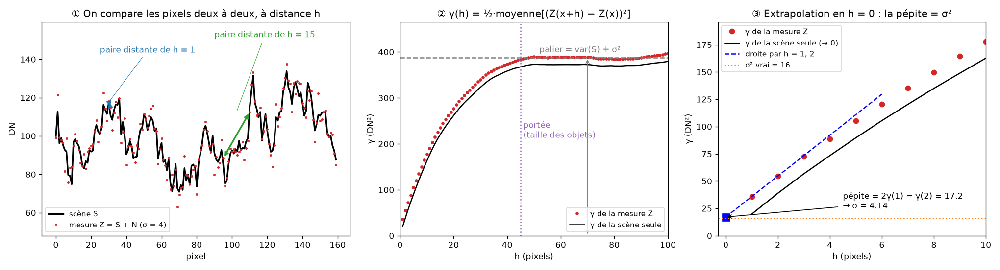
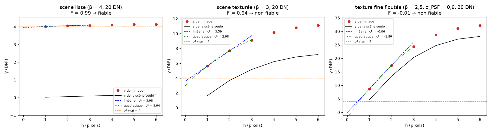
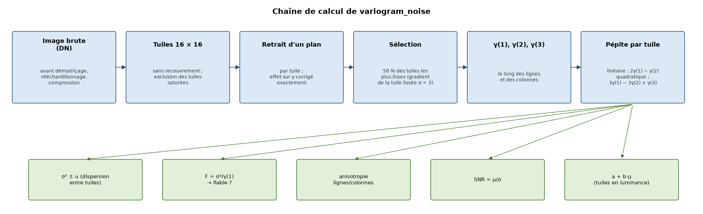
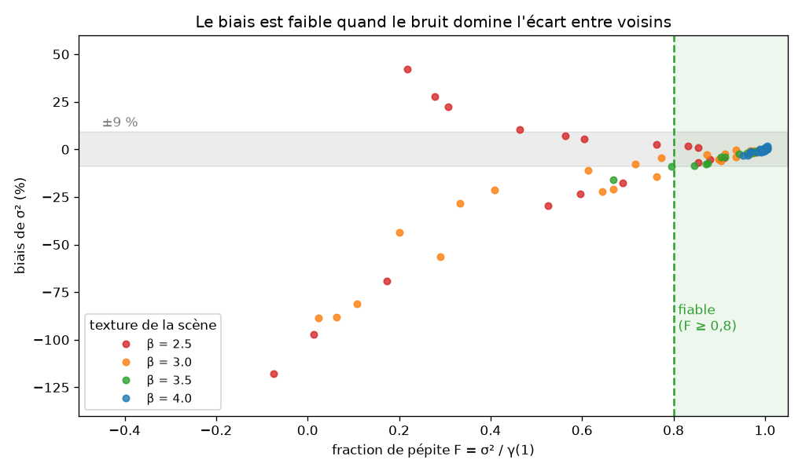
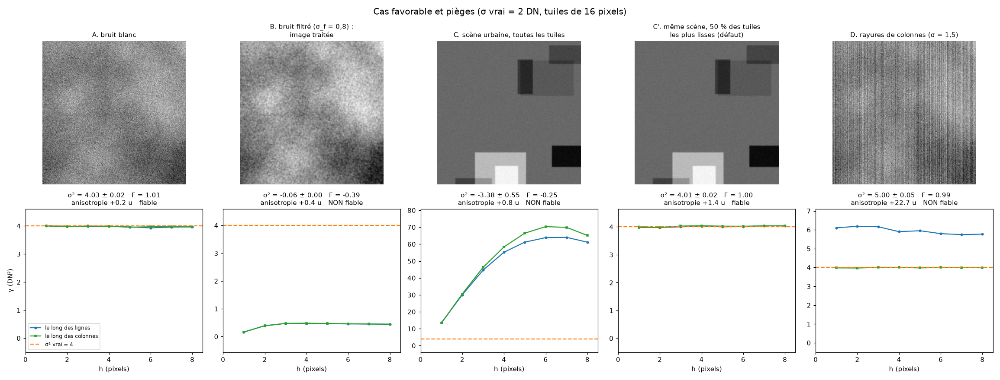
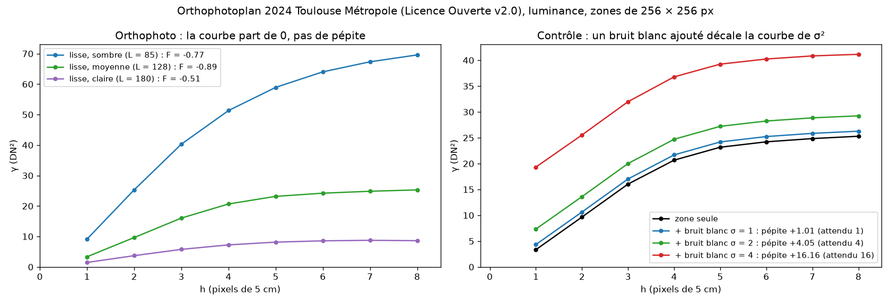

# Variance du bruit et SNR par le variogramme

## 1. Objet

Mesurer la variance du bruit σ², et donc le SNR, **sur une scène
quelconque**, sans mire ni champ uniforme, à partir d'une seule image :
c'est l'estimation dite « par variogramme » (Curran et Dungan, 1989), issue
de la géostatistique (Matheron, 1963). La méthode rend aussi un modèle de
bruit σ² = a + b·μ lorsque la scène couvre plusieurs niveaux, et deux
diagnostics qui disent quand la mesure est exploitable.

Elle complète les [estimateurs sur scène](bruit-estimateurs/index.md) (Ponomarenko,
ondelettes, patchs plats, PCA), qui sont comparés au §5.

**Statut** : validée sur simulation (`tests/test_variogram.py`, 11 tests ;
robustes sur 30 graines) ; incertitude vérifiée par Monte-Carlo ; biais
cartographié selon la scène (`examples/variogram_study.py`, §4).
Module : `eoqual.measure.noise.variogram` (fonctions `variogram_noise` et
`variogram`, méthode `"variogram"` de `estimate_noise`).

## 2. Principe

### 2.1 Variogramme, pépite, palier, portée

Le **variogramme** d'une image Z mesure de combien deux pixels distants de
h diffèrent en moyenne :

  γ(h) = ½ · E[(Z(x + h) − Z(x))²]

On le calcule en formant toutes les paires de pixels séparés de h (le long
des lignes, ou des colonnes), en élevant leur différence au carré, en
moyennant et en divisant par deux (figure 1, ①-②).



*Figure 1 — Profil simulé : scène corrélée (longueur ~20 px, variance
≈ 370 DN²) plus un bruit blanc σ = 4 DN. ① paires à h = 1 et h = 15 ;
② variogramme de la mesure (points) et de la scène seule (trait) ;
③ extrapolation en h = 0 : pépite 17,2 DN², soit σ ≈ 4,14 pour 4 vrai.*

Trois grandeurs se lisent sur la courbe :

| Grandeur | Définition | Ce qu'elle mesure |
|---|---|---|
| **Pépite** (« nugget ») | limite de γ(h) quand h → 0, extrapolée | variance du bruit blanc σ² |
| **Palier** (« sill ») | plateau atteint aux grandes distances | variance totale var(S) + σ² |
| **Portée** (« range ») | distance où le palier est atteint | taille typique des objets de la scène |

### 2.2 Pourquoi le bruit forme la pépite

On écrit Z = S + N, avec S la scène et N un bruit **blanc** (non corrélé
d'un pixel à l'autre) de variance σ², indépendant de S. La différence d'une
paire vaut :

  Z(x + h) − Z(x) = [S(x + h) − S(x)] + [N(x + h) − N(x)]

- La partie bruit est la différence de deux tirages indépendants : sa
  variance vaut 2σ², ramenée à σ² par le facteur ½, **quelle que soit h ≥ 1**.
- La partie scène est presque nulle pour deux pixels voisins et grandit
  avec h.
- Les termes croisés s'annulent en moyenne (indépendance).

D'où, pour h ≥ 1 :

  **γ_Z(h) = γ_S(h) + σ²**

Le variogramme de la mesure est celui de la scène, **décalé de σ²** à
toutes les distances (figure 1 ②). Comme γ_S(h) → 0 quand h → 0, la
valeur extrapolée en 0, la pépite, vaut σ². On ne peut pas mesurer γ(0) (un
pixel ne diffère pas de lui-même) : il faut **extrapoler**.

### 2.3 Extrapolation à l'origine

Deux modèles sont proposés (`model`) :

| Modèle | Points | Pépite | Exact si, près de l'origine, γ_S(h) ∝ |
|---|---|---|---|
| `"linear"` (défaut) | h = 1, 2 | 2γ(1) − γ(2) | h |
| `"quadratic"` | h = 1, 2, 3 | 3γ(1) − 3γ(2) + γ(3) | h + h² |

La forme de γ_S près de l'origine dépend de la scène. Pour une texture
fractale de spectre 1/f^β (le modèle de scène du [simulateur](simulateur/index.md)), γ_S(h) ∝
h^(β−2) : linéaire pour β = 3, presque quadratique pour β = 4 ou une scène
floutée par la FTM. Aucun modèle n'est exact pour toutes les scènes ; le
biais résiduel vaut −[γ_S(0⁺) extrapolé], d'autant plus grand que la scène
varie entre voisins (figure 2). Le modèle linéaire, de plus faible
variance (0,6 % contre environ 0,9 % pour le quadratique, §4), est
retenu par défaut.



*Figure 2 — Bruit blanc σ² = 4 DN² sur trois scènes de 20 DN d'écart-type.
Scène lisse : la courbe de la scène reste près de 0, la pépite vaut 3,98
(linéaire) ; scène texturée β = 3 : la scène ajoute 1,7 DN² dès h = 1, la
pépite tombe à 3,59 ; texture fine floutée : la scène domine, pépite −0,06.
La fraction F (§2.5) le signale.*

### 2.4 Lien avec le spectre de puissance du bruit

Pour un champ stationnaire de covariance C(h), γ(h) = C(0) − C(h), et le NPS
des [mesures radiométriques, chapitre 12](radiometrie/12-nps-bruits-structures.md) est la transformée de Fourier de C. Variogramme et NPS
portent donc la même information, l'un dans l'espace, l'autre en
fréquence : un bruit blanc forme un **plancher plat** du NPS et une
**pépite** du variogramme. Le variogramme est plus simple à lire près de
l'origine (petites distances = hautes fréquences) ; le NPS sépare mieux les
motifs périodiques. Les deux supposent le bruit stationnaire et partagent
la même limite : un bruit filtré n'est plus blanc (§4.3).

### 2.5 Fraction de pépite F : quand la mesure est-elle fiable ?

  **F = σ² / γ(1)**

est la part du bruit dans l'écart moyen entre deux pixels voisins. Elle se
calcule sans connaître le vrai σ² :

- **F proche de 1** : la scène ne varie presque pas d'un pixel au suivant ;
  la courbe est plate près de l'origine et l'extrapolation, courte, est
  sûre ;
- **F faible** : la scène pèse dans γ(1) ; l'extrapolation dépend de sa
  forme et le biais devient incontrôlé ;
- **F négative** : la courbe part sous zéro ; le bruit n'est pas blanc (image
  traitée) ou la scène est lissée.

L'étude (§4, figure 4) montre que **F ≥ 0,8** limite le biais à 9 %
sur toutes les scènes simulées (6 % avec F ≥ 0,9) ; c'est le seuil par
défaut (`min_nugget_fraction`).

## 3. Mise en œuvre

### 3.1 Chaîne de calcul



*Figure 3 — Chaîne de calcul : de l'image brute aux sorties.*

1. **Tuiles** de 16 × 16 pixels, sans recouvrement. Les tuiles contenant un
   pixel saturé sont exclues (`saturation`) : l'écrêtage réduit la
   variance.
2. **Retrait d'un plan** par moindres carrés dans chaque tuile, pour ne pas
   compter un gradient d'éclairement comme du variogramme de scène.
3. **Sélection** des 50 % de tuiles les plus lisses (`keep_fraction`), sur
   l'énergie de gradient de la tuile **lissée** par une gaussienne σ = 3 px.
   Le lissage rend le critère presque insensible au bruit, ce qui évite le
   biais de tri décrit pour les [estimateurs sur scène](bruit-estimateurs/methodes.md#biais-résiduel-des-méthodes-par-sélection-de-patchs) (retenir les tuiles où le bruit est
   faible par hasard) ; il écarte les tuiles traversées par un bord d'objet.
4. **γ(1), γ(2), γ(3)** dans chaque tuile, le long des lignes et des
   colonnes, corrigés du retrait du plan (§3.2).
5. **Pépite par tuile et par direction** (modèle linéaire ou quadratique),
   puis moyenne des tuiles.

Sorties : σ² et son incertitude, F, l'anisotropie lignes/colonnes, le SNR à
la luminance moyenne, le modèle a + b·μ et le verdict `reliable`.

### 3.2 Correction exacte du retrait du plan

Retirer un plan d'un bruit blanc n laisse le résidu r = (I − H)·n, de
covariance σ²(I − H), où H est la projection sur les plans
(H_ab = d_aᵀ(DᵀD)⁻¹d_b, d_a = (x_a, y_a, 1)). Le variogramme d'un bruit
blanc après retrait vaut donc :

  γ(h) = σ² · c(h),  c(h) = moyenne sur les paires (a, b) de [1 − ½(H_aa + H_bb) + H_ab]

Le code divise chaque γ(h) par c(h), calculé exactement pour la taille de
tuile. L'effet est faible à h = 1 (c = 0,9999 pour T = 16) mais croît avec h
(0,994 à h = 8) : sans correction, la courbe d'un bruit blanc pencherait.

### 3.3 Incertitude

Chaque tuile donne une pépite indépendante ; σ² est leur moyenne et son
incertitude-type la dispersion entre tuiles divisée par √n. Vérifiée par
Monte-Carlo : sur 400 tirages du bruit sur une même scène, la dispersion
réelle des σ² estimés vaut 0,98 fois l'incertitude annoncée. Le test
`test_uncertainty_matches_monte_carlo` vérifie ce rapport à 5 u
(100 tirages).

Pour une image de 512 × 512 pixels (1024 tuiles, 512 retenues),
l'incertitude relative vaut environ 0,6 % (tableau 4).

### 3.4 Directions et anisotropie

La pépite est calculée séparément le long des lignes et des colonnes.
L'**anisotropie** (pépite lignes − pépite colonnes) / incertitude combinée
signale un bruit structuré : des rayures de colonnes s'ajoutent aux paires
prises le long d'une ligne, pas à celles prises le long d'une colonne
(figure 5, cas D). Au-delà de 5 u, la mesure est déclarée non fiable ;
la direction la plus basse donne alors le bruit blanc, l'écart entre les
deux le bruit structuré (à mesurer plutôt par `structured_noise`,
[chapitre 12](radiometrie/12-nps-bruits-structures.md)).

### 3.5 Modèle de bruit et SNR

Le SNR à la luminance moyenne des tuiles retenues vaut μ/σ, d'incertitude
SNR·u(σ²)/(2σ²). Lorsque les tuiles couvrent plusieurs niveaux, la droite
σ² = a + b·μ est ajustée par moindres carrés sur les pépites des tuiles,
avec la covariance s²(XᵀX)⁻¹ tirée des résidus. Le résultat porte `a`, `b`
et `cov` : il s'utilise directement avec `snr_at_levels` ([chapitre 10](radiometrie/10-pushbroom-snr.md)).

### 3.6 Exemple

```python
import numpy as np
from eoqual.measure.noise import variogram_noise
from eoqual.measure.radiometry import snr_at_levels
from eoqual.measure.synthetic.scene import natural_scene

rng = np.random.default_rng(0)
scene = natural_scene((1024, 1024), 600.0, rng, contrast=0.3, beta=4.0).photons   # scène lisse
image = scene + rng.normal(0.0, 1.0, scene.shape) * np.sqrt(4.0 + 0.02 * scene)  # σ² = 4 + 0,02·μ
r = variogram_noise(image)
print(f"σ² = {r.variance:.2f} ± {r.u_variance:.2f} DN² à μ = {r.mean:.0f} DN ; SNR = {r.snr:.1f} ± {r.u_snr:.1f}")
print(f"F = {r.nugget_fraction:.2f}, anisotropie {r.anisotropy:+.1f} u, fiable : {r.reliable}")
print(f"a = {r.a:.2f} ± {np.sqrt(r.cov[0, 0]):.2f}, b = {r.b:.4f} ± {np.sqrt(r.cov[1, 1]):.4f}")
s = snr_at_levels(r, [200.0, 800.0])
```

Sortie : σ² = 15,50 ± 0,09 DN² à μ = 597 DN (15,94 vrai) ; SNR = 151,7 ;
F = 0,95, fiable ; a = 3,56 ± 0,17 (4 vrai), b = 0,0200 ± 0,0003 (0,02 vrai) ;
SNR à 200 et 800 DN : 72,8 et 180,9 (70,7 et 178,9 vrais). Le léger déficit
(−3 %) est celui que prévoit le tableau 1 pour F ≈ 0,95 : la scène, très
contrastée ici (écart-type 180 DN), contribue encore un peu à γ(1).

### 3.7 Paramètres et recommandations

| Paramètre | Défaut | Rôle | Conseil |
|---|---|---|---|
| `tile` | 16 | côté des tuiles | 16 : évite les bords d'objets (tableau 2) ; au moins une trentaine de tuiles retenues |
| `keep_fraction` | 0,5 | tuiles les plus lisses retenues | 1 sur une zone déjà choisie uniforme |
| `model` | `"linear"` | extrapolation | `"quadratic"` sur scène lisse et floutée (β ≥ 3,5) |
| `saturation` | aucun | exclusion des tuiles écrêtées | toujours renseigner (ex. 4095 en 12 bits) |
| `selection_sigma` | 3 | lissage du critère de sélection | ne pas descendre sous 2 (biais de sélection) |
| `min_nugget_fraction` | 0,8 | seuil de fiabilité | 0,9 pour un biais < 6 % (figure 4) |

- Travailler sur l'**image brute** du capteur, avant dématriçage (par
  plan de Bayer), rééchantillonnage, compression ou débruitage.
- Toujours lire `reliable`, `nugget_fraction` et `anisotropy` avant σ².
- Pour un bruit dépendant du signal, vérifier que les tuiles couvrent bien
  la plage de luminance (`tile_mean`) avant d'utiliser a et b.

## 4. Validation

Étude `examples/variogram_study.py` : bruit blanc σ = 2 DN sur des scènes de
niveau moyen 1000 DN, 512 × 512 pixels, paramètres par défaut, 8
réalisations (scène et bruit) par configuration. Les tableaux sont repris
tels quels de sa sortie.

### 4.1 Scènes fractales

*Tableau 1 — Biais relatif de σ² selon la texture (β), le flou optique
(σ_PSF) et l'écart-type de la scène.*

| β | Flou optique σ_PSF | Écart-type de scène (DN) | Biais, modèle linéaire | Biais, modèle quadratique | F | Fiable |
|---|---|---|---|---|---|---|
| 2.5 | 0.0 | 5 | +1.7 ± 0.2 % | -6.7 ± 0.6 % | 0.85 | 100% |
| 2.5 | 0.0 | 20 | +26.3 ± 1.8 % | -103.2 ± 6.8 % | 0.31 | 0% |
| 2.5 | 0.6 | 5 | -5.8 ± 0.4 % | -8.7 ± 0.7 % | 0.88 | 100% |
| 2.5 | 0.6 | 20 | -93.7 ± 6.7 % | -134.1 ± 9.5 % | 0.04 | 0% |
| 3.0 | 0.0 | 5 | -0.5 ± 0.2 % | -1.8 ± 0.4 % | 0.97 | 100% |
| 3.0 | 0.0 | 20 | -9.5 ± 1.1 % | -23.2 ± 2.7 % | 0.66 | 0% |
| 3.0 | 0.6 | 5 | -1.0 ± 0.2 % | -1.5 ± 0.4 % | 0.98 | 100% |
| 3.0 | 0.6 | 20 | -17.7 ± 2.1 % | -20.1 ± 2.3 % | 0.71 | 12% |
| 3.5 | 0.0 | 5 | -0.2 ± 0.2 % | -0.5 ± 0.3 % | 1.00 | 100% |
| 3.5 | 0.0 | 20 | -2.7 ± 0.4 % | -3.8 ± 0.6 % | 0.94 | 100% |
| 3.5 | 0.6 | 5 | -0.2 ± 0.2 % | -0.4 ± 0.3 % | 1.00 | 100% |
| 3.5 | 0.6 | 20 | -3.0 ± 0.4 % | -3.0 ± 0.5 % | 0.95 | 100% |
| 4.0 | 0.0 | 5 | +0.1 ± 0.2 % | -0.2 ± 0.3 % | 1.00 | 100% |
| 4.0 | 0.0 | 20 | -0.4 ± 0.2 % | -0.7 ± 0.4 % | 0.99 | 100% |
| 4.0 | 0.6 | 5 | +0.1 ± 0.2 % | -0.2 ± 0.3 % | 1.00 | 100% |
| 4.0 | 0.6 | 20 | -0.4 ± 0.2 % | -0.6 ± 0.4 % | 0.99 | 100% |

Lecture :

- **Le biais dépend de la scène, pas du bruit** : nul pour une scène lisse
  (β ≥ 3,5), il grandit avec la rugosité (β petit) et le contraste, et le
  flou optique l'aggrave (la scène floutée a une courbe en h² que la droite
  extrapole trop bas).
- **Le modèle quadratique n'aide pas** en général : il ne gagne qu'à
  β = 3,5-4 avec flou, et coûte 50 % de variance en plus.
- **Le diagnostic fonctionne** : dans ce tableau, toutes les
  configurations déclarées fiables ont un biais de moins de 6 %, et toutes
  celles de biais supérieur à 10 % sont déclarées non fiables. Sur les 96
  configurations de la figure 4, le biais d'une mesure fiable atteint au
  plus 8,6 % (scènes à 4 % de contraste, floutées).



*Figure 4 — Biais de σ² en fonction de F, sur 96 configurations (β de
2,5 à 4, avec ou sans flou, contrastes de 0,5 à 4 %). Au-delà de F = 0,8
(zone verte), le biais reste dans ±9 % (62 configurations), et dans ±6 %
au-delà de F = 0,9.*

### 4.2 Scène urbaine : taille des tuiles et sélection

Aplats rectangulaires superposés (toits, chaussées), bords francs, légère
FTM : la scène est lisse par morceaux mais traversée de bords.

*Tableau 2 — Scène urbaine, bruit blanc σ = 2 DN.*

| Taille des tuiles | Fraction retenue | Biais, modèle linéaire | F | Fiable |
|---|---|---|---|---|
| 64 | 1.0 | -264.3 ± 17.7 % | -0.49 | 0% |
| 64 | 0.5 | -53.9 ± 5.8 % | 0.32 | 0% |
| 64 | 0.25 | -4 ± 4.0 % | 0.76 | 50% |
| 32 | 1.0 | -244.9 ± 17.7 % | -0.44 | 0% |
| 32 | 0.5 | -17.5 ± 3.1 % | 0.68 | 12% |
| 32 | 0.25 | -0.5 ± 0.3 % | 0.99 | 100% |
| 16 | 1.0 | -196.3 ± 13.4 % | -0.31 | 0% |
| 16 | 0.5 | -0.0 ± 0.2 % | 0.99 | 100% |
| 16 | 0.25 | -0.4 ± 0.3 % | 1.00 | 100% |

Un bord dans une tuile domine son variogramme. Sans sélection, toutes les
tailles échouent ; avec sélection, de **petites tuiles** trouvent assez de
zones sans bord : 16 pixels et 50 % des tuiles donnent un biais nul. C'est
le réglage par défaut.

### 4.3 Bruit corrélé

Bruit blanc σ = 2 DN filtré par une gaussienne d'écart-type σ_f, comme après
un dématriçage, un rééchantillonnage ou une compression.

*Tableau 3 — Bruit corrélé.*

| Filtre σ_f (pixels) | Variance du bruit par pixel (DN²) | Pépite (DN²) | F | Fiable |
|---|---|---|---|---|
| 0.0 | 4.00 | 3.99 | 1.00 | 100% |
| 0.3 | 3.88 | 3.81 | 0.99 | 100% |
| 0.5 | 1.64 | 0.82 | 0.68 | 0% |
| 0.8 | 0.50 | -0.06 | -0.39 | 0% |
| 1.2 | 0.22 | -0.04 | -1.09 | 0% |

Dès que le filtre couvre plus d'un demi-pixel, le bruit n'est plus blanc :
il ne forme plus une pépite mais monte progressivement avec h, comme une
scène. La pépite ne mesure alors **plus la variance du bruit par pixel**
(0,82 pour 1,64), et F le signale. Ce n'est pas un défaut propre au
variogramme : tous les estimateurs du tableau 5 échouent de même.

### 4.4 Bruit blanc seul : biais propre de l'estimateur

*Tableau 4 — Bruit blanc seul, 60 tirages.*

| Taille des tuiles | Fraction retenue | Biais | Incertitude d'une mesure (u/σ²) |
|---|---|---|---|
| 16 | 1.0 | -0.0 ± 0.1 % | 0.43 % |
| 16 | 0.5 | +0.1 ± 0.1 % | 0.60 % |
| 16 | 0.25 | +0.1 ± 0.1 % | 0.85 % |
| 64 | 1.0 | -0.0 ± 0.1 % | 0.41 % |
| 64 | 0.5 | -0.1 ± 0.1 % | 0.57 % |
| 64 | 0.25 | -0.1 ± 0.1 % | 0.77 % |

L'estimateur est sans biais à 0,1 % près, sélection comprise ; retenir moins
de tuiles augmente seulement l'incertitude.

### 4.5 Cas favorable et pièges



*Figure 5 — σ vrai = 2 DN, tuiles de 16 pixels. A : bruit blanc, courbe
plate à 4, pépite 4,03 ± 0,02, fiable. B : bruit filtré, pas de pépite
(−0,06), non fiable. C : scène urbaine sans sélection, variogramme dominé
par les bords (pépite −3,4). C' : même scène avec sélection (défaut), 4,01
± 0,02, fiable. D : rayures de colonnes (σ = 1,5 DN) : pépite 6,2 le long
des lignes, 4,0 le long des colonnes, anisotropie +22,7 u, non fiable ; la
direction des colonnes donne le bruit blanc.*

Liste des tests : §4.6.

### 4.6 Tests

| Test | Vérifie |
|---|---|
| `test_white_noise_recovered` | scène lisse + bruit blanc : σ² à 5 u ; fiable, F > 0,95 ; \|anisotropie\| < 5 ; SNR à 5 u |
| `test_no_selection_bias_on_pure_noise` (linéaire, quadratique) | bruit seul, 25 % des tuiles retenues : σ² à 5 u |
| `test_uncertainty_matches_monte_carlo` | dispersion de 100 estimations / u moyen = 1 à 5/√(2·99) |
| `test_variogram_of_white_noise_is_flat` | γ(h) = σ² à 5 u pour h = 1 … 8 (correction du retrait du plan) |
| `test_signal_dependent_noise_model_and_snr` | tuiles uniformes à 144 niveaux : a et b à 5 u ; SNR de `snr_at_levels` à 5 u |
| `test_correlated_noise_is_flagged` | bruit filtré (σ_f = 0,8) : non fiable, F < 0,2 |
| `test_column_stripes_raise_anisotropy` | rayures de colonnes : anisotropie > 5, non fiable ; pépite des colonnes = σ² et pépite des lignes = σ² + pépite des rayures réalisée, à 5 u |
| `test_saturated_tiles_excluded` | tuiles contenant un pixel saturé exclues |
| `test_errors` | entrées invalides rejetées |

Plus le cas `variogram` de `test_noise.py::test_variance_recovered` (5 u).

## 5. Comparaison avec les autres estimateurs sur scène

### 5.1 Mesures

Mêmes images pour les cinq estimateurs de `estimate_noise`, paramètres par
défaut, 8 réalisations.

*Tableau 5 — Biais relatif de σ² (σ = 2 DN).*

| Scène | variogram | ponomarenko | wavelets | flat_patches | pca_estimate | F (variogramme) |
|---|---|---|---|---|---|---|
| lisse (β = 4) | +0 % | -3 % | +0 % | -28 % | -32 % | 1.00 |
| texturée (β = 3, 20 DN) | -8 % | +8 % | +16 % | +29 % | -19 % | 0.69 |
| urbaine | +1 % | -4 % | +1 % | -26 % | -28 % | 0.99 |
| bruit filtré (σ_f = 0,5) | -50 % | -51 % | -45 % | -34 % | -60 % | 0.68 |
| rayures de colonnes (σ = 1,5) | +31 % | -2 % | +0 % | -3 % | -25 % | 1.01 |

(Les biais de `flat_patches` et `pca_estimate` sur scène lisse sont le
biais de tri documenté pour les [estimateurs sur scène](bruit-estimateurs/methodes.md#biais-résiduel-des-méthodes-par-sélection-de-patchs).)

### 5.2 Principe des méthodes comparées

| Méthode | Ce qu'elle isole | Hypothèse sur la scène |
|---|---|---|
| `variogram` | saut à l'origine des différences entre voisins | varie peu entre deux pixels voisins (F élevé) |
| `ponomarenko` | énergie DCT haute fréquence des blocs 8 × 8 les moins texturés | la scène n'a pas d'énergie aux hautes fréquences des blocs retenus |
| `wavelets` (Donoho-Johnstone) | médiane des coefficients d'ondelette diagonaux | parcimonieuse : peu de coefficients de détail forts |
| `flat_patches`, `pca_estimate` | variance de patchs plats, petites valeurs propres | des patchs vraiment plats existent |

### 5.3 Avantages du variogramme

- **Il dit quand il se trompe.** F et l'anisotropie se calculent sur
  l'image ; dans l'étude, toute mesure déclarée fiable a un biais de moins
  de 9 % (6 % avec F ≥ 0,9). Les autres estimateurs échouent en silence : sur la scène
  texturée, Ponomarenko (+8 %) et les ondelettes (+16 %) rendent une valeur
  plausible sans aucun signal d'alerte, là où le variogramme (−8 %) se
  déclare non fiable.
- **Il voit la structure du bruit.** Les directions séparées détectent
  rayures et bruit de colonnes (anisotropie +22,7 u) et donnent le bruit
  blanc dans l'autre direction. Les ondelettes diagonales et Ponomarenko
  les ignorent : leur σ² est juste (−2 %, +0 %), mais le bruit structuré
  passe inaperçu. La valeur combinée du variogramme (+31 %) n'est pas une
  erreur à corriger : elle est déclarée non fiable et doit être lue par
  direction.
- **Il est sans biais quand la scène s'y prête**, sans étalonnage ni seuil
  au jugé (tableau 4), avec une incertitude vérifiée par Monte-Carlo.
- **Il rend un modèle a + b·μ** et le SNR, directement utilisables par
  `snr_at_levels`.
- **Il se relie au NPS** (§2.4) : un même langage pour le bruit blanc et
  le bruit filtré.

### 5.4 Limites du variogramme face aux autres

- **Sensibilité à la texture fine.** Une scène rugueuse à l'échelle du
  pixel (β ≈ 2,5-3, contrastée) fausse la pépite ; Ponomarenko, qui ne
  garde que les hautes fréquences DCT des blocs les plus lisses, y résiste
  mieux (+8 % contre −8 %, tableau 5 ; +26 à −94 % pour le variogramme
  dans le tableau 1). Sur de telles scènes, le variogramme refuse la
  mesure : utile, mais il ne fournit alors pas de valeur.
- **Taille d'image.** Il lui faut une trentaine de tuiles lisses au moins ;
  Ponomarenko et les ondelettes fonctionnent sur des images plus petites.
- **Une valeur par image ou par niveau, pas de carte fine** : le modèle
  a + b·μ suppose que les tuiles couvrent la plage de luminance utile.
- **Bruit corrélé : aucun estimateur ne s'en sort** (−34 à −60 %). Le
  variogramme a seulement l'avantage de le signaler.

### 5.5 Quelle méthode choisir ?

| Situation | Choix |
|---|---|
| Image brute, scène lisse ou urbaine, besoin d'une valeur avec garantie | `variogram`, en vérifiant `reliable` |
| Scène texturée à l'échelle du pixel | `ponomarenko` ; le variogramme sert de contrôle (F faible = prudence) |
| Suspicion de rayures, bruit de ligne ou de colonne | `variogram` (anisotropie), puis `structured_noise` ([chapitre 12](radiometrie/12-nps-bruits-structures.md)) |
| Image traitée (dématriçage, rééchantillonnage, compression) | aucune estimation de σ² par pixel n'est fiable : NPS ([chapitre 12](radiometrie/12-nps-bruits-structures.md)) pour la forme du bruit |
| Bruit dépendant du signal sur scène | `variogram` (a, b) ou `ponomarenko` avec `num_bins > 1`, et comparer |

En pratique, **croiser le variogramme et Ponomarenko** : accord à
l'incertitude près et F ≥ 0,8, la valeur est sûre ; désaccord, la scène ou le
bruit violent une hypothèse, et F, l'anisotropie et le NPS disent laquelle.

## 6. Cas réel : orthophotographie

Notebook `examples/real_scene_variogram.ipynb` (données hors du projet, voir
`examples/PLAN_TESTS_DONNEES_REELLES.md`) : *Orthophotoplan 2024* de
Toulouse Métropole, extrait de 10240 × 10240 pixels au pas de 5 cm (RGB
8 bits, place du Capitole), Licence Ouverte v2.0 (Etalab). Luminance ; zones
de 256 × 256 pixels (12,8 m) : la plus lisse dans trois gammes de luminance,
et une zone texturée.



*Figure 6 — À gauche : les variogrammes des zones lisses partent de 0,
sans pépite. À droite : un bruit blanc ajouté à la zone moyenne décale la
courbe d'exactement σ² (+1,01, +4,05, +16,16 pour 1, 4, 16).*

| Zone | Luminance | Pépite (DN²) | F | Fiable | Ponomarenko σ² (DN²) |
|---|---|---|---|---|---|
| lisse, sombre | 85 | −7,03 ± 1,43 | −0,77 | non | 0,24 |
| lisse, moyenne | 128 | −2,97 ± 0,89 | −0,89 | non | 0,12 |
| lisse, claire | 180 | −0,75 ± 0,03 | −0,51 | non | 0,11 |
| texturée | 140 | −38,10 ± 2,35 | −0,66 | non | 0,76 |

Lecture :

- **Pas de bruit blanc mesurable.** Une orthophoto n'est pas une image
  brute : dématriçage, orthorectification (rééchantillonnage), mosaïquage
  et probablement débruitage ou compression ont corrélé le bruit entre
  voisins (cas B de la figure 5). La pépite est négative et la mesure est
  déclarée non fiable, à juste titre.
- **Le contrôle innocente la méthode.** Un bruit blanc ajouté augmente la
  pépite exactement de sa variance : c'est l'image, pas la méthode, qui n'a
  pas de bruit blanc mesurable. Comme la courbe de la zone seule part sous
  zéro (scène lissée), la pépite absolue n'est juste que pour un bruit bien
  plus fort que ce décalage (F reste < 0,8 jusqu'à σ = 4 DN).
- **Ponomarenko rend quelques dixièmes de DN²**, sans signal d'alerte ; il
  suppose lui aussi un bruit blanc : sa valeur est une borne basse, pas le
  bruit du capteur.
- **Pour mesurer le bruit du capteur**, il faut les images brutes de
  l'acquisition aérienne (par plan de Bayer), pas l'orthophoto.

## 7. Limites

- **Bruit blanc requis** : image brute, avant tout traitement qui corrèle
  les pixels voisins (§4.3). Sur un produit traité, utiliser le NPS
  ([chapitre 12](radiometrie/12-nps-bruits-structures.md)).
- **Scène lisse à l'échelle du pixel** : la texture fine biaise la pépite
  (§4.1) ; F le signale, sans corriger.
- **Bruit fixe et bruit temporel confondus** : sur une seule image, la DSNU
  et la PRNU pixel à pixel sont blanches et entrent dans la pépite. Pour les
  séparer : piles temporelles et [mesures radiométriques](radiometrie/index.md), chapitres 3, 5 et 11.
- **Bruit structuré** : détecté par l'anisotropie, pas mesuré ; utiliser
  `structured_noise`.
- **Sélection et forme de la courbe** : retenir les tuiles lisses creuse
  légèrement la courbe aux grandes distances (−1,7 % à h = 8 sur un bruit
  blanc, sans effet sur la pépite) ; pour tracer la forme exacte, utiliser
  `variogram(..., keep_fraction=1)`.
- **Écrêtage et quantification** : exclure les tuiles saturées
  (`saturation`) ; un bruit inférieur au pas de quantification
  (σ < 0,3 DN) n'est pas mesurable.
- **Pas de masque** : les zones à exclure (nuages, eau, ombres) se traitent
  en amont, en découpant l'image.

## 8. Formulaire

| Grandeur | Expression |
|---|---|
| Variogramme | γ(h) = ½·E[(Z(x + h) − Z(x))²] = C(0) − C(h) |
| Scène + bruit blanc | γ_Z(h) = γ_S(h) + σ², h ≥ 1 |
| Pépite, modèle linéaire | σ² = 2γ(1) − γ(2) |
| Pépite, modèle quadratique | σ² = 3γ(1) − 3γ(2) + γ(3) |
| Scène fractale 1/f^β | γ_S(h) ∝ h^(β−2) près de l'origine |
| Retrait du plan | γ(h) = σ²·c(h), c(h) = moyenne[1 − ½(H_aa + H_bb) + H_ab], H = D(DᵀD)⁻¹Dᵀ |
| Fraction de pépite | F = σ²/γ(1) ; fiable si F ≥ 0,8, σ² > 3u, \|anisotropie\| ≤ 5 |
| Incertitude | u(σ²) = écart-type des pépites des tuiles / √n |
| SNR | μ/σ ; u(SNR) = SNR·u(σ²)/(2σ²) |

## 9. Pistes

- Masque de zones à exclure (nuages, eau, ombres) en entrée.
- Mode Bayer : pépite par plan de la mosaïque brute.
- Correction du biais de scène à partir de la forme de γ(h) aux distances
  2 à 6 (modèle en h^α ajusté), au lieu de seulement le signaler par F.
- Modèle a + b·μ pondéré par l'incertitude propre de chaque classe de
  luminance (regroupement des tuiles en classes).

## Références

- P. J. Curran, J. L. Dungan, « Estimation of signal-to-noise: a new
  procedure applied to AVIRIS data », *IEEE Transactions on Geoscience and
  Remote Sensing* 27(5), 620-628, 1989 (SNR par la pépite du variogramme).
- G. Matheron, « Principles of geostatistics », *Economic Geology* 58(8),
  1246-1266, 1963 (variogramme, effet de pépite).
