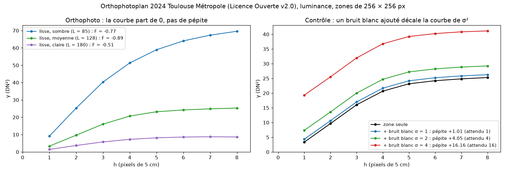

# Variogramme : comparaison et cas réel

## 5. Comparaison avec les autres estimateurs sur scène

### 5.1 Mesures

Mêmes images pour les cinq estimateurs de `estimate_noise`, paramètres par
défaut, 8 réalisations.

*Tableau 5 — Biais relatif de σ² (σ = 2 DN).*

| Scène | variogram | ponomarenko | wavelets | flat_patches | pca_estimate | F (variogramme) |
|---|---|---|---|---|---|---|
| lisse (β = 4) | +0 % | -3 % | +0 % | -28 % | -32 % | 1.00 |
| texturée (β = 3, 20 DN) | -8 % | +8 % | +16 % | +29 % | -19 % | 0.69 |
| urbaine | +1 % | -4 % | +1 % | -26 % | -28 % | 0.99 |
| bruit filtré (σ_f = 0,5) | -50 % | -51 % | -45 % | -34 % | -60 % | 0.68 |
| rayures de colonnes (σ = 1,5) | +31 % | -2 % | +0 % | -3 % | -25 % | 1.01 |

(Les biais de `flat_patches` et `pca_estimate` sur scène lisse sont le
biais de tri documenté pour les [estimateurs sur scène](../bruit-estimateurs/methodes.md#biais-résiduel-des-méthodes-par-sélection-de-patchs).)

### 5.2 Principe des méthodes comparées

| Méthode | Ce qu'elle isole | Hypothèse sur la scène |
|---|---|---|
| `variogram` | saut à l'origine des différences entre voisins | varie peu entre deux pixels voisins (F élevé) |
| `ponomarenko` | énergie DCT haute fréquence des blocs 8 × 8 les moins texturés | la scène n'a pas d'énergie aux hautes fréquences des blocs retenus |
| `wavelets` (Donoho-Johnstone) | médiane des coefficients d'ondelette diagonaux | parcimonieuse : peu de coefficients de détail forts |
| `flat_patches`, `pca_estimate` | variance de patchs plats, petites valeurs propres | des patchs vraiment plats existent |

### 5.3 Avantages du variogramme

- **Il dit quand il se trompe.** F et l'anisotropie se calculent sur
  l'image ; dans l'étude, toute mesure déclarée fiable a un biais de moins
  de 9 % (6 % avec F ≥ 0,9). Les autres estimateurs échouent en silence : sur la scène
  texturée, Ponomarenko (+8 %) et les ondelettes (+16 %) rendent une valeur
  plausible sans aucun signal d'alerte, là où le variogramme (−8 %) se
  déclare non fiable.
- **Il voit la structure du bruit.** Les directions séparées détectent
  rayures et bruit de colonnes (anisotropie +22,7 u) et donnent le bruit
  blanc dans l'autre direction. Les ondelettes diagonales et Ponomarenko
  les ignorent : leur σ² est juste (−2 %, +0 %), mais le bruit structuré
  passe inaperçu. La valeur combinée du variogramme (+31 %) n'est pas une
  erreur à corriger : elle est déclarée non fiable et doit être lue par
  direction.
- **Il est sans biais quand la scène s'y prête**, sans étalonnage ni seuil
  au jugé (tableau 4), avec une incertitude vérifiée par Monte-Carlo.
- **Il rend un modèle a + b·μ** et le SNR, directement utilisables par
  `snr_at_levels`.
- **Il se relie au NPS** ([§2.4](principe.md#24-lien-avec-le-spectre-de-puissance-du-bruit)) : un même langage pour le bruit blanc et
  le bruit filtré.

### 5.4 Limites du variogramme face aux autres

- **Sensibilité à la texture fine.** Une scène rugueuse à l'échelle du
  pixel (β ≈ 2,5-3, contrastée) fausse la pépite ; Ponomarenko, qui ne
  garde que les hautes fréquences DCT des blocs les plus lisses, y résiste
  mieux (+8 % contre −8 %, tableau 5 ; +26 à −94 % pour le variogramme
  dans le tableau 1). Sur de telles scènes, le variogramme refuse la
  mesure : utile, mais il ne fournit alors pas de valeur.
- **Taille d'image.** Il lui faut une trentaine de tuiles lisses au moins ;
  Ponomarenko et les ondelettes fonctionnent sur des images plus petites.
- **Une valeur par image ou par niveau, pas de carte fine** : le modèle
  a + b·μ suppose que les tuiles couvrent la plage de luminance utile.
- **Bruit corrélé : aucun estimateur ne s'en sort** (−34 à −60 %). Le
  variogramme a seulement l'avantage de le signaler.

### 5.5 Quelle méthode choisir ?

| Situation | Choix |
|---|---|
| Image brute, scène lisse ou urbaine, besoin d'une valeur avec garantie | `variogram`, en vérifiant `reliable` |
| Scène texturée à l'échelle du pixel | `ponomarenko` ; le variogramme sert de contrôle (F faible = prudence) |
| Suspicion de rayures, bruit de ligne ou de colonne | `variogram` (anisotropie), puis `structured_noise` ([chapitre 12](../radiometrie/12-nps-bruits-structures.md)) |
| Image traitée (dématriçage, rééchantillonnage, compression) | aucune estimation de σ² par pixel n'est fiable : NPS ([chapitre 12](../radiometrie/12-nps-bruits-structures.md)) pour la forme du bruit |
| Bruit dépendant du signal sur scène | `variogram` (a, b) ou `ponomarenko` avec `num_bins > 1`, et comparer |

En pratique, **croiser le variogramme et Ponomarenko** : accord à
l'incertitude près et F ≥ 0,8, la valeur est sûre ; désaccord, la scène ou le
bruit violent une hypothèse, et F, l'anisotropie et le NPS disent laquelle.

## 6. Cas réel : orthophotographie

Notebook `examples/real_scene_variogram.ipynb` (données hors du projet, voir
`examples/PLAN_TESTS_DONNEES_REELLES.md`) : *Orthophotoplan 2024* de
Toulouse Métropole, extrait de 10240 × 10240 pixels au pas de 5 cm (RGB
8 bits, place du Capitole), Licence Ouverte v2.0 (Etalab). Luminance ; zones
de 256 × 256 pixels (12,8 m) : la plus lisse dans trois gammes de luminance,
et une zone texturée.

*Figure 6 — À gauche : les variogrammes des zones lisses partent de 0,
sans pépite. À droite : un bruit blanc ajouté à la zone moyenne décale la
courbe d'exactement σ² (+1,01, +4,05, +16,16 pour 1, 4, 16).*

| Zone | Luminance | Pépite (DN²) | F | Fiable | Ponomarenko σ² (DN²) |
|---|---|---|---|---|---|
| lisse, sombre | 85 | −7,03 ± 1,43 | −0,77 | non | 0,24 |
| lisse, moyenne | 128 | −2,97 ± 0,89 | −0,89 | non | 0,12 |
| lisse, claire | 180 | −0,75 ± 0,03 | −0,51 | non | 0,11 |
| texturée | 140 | −38,10 ± 2,35 | −0,66 | non | 0,76 |

Lecture :

- **Pas de bruit blanc mesurable.** Une orthophoto n'est pas une image
  brute : dématriçage, orthorectification (rééchantillonnage), mosaïquage
  et probablement débruitage ou compression ont corrélé le bruit entre
  voisins (cas B de la figure 5). La pépite est négative et la mesure est
  déclarée non fiable, à juste titre.
- **Le contrôle innocente la méthode.** Un bruit blanc ajouté augmente la
  pépite exactement de sa variance : c'est l'image, pas la méthode, qui n'a
  pas de bruit blanc mesurable. Comme la courbe de la zone seule part sous
  zéro (scène lissée), la pépite absolue n'est juste que pour un bruit bien
  plus fort que ce décalage (F reste < 0,8 jusqu'à σ = 4 DN).
- **Ponomarenko rend quelques dixièmes de DN²**, sans signal d'alerte ; il
  suppose lui aussi un bruit blanc : sa valeur est une borne basse, pas le
  bruit du capteur.
- **Pour mesurer le bruit du capteur**, il faut les images brutes de
  l'acquisition aérienne (par plan de Bayer), pas l'orthophoto.
