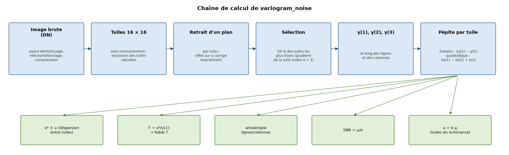

# Variogramme : mise en œuvre

## 3. Mise en œuvre

### 3.1 Chaîne de calcul



*Figure 3 — Chaîne de calcul : de l'image brute aux sorties.*

1. **Tuiles** de 16 × 16 pixels, sans recouvrement. Les tuiles contenant un
   pixel saturé sont exclues (`saturation`) : l'écrêtage réduit la
   variance.
2. **Retrait d'un plan** par moindres carrés dans chaque tuile, pour ne pas
   compter un gradient d'éclairement comme du variogramme de scène.
3. **Sélection** des 50 % de tuiles les plus lisses (`keep_fraction`), sur
   l'énergie de gradient de la tuile **lissée** par une gaussienne σ = 3 px.
   Le lissage rend le critère presque insensible au bruit, ce qui évite le
   biais de tri décrit pour les [estimateurs sur scène](../bruit-estimateurs/methodes.md#biais-résiduel-des-méthodes-par-sélection-de-patchs) (retenir les tuiles où le bruit est
   faible par hasard) ; il écarte les tuiles traversées par un bord d'objet.
4. **γ(1), γ(2), γ(3)** dans chaque tuile, le long des lignes et des
   colonnes, corrigés du retrait du plan (§3.2).
5. **Pépite par tuile et par direction** (modèle linéaire ou quadratique),
   puis moyenne des tuiles.

Sorties : σ² et son incertitude, F, l'anisotropie lignes/colonnes, le SNR à
la luminance moyenne, le modèle a + b·μ et le verdict `reliable`.

### 3.2 Correction exacte du retrait du plan

Retirer un plan d'un bruit blanc n laisse le résidu r = (I − H)·n, de
covariance σ²(I − H), où H est la projection sur les plans
(H_ab = d_aᵀ(DᵀD)⁻¹d_b, d_a = (x_a, y_a, 1)). Le variogramme d'un bruit
blanc après retrait vaut donc :

  γ(h) = σ² · c(h),  c(h) = moyenne sur les paires (a, b) de [1 − ½(H_aa + H_bb) + H_ab]

Le code divise chaque γ(h) par c(h), calculé exactement pour la taille de
tuile. L'effet est faible à h = 1 (c = 0,9999 pour T = 16) mais croît avec h
(0,994 à h = 8) : sans correction, la courbe d'un bruit blanc pencherait.

### 3.3 Incertitude

Chaque tuile donne une pépite indépendante ; σ² est leur moyenne et son
incertitude-type la dispersion entre tuiles divisée par √n. Vérifiée par
Monte-Carlo : sur 400 tirages du bruit sur une même scène, la dispersion
réelle des σ² estimés vaut 0,98 fois l'incertitude annoncée. Le test
`test_uncertainty_matches_monte_carlo` vérifie ce rapport à 5 u
(100 tirages).

Pour une image de 512 × 512 pixels (1024 tuiles, 512 retenues),
l'incertitude relative vaut environ 0,6 % (tableau 4).

### 3.4 Directions et anisotropie

La pépite est calculée séparément le long des lignes et des colonnes.
L'**anisotropie** (pépite lignes − pépite colonnes) / incertitude combinée
signale un bruit structuré : des rayures de colonnes s'ajoutent aux paires
prises le long d'une ligne, pas à celles prises le long d'une colonne
(figure 5, cas D). Au-delà de 5 u, la mesure est déclarée non fiable ;
la direction la plus basse donne alors le bruit blanc, l'écart entre les
deux le bruit structuré (à mesurer plutôt par `structured_noise`,
[chapitre 12](../radiometrie/12-nps-bruits-structures.md)).

### 3.5 Modèle de bruit et SNR

Le SNR à la luminance moyenne des tuiles retenues vaut μ/σ, d'incertitude
SNR·u(σ²)/(2σ²). Lorsque les tuiles couvrent plusieurs niveaux, la droite
σ² = a + b·μ est ajustée par moindres carrés sur les pépites des tuiles,
avec la covariance s²(XᵀX)⁻¹ tirée des résidus. Le résultat porte `a`, `b`
et `cov` : il s'utilise directement avec `snr_at_levels` ([chapitre 10](../radiometrie/10-pushbroom-snr.md)).

### 3.6 Exemple

```python
import numpy as np
from eoqual.measure.noise import variogram_noise
from eoqual.measure.radiometry import snr_at_levels
from eoqual.measure.synthetic.scene import natural_scene

rng = np.random.default_rng(0)
scene = natural_scene((1024, 1024), 600.0, rng, contrast=0.3, beta=4.0).photons   # scène lisse
image = scene + rng.normal(0.0, 1.0, scene.shape) * np.sqrt(4.0 + 0.02 * scene)  # σ² = 4 + 0,02·μ
r = variogram_noise(image)
print(f"σ² = {r.variance:.2f} ± {r.u_variance:.2f} DN² à μ = {r.mean:.0f} DN ; SNR = {r.snr:.1f} ± {r.u_snr:.1f}")
print(f"F = {r.nugget_fraction:.2f}, anisotropie {r.anisotropy:+.1f} u, fiable : {r.reliable}")
print(f"a = {r.a:.2f} ± {np.sqrt(r.cov[0, 0]):.2f}, b = {r.b:.4f} ± {np.sqrt(r.cov[1, 1]):.4f}")
s = snr_at_levels(r, [200.0, 800.0])
```

Sortie : σ² = 15,50 ± 0,09 DN² à μ = 597 DN (15,94 vrai) ; SNR = 151,7 ;
F = 0,95, fiable ; a = 3,56 ± 0,17 (4 vrai), b = 0,0200 ± 0,0003 (0,02 vrai) ;
SNR à 200 et 800 DN : 72,8 et 180,9 (70,7 et 178,9 vrais). Le léger déficit
(−3 %) est celui que prévoit le tableau 1 pour F ≈ 0,95 : la scène, très
contrastée ici (écart-type 180 DN), contribue encore un peu à γ(1).

### 3.7 Paramètres et recommandations

| Paramètre | Défaut | Rôle | Conseil |
|---|---|---|---|
| `tile` | 16 | côté des tuiles | 16 : évite les bords d'objets (tableau 2) ; au moins une trentaine de tuiles retenues |
| `keep_fraction` | 0,5 | tuiles les plus lisses retenues | 1 sur une zone déjà choisie uniforme |
| `model` | `"linear"` | extrapolation | `"quadratic"` sur scène lisse et floutée (β ≥ 3,5) |
| `saturation` | aucun | exclusion des tuiles écrêtées | toujours renseigner (ex. 4095 en 12 bits) |
| `selection_sigma` | 3 | lissage du critère de sélection | ne pas descendre sous 2 (biais de sélection) |
| `min_nugget_fraction` | 0,8 | seuil de fiabilité | 0,9 pour un biais < 6 % (figure 4) |

- Travailler sur l'**image brute** du capteur, avant dématriçage (par
  plan de Bayer), rééchantillonnage, compression ou débruitage.
- Toujours lire `reliable`, `nugget_fraction` et `anisotropy` avant σ².
- Pour un bruit dépendant du signal, vérifier que les tuiles couvrent bien
  la plage de luminance (`tile_mean`) avant d'utiliser a et b.
