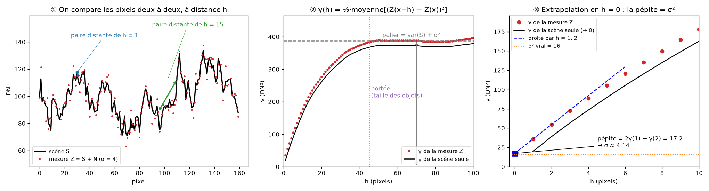
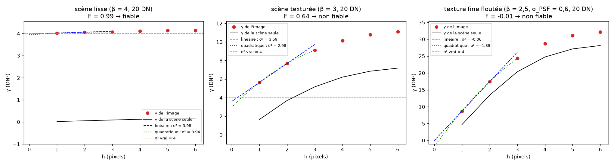

# Variogramme : objet et principe

## 1. Objet

Mesurer la variance du bruit σ², et donc le SNR, **sur une scène
quelconque**, sans mire ni champ uniforme, à partir d'une seule image :
c'est l'estimation dite « par variogramme » (Curran et Dungan, 1989), issue
de la géostatistique (Matheron, 1963). La méthode rend aussi un modèle de
bruit σ² = a + b·μ lorsque la scène couvre plusieurs niveaux, et deux
diagnostics qui disent quand la mesure est exploitable.

Elle complète les [estimateurs sur scène](../bruit-estimateurs/index.md) (Ponomarenko,
ondelettes, patchs plats, PCA), qui sont comparés au [§5](comparaison.md#5-comparaison-avec-les-autres-estimateurs-sur-scène).

**Statut** : validée sur simulation (`tests/test_variogram.py`, 11 tests ;
robustes sur 30 graines) ; incertitude vérifiée par Monte-Carlo ; biais
cartographié selon la scène (`examples/variogram_study.py`, [§4](validation.md#4-validation)).
Module : `eoqual.measure.noise.variogram` (fonctions `variogram_noise` et
`variogram`, méthode `"variogram"` de `estimate_noise`).

## 2. Principe

### 2.1 Variogramme, pépite, palier, portée

Le **variogramme** d'une image Z mesure de combien deux pixels distants de
h diffèrent en moyenne :

  γ(h) = ½ · E[(Z(x + h) − Z(x))²]

On le calcule en formant toutes les paires de pixels séparés de h (le long
des lignes, ou des colonnes), en élevant leur différence au carré, en
moyennant et en divisant par deux (figure 1, ①-②).

*Figure 1 — Profil simulé : scène corrélée (longueur ~20 px, variance
≈ 370 DN²) plus un bruit blanc σ = 4 DN. ① paires à h = 1 et h = 15 ;
② variogramme de la mesure (points) et de la scène seule (trait) ;
③ extrapolation en h = 0 : pépite 17,2 DN², soit σ ≈ 4,14 pour 4 vrai.*

Trois grandeurs se lisent sur la courbe :

| Grandeur | Définition | Ce qu'elle mesure |
|---|---|---|
| **Pépite** (« nugget ») | limite de γ(h) quand h → 0, extrapolée | variance du bruit blanc σ² |
| **Palier** (« sill ») | plateau atteint aux grandes distances | variance totale var(S) + σ² |
| **Portée** (« range ») | distance où le palier est atteint | taille typique des objets de la scène |

### 2.2 Pourquoi le bruit forme la pépite

On écrit Z = S + N, avec S la scène et N un bruit **blanc** (non corrélé
d'un pixel à l'autre) de variance σ², indépendant de S. La différence d'une
paire vaut :

  Z(x + h) − Z(x) = [S(x + h) − S(x)] + [N(x + h) − N(x)]

- La partie bruit est la différence de deux tirages indépendants : sa
  variance vaut 2σ², ramenée à σ² par le facteur ½, **quelle que soit h ≥ 1**.
- La partie scène est presque nulle pour deux pixels voisins et grandit
  avec h.
- Les termes croisés s'annulent en moyenne (indépendance).

D'où, pour h ≥ 1 :

  **γ_Z(h) = γ_S(h) + σ²**

Le variogramme de la mesure est celui de la scène, **décalé de σ²** à
toutes les distances (figure 1 ②). Comme γ_S(h) → 0 quand h → 0, la
valeur extrapolée en 0, la pépite, vaut σ². On ne peut pas mesurer γ(0) (un
pixel ne diffère pas de lui-même) : il faut **extrapoler**.

### 2.3 Extrapolation à l'origine

Deux modèles sont proposés (`model`) :

| Modèle | Points | Pépite | Exact si, près de l'origine, γ_S(h) ∝ |
|---|---|---|---|
| `"linear"` (défaut) | h = 1, 2 | 2γ(1) − γ(2) | h |
| `"quadratic"` | h = 1, 2, 3 | 3γ(1) − 3γ(2) + γ(3) | h + h² |

La forme de γ_S près de l'origine dépend de la scène. Pour une texture
fractale de spectre 1/f^β (le modèle de scène du [simulateur](../simulateur/index.md)), γ_S(h) ∝
h^(β−2) : linéaire pour β = 3, presque quadratique pour β = 4 ou une scène
floutée par la FTM. Aucun modèle n'est exact pour toutes les scènes ; le
biais résiduel vaut −[γ_S(0⁺) extrapolé], d'autant plus grand que la scène
varie entre voisins (figure 2). Le modèle linéaire, de plus faible
variance (0,6 % contre environ 0,9 % pour le quadratique, [§4](validation.md#4-validation)), est
retenu par défaut.

*Figure 2 — Bruit blanc σ² = 4 DN² sur trois scènes de 20 DN d'écart-type.
Scène lisse : la courbe de la scène reste près de 0, la pépite vaut 3,98
(linéaire) ; scène texturée β = 3 : la scène ajoute 1,7 DN² dès h = 1, la
pépite tombe à 3,59 ; texture fine floutée : la scène domine, pépite −0,06.
La fraction F (§2.5) le signale.*

### 2.4 Lien avec le spectre de puissance du bruit

Pour un champ stationnaire de covariance C(h), γ(h) = C(0) − C(h), et le NPS
des [mesures radiométriques, chapitre 12](../radiometrie/12-nps-bruits-structures.md) est la transformée de Fourier de C. Variogramme et NPS
portent donc la même information, l'un dans l'espace, l'autre en
fréquence : un bruit blanc forme un **plancher plat** du NPS et une
**pépite** du variogramme. Le variogramme est plus simple à lire près de
l'origine (petites distances = hautes fréquences) ; le NPS sépare mieux les
motifs périodiques. Les deux supposent le bruit stationnaire et partagent
la même limite : un bruit filtré n'est plus blanc ([§4.3](validation.md#43-bruit-corrélé)).

### 2.5 Fraction de pépite F : quand la mesure est-elle fiable ?

  **F = σ² / γ(1)**

est la part du bruit dans l'écart moyen entre deux pixels voisins. Elle se
calcule sans connaître le vrai σ² :

- **F proche de 1** : la scène ne varie presque pas d'un pixel au suivant ;
  la courbe est plate près de l'origine et l'extrapolation, courte, est
  sûre ;
- **F faible** : la scène pèse dans γ(1) ; l'extrapolation dépend de sa
  forme et le biais devient incontrôlé ;
- **F négative** : la courbe part sous zéro ; le bruit n'est pas blanc (image
  traitée) ou la scène est lissée.

L'étude ([§4](validation.md#4-validation), figure 4) montre que **F ≥ 0,8** limite le biais à 9 %
sur toutes les scènes simulées (6 % avec F ≥ 0,9) ; c'est le seuil par
défaut (`min_nugget_fraction`).
