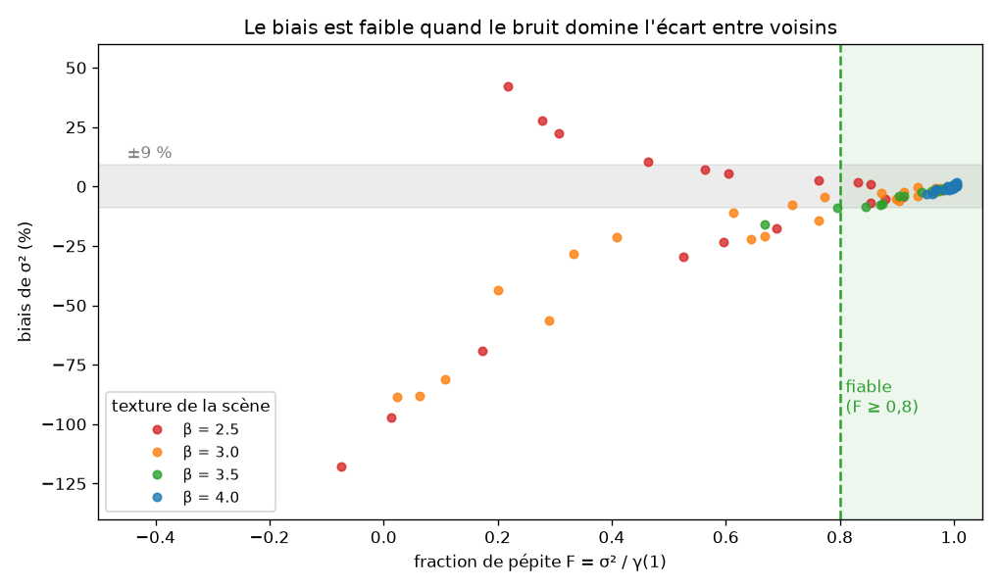
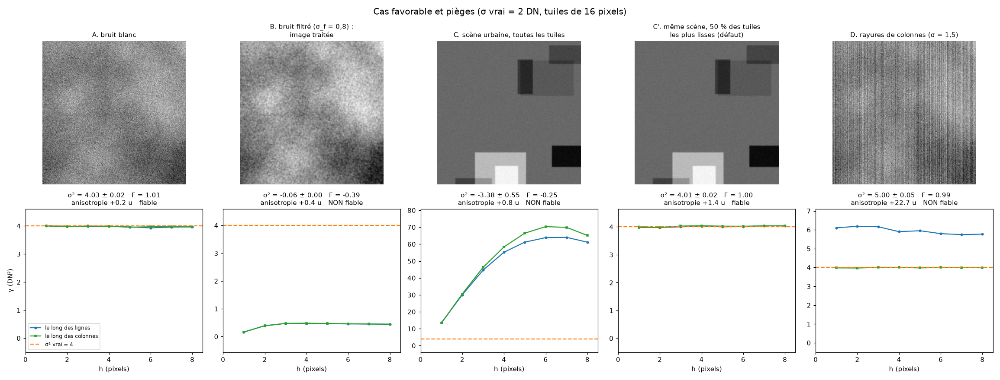

# Variogramme : validation

## 4. Validation

Étude `examples/variogram_study.py` : bruit blanc σ = 2 DN sur des scènes de
niveau moyen 1000 DN, 512 × 512 pixels, paramètres par défaut, 8
réalisations (scène et bruit) par configuration. Les tableaux sont repris
tels quels de sa sortie.

### 4.1 Scènes fractales

*Tableau 1 — Biais relatif de σ² selon la texture (β), le flou optique
(σ_PSF) et l'écart-type de la scène.*

| β | Flou optique σ_PSF | Écart-type de scène (DN) | Biais, modèle linéaire | Biais, modèle quadratique | F | Fiable |
|---|---|---|---|---|---|---|
| 2.5 | 0.0 | 5 | +1.7 ± 0.2 % | -6.7 ± 0.6 % | 0.85 | 100% |
| 2.5 | 0.0 | 20 | +26.3 ± 1.8 % | -103.2 ± 6.8 % | 0.31 | 0% |
| 2.5 | 0.6 | 5 | -5.8 ± 0.4 % | -8.7 ± 0.7 % | 0.88 | 100% |
| 2.5 | 0.6 | 20 | -93.7 ± 6.7 % | -134.1 ± 9.5 % | 0.04 | 0% |
| 3.0 | 0.0 | 5 | -0.5 ± 0.2 % | -1.8 ± 0.4 % | 0.97 | 100% |
| 3.0 | 0.0 | 20 | -9.5 ± 1.1 % | -23.2 ± 2.7 % | 0.66 | 0% |
| 3.0 | 0.6 | 5 | -1.0 ± 0.2 % | -1.5 ± 0.4 % | 0.98 | 100% |
| 3.0 | 0.6 | 20 | -17.7 ± 2.1 % | -20.1 ± 2.3 % | 0.71 | 12% |
| 3.5 | 0.0 | 5 | -0.2 ± 0.2 % | -0.5 ± 0.3 % | 1.00 | 100% |
| 3.5 | 0.0 | 20 | -2.7 ± 0.4 % | -3.8 ± 0.6 % | 0.94 | 100% |
| 3.5 | 0.6 | 5 | -0.2 ± 0.2 % | -0.4 ± 0.3 % | 1.00 | 100% |
| 3.5 | 0.6 | 20 | -3.0 ± 0.4 % | -3.0 ± 0.5 % | 0.95 | 100% |
| 4.0 | 0.0 | 5 | +0.1 ± 0.2 % | -0.2 ± 0.3 % | 1.00 | 100% |
| 4.0 | 0.0 | 20 | -0.4 ± 0.2 % | -0.7 ± 0.4 % | 0.99 | 100% |
| 4.0 | 0.6 | 5 | +0.1 ± 0.2 % | -0.2 ± 0.3 % | 1.00 | 100% |
| 4.0 | 0.6 | 20 | -0.4 ± 0.2 % | -0.6 ± 0.4 % | 0.99 | 100% |

Lecture :

- **Le biais dépend de la scène, pas du bruit** : nul pour une scène lisse
  (β ≥ 3,5), il grandit avec la rugosité (β petit) et le contraste, et le
  flou optique l'aggrave (la scène floutée a une courbe en h² que la droite
  extrapole trop bas).
- **Le modèle quadratique n'aide pas** en général : il ne gagne qu'à
  β = 3,5-4 avec flou, et coûte 50 % de variance en plus.
- **Le diagnostic fonctionne** : dans ce tableau, toutes les
  configurations déclarées fiables ont un biais de moins de 6 %, et toutes
  celles de biais supérieur à 10 % sont déclarées non fiables. Sur les 96
  configurations de la figure 4, le biais d'une mesure fiable atteint au
  plus 8,6 % (scènes à 4 % de contraste, floutées).

*Figure 4 — Biais de σ² en fonction de F, sur 96 configurations (β de
2,5 à 4, avec ou sans flou, contrastes de 0,5 à 4 %). Au-delà de F = 0,8
(zone verte), le biais reste dans ±9 % (62 configurations), et dans ±6 %
au-delà de F = 0,9.*

### 4.2 Scène urbaine : taille des tuiles et sélection

Aplats rectangulaires superposés (toits, chaussées), bords francs, légère
FTM : la scène est lisse par morceaux mais traversée de bords.

*Tableau 2 — Scène urbaine, bruit blanc σ = 2 DN.*

| Taille des tuiles | Fraction retenue | Biais, modèle linéaire | F | Fiable |
|---|---|---|---|---|
| 64 | 1.0 | -264.3 ± 17.7 % | -0.49 | 0% |
| 64 | 0.5 | -53.9 ± 5.8 % | 0.32 | 0% |
| 64 | 0.25 | -4 ± 4.0 % | 0.76 | 50% |
| 32 | 1.0 | -244.9 ± 17.7 % | -0.44 | 0% |
| 32 | 0.5 | -17.5 ± 3.1 % | 0.68 | 12% |
| 32 | 0.25 | -0.5 ± 0.3 % | 0.99 | 100% |
| 16 | 1.0 | -196.3 ± 13.4 % | -0.31 | 0% |
| 16 | 0.5 | -0.0 ± 0.2 % | 0.99 | 100% |
| 16 | 0.25 | -0.4 ± 0.3 % | 1.00 | 100% |

Un bord dans une tuile domine son variogramme. Sans sélection, toutes les
tailles échouent ; avec sélection, de **petites tuiles** trouvent assez de
zones sans bord : 16 pixels et 50 % des tuiles donnent un biais nul. C'est
le réglage par défaut.

### 4.3 Bruit corrélé

Bruit blanc σ = 2 DN filtré par une gaussienne d'écart-type σ_f, comme après
un dématriçage, un rééchantillonnage ou une compression.

*Tableau 3 — Bruit corrélé.*

| Filtre σ_f (pixels) | Variance du bruit par pixel (DN²) | Pépite (DN²) | F | Fiable |
|---|---|---|---|---|
| 0.0 | 4.00 | 3.99 | 1.00 | 100% |
| 0.3 | 3.88 | 3.81 | 0.99 | 100% |
| 0.5 | 1.64 | 0.82 | 0.68 | 0% |
| 0.8 | 0.50 | -0.06 | -0.39 | 0% |
| 1.2 | 0.22 | -0.04 | -1.09 | 0% |

Dès que le filtre couvre plus d'un demi-pixel, le bruit n'est plus blanc :
il ne forme plus une pépite mais monte progressivement avec h, comme une
scène. La pépite ne mesure alors **plus la variance du bruit par pixel**
(0,82 pour 1,64), et F le signale. Ce n'est pas un défaut propre au
variogramme : tous les estimateurs du tableau 5 échouent de même.

### 4.4 Bruit blanc seul : biais propre de l'estimateur

*Tableau 4 — Bruit blanc seul, 60 tirages.*

| Taille des tuiles | Fraction retenue | Biais | Incertitude d'une mesure (u/σ²) |
|---|---|---|---|
| 16 | 1.0 | -0.0 ± 0.1 % | 0.43 % |
| 16 | 0.5 | +0.1 ± 0.1 % | 0.60 % |
| 16 | 0.25 | +0.1 ± 0.1 % | 0.85 % |
| 64 | 1.0 | -0.0 ± 0.1 % | 0.41 % |
| 64 | 0.5 | -0.1 ± 0.1 % | 0.57 % |
| 64 | 0.25 | -0.1 ± 0.1 % | 0.77 % |

L'estimateur est sans biais à 0,1 % près, sélection comprise ; retenir moins
de tuiles augmente seulement l'incertitude.

### 4.5 Cas favorable et pièges

*Figure 5 — σ vrai = 2 DN, tuiles de 16 pixels. A : bruit blanc, courbe
plate à 4, pépite 4,03 ± 0,02, fiable. B : bruit filtré, pas de pépite
(−0,06), non fiable. C : scène urbaine sans sélection, variogramme dominé
par les bords (pépite −3,4). C' : même scène avec sélection (défaut), 4,01
± 0,02, fiable. D : rayures de colonnes (σ = 1,5 DN) : pépite 6,2 le long
des lignes, 4,0 le long des colonnes, anisotropie +22,7 u, non fiable ; la
direction des colonnes donne le bruit blanc.*

Liste des tests : §4.6.

### 4.6 Tests

| Test | Vérifie |
|---|---|
| `test_white_noise_recovered` | scène lisse + bruit blanc : σ² à 5 u ; fiable, F > 0,95 ; \|anisotropie\| < 5 ; SNR à 5 u |
| `test_no_selection_bias_on_pure_noise` (linéaire, quadratique) | bruit seul, 25 % des tuiles retenues : σ² à 5 u |
| `test_uncertainty_matches_monte_carlo` | dispersion de 100 estimations / u moyen = 1 à 5/√(2·99) |
| `test_variogram_of_white_noise_is_flat` | γ(h) = σ² à 5 u pour h = 1 … 8 (correction du retrait du plan) |
| `test_signal_dependent_noise_model_and_snr` | tuiles uniformes à 144 niveaux : a et b à 5 u ; SNR de `snr_at_levels` à 5 u |
| `test_correlated_noise_is_flagged` | bruit filtré (σ_f = 0,8) : non fiable, F < 0,2 |
| `test_column_stripes_raise_anisotropy` | rayures de colonnes : anisotropie > 5, non fiable ; pépite des colonnes = σ² et pépite des lignes = σ² + pépite des rayures réalisée, à 5 u |
| `test_saturated_tiles_excluded` | tuiles contenant un pixel saturé exclues |
| `test_errors` | entrées invalides rejetées |

Plus le cas `variogram` de `test_noise.py::test_variance_recovered` (5 u).
