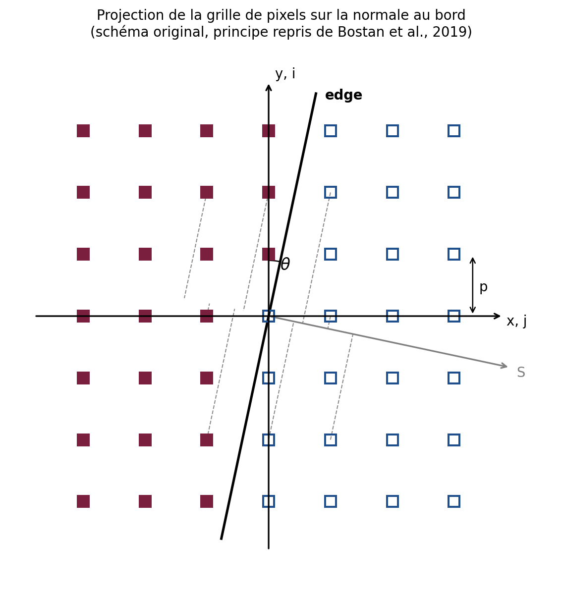

# MTF par bord incliné

Module `eoqual.measure.mtf.slanted_edge`.

Estimation de l'orientation et de la MTF (Modulation Transfer Function)
d'un système d'imagerie à partir d'une mire à bord incliné, avec
plusieurs algorithmes indépendants comparables entre eux à chaque
étape.

**Statut** : opérationnel, validé sur cas synthétiques (bords propres,
bruités, angles variés, PSF gaussienne connue). À valider par
simulation plus poussée avant un usage métrologique de production.

---

## Contexte et objectifs

Ce pipeline est une brique logicielle d'estimation de la FTM par la
méthode du bord incliné, **fortement modulaire**, permettant de remplacer aisément une
implémentation élémentaire par une autre (détection de bord,
construction d'ESF, calcul de MTF) ou de laisser le choix à
l'utilisateur — c'est exactement le principe directeur de
l'architecture décrit en §2.1 (template method + comparateur), qui
permet à `EdgeOrientationComparator`/`MTFComparator` d'exécuter et de
comparer plusieurs implémentations interchangeables sur la même donnée.

Les études de sensibilité (angle, bruit, comparaison des algorithmes)
disposent d'un harnais (§8.12). L'exploitation de bords naturels sur
cibles urbaines, plutôt que de mires dédiées, reste une piste (§12).

---

## Sommaire

1. [Fondements théoriques](#1-fondements-théoriques)
2. [Architecture logicielle](#2-architecture-logicielle)
3. [Module d'orientation](#3-module-dorientation)
4. [Module de MTF](#4-module-de-mtf)
5. [Support Bayer](#5-support-bayer)
6. [Visualisation](#6-visualisation)
7. [Orchestration (`cli.py`)](#7-orchestration-clipy)
8. [Guide d'utilisation](#8-guide-dutilisation)
9. [Choix de conception et pièges évités](#9-choix-de-conception-et-pièges-évités)
10. [Bibliographie](#10-bibliographie)
11. [Annexe — formulaire de référence](#11-annexe--formulaire-de-référence)
12. [Pistes](#12-pistes)

---

## 1. Fondements théoriques

### 1.1 Principe de la méthode du bord incliné

Un objectif/capteur dégrade une scène idéale par sa **PSF** (Point
Spread Function). Pour un bord noir/blanc parfait (marche de Heaviside)
observé à travers ce système, l'image obtenue est l'**ESF** (Edge
Spread Function) : la convolution de la marche par la PSF, intégrée
selon la direction du bord.

La **LSF** (Line Spread Function) est la dérivée de l'ESF selon la
direction perpendiculaire au bord :

$$
\text{LSF}(x) = \frac{d}{dx}\text{ESF}(x)
$$

La **MTF** est le module de la transformée de Fourier de la LSF,
normalisée à 1 en fréquence nulle :

$$
\text{MTF}(f) = \frac{|\mathcal{F}[\text{LSF}](f)|}{|\mathcal{F}[\text{LSF}](0)|}
$$

**Pourquoi incliner le bord ?** Un bord parfaitement vertical n'est
échantillonné qu'à la résolution native du capteur (1 échantillon par
pixel et par ligne). En inclinant le bord d'un petit angle θ, chaque
ligne de l'image voit le bord à une position sous-pixel légèrement
différente de la précédente. En recombinant toutes les lignes, on
reconstruit un profil d'ESF **sur-échantillonné**, à une résolution
effective de `1/sin(θ)` échantillons par pixel — c'est tout l'intérêt
de la méthode, normalisée par la méthode "edge SFR" de l'ISO 12233
[[ISO12233]](#10-bibliographie) et popularisée dans son usage pratique
par Burns [[Burns2000]](#10-bibliographie).

### 1.2 Le problème de périodicité de la FFT

Un point central, à l'origine de plusieurs choix d'implémentation de ce
pipeline : une ligne de bord brute est un **échelon**, pas un signal
périodique. La FFT traite pourtant implicitement tout signal comme
périodique — elle recolle silencieusement la fin du signal à son début,
créant une **discontinuité artificielle** à la jointure. Le spectre
d'un échelon périodisé de cette façon contient donc des harmoniques
paires *et* impaires, sans que les paires aient de raison d'être
négligeables.

Un vrai **créneau à 50 % de rapport cyclique**, en revanche, vérifie la
symétrie demi-onde :

$$
f(x + T/2) = -f(x)
$$

Le développement en série de Fourier d'un signal à symétrie demi-onde
n'a, par construction, **que des harmoniques impaires** :

$$
a_{2m} = b_{2m} = 0 \quad \forall m
$$

Deux stratégies, toutes deux implémentées dans ce pipeline, permettent
d'exploiter cette propriété :

- **Mirroring** (`orientation/fourier.py`, `estimators/spatial.py`,
  `estimators/spectral.py`) : construire explicitement un signal à symétrie
  demi-onde en concaténant le profil avec une transformation
  photométrique miroir (`distance_to_white`, `distance_to_black`), de
  largeur double de l'original. La FFT de ce signal double n'a alors
  d'énergie significative que sur les harmoniques impaires — le rapport
  énergie-impaire/énergie-paire devient une métrique de qualité directe
  de cette hypothèse.
- **Fenêtrage** (`estimators/spectral_correlation.py`) : atténuer le signal
  vers 0 à ses extrémités (fenêtre de Hanning) avant la FFT, ce qui
  supprime la discontinuité de périodisation sans construire de
  représentation doublée. Plus léger, mais utilise moins de données par
  construction (pas de doublement) et ne bénéficie pas de la garantie
  stricte "harmoniques paires nulles".

### 1.3 Correction d'angle

Le bord étant incliné d'un angle θ, la fréquence mesurée le long des
lignes de balayage est **compressée** par rapport à la fréquence réelle
perpendiculaire au bord (direction physiquement pertinente pour la MTF
d'un capteur). La convention ISO 12233, suivie uniformément dans tout
ce pipeline, est de corriger l'axe des **fréquences**, pas l'amplitude
de la MTF :

$$
f_{\text{corrigée}} = \frac{f_{\text{mesurée}}}{\cos\theta}
$$

C'est le champ `frequency_corrected` de `MTFResult`, distinct de
`frequency` (brute). Appliquer cette correction sur la MTF elle-même
(`mtf /= cos(θ)`), comme on le voit parfois, n'est pas la même
opération mathématiquement ; ce pipeline n'adopte pas cette convention
(voir §9.9).

### 1.4 Théorème du décalage (shift theorem)

Utilisé abondamment pour l'estimation de pente et le calcul de MTF
spectral : décaler un signal de `d` échantillons multiplie son k-ième
coefficient de Fourier par un facteur de phase pure :

$$
\mathcal{F}[f(x-d)](k) = \mathcal{F}[f(x)](k) \cdot e^{-2\pi i k d / N}
$$

Deux lignes du bord, séparées de `Δy` lignes, sont (approximativement)
la même ESF décalée de `dx·Δy` colonnes, où `dx` est la pente
(colonnes/ligne). La différence de phase mesurée entre leurs spectres,
à une fréquence donnée, donne directement une estimation de `dx` :

$$
dx = -\frac{\Delta\varphi_k \cdot N}{2\pi \cdot k \cdot \Delta y}
$$

C'est le cœur de `fourier_utils.estimate_slope_multiharmonic` (moyenné
sur plusieurs harmoniques basses et plusieurs paires de lignes) et de
`SpectralCorrelationMTFEstimator` (corrélation de phase fréquence par
fréquence).

### 1.5 Correction d'ouverture pixel (sinc)

Le photosite du capteur intègre la lumière sur toute sa surface — il se
comporte comme un filtre passe-bas de réponse
[[Boreman2001]](#10-bibliographie) :

$$
\text{MTF}_{\text{pixel}}(f) = \left|\frac{\sin(\pi f \cdot p)}{\pi f \cdot p}\right| = |\text{sinc}(f \cdot p)|
$$

où `p` est le pas physique du pixel (`pixel_pitch`). Ce terme fait
partie de la **MTF du système** avant échantillonnage, celle que mesure un
bord incliné et que tous les estimateurs renvoient par défaut. Diviser la
MTF mesurée par ce terme (`MTFCorrections.pixel_aperture`) déconvolue
l'intégration sur le pixel et isole la MTF de l'optique seule : c'est une
option de `EsfLsfMTFEstimator` (`remove_pixel_aperture=True`), pour l'usage
de laboratoire où l'on caractérise un objectif indépendamment du capteur
(§9.13).

### 1.6 Biais de dérivation numérique

Une dérivée par différences centrées (`np.gradient`, pas `Δx`) n'a pas
la réponse en fréquence idéale `H_{\text{idéal}}(f) = 2\pi i f` d'une
dérivation exacte, mais :

$$
H(f) = \frac{\sin(2\pi f \Delta x)}{\Delta x}
\quad\Longrightarrow\quad
\frac{H(f)}{H_{\text{idéal}}(f)} = \text{sinc}(2f\Delta x)
$$

Diviser par ce facteur (`MTFCorrections.derivative`) corrige ce biais —
**uniquement pertinent** quand la LSF vient effectivement d'une
dérivation numérique (voir §9.6).

---

## 2. Architecture logicielle

### 2.1 Principe directeur : template method + comparateur

Chaque famille d'algorithmes (orientation, MTF) partage :

- une **classe de base abstraite** (`EdgeOrientationDetector`,
  `SlantedEdgeMTFEstimator`) qui prend en charge tout ce qui est commun
  (canonicalisation, conversions de repère, contrat de sortie) et
  délègue le calcul propre à chaque algorithme à une méthode abstraite ;
- un **comparateur** (`EdgeOrientationComparator`, `MTFComparator`) qui
  exécute plusieurs implémentations sur la même entrée et collecte
  leurs résultats dans un dictionnaire, sans jamais interrompre la
  comparaison si l'une échoue (l'erreur est capturée et rapportée dans
  `details["error"]`).

Certaines implémentations (`EsfLsfMTFEstimator`,
`SpectralCorrelationMTFEstimator`) ont une méthodologie de calcul de
pente entièrement différente du socle commun et **surchargent
`estimate()` en entier**, plutôt que de forcer leur logique dans le
canevas partagé — un choix explicite, documenté dans chaque classe.

### 2.2 Graphe de dépendances (fichiers)

```
Couche 0 (aucune dépendance interne)
  preprocess.py   fourier_utils.py   estimators/esf_models.py   (eoqual-core : eoqual.core.bayer, eoqual.core.edge)

Couche 1
  orientation/base.py  →  preprocess.py
  estimators/base.py    →  preprocess.py, fourier_utils.py, orientation/fourier.py

Couche 2
  orientation/gradient.py, orientation/pca.py, orientation/fourier.py
                        →  orientation/base.py (+ fourier_utils.py pour fourier)
  estimators/spatial.py, estimators/spectral.py, estimators/spectral_correlation.py, estimators/esf_lsf.py
                        →  estimators/base.py (+ fourier_utils.py, estimators/esf_models.py)

Couche 3
  visualization.py       →  orientation/base.py, estimators/base.py (types uniquement)
  bootstrap.py        →  estimators/base.py
  chromatic.py →  eoqual.core.bayer, orientation/base.py (types uniquement)

Couche 4
  cli.py               →  tout (dont bootstrap.py, chromatic.py)
  sensitivity.py  →  orientation/base.py, estimators/base.py, preprocess.py
```

Aucun cycle d'import réel (vérifié par analyse statique du graphe AST).
Deux imports différés existent, tous deux nécessaires pour casser un
vrai cycle : dans `EdgeOrientationComparator.__init__` (import de
`gradient_orientation`/`pca_orientation`/`fourier_orientation`) et dans
`MTFComparator.__init__` (import de `spatial_mtf`/`spectral_mtf`/
`estimators/esf_lsf`/`estimators/spectral_correlation`) — ces modules importent tous
la classe de base qu'ils étendent, donc un import de niveau module
créerait un cycle.

### 2.3 Convention de repère

Toute image est ramenée à un **repère canonique** avant traitement
(`SlantedEdgePreprocessor.preprocess`, voir §3.1) : bord proche de la
verticale (balayage ligne par ligne cohérent), région sombre à gauche.
Chaque estimateur travaille dans ce repère puis reconvertit son
résultat (angle, positions) vers le repère de l'image originale avant
de le renvoyer — l'appelant n'a jamais à se soucier de la
transposition/inversion interne.

### 2.4 Convention de fréquence MTF

Toutes les fréquences (`MTFResult.frequency`,
`MTFResult.frequency_corrected`) sont exprimées en **cycles par pixel
physique du capteur**, 0.5 = fréquence de Nyquist. Le paramètre
`pixel_pitch`, commun aux quatre méthodes de MTF (`SlantedEdgeMTFEstimator`,
voir §4.1), convertit la fréquence "brute" (cycles par échantillon du
tableau fourni) vers cette convention physique :

$$
f_{\text{physique}} = f_{\text{brute}} \times \text{pixel\_pitch}
$$

`pixel_pitch = 1.0` (défaut) pour une image en niveaux de gris pleine
résolution ; `pixel_pitch = 0.5` pour un plan Bayer sous-échantillonné
(voir §5). Cette convention uniforme est ce qui rend les quatre
méthodes directement superposables sur un même graphique, quelle que
soit leur résolution native de travail.

---

## 3. Module d'orientation

Estime l'angle d'inclinaison du bord par plusieurs algorithmes
indépendants, chacun produisant en plus de l'angle une **position
sous-pixel du bord par ligne** (`edge_rows`/`edge_columns`) et une
**métrique de qualité testant l'hypothèse propre à l'algorithme** — pas
une métrique arbitraire.

### 3.1 `preprocess.py` — canonicalisation générique

`SlantedEdgePreprocessor.preprocess(image)` :

1. Détecte si le bord est majoritairement horizontal (comparaison de
   l'énergie des gradients de Sobel horizontal/vertical) ; transpose si
   besoin.
2. Détecte le côté sombre (moyenne des `percentile`% de colonnes
   extrêmes) ; retourne l'image horizontalement si besoin.
3. Estime les niveaux noir/blanc de référence par moyenne robuste
   (percentile) des colonnes extrêmes.

Retourne un `PreprocessingResult` (image canonicalisée, niveaux noir/
blanc, indicateurs `was_transposed`/`was_flipped`).

### 3.2 `orientation/base.py` — socle générique

- **`FrameCanonicalizer`** : enveloppe autour du préprocesseur, plus
  les fonctions de conversion angle/positions vers le repère d'origine
  (défait flip puis transpose).
- **`OrientationResult`** : type de résultat commun — `algorithm`,
  `angle_deg` (replié dans [-90°, 90°], convention `atan2(Δligne,
  Δcolonne)`), `is_horizontal`, `was_transposed`/`was_flipped`,
  `edge_rows`/`edge_columns`, `quality_metric_name`/`quality_metric_value`,
  `details`.
- **`EdgeOrientationDetector`** (ABC) : template method. `analyse()`
  canonicalise, appelle `_estimate_canonical()` (abstraite), reconvertit
  le résultat. Fournit aussi des utilitaires partagés : repli d'angle,
  seuillage robuste de magnitude de gradient, régression linéaire
  position-par-ligne → angle.
- **`EdgeOrientationComparator`** : exécute plusieurs détecteurs,
  défaut = `{gradient, pca, fourier}`.

### 3.3 `orientation/gradient.py` — `GradientOrientationDetector`

**Hypothèse testée** : chaque ligne a un maximum local net de
`|d(intensité)/d(colonne)|` au niveau du bord.

**Algorithme** : dérivée par différences centrées de chaque ligne ;
position du maximum de `|gradient|` ; interpolation parabolique à 3
points autour du maximum pour la position sous-pixel ; régression
linéaire des positions sur toutes les lignes → angle.

**Métrique** (`peak_sharpness`) : courbure de la parabole normalisée
par la hauteur du pic — grande pour un maximum net et non ambigu,
petite pour un profil plat ou bruité.

Pas de paramètre constructeur (comportement fixe).

### 3.4 `orientation/pca.py` — `PCAOrientationDetector`

**Hypothèse testée** : les pixels de fort gradient sont alignés sur une
droite fine (le bord).

**Algorithme** :
1. Seuillage robuste (percentile parmi les valeurs non nulles
   uniquement — évite qu'un bord fin sélectionne toute l'image, voir
   §9.1) des pixels de fort gradient (Sobel).
2. **Première passe** : PCA sur le nuage de points brut → angle et
   `eigenvalue_ratio` (métrique, calculée sur ce nuage non filtré pour
   rester un diagnostic honnête des candidats bruts).
3. **RANSAC** : de nombreuses droites candidates tirées de paires de
   points aléatoires ; conservation de celle avec le plus de points à
   l'intérieur de `ransac_tolerance` [[FischlerBolles1981]](#10-bibliographie)
   — nécessaire pour les images bruitées où les points de bruit peuvent
   être majoritaires (voir §9.2).
4. **Seconde passe** : PCA sur les seuls inliers RANSAC → angle final
   (cohérent avec les positions par ligne, voir §9.2) et centroïde pondéré
   par ligne → `edge_rows`/`edge_columns` ("projection").

**Paramètres constructeur** :

| Paramètre | Défaut | Rôle |
|---|---|---|
| `gradient_percentile` | 90.0 | Seuil de sélection des pixels de fort gradient |
| `ransac_tolerance` | 2.0 | Distance perpendiculaire max. (px) pour un inlier |
| `ransac_iterations` | 300 | Nombre de droites candidates testées |
| `canonicalization_percentile` | 10.0 | Transmis au préprocesseur |

### 3.5 `orientation/fourier.py` — `FourierOrientationDetector`

**Hypothèse testée** : la représentation symétrique (mirroring, §1.2)
a une énergie négligeable sur ses harmoniques paires.

**Deux méthodes internes, sélectionnables via `angle_source`** :

- **`"fundamental"`** (défaut) : phase de l'harmonique k=1 de la
  représentation symétrique → position absolue par ligne (calibrée +
  `unwrap` à travers les lignes), puis régression linéaire → angle.
  C'est la seule des deux qui produit des positions par ligne — donc
  toujours calculée, quel que soit `angle_source`, car nécessaire au
  tracé comparatif.
- **`"multiharmonic"`** : différence de phase entre paires de lignes
  glissantes, moyennée sur plusieurs harmoniques impaires basses
  (`fourier_utils.estimate_slope_multiharmonic`) — statistiquement plus
  robuste (plus de données moyennées) mais ne donne qu'un angle global.

**Métrique** (`odd_even_ratio`) : rapport de l'énergie des harmoniques
impaires sur celle des paires — test direct de l'hypothèse de symétrie
demi-onde.

**Paramètres constructeur** :

| Paramètre | Défaut | Rôle |
|---|---|---|
| `canonicalization_percentile` | 10.0 | Transmis au préprocesseur |
| `angle_source` | `"fundamental"` | `"fundamental"` ou `"multiharmonic"` |
| `low_freq_ratio` | 0.2 | Fraction des harmoniques basses (mode multiharmonic) |
| `block_gap` | 2 | Écart en lignes entre paires comparées (mode multiharmonic) |

### 3.6 `fourier_utils.py` — utilitaires partagés

- `reference_spectrum(size)` : spectre analytique d'un échelon idéal
  aux harmoniques impaires, `(-1)^{1+k}/((1+2k)\pi)`.
- `estimate_slope_multiharmonic(rect, low_freq_ratio, block_gap)` :
  implémentation partagée par `FourierOrientationDetector` (mode
  multiharmonic) et `SlantedEdgeMTFEstimator` (socle commun spatial/
  spectral) — évite la duplication de cette logique entre estimation
  d'angle et estimation de MTF.

---

## 4. Module de MTF

Quatre méthodes indépendantes, comparables via `MTFComparator`, toutes
produisant un `MTFResult` (`method`, `mtf`, `frequency`,
`frequency_corrected`, `dx`, `theta_rad`, `oversample_factor`,
`details`).

### 4.1 `estimators/base.py` — socle générique

- **`SlantedEdgeMTFEstimator`** (ABC) : template method partagé par
  `SpatialMTFEstimator`/`SpectralMTFEstimator` (les deux méthodes qui
  utilisent la représentation symétrique + `estimate_slope_multiharmonic`).
  `estimate(frame, oversample_factor)` : construit la représentation
  symétrique (délègue à `FourierOrientationDetector._build_symmetric_representation`),
  estime `(dx, theta)`, appelle `_compute_mtf()` (abstraite), applique
  `pixel_pitch` puis la correction d'angle sur la fréquence.
- **`MTFComparator`** : défaut = `{spatial, spectral, esf_lsf,
  spectral_correlation}`.

**Paramètres de la classe de base** (hérités par toutes les méthodes) :

| Paramètre | Défaut | Rôle |
|---|---|---|
| `low_freq_ratio` | 0.2 | Utilisé par spatial/spectral (estimation de pente partagée) |
| `block_gap` | 2 | Idem |
| `pixel_pitch` | 1.0 | Conversion cycles/échantillon → cycles/pixel physique (§2.4) — commun aux 4 méthodes |

### 4.2 `estimators/spatial.py` — `SpatialMTFEstimator`

**Principe** : dé-interlacement spatial. Chaque pixel de la
représentation symétrique est replacé selon sa position "effective" le
long du bord (`interlace_1d`, tenant compte du décalage `dx`), les
points sont triés puis interpolés sur une grille régulière et
anti-symétrisés (`regularise_signal`, force l'anti-symétrie attendue
d'un bord idéal). FFT du signal 1D résultant, divisée par le spectre
analytique de référence.

**Avantage** : un seul signal très sur-échantillonné (autant de points
que de pixels dans la ROI) → bon rapport signal/bruit sur la forme du
bord. **Inconvénient** : sensible à la qualité de l'interpolation,
suppose `dx` parfaitement linéaire sur toute la hauteur de la ROI.

Pas de paramètre propre au-delà de ceux hérités de la classe de base.

### 4.3 `estimators/spectral.py` — `SpectralMTFEstimator`

**Principe** : résolution d'un système linéaire par moindres carrés,
fréquence par fréquence, combinant 1, 2 ou 4 répliques spectrales
(selon `oversample_factor`) pondérées par le spectre de référence
analytique — permet de reconstruire la MTF au-delà de Nyquist en
dés-aliasant les répliques.

**Avantage** : exploite directement la redondance entre toutes les
lignes pour chaque fréquence, sans interpolation spatiale.
**Inconvénient** : plus coûteux (une résolution par fréquence).

Pas de paramètre propre au-delà de ceux hérités.

### 4.4 `estimators/esf_lsf.py` + `estimators/esf_models.py` — `EsfLsfMTFEstimator`

Méthodologie entièrement différente de spatial/spectral : détection de
bord ligne par ligne (pas de mirroring), construction d'ESF par
projection géométrique, LSF selon un modèle choisi indépendamment.
Surcharge `estimate()` en entier.

**Étapes découplées** :

1. **`ParametricEdgeDetector`** (`mode`) : localise le bord de chaque
   ligne — `"sigmoid"` (fit sur l'intensité) ou `"gaussian"` (fit sur le
   gradient).
2. **`GeometricESFBuilder`** : régression linéaire (angle affiné) ;
   projection de chaque pixel sur la **normale au bord** (référence
   **fixe** = droite ajustée évaluée à la ligne centrale, pas la
   position bruitée par ligne — voir §9.4) — le même principe que la
   méthode de Kohm [[Kohm2004]](#10-bibliographie) (projection des
   coordonnées de pixel sur la normale à l'arête, utilisée pour la MTF
   embarquée d'OrbView-3) ; moyenne par bin avec rejet
   des bins peu peuplés (`esf_min_samples_per_bin`) ; lissage
   Savitzky-Golay optionnel (`esf_smoothing`, désactivé par défaut, voir
   §9.5). Construite **une seule fois**, indépendamment du modèle de fit
   choisi ensuite.

   

   *Schéma original (pas une reproduction) illustrant le principe de
   projection : chaque pixel de coordonnées `(x, y)` est projeté sur
   l'axe `S`, perpendiculaire au bord d'angle θ — c'est cette
   projection que calcule `GeometricESFBuilder` (formule au §9.4).
   Principe repris de Bostan et al.
   [[Bostan2019]](#10-bibliographie), qui en donne une version plus
   complète (avec construction de l'ESF sous-jacente).*
3. **Modèle de fit ESF → LSF** (`esf_model`, `ESF_FIT_MODELS`) :
   - `"numeric"` : dérivation numérique directe (`MTFComputer.compute_lsf`,
     voir options ci-dessous, dont un mode de dérivation par filtre de
     Savitzky-Golay [[SavitzkyGolay1964]](#10-bibliographie)).
   - `"sigmoid"` : fit d'une sigmoïde (`estimators.esf_models.sigmoid`), dérivée
     analytique. **Mise en garde** : biais de forme aux hautes
     fréquences si la vraie PSF n'est pas tanh-shaped (voir §9.6) — pas le
     défaut pour cette raison.
   - `"pchip"` (**défaut**) : interpolation spline cubique monotone
     [[FritschCarlson1980]](#10-bibliographie), aucune forme imposée,
     recentrage sous-pixel par rampe de phase FFT.
   - `"tikhonov"` : régularisation de Tikhonov d'ordre 2 (pénalisation
     de courbure) pondérée par la précision de chaque bin de l'ESF
     (`ESFData.bin_count`), avec sélection automatique du paramètre de
     régularisation λ par courbe en L -- inspiré de
     [[Xie2018]](#10-bibliographie), qui pose le problème comme une
     estimation d'ESF mal posée face au bruit. **Fidélité** : l'article
     original n'étant pas accessible (payant), c'est une formulation de
     Tikhonov standard (équivalente à un smoothing spline /
     Whittaker-Henderson) construite pour répondre au même problème
     avec les mêmes ingrédients qu'ils décrivent (régularisation,
     poids de précision, courbe en L) -- pas un portage de leurs
     équations exactes. La sélection de λ lisse (Savitzky-Golay) les
     courbes log-résidu/log-rugosité avant d'en calculer la courbure, et
     teste une grille densifiée à 80 valeurs (voir §9.11, dont la
     limite résiduelle non résolue). Voir
     `fit_esf_tikhonov` pour la formulation complète.

   **Note sur la fonction de Fermi** : une fonction de Fermi-Dirac
   (`1/(1+e^{-(x-x_0)/T})`) est mathématiquement la même famille que
   `"sigmoid"` (tanh) à reparamétrisation près --
   `\tanh(z) = 2\cdot\text{Fermi}(2z) - 1` -- donc leurs dérivées (LSF)
   sont proportionnelles. L'ajuster donnerait la même MTF (vérifié
   numériquement : écart < 1e-4, de l'ordre du bruit d'ajustement) et
   hériterait du même biais de forme que `"sigmoid"` (voir ci-dessus) :
   pas ajoutée comme option séparée pour cette raison.
4. **`compute_fwhm`** / **`compute_rer`** : deux résumés scalaires
   indépendants de la MTF, exposés dans `details["fwhm"]`/`details["rer"]`.
   - `compute_fwhm` : largeur à mi-hauteur de la LSF.
   - `compute_rer` (RER, Relative Edge Response) :
     `ESF(centre+0.5) - ESF(centre-0.5)`, sur l'ESF normalisée [0,1] --
     un des trois paramètres de la GIQE (General Image Quality
     Equation) utilisée pour prédire le NIIRS en télédétection
     [[Harrington2015]](#10-bibliographie). Calcul direct sur l'ESF,
     sans FFT ni fenêtrage -- insensible aux artefacts de troncature et
     de fenêtrage (voir §9.7 et §9.8). Calculé sur l'ESF partagée
     (`GeometricESFBuilder`), donc valable quel que soit `esf_model`.
5. **Corrections** : `MTFCorrections.derivative` (biais `np.gradient`,
   **uniquement si `esf_model="numeric"`**, voir §9.6) puis
   `MTFCorrections.pixel_aperture` (aperture pixel), **seulement si
   `remove_pixel_aperture=True`** : par défaut, MTF du système (§1.5,
   §9.13).

**Paramètres constructeur** :

| Paramètre | Défaut | Rôle |
|---|---|---|
| `mode` | `"sigmoid"` | Localisation du bord par ligne (`ParametricEdgeDetector`) |
| `esf_model` | `"pchip"` | Modèle ESF→LSF : `"numeric"`, `"sigmoid"`, `"pchip"` |
| `pixel_pitch` | 1.0 | §2.4 |
| `remove_pixel_aperture` | `False` | Retire la MTF du pixel (MTF de l'optique seule), §1.5 |
| `fit_window` | 5 | Demi-largeur de fenêtre du détecteur de bord |
| `esf_half_width` | 20.0 | Demi-largeur (px) de la bande d'ESF |
| `esf_oversample` | 5 | Échantillons d'ESF par pixel capteur, ou `"auto"` (§9.14) |
| `esf_binning_mode` | `"omni"` | `"omni"` (bin fixe) ou `"iso_cos"` (bin ×cos(θ), §9.14) |
| `outlier_threshold` | 5.0 | Rejet des lignes déviant de la médiane (px) |
| `esf_min_samples_per_bin` | 5 | Rejet des bins d'ESF peu peuplés |
| `esf_smoothing` | `False` | Lissage Savitzky-Golay de l'ESF |
| `lsf_points` | 1000 | Résolution de grille LSF (`"sigmoid"`/`"pchip"`) |
| `lsf_derivative_method` | `"gradient"` | `"gradient"` ou `"savgol_deriv"` (`"numeric"` seul.) |
| `lsf_filter_type` | `"tukey"` | `"tukey"`, `"savgol"`, `"gaussian"`, `"none"` (`"numeric"` seul.) |
| `lsf_window_length` | 15 | Longueur de fenêtre Savitzky-Golay/gaussienne |
| `lsf_polyorder` | 3 | Ordre du polynôme Savitzky-Golay |
| `lsf_tukey_alpha` | 0.15 | Paramètre α de la fenêtre de Tukey |
| `tikhonov_lambda` | `"auto"` | λ de régularisation (`esf_model="tikhonov"`), ou valeur fixée |
| `tikhonov_lambda_grid` | 80 valeurs, [1e-6, 1e3] | Grille de λ testée si `"auto"` (§9.11) |

### 4.5 `estimators/spectral_correlation.py` — `SpectralCorrelationMTFEstimator`

**Principe** : corrélation de phase à une composante, fréquence par
fréquence, sans représentation symétrique ni spectre de référence.
Pour chaque fréquence `f_k`, projection (moindres carrés à une
composante) du spectre mesuré de chaque ligne sur la rampe de phase
théorique `exp(-2πi f_k · décalage_ligne)` — récupère directement
l'amplitude complexe du système à cette fréquence.

**Estimation de pente propre** (pas `estimate_slope_multiharmonic`) :
fenêtre de Hanning sur chaque ligne avant FFT (réponse alternative au
problème de non-périodicité, §1.2), paires de lignes **non
chevauchantes**.

**Deux pièges de la forme naïve évités** (voir §9.7 et §9.8 pour le détail
des validations numériques) :
1. LSF calculée par différenciation de chaque ligne avant corrélation
   (corréler le spectre du bord brut, non différencié, sous-estime la
   MTF d'un facteur ~30).
2. Fenêtrage Hanning de la LSF avant FFT (anti-dépassement MTF > 1).

**Limite assumée** : pas de dés-aliasing au-delà de Nyquist ;
`oversample_factor` accepté pour l'interface mais sans effet.

**Paramètres constructeur** :

| Paramètre | Défaut | Rôle |
|---|---|---|
| `apply_hanning` | `True` | Fenêtrage Hanning pour l'estimation de pente |
| `line_spacing` | 2 | Écart entre paires de lignes (pente) |
| `low_frequency_ratio` | 0.2 | Fraction des fréquences basses (pente) |
| `pixel_pitch` | 1.0 | §2.4 |

---

## 5. Support Bayer

**`eoqual.core.bayer`** (eoqual-core) : `extract_bayer_planes(image, pattern)` sépare une
mosaïque RAW 2D en plans `R`, `G1`, `G2`, `B`, `G` (moyenne G1/G2), pour les
motifs `RGGB` (défaut), `BGGR`, `GRBG` et `GBRG` (CLI : `--bayer-pattern`).
Exemple, motif `RGGB` :

```
R  G1
G2 B
```

Chaque plan a une résolution moitié dans chaque dimension. Traité par
le pipeline exactement comme une image en niveaux de gris, à condition
de régler `pixel_pitch = BAYER_SAMPLING_FACTOR = 0.5` sur les quatre
estimateurs de MTF (un échantillon du plan = 2 pixels physiques du
capteur, §2.4) — c'est exactement ce que fait `cli.py` via
`--image-format`.

L'orientation (angle) n'a pas besoin de cette conversion : elle est
sans dimension, chaque plan est traité tel quel.

---

## 6. Visualisation

**`visualization.py`** — `SlantedEdgeVisualizer` (méthodes statiques,
aucun état) :

- `plot_image` : mire brute (heatmap Plotly).
- `print_orientation_summary` / `plot_orientation_comparison` : tableau
  texte + superposition des positions sous-pixel des 3 algorithmes
  d'orientation sur l'image.
- `print_mtf_summary` / `plot_mtf_comparison` : tableau texte (angle,
  `dx`, MTF échantillonnée à quelques fréquences) + courbes MTF
  superposées, avec repères verticaux fₑ/4 et fₑ/2, légende ancrée en
  haut à droite du tracé.
- `plot_esf_lsf` : ESF et LSF côte à côte (deux sous-graphiques), pour
  un `MTFResult` qui les expose dans `details` -- seuls les
  estimateurs `esf_lsf_*` le font (`spatial`/`spectral`/
  `spectral_correlation` ne construisent pas d'ESF explicite, voir §4).
  Lève une erreur claire si appelée sur un résultat qui n'en a pas,
  plutôt que d'échouer silencieusement.

Toutes les figures sont des fichiers HTML Plotly autonomes (interactifs
— zoom, survol).

**`bootstrap.py`** — intervalles de confiance sur une courbe de MTF
par ré-échantillonnage des lignes de la ROI (bootstrap), indépendant du
harnais de sensibilité (§8.12) : celui-ci répond à "quel est le
biais systématique d'une méthode sur de nombreuses images de vérité
connue ?", `bootstrap.py` répond à "quelle confiance accorder à
*cette* mesure, sur *cette* image ?" -- utile en usage normal, une seule
image réelle, sans vérité terrain. `bootstrap_mtf(estimator, frame,
n_bootstrap=30, ...)` fonctionne avec n'importe lequel des quatre
estimateurs de MTF (même interface `estimate(frame, oversample_factor)`
pour tous, aucun cas particulier nécessaire) ; `plot_bootstrap_mtf`
trace la moyenne ± intervalle de confiance (bande remplie), une courbe
par méthode.

Chaque ligne de la ROI est traitée comme une mesure indépendante et
bruitée du même bord (exactement l'hypothèse sur laquelle repose la
méthode elle-même), ré-échantillonnée avec remise à chaque tirage.
Attention au coût avec `esf_model="tikhonov"` (déjà coûteux par
construction, voir §4.4) : réduire `n_bootstrap` en conséquence.

**`chromatic.py`** — décalage sous-pixel latéral entre plans
Bayer (aberration chromatique), à partir de `OrientationResult` déjà
calculés indépendamment sur chaque plan (aucun nouveau calcul
d'orientation). Chaque plan étant sous-échantillonné à une position
différente de la grille pleine résolution (`eoqual.core.bayer.bayer_offsets("RGGB")`),
`compute_chromatic_shifts` ramène la droite de bord de chaque plan dans
ce repère commun (la pente reste inchangée par ce changement d'échelle
uniforme ; seule l'ordonnée à l'origine se décale) et calcule l'écart
entre plans à une ligne de référence commune. Le plan `"G"` (moyenne de
G1 et G2, voir `eoqual.core.bayer.extract_bayer_planes`) a un décalage de grille
**approximatif** (`(0.5, 0.5)`, la moyenne des deux positions
physiques réelles de G1 et G2) -- utiliser `"G1"`/`"G2"` directement
pour une position exacte. Branché dans `cli.py` (`process_zone`) :
calculé automatiquement pour toute zone Bayer à plusieurs plans, avec
le même algorithme d'orientation sur chacun (`--chromatic-algorithm`,
défaut `"fourier"` -- mélanger des algorithmes différents entre plans
introduirait un biais propre à chacun dans la mesure, pas seulement
l'aberration chromatique elle-même).

**Validation** : décalage chromatique latéral injecté artificiellement
dans une mosaïque Bayer synthétique (R décalé de +0.6 px, B de -0.3 px
par rapport à G) et retrouvé à mieux que 0.002 px près par
`compute_chromatic_shifts`, à la fois en test unitaire et via `cli.py`
de bout en bout.

---

## 7. Orchestration (`cli.py`)

Ne contient aucun calcul ni tracé — uniquement l'enchaînement :

```
main()
 └─ pour chaque (image, zone_label) :
     process_zone()
      ├─ load_image()            # gray ou mosaïque Bayer brute
      ├─ get_analysis_planes()   # 1 plan (gray) ou 1-3 plans (Bayer)
      └─ pour chaque plan :
          process_plane()
           ├─ EdgeOrientationComparator → affichage + tracé
           └─ MTFComparator (pixel_pitch = sampling_factor du plan)
                                  → affichage + collecte pour tracé combiné
 └─ tracé MTF combiné, toutes zones/plans/méthodes confondus
```

Une **zone** = une image (un fichier). Un **plan** = une sous-image
(toujours 1 pour `gray`, jusqu'à 3 pour `bayer`).

---

## 8. Guide d'utilisation

### 8.1 Installation / dépendances

Socle : `numpy`, `scipy`, `opencv-python` (`cv2`), `imageio`, `rich`
(voir `pyproject.toml`). Extra `plot` (`plotly`) pour `visualization.py`,
`bootstrap.plot_bootstrap_mtf`, `SyntheticSlantedEdge.plot` et la CLI ;
extra `study` (`pandas` + `plotly`) pour `sensitivity.py`.

### 8.2 Usage en ligne de commande

```bash
eoqual-measure-mtf mire.png
eoqual-measure-mtf mire_H0.png mire_H1.png mire_V0.png --zone-labels H0 H1 V0
eoqual-measure-mtf mire_raw.tiff --image-format bayer --bayer-pattern GRBG
eoqual-measure-mtf mire.png --oversample-factor 2 --fourier-angle-source multiharmonic
```

### 8.3 Paramètres CLI — positionnels

| Argument | Rôle |
|---|---|
| `images` | Un ou plusieurs chemins d'image, un par zone |

### 8.4 Paramètres CLI — généraux

| Option | Défaut | Rôle |
|---|---|---|
| `--zone-labels` | noms de fichiers | Un label par image |
| `--image-format` | `gray` | `gray`, `bayer`, `bayer-r`, `bayer-g`, `bayer-b` (`rggb*` : alias) |
| `--bayer-pattern` | `RGGB` | `RGGB`, `BGGR`, `GRBG`, `GBRG` (formats `bayer*`) |
| `--show-mire` | désactivé | Trace aussi la mire brute de chaque plan |
| `--no-plot` | désactivé | Ne produit aucun graphique (texte seul) |

### 8.5 Paramètres CLI — orientation

| Option | Défaut | Rôle |
|---|---|---|
| `--gradient-percentile` | 90.0 | Seuil de sélection des pixels de fort gradient (Gradient, PCA) |
| `--canonicalization-percentile` | 10.0 | Percentile pour l'estimation des niveaux noir/blanc |
| `--fourier-angle-source` | `fundamental` | `fundamental` ou `multiharmonic` (Fourier) |
| `--fourier-low-freq-ratio` | 0.2 | Fraction des harmoniques basses (Fourier, mode multiharmonic) |
| `--fourier-block-gap` | 2 | Écart en lignes entre paires (Fourier, mode multiharmonic) |

### 8.6 Paramètres CLI — MTF, communs

| Option | Défaut | Rôle |
|---|---|---|
| `--oversample-factor` | 4 | 1, 2 ou 4 — facteur de sur-échantillonnage (spatial/spectral) |
| `--mtf-low-freq-ratio` | 0.2 | Fraction des harmoniques basses pour l'estimation de pente (spatial/spectral) |
| `--mtf-block-gap` | 2 | Écart en lignes entre paires (spatial/spectral) |
| `--no-angle-correction` | désactivé | Rapporte/trace la MTF selon la fréquence brute, pas corrigée par cos(θ) |

### 8.7 Paramètres CLI — ESF/LSF

| Option | Défaut | Rôle |
|---|---|---|
| `--esf-lsf-mode` | `sigmoid` | Localisation du bord par ligne : `sigmoid` ou `gaussian` |
| `--esf-lsf-esf-model` | `pchip` | Modèle ESF→LSF : `numeric`, `sigmoid`, `pchip` |
| `--esf-lsf-derivative-method` | `gradient` | `gradient` ou `savgol_deriv` (si `esf_model=numeric`) |
| `--esf-lsf-filter-type` | `tukey` | `tukey`, `savgol`, `gaussian`, `none` (si `esf_model=numeric`) |
| `--esf-lsf-window-length` | 15 | Longueur de fenêtre Savitzky-Golay/gaussienne |
| `--esf-lsf-polyorder` | 3 | Ordre du polynôme Savitzky-Golay |

### 8.8 Paramètres CLI — corrélation spectrale

| Option | Défaut | Rôle |
|---|---|---|
| `--no-spectral-correlation-hanning` | désactivé | Désactive le fenêtrage Hanning de l'estimation de pente |
| `--spectral-correlation-line-spacing` | 2 | Écart entre paires de lignes non chevauchantes |
| `--spectral-correlation-low-freq-ratio` | 0.2 | Fraction des fréquences basses pour l'estimation de pente |

### 8.9 Utilisation programmatique (sans CLI)

```python
import imageio.v2 as imageio
from eoqual.measure.mtf.slanted_edge import (
    EdgeOrientationComparator,
    MTFComparator,
    SlantedEdgePreprocessor,
)

image = imageio.imread("mire.png").astype(float)

# Orientation
orientation_results = EdgeOrientationComparator().compare(image)
for name, result in orientation_results.items():
    print(name, result.angle_deg, result.quality_metric_value)

# MTF
frame = SlantedEdgePreprocessor().preprocess(image)
mtf_results = MTFComparator().compare(frame, oversample_factor=4)
for name, result in mtf_results.items():
    print(name, result.value_at(0.25))  # MTF interpolée à f=0.25 c/px

# Raccourci : un estimateur, un résultat
from eoqual.measure import measure_mtf
res = measure_mtf(image, "esf_lsf", esf_model="tikhonov")
res.value_at(0.5), res.frequency_at(0.5)   # MTF@Nyquist, MTF50
```

### 8.10 Interprétation des métriques de qualité (orientation)

| Algorithme | Métrique | Signification |
|---|---|---|
| Gradient | `peak_sharpness` | Grand = maximum de gradient net et net par ligne |
| PCA | `eigenvalue_ratio` | Grand = points bien alignés sur une droite fine |
| Fourier | `odd_even_ratio` | Grand = symétrie demi-onde bien vérifiée |

Une valeur faible signale que l'hypothèse propre à l'algorithme est
mise à mal (bruit, mauvais cadrage, bord non net) — comparer aux autres
algorithmes plutôt que de se fier à un seul.

### 8.11 Interprétation du tracé MTF

Toutes les courbes doivent être lues jusqu'à la fréquence où la vraie
MTF s'approche de 0 (souvent 0.25–0.35 c/px selon la netteté du
système) : au-delà, la courbe reflète le **plancher de bruit** de la
mesure, pas un signal réel — une oscillation aléatoire proche de 0 y
est normale et attendue, quelle que soit la méthode (voir §9.3).

---

### 8.12 Études de sensibilité

Trois études : effet de l'angle, effet du bruit, comparaison des
algorithmes. **L'outillage est branché sur le générateur de mires du
paquet**
(`eoqual/measure/synthetic/slanted_edge.py::SyntheticSlantedEdge`) :

- **`sensitivity.py`** : `SensitivityStudy`, `SensitivityGrid`,
  `plot_sensitivity`, `plot_heatmap` -- le harnais générique (balayage
  angle × bruit, répétitions Monte-Carlo, agrégation biais/écart-type/
  temps/échecs). Le générateur fournit lui-même sa fonction de MTF
  théorique (`edge.mtf_theoretical`), plutôt que de supposer une PSF
  gaussienne fixe : le harnais fonctionne donc aussi pour les PSF
  lorentzienne et pillbox de `SyntheticSlantedEdge`.
- **`examples/mtf_sensitivity_study.py`** : script complet, prêt à l'emploi,
  branché sur `SyntheticSlantedEdge` (`python examples/mtf_sensitivity_study.py
  --quick` pour un essai rapide, sans arguments pour la grille complète
  -- 11 angles × 6 niveaux de bruit × 10 répétitions par défaut).

Effets couverts :
- **Effet de l'angle du bord** et **effet du bruit** sur la précision
  de l'angle et de la MTF estimés, avec répétitions Monte-Carlo par
  point pour séparer biais systématique (moyenne de l'erreur vs vérité
  terrain connue) et sensibilité au bruit (écart-type).
- **Comparaison des algorithmes d'estimation d'angle et de MTF** :
  temps de calcul et taux d'échec chronométrés/capturés pour chaque
  essai en plus de l'erreur. La comparaison de complexité (nombre de
  paramètres, lignes de code) reste qualitative, à documenter
  séparément.

Deux points de vigilance :
- **Convention d'angle** : `SyntheticSlantedEdge` paramètre le bord par
  son inclinaison depuis une direction de référence
  (`orientation="vertical"` ou `"horizontal"`), pas directement dans la
  convention des estimateurs (`atan2(delta_ligne, delta_colonne)`,
  §3.2). Vérifié empiriquement (voir `examples/mtf_sensitivity_study.py::
  angle_conversion_for`) : `"vertical"` -> `angle_estimé = angle_deg -
  90` (replié) ; `"horizontal"` -> `angle_estimé = -angle_deg`.
  L'oublier donne un "biais" de ~90° qui n'a rien à voir avec la
  précision réelle des estimateurs.
- **Coût de `esf_lsf_tikhonov`** : exclu par défaut de
  `examples/mtf_sensitivity_study.py` (résolution d'un système linéaire par
  valeur de λ testée, 80 par image) -- `--with-tikhonov` pour
  l'inclure, au prix d'un temps de calcul nettement plus élevé sur une
  grande grille.

## 9. Choix de conception et pièges évités

Problèmes de méthode qui expliquent des choix d'implémentation peu
intuitifs au premier abord : ce que fait le pipeline, ce que ferait une
implémentation naïve, et l'effet mesuré.

### 9.1 Seuillage par percentile sur magnitude de gradient

`np.percentile(magnitude, p)` dégénère à 0 dès que plus de `100-p` % des
pixels sont exactement plats (bord fin non flouté) : il sélectionne alors
toute l'image au lieu du seul bord. Le percentile est donc calculé sur les
seules valeurs strictement non nulles
(`EdgeOrientationDetector._robust_threshold`).

### 9.2 Biais PCA sur image bruitée (centroïde par ligne)

Le centroïde pondéré par ligne (PCA) moyenne *tous* les pixels au-dessus
du seuil de gradient. Sur une zone bruitée, le bruit crée plus de pixels
au-dessus du seuil que le vrai bord, ce qui biaise la position de façon
*systématique*, et pas seulement aléatoire. Un filtrage par MAD ne suffit
pas (les aberrants sont majoritaires) : les points sont filtrés par RANSAC
(§3.4). L'angle est ajusté sur les mêmes inliers que les positions, pour
que l'angle et les positions restent cohérents.

### 9.3 Bruit de mesure près de la fréquence de Nyquist

Phénomène **normal** : la MTF vraie décroît vers 0 alors que le bruit de
mesure ne décroît pas au même rythme. Au-delà d'une certaine fréquence, le
rapport signal/bruit de l'estimation se dégrade et la courbe reflète le
plancher de bruit, quelle que soit la méthode.

### 9.4 Projection géométrique de l'ESF (référence fixe)

La distance de chaque pixel au bord est calculée par rapport à une
référence *fixe*, la droite ajustée évaluée à la ligne centrale ; la
position de bord par ligne ne sert qu'à choisir la fenêtre de colonnes.
Utiliser directement la position *par ligne* (bruitée) dans le calcul de
distance ne se simplifie pas correctement (dérivation analytique) et
réinjecte quasiment l'indice de ligne brut dans la distance projetée
(plage observée de ±39 au lieu des ±20 attendus).

La distance point-droite vaut `(col - edge_pos_fit)·cos(θ)`. La
différence brute `col - edge_pos_fit` n'est la projection orthogonale que
pour un angle faible ; au-delà, elle surestime la largeur effective de
l'ESF.

### 9.5 Sur-lissage de l'ESF (Savitzky-Golay)

Le lissage Savitzky-Golay de l'ESF (fenêtre adaptative `min(31, n/5)`)
dégrade nettement la MTF haute fréquence (0,32 → 0,066 à f = 0,25 c/px,
vérifié numériquement). Il est désactivé par défaut
(`esf_smoothing=False`).

### 9.6 Biais de forme du modèle sigmoïde (ESF)

La dérivée d'une sigmoïde (`sech²`) a des queues spectrales qui décroissent
plus lentement que celles d'une PSF gaussienne : la MTF haute fréquence est
surestimée de façon systématique si la vraie PSF n'a pas une forme en tanh,
*même sans bruit* (0,153 contre 0,077 théorique à f = 0,3 c/px, PSF
gaussienne connue, σ = 1,2 px). `pchip`, qui n'impose aucune forme, ne
montre pas ce biais (0,098 dans le même test) : c'est pourquoi c'est le
modèle par défaut.

La correction du biais de dérivation numérique (`MTFCorrections.derivative`,
§1.6) ne s'applique qu'à `esf_model="numeric"` : les dérivées analytiques
(`sigmoid`, `pchip`) n'en ont pas besoin. Un biais de forme ne se corrige
pas non plus par une correction sinc : réintroduire une correction pour
compenser une surestimation aux hautes fréquences masquerait le symptôme
sans traiter sa cause, le modèle.

### 9.7 Fenêtrage de la LSF (corrélation spectrale)

Sur une image bruitée, sans fenêtrage de la LSF avant FFT, la fuite
spectrale déstabilise la corrélation de phase et sa normalisation par la
valeur en f = 0 : la MTF dépasse 1 d'environ 4 %. Le fenêtrage de Hann
ramène ce dépassement sous 0,6 % (5 tirages bruités).

### 9.8 Différenciation avant corrélation (corrélation spectrale)

Corréler le spectre du bord *brut* (ESF, non différencié) plutôt que
celui de la LSF hérite de la décroissance en 1/k du spectre d'un échelon :
la MTF est sous-évaluée d'un facteur 30 environ (vérifié contre une MTF
théorique connue). Chaque ligne est donc différenciée avant corrélation.

### 9.9 Convention de correction d'angle

Diviser la MTF par `cos(angle)`, plutôt que corriger la fréquence, n'est
pas conforme à la convention ISO 12233 suivie dans tout le pipeline
(§1.3).

### 9.10 FWHM : première traversée de part et d'autre du pic

`compute_fwhm` cherche la première traversée du demi-maximum de part et
d'autre du pic, avec interpolation sous-pixel : c'est la définition
standard. Prendre le premier et le dernier point au-dessus du demi-maximum
sur tout le domaine de la LSF rend la mesure sensible à un rebond de bruit
isolé loin du pic : avec `esf_model="tikhonov"` sur un cas très bruité, un
unique point parasite à +21 px du pic donne une FWHM de 22 px au lieu des
2 à 3 px attendus.

Au bruit nul, `"tikhonov"` donne une FWHM de 2,820 px pour 2,826 px
théorique (PSF gaussienne σ = 1,2 px). `"numeric"` et `"pchip"` donnent au
contraire des FWHM anormalement petites (0,3 à 0,4 px) sur le même cas :
leur LSF dérivée brute porte un pic à l'échelle d'un seul bin, non
représentatif de la largeur physique.

### 9.11 Régularisation de Tikhonov et sélection de λ

`esf_model="tikhonov"` (§4.4) reprend le principe de
[[Xie2018]](#10-bibliographie) par une formulation de Tikhonov standard
construite indépendamment. Sur bord synthétique (PSF gaussienne
σ = 1,2 px), il est compétitif avec `"pchip"` et `"numeric"` en MTF à tous
les niveaux de bruit testés, et nettement meilleur sur la FWHM au bruit
nul (§9.10).

`fit_esf_tikhonov` (`tikhonov_lambda="auto"`) sélectionne λ au « coin » de
la courbe en L, repéré par la courbure de `log(résidu pondéré)` en fonction
de `log(rugosité de f)`. Ce calcul dérive *deux fois de suite* une courbe
échantillonnée : c'est une instabilité différente de celle du §1.6 (biais
*systématique* en `sinc` d'une dérivation simple). Une double dérivée
numérique d'une courbe faiblement échantillonnée amplifie la moindre
irrégularité, au point de déplacer le maximum de courbure détecté : sur
40 valeurs de λ, deux bords à angles très proches (−4° et −5°, même PSF,
sans bruit) donnent des λ dans un rapport 24 environ (14 contre 345), et au
premier angle une LSF dentelée de FWHM 0,58 px au lieu de 2,826 px.

La sélection utilise donc une grille densifiée (80 valeurs log-espacées
entre 1e-6 et 1e3) et lisse `log_res`/`log_rough` par Savitzky-Golay
(fenêtre impaire ≤ 11, ordre 3) *avant* de calculer la courbure. Sur le cas
−4°/−5°, le second angle retrouve une FWHM de 2,829 px, mais le premier
reste sous-régularisé (0,58 px) : le lissage stabilise la détection sans la
rendre fiable pour tout angle.

**Limite connue, non résolue.** Quand la courbe en L est lisse, sans
coin net (cas rencontré en pratique, pas rare), la détection par
courbure peut encore sélectionner un λ insuffisant. Vérifié
numériquement : sur des bords synthétiques à angles proches (-1° à
-20°, PSF gaussienne identique), la FWHM récupérée en mode `"auto"`
varie entre ~0.5 et ~2.9 px pour une valeur théorique de 2.826 px — y
compris avec un λ **fixe** (essayé 50.0), certains angles restent mal
régularisés : la fragilité n'est donc pas uniquement une question de
grille ou de lissage de la sélection automatique. Des pistes plus
robustes (critère de discordance de Morozov, validation croisée
généralisée — GCV) n'ont pas été implémentées. **En pratique** : si un
résultat `esf_model="tikhonov"` semble implausible, inspecter
`details["fwhm"]` et essayer plusieurs valeurs fixes de
`tikhonov_lambda` plutôt que de faire confiance à `"auto"` sans
vérification.

### 9.12 Normalisation de la MTF (ESF/LSF)

La MTF de l'estimateur ESF/LSF est normalisée par sa composante continue
(`eoqual.core.edge.lsf_to_mtf`). La normaliser par son maximum sur les
seules fréquences positives revient à la normaliser par sa valeur au
premier bin `1/(N·dx)` : la courbe est alors surestimée de 0,7 à 1,3 % sur
les mires de test, et la dispersion bootstrap est plus forte (la
normalisation par la composante continue la réduit de 25 à 37 %), la
valeur au premier bin étant plus bruitée que le saut de l'ESF. Les
estimateurs spatial, spectral et corrélation spectrale ne sont pas
concernés.

### 9.13 MTF du système ou de l'optique seule (`esf_lsf`)

Les quatre estimateurs renvoient la **MTF du système** avant
échantillonnage, pixel compris (optique × pixel × diffusion × mouvements) :
celle que mesure l'ISO 12233 et que publient les opérateurs. Le retrait du
pixel (`MTFCorrections.pixel_aperture`, §1.5) est une option de `esf_lsf`
(`remove_pixel_aperture=True`, CLI `--esf-lsf-remove-pixel-aperture`), pour
l'usage de laboratoire où l'on caractérise un objectif indépendamment du
capteur. Mélanger les deux conventions dans un comparateur ferait passer
pour une différence de méthode un écart de `1/sinc(f)` : +11 % à
0,25 cycle/pixel, +57 % au Nyquist.

Le simulateur `SyntheticSlantedEdge` intègre par défaut le bord et la PSF
sur le pixel (`pixel_integration=True` : calcul sur une grille
`supersample` fois plus fine, puis moyenne sur chaque pixel), et sa vérité
`mtf_theoretical` inclut `|sinc(f)|`. L'échantillonnage ponctuel
(`pixel_integration=False`) replie les bords fins et fausse la MTF près du
Nyquist : pour un bord fin (σ = 0,6 px), la MTF mesurée au Nyquist double
(0,31 pour 0,17).

**Justesse mesurée** (bord intégré sur le pixel, σ = 0,8 px, 128 × 128, 5°,
bruit 0,002, 12 tirages) :

| `esf_model` | MTF(0,25) mesurée | vérité | écart-type d'une mesure |
|---|---|---|---|
| `numeric` | 0,4058 | 0,4088 | 0,0009 |
| `pchip` | 0,4137 | 0,4088 | 0,0008 |

Restent deux biais de méthode, petits devant le facteur `1/sinc` corrigé
mais supérieurs à l'incertitude statistique : `numeric` sous-estime
d'environ 0,003 (≈ 3 u), `pchip` surestime d'environ 0,005 (≈ 6 u). Sans
bruit et avec σ = 0,6 px, `numeric` donne 0,571 et `pchip` 0,579 pour une
vérité de 0,577 ; `tikhonov` (λ automatique) sous-estime nettement (0,499)
et `sigmoid` surestime au Nyquist (0,160 pour 0,108). Sur le simulateur à
échantillonnage ponctuel, un bord fin (σ = 0,6 px) est replié et la MTF
mesurée au Nyquist double (0,31 pour 0,17) : d'où l'intégration sur le pixel
par défaut.

Tests (`tests/test_mtf.py`) : vérité du simulateur intégré, relation
exacte entre les deux options, et choix entre les hypothèses « système » et
« optique » sur 12 tirages, stable sur les 30 valeurs de
`EOQUAL_TEST_SEED`.

### 9.14 Binning adaptatif à l'angle

[[Wu2022]](#10-bibliographie), qui s'appuie sur le jeu de données de
comparaison de [[ViallefontRobinet2018]](#10-bibliographie), montre
numériquement que deux choix affectent sensiblement la qualité de la MTF
aux moyennes et hautes fréquences :
- la largeur de bin de l'ESF, fixe (`"omni"`) ou réduite par `cos(theta)`
  (`"iso_cos"`, meilleure convergence d'après cette étude) ;
- le suréchantillonnage, fixe ou adaptatif à l'angle mesuré
  (`OSR_optimal = 1/tan(theta)`, borné à [2, 10]).

Les deux sont des options de `GeometricESFBuilder` et `EsfLsfMTFEstimator`
(`binning_mode`, `oversample="auto"`, §4.4) ; `"omni"` et un `oversample`
fixe restent le défaut. Sur bord synthétique (PSF gaussienne σ = 1,2 px,
angles −3° et −15°), `"iso_cos"` réduit légèrement la surestimation de la
MTF aux hautes fréquences par rapport à `"omni"`, dans le sens attendu par
Wu et al., mais l'écart reste modeste : à confirmer sur une gamme d'angles
et de bruits plus large (§8.12).

### 9.15 RER et FWHM, pas d'« overshoot H »

Le "H" de la GIQE
[[Harrington2015]](#10-bibliographie) mesure le ringing introduit par
un filtre de *sharpening* appliqué en traitement sol -- ce n'est pas
une propriété du bord lui-même, mais un artefact de post-traitement.
Ce pipeline ne modélise aucune étape de sharpening ; calculer "H" sur
une image brute non traitée serait trompeur (toujours proche de sa
valeur neutre, sans rapport avec la définition GIQE). Non ajouté pour
cette raison, contrairement à RER et FWHM (§4.4) qui sont eux des
propriétés directes du bord mesuré.

## 10. Bibliographie

Références directement liées aux méthodes implémentées dans ce
pipeline (norme, algorithmes, méthodes numériques) — pas une revue de
littérature exhaustive du domaine MTF.

- **[ISO12233]** ISO 12233:2017, *Photography — Electronic still
  picture imaging — Resolution and spatial frequency responses*,
  International Organization for Standardization, 2017. La norme de
  référence pour la mesure de SFR/MTF par bord incliné ("edge SFR") sur
  laquelle repose l'ensemble de ce pipeline (§1.1, §1.3).

- **[Burns2000]** P. D. Burns, "Slanted-Edge MTF for Digital Camera and
  Scanner Analysis," *Proc. IS&T PICS Conference*, pp. 135–138, 2000.
  Référence pratique classique de la méthode du bord incliné pour
  l'imagerie numérique (algorithme d'entrelacement, dérivation par
  différences finies `[-0.5, 0, 0.5]`, effets du bruit et de la
  longueur d'enregistrement) — la base conceptuelle de
  `estimators/spatial.py`/`estimators/spectral.py` (§4.2, §4.3).

- **[Boreman2001]** G. D. Boreman, *Modulation Transfer Function in
  Optical and Electro-Optical Systems*, SPIE Tutorial Texts in Optical
  Engineering, Vol. TT52, SPIE Press, 2001. Référence générale sur la
  MTF, l'ESF/LSF, et les effets d'échantillonnage/aperture d'un capteur
  (§1.5, correction sinc d'aperture pixel).

- **[FischlerBolles1981]** M. A. Fischler, R. C. Bolles, "Random Sample
  Consensus: A Paradigm for Model Fitting with Applications to Image
  Analysis and Automated Cartography," *Communications of the ACM*,
  24(6), pp. 381–395, 1981. Algorithme RANSAC, utilisé par
  `PCAOrientationDetector` pour rejeter les points de bruit majoritaires
  avant l'ajustement de la droite de bord (§3.4, §9.2).

- **[FritschCarlson1980]** F. N. Fritsch, R. E. Carlson, "Monotone
  Piecewise Cubic Interpolation," *SIAM Journal on Numerical Analysis*,
  17(2), pp. 238–246, 1980. Base de l'interpolation PCHIP
  (`scipy.interpolate.PchipInterpolator`) utilisée par
  `fit_esf_pchip` (§4.4), modèle par défaut de `EsfLsfMTFEstimator`.

- **[SavitzkyGolay1964]** A. Savitzky, M. J. E. Golay, "Smoothing and
  Differentiation of Data by Simplified Least Squares Procedures,"
  *Analytical Chemistry*, 36(8), pp. 1627–1639, 1964. Filtre utilisé en
  option pour le lissage et/ou la dérivation de l'ESF/LSF
  (`lsf_derivative_method="savgol_deriv"`, `lsf_filter_type="savgol"`,
  §4.4) ainsi que pour le lissage optionnel de l'ESF
  (`GeometricESFBuilder`, §4.4, désactivé par défaut — voir §9.5).

- **[Harrington2015]** L. Harrington, D. Blanchard, J. Salacain, S.
  Smith, P. Amanik, "General Image Quality Equation: GIQE Version 5,"
  National Geospatial-Intelligence Agency, Fort Belvoir, VA, USA, Tech.
  Report, 2015. Définit le RER (Relative Edge Response) comme l'un des
  trois paramètres de la GIQE, utilisée en télédétection pour prédire
  le NIIRS — base de `compute_rer` (§4.4).

- **[ViallefontRobinet2018]** F. Viallefont-Robinet, D. Helder, R.
  Fraisse, A. Newbury, F. van den Bergh, D. Lee, S. Saunier,
  "Comparison of MTF measurements using edge method: towards reference
  data set," *Optics Express*, 26(26), pp. 33625–33648, 2018. Étude
  comparative multi-équipes (CNES/ONERA, SDSU, Airbus DS, DigitalGlobe,
  CSIR, KARI, Telespazio) de plusieurs implémentations de la méthode du
  bord incliné sur un même jeu de données de référence — directement
  dans l'esprit de ce pipeline (comparer plusieurs implémentations sur
  la même entrée, §2.1). Décrit notamment la méthode KARI, qui rogne
  l'ESF sur-échantillonnée selon un point de rupture ("knee point")
  détecté sur la dérivée seconde de la LSF, pour limiter l'impact du
  bruit et de la non-uniformité de la ROI — une piste non implémentée
  ici (voir §12).

- **[Kohm2004]** K. Kohm, "Modulation Transfer Function Measurement
  Method and Results for the Orbview-3 High Resolution Imaging
  Satellite," *Proc. ISPRS*, Istanbul, Turkey, pp. 12–23, 2004. Mesure
  MTF en orbite par méthode du bord incliné, sur bords dédiés et
  naturels ; introduit la projection des coordonnées de pixel sur la
  normale à l'arête, reprise par `GeometricESFBuilder` (§4.4).

- **[Bostan2019]** G. Bostan, P. E. Sterian, T. Necsoiu, A. P. Bobei,
  C. D. Sarafoleanu, "The slanted-edge method application in testing
  the optical resolution of a vision system," *Journal of
  Optoelectronics and Advanced Materials*, 21(1-2), pp. 22–34, 2019.
  Illustration détaillée de la géométrie de projection de la grille de
  pixels sur la normale au bord (angle θ, pas `p·cos(θ)`/`p·sin(θ)`) —
  base du schéma original du §4.4 (figure non reproduite, sous droits ;
  redessinée pour cette documentation).

- **[VanZwanenberg2019]** O. van Zwanenberg, S. Triantaphillidou, R.
  Jenkin, A. Psarrou, "Edge Detection Techniques for Quantifying
  Spatial Imaging System Performance and Image Quality," *Proc.
  IEEE/CVF CVPR Workshops (NTIRE)*, Long Beach, CA, 2019. Sélection et
  extraction automatique de bords exploitables dans des scènes
  naturelles (pas de mire dédiée) pour y appliquer la méthode ISO
  12233 — piste identifiée mais non implémentée pour l'usage sur cibles
  urbaines (voir §12).

- **[Wu2022]** Y. Wu, W. Xu, Y. Piao, W. Yue, "Analysis of Edge Method
  Accuracy and Practical Multidirectional Modulation Transfer Function
  Measurement," *Applied Sciences*, 12(24), 12748, 2022 (accès libre).
  Analyse quantitative de l'effet de l'angle, du suréchantillonnage, de
  la ROI, du contraste et du bruit sur la précision de la méthode du
  bord incliné, en s'appuyant sur le jeu de données de comparaison de
  [[ViallefontRobinet2018]](#10-bibliographie). Base du binning
  adaptatif à l'angle (`binning_mode="iso_cos"`,
  `oversample="auto"`) de `GeometricESFBuilder` (§4.4, §9.14).

- **[Xie2018]** X. Xie, H. Fan, A. Wang, N. Zou, Y. Zhang, "Regularized
  slanted-edge method for measuring the modulation transfer function of
  imaging systems," *Applied Optics*, 57(22), pp. 6552–6558, 2018.
  Pose l'estimation de l'ESF comme un problème mal posé face au bruit
  et le résout par régularisation de Tikhonov + poids de précision
  variables (méthode vérifiée pour bruits gaussien, gamma et Rayleigh,
  +0.01–9.02% de précision, 4.33% en moyenne). Article non consulté
  (accès payant) : `fit_esf_tikhonov` reprend le même principe général
  (Tikhonov, poids de précision, courbe en L) via une formulation
  standard construite indépendamment -- voir la mise en garde de
  fidélité au §4.4.

---

## 11. Annexe — formulaire de référence

| Grandeur | Formule | Où |
|---|---|---|
| Symétrie demi-onde | `f(x+T/2) = -f(x)` | §1.2 |
| Correction d'angle (fréquence) | `f_corr = f / cos(θ)` | §1.3 |
| Théorème du décalage | `F[f(x-d)](k) = F[f](k)·e^{-2πikd/N}` | §1.4 |
| Pente par différence de phase | `dx = -Δφ_k·N / (2π·k·Δy)` | §1.4 |
| MTF aperture pixel | `MTF_pixel(f) = |sinc(f·p)|` | §1.5 |
| Biais dérivée numérique (`np.gradient`) | `H(f)/H_idéal(f) = sinc(2f·Δx)` | §1.6 |
| Conversion fréquence physique | `f_phys = f_brut × pixel_pitch` | §2.4 |
| Facteur d'échantillonnage Bayer RGGB | `pixel_pitch = 0.5` | §5 |

---

## 12. Pistes

Pistes identifiées mais non implémentées.

### 12.1 Bords naturels / cibles urbaines

Le pipeline actuel suppose une mire dédiée à bord unique et net,
correctement cadrée. Pour une utilisation sur cibles urbaines/scènes
naturelles (moins de contraintes d'acquisition que les mires dédiées,
utile pour des passages proches du nadir), il faudrait une étape
préalable de **détection/sélection automatique de bords exploitables**
dans une scène quelconque, non implémentée ici : voir
[[VanZwanenberg2019]](#10-bibliographie) et
[[Kohm2004]](#10-bibliographie) (qui traite déjà les deux cas, bords
dédiés et naturels).

### 12.2 Rognage adaptatif de l'ESF (méthode KARI)

[[ViallefontRobinet2018]](#10-bibliographie) décrit une méthode qui
rogne l'ESF sur-échantillonnée à un point de rupture ("knee point")
détecté sur la dérivée seconde de la LSF, plutôt qu'à une demi-largeur
fixe (`esf_half_width`, §4.4) -- pourrait améliorer la robustesse au
bruit et à la non-uniformité de la ROI. Non implémenté.

### 12.3 MTF 2D (PSF séparable)

Ce pipeline calcule uniquement une MTF **1D**, dans la direction
perpendiculaire au bord. Une extension possible consiste à construire une PSF 2D synthétique par produit
extérieur de la LSF 1D avec elle-même (`np.outer`), sous l'hypothèse
que la PSF est **séparable** (résolution identique dans les deux
directions) -- une approximation courante mais pas toujours valide pour
un système optique réel. La MTF 2D s'obtiendrait alors par FFT 2D de
cette PSF synthétique. Non implémenté ; utile seulement pour une
visualisation qualitative de la réponse fréquentielle dans toutes les
directions, pas pour une mesure indépendante.
