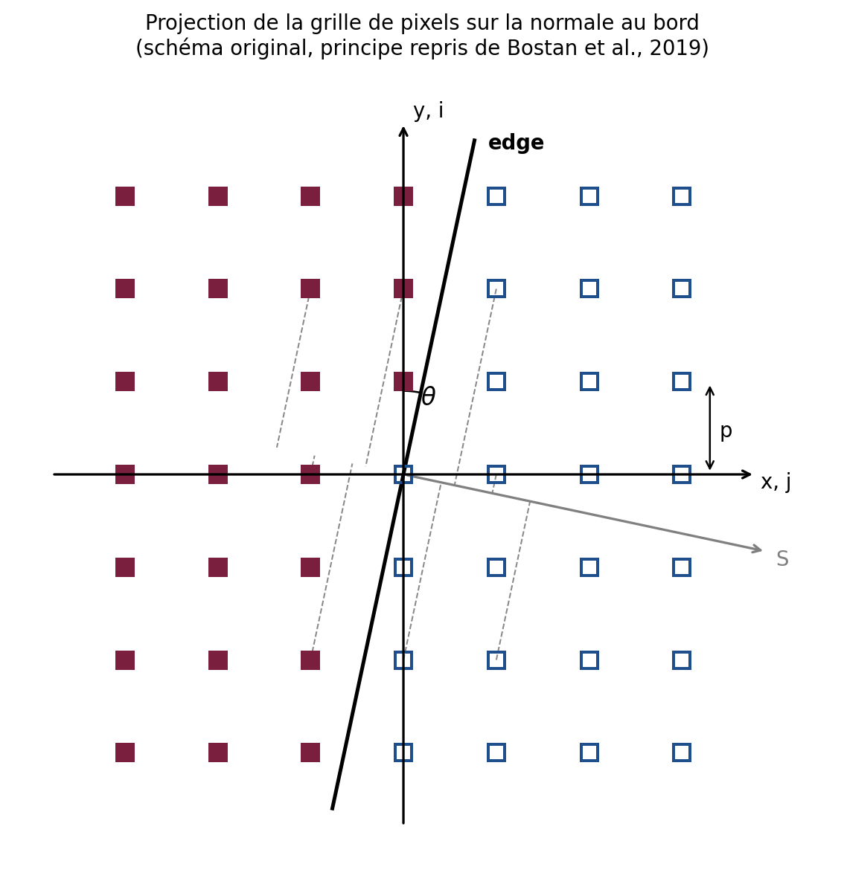

# MTF : orientation et estimateurs

## 3. Module d'orientation

Estime l'angle d'inclinaison du bord par plusieurs algorithmes
indépendants, chacun produisant en plus de l'angle une **position
sous-pixel du bord par ligne** (`edge_rows`/`edge_columns`) et une
**métrique de qualité testant l'hypothèse propre à l'algorithme** — pas
une métrique arbitraire.

### 3.1 `preprocess.py` — canonicalisation générique

`SlantedEdgePreprocessor.preprocess(image)` :

1. Détecte si le bord est majoritairement horizontal (comparaison de
   l'énergie des gradients de Sobel horizontal/vertical) ; transpose si
   besoin.
2. Détecte le côté sombre (moyenne des `percentile`% de colonnes
   extrêmes) ; retourne l'image horizontalement si besoin.
3. Estime les niveaux noir/blanc de référence par moyenne robuste
   (percentile) des colonnes extrêmes.

Retourne un `PreprocessingResult` (image canonicalisée, niveaux noir/
blanc, indicateurs `was_transposed`/`was_flipped`).

### 3.2 `orientation/base.py` — socle générique

- **`FrameCanonicalizer`** : enveloppe autour du préprocesseur, plus
  les fonctions de conversion angle/positions vers le repère d'origine
  (défait flip puis transpose).
- **`OrientationResult`** : type de résultat commun — `algorithm`,
  `angle_deg` (replié dans [-90°, 90°], convention `atan2(Δligne,
  Δcolonne)`), `is_horizontal`, `was_transposed`/`was_flipped`,
  `edge_rows`/`edge_columns`, `quality_metric_name`/`quality_metric_value`,
  `details`.
- **`EdgeOrientationDetector`** (ABC) : template method. `analyse()`
  canonicalise, appelle `_estimate_canonical()` (abstraite), reconvertit
  le résultat. Fournit aussi des utilitaires partagés : repli d'angle,
  seuillage robuste de magnitude de gradient, régression linéaire
  position-par-ligne → angle.
- **`EdgeOrientationComparator`** : exécute plusieurs détecteurs,
  défaut = `{gradient, pca, fourier}`.

### 3.3 `orientation/gradient.py` — `GradientOrientationDetector`

**Hypothèse testée** : chaque ligne a un maximum local net de
`|d(intensité)/d(colonne)|` au niveau du bord.

**Algorithme** : dérivée par différences centrées de chaque ligne ;
position du maximum de `|gradient|` ; interpolation parabolique à 3
points autour du maximum pour la position sous-pixel ; régression
linéaire des positions sur toutes les lignes → angle.

**Métrique** (`peak_sharpness`) : courbure de la parabole normalisée
par la hauteur du pic — grande pour un maximum net et non ambigu,
petite pour un profil plat ou bruité.

Pas de paramètre constructeur (comportement fixe).

### 3.4 `orientation/pca.py` — `PCAOrientationDetector`

**Hypothèse testée** : les pixels de fort gradient sont alignés sur une
droite fine (le bord).

**Algorithme** :
1. Seuillage robuste (percentile parmi les valeurs non nulles
   uniquement — évite qu'un bord fin sélectionne toute l'image, voir
   [§9.1](choix.md#91-seuillage-par-percentile-sur-magnitude-de-gradient)) des pixels de fort gradient (Sobel).
2. **Première passe** : PCA sur le nuage de points brut → angle et
   `eigenvalue_ratio` (métrique, calculée sur ce nuage non filtré pour
   rester un diagnostic honnête des candidats bruts).
3. **RANSAC** : de nombreuses droites candidates tirées de paires de
   points aléatoires ; conservation de celle avec le plus de points à
   l'intérieur de `ransac_tolerance` [[FischlerBolles1981]](references.md#10-bibliographie)
   — nécessaire pour les images bruitées où les points de bruit peuvent
   être majoritaires (voir [§9.2](choix.md#92-biais-pca-sur-image-bruitée-centroïde-par-ligne)).
4. **Seconde passe** : PCA sur les seuls inliers RANSAC → angle final
   (cohérent avec les positions par ligne, voir [§9.2](choix.md#92-biais-pca-sur-image-bruitée-centroïde-par-ligne)) et centroïde pondéré
   par ligne → `edge_rows`/`edge_columns` ("projection").

**Paramètres constructeur** :

| Paramètre | Défaut | Rôle |
|---|---|---|
| `gradient_percentile` | 90.0 | Seuil de sélection des pixels de fort gradient |
| `ransac_tolerance` | 2.0 | Distance perpendiculaire max. (px) pour un inlier |
| `ransac_iterations` | 300 | Nombre de droites candidates testées |
| `canonicalization_percentile` | 10.0 | Transmis au préprocesseur |

### 3.5 `orientation/fourier.py` — `FourierOrientationDetector`

**Hypothèse testée** : la représentation symétrique (mirroring, [§1.2](theorie.md#12-le-problème-de-périodicité-de-la-fft))
a une énergie négligeable sur ses harmoniques paires.

**Deux méthodes internes, sélectionnables via `angle_source`** :

- **`"fundamental"`** (défaut) : phase de l'harmonique k=1 de la
  représentation symétrique → position absolue par ligne (calibrée +
  `unwrap` à travers les lignes), puis régression linéaire → angle.
  C'est la seule des deux qui produit des positions par ligne — donc
  toujours calculée, quel que soit `angle_source`, car nécessaire au
  tracé comparatif.
- **`"multiharmonic"`** : différence de phase entre paires de lignes
  glissantes, moyennée sur plusieurs harmoniques impaires basses
  (`fourier_utils.estimate_slope_multiharmonic`) — statistiquement plus
  robuste (plus de données moyennées) mais ne donne qu'un angle global.

**Métrique** (`odd_even_ratio`) : rapport de l'énergie des harmoniques
impaires sur celle des paires — test direct de l'hypothèse de symétrie
demi-onde.

**Paramètres constructeur** :

| Paramètre | Défaut | Rôle |
|---|---|---|
| `canonicalization_percentile` | 10.0 | Transmis au préprocesseur |
| `angle_source` | `"fundamental"` | `"fundamental"` ou `"multiharmonic"` |
| `low_freq_ratio` | 0.2 | Fraction des harmoniques basses (mode multiharmonic) |
| `block_gap` | 2 | Écart en lignes entre paires comparées (mode multiharmonic) |

### 3.6 `fourier_utils.py` — utilitaires partagés

- `reference_spectrum(size)` : spectre analytique d'un échelon idéal
  aux harmoniques impaires, `(-1)^{1+k}/((1+2k)\pi)`.
- `estimate_slope_multiharmonic(rect, low_freq_ratio, block_gap)` :
  implémentation partagée par `FourierOrientationDetector` (mode
  multiharmonic) et `SlantedEdgeMTFEstimator` (socle commun spatial/
  spectral) — évite la duplication de cette logique entre estimation
  d'angle et estimation de MTF.

## 4. Module de MTF

Quatre méthodes indépendantes, comparables via `MTFComparator`, toutes
produisant un `MTFResult` (`method`, `mtf`, `frequency`,
`frequency_corrected`, `dx`, `theta_rad`, `oversample_factor`,
`details`).

### 4.1 `estimators/base.py` — socle générique

- **`SlantedEdgeMTFEstimator`** (ABC) : template method partagé par
  `SpatialMTFEstimator`/`SpectralMTFEstimator` (les deux méthodes qui
  utilisent la représentation symétrique + `estimate_slope_multiharmonic`).
  `estimate(frame, oversample_factor)` : construit la représentation
  symétrique (délègue à `FourierOrientationDetector._build_symmetric_representation`),
  estime `(dx, theta)`, appelle `_compute_mtf()` (abstraite), applique
  `pixel_pitch` puis la correction d'angle sur la fréquence.
- **`MTFComparator`** : défaut = `{spatial, spectral, esf_lsf,
  spectral_correlation}`.

**Paramètres de la classe de base** (hérités par toutes les méthodes) :

| Paramètre | Défaut | Rôle |
|---|---|---|
| `low_freq_ratio` | 0.2 | Utilisé par spatial/spectral (estimation de pente partagée) |
| `block_gap` | 2 | Idem |
| `pixel_pitch` | 1.0 | Conversion cycles/échantillon → cycles/pixel physique ([§2.4](architecture.md#24-convention-de-fréquence-mtf)) — commun aux 4 méthodes |

### 4.2 `estimators/spatial.py` — `SpatialMTFEstimator`

**Principe** : dé-interlacement spatial. Chaque pixel de la
représentation symétrique est replacé selon sa position "effective" le
long du bord (`interlace_1d`, tenant compte du décalage `dx`), les
points sont triés puis interpolés sur une grille régulière et
anti-symétrisés (`regularise_signal`, force l'anti-symétrie attendue
d'un bord idéal). FFT du signal 1D résultant, divisée par le spectre
analytique de référence.

**Avantage** : un seul signal très sur-échantillonné (autant de points
que de pixels dans la ROI) → bon rapport signal/bruit sur la forme du
bord. **Inconvénient** : sensible à la qualité de l'interpolation,
suppose `dx` parfaitement linéaire sur toute la hauteur de la ROI.

Pas de paramètre propre au-delà de ceux hérités de la classe de base.

### 4.3 `estimators/spectral.py` — `SpectralMTFEstimator`

**Principe** : résolution d'un système linéaire par moindres carrés,
fréquence par fréquence, combinant 1, 2 ou 4 répliques spectrales
(selon `oversample_factor`) pondérées par le spectre de référence
analytique — permet de reconstruire la MTF au-delà de Nyquist en
dés-aliasant les répliques.

**Avantage** : exploite directement la redondance entre toutes les
lignes pour chaque fréquence, sans interpolation spatiale.
**Inconvénient** : plus coûteux (une résolution par fréquence).

Pas de paramètre propre au-delà de ceux hérités.

### 4.4 `estimators/esf_lsf.py` + `estimators/esf_models.py` — `EsfLsfMTFEstimator`

Méthodologie entièrement différente de spatial/spectral : détection de
bord ligne par ligne (pas de mirroring), construction d'ESF par
projection géométrique, LSF selon un modèle choisi indépendamment.
Surcharge `estimate()` en entier.

**Étapes découplées** :

1. **`ParametricEdgeDetector`** (`mode`) : localise le bord de chaque
   ligne — `"sigmoid"` (fit sur l'intensité) ou `"gaussian"` (fit sur le
   gradient).
2. **`GeometricESFBuilder`** : régression linéaire (angle affiné) ;
   projection de chaque pixel sur la **normale au bord** (référence
   **fixe** = droite ajustée évaluée à la ligne centrale, pas la
   position bruitée par ligne — voir [§9.4](choix.md#94-projection-géométrique-de-lesf-référence-fixe)) — le même principe que la
   méthode de Kohm [[Kohm2004]](references.md#10-bibliographie) (projection des
   coordonnées de pixel sur la normale à l'arête, utilisée pour la MTF
   embarquée d'OrbView-3) ; moyenne par bin avec rejet
   des bins peu peuplés (`esf_min_samples_per_bin`) ; lissage
   Savitzky-Golay optionnel (`esf_smoothing`, désactivé par défaut, voir
   [§9.5](choix.md#95-sur-lissage-de-lesf-savitzky-golay)). Construite **une seule fois**, indépendamment du modèle de fit
   choisi ensuite.

   

   *Schéma original (pas une reproduction) illustrant le principe de
   projection : chaque pixel de coordonnées `(x, y)` est projeté sur
   l'axe `S`, perpendiculaire au bord d'angle θ — c'est cette
   projection que calcule `GeometricESFBuilder` (formule au [§9.4](choix.md#94-projection-géométrique-de-lesf-référence-fixe)).
   Principe repris de Bostan et al.
   [[Bostan2019]](references.md#10-bibliographie), qui en donne une version plus
   complète (avec construction de l'ESF sous-jacente).*
3. **Modèle de fit ESF → LSF** (`esf_model`, `ESF_FIT_MODELS`) :
   - `"numeric"` : dérivation numérique directe (`MTFComputer.compute_lsf`,
     voir options ci-dessous, dont un mode de dérivation par filtre de
     Savitzky-Golay [[SavitzkyGolay1964]](references.md#10-bibliographie)).
   - `"sigmoid"` : fit d'une sigmoïde (`estimators.esf_models.sigmoid`), dérivée
     analytique. **Mise en garde** : biais de forme aux hautes
     fréquences si la vraie PSF n'est pas tanh-shaped (voir [§9.6](choix.md#96-biais-de-forme-du-modèle-sigmoïde-esf)) — pas le
     défaut pour cette raison.
   - `"pchip"` (**défaut**) : interpolation spline cubique monotone
     [[FritschCarlson1980]](references.md#10-bibliographie), aucune forme imposée,
     recentrage sous-pixel par rampe de phase FFT.
   - `"tikhonov"` : régularisation de Tikhonov d'ordre 2 (pénalisation
     de courbure) pondérée par la précision de chaque bin de l'ESF
     (`ESFData.bin_count`), avec sélection automatique du paramètre de
     régularisation λ par courbe en L -- inspiré de
     [[Xie2018]](references.md#10-bibliographie), qui pose le problème comme une
     estimation d'ESF mal posée face au bruit. **Fidélité** : l'article
     original n'étant pas accessible (payant), c'est une formulation de
     Tikhonov standard (équivalente à un smoothing spline /
     Whittaker-Henderson) construite pour répondre au même problème
     avec les mêmes ingrédients qu'ils décrivent (régularisation,
     poids de précision, courbe en L) -- pas un portage de leurs
     équations exactes. La sélection de λ lisse (Savitzky-Golay) les
     courbes log-résidu/log-rugosité avant d'en calculer la courbure, et
     teste une grille densifiée à 80 valeurs (voir [§9.11](choix.md#911-régularisation-de-tikhonov-et-sélection-de-λ), dont la
     limite résiduelle non résolue). Voir
     `fit_esf_tikhonov` pour la formulation complète.

   **Note sur la fonction de Fermi** : une fonction de Fermi-Dirac
   (`1/(1+e^{-(x-x_0)/T})`) est mathématiquement la même famille que
   `"sigmoid"` (tanh) à reparamétrisation près --
   `\tanh(z) = 2\cdot\text{Fermi}(2z) - 1` -- donc leurs dérivées (LSF)
   sont proportionnelles. L'ajuster donnerait la même MTF (vérifié
   numériquement : écart < 1e-4, de l'ordre du bruit d'ajustement) et
   hériterait du même biais de forme que `"sigmoid"` (voir ci-dessus) :
   pas ajoutée comme option séparée pour cette raison.
4. **`compute_fwhm`** / **`compute_rer`** : deux résumés scalaires
   indépendants de la MTF, exposés dans `details["fwhm"]`/`details["rer"]`.
   - `compute_fwhm` : largeur à mi-hauteur de la LSF.
   - `compute_rer` (RER, Relative Edge Response) :
     `ESF(centre+0.5) - ESF(centre-0.5)`, sur l'ESF normalisée [0,1] --
     un des trois paramètres de la GIQE (General Image Quality
     Equation) utilisée pour prédire le NIIRS en télédétection
     [[Harrington2015]](references.md#10-bibliographie). Calcul direct sur l'ESF,
     sans FFT ni fenêtrage -- insensible aux artefacts de troncature et
     de fenêtrage (voir [§9.7](choix.md#97-fenêtrage-de-la-lsf-corrélation-spectrale) et [§9.8](choix.md#98-différenciation-avant-corrélation-corrélation-spectrale)). Calculé sur l'ESF partagée
     (`GeometricESFBuilder`), donc valable quel que soit `esf_model`.
5. **Corrections** : `MTFCorrections.derivative` (biais `np.gradient`,
   **uniquement si `esf_model="numeric"`**, voir [§9.6](choix.md#96-biais-de-forme-du-modèle-sigmoïde-esf)) puis
   `MTFCorrections.pixel_aperture` (aperture pixel), **seulement si
   `remove_pixel_aperture=True`** : par défaut, MTF du système ([§1.5](theorie.md#15-correction-douverture-pixel-sinc),
   [§9.13](choix.md#913-mtf-du-système-ou-de-loptique-seule-esf_lsf)).

**Paramètres constructeur** :

| Paramètre | Défaut | Rôle |
|---|---|---|
| `mode` | `"sigmoid"` | Localisation du bord par ligne (`ParametricEdgeDetector`) |
| `esf_model` | `"pchip"` | Modèle ESF→LSF : `"numeric"`, `"sigmoid"`, `"pchip"` |
| `pixel_pitch` | 1.0 | [§2.4](architecture.md#24-convention-de-fréquence-mtf) |
| `remove_pixel_aperture` | `False` | Retire la MTF du pixel (MTF de l'optique seule), [§1.5](theorie.md#15-correction-douverture-pixel-sinc) |
| `fit_window` | 5 | Demi-largeur de fenêtre du détecteur de bord |
| `esf_half_width` | 20.0 | Demi-largeur (px) de la bande d'ESF |
| `esf_oversample` | 5 | Échantillons d'ESF par pixel capteur, ou `"auto"` ([§9.14](choix.md#914-binning-adaptatif-à-langle)) |
| `esf_binning_mode` | `"omni"` | `"omni"` (bin fixe) ou `"iso_cos"` (bin ×cos(θ), [§9.14](choix.md#914-binning-adaptatif-à-langle)) |
| `outlier_threshold` | 5.0 | Rejet des lignes déviant de la médiane (px) |
| `esf_min_samples_per_bin` | 5 | Rejet des bins d'ESF peu peuplés |
| `esf_smoothing` | `False` | Lissage Savitzky-Golay de l'ESF |
| `lsf_points` | 1000 | Résolution de grille LSF (`"sigmoid"`/`"pchip"`) |
| `lsf_derivative_method` | `"gradient"` | `"gradient"` ou `"savgol_deriv"` (`"numeric"` seul.) |
| `lsf_filter_type` | `"tukey"` | `"tukey"`, `"savgol"`, `"gaussian"`, `"none"` (`"numeric"` seul.) |
| `lsf_window_length` | 15 | Longueur de fenêtre Savitzky-Golay/gaussienne |
| `lsf_polyorder` | 3 | Ordre du polynôme Savitzky-Golay |
| `lsf_tukey_alpha` | 0.15 | Paramètre α de la fenêtre de Tukey |
| `tikhonov_lambda` | `"auto"` | λ de régularisation (`esf_model="tikhonov"`), ou valeur fixée |
| `tikhonov_lambda_grid` | 80 valeurs, [1e-6, 1e3] | Grille de λ testée si `"auto"` ([§9.11](choix.md#911-régularisation-de-tikhonov-et-sélection-de-λ)) |

### 4.5 `estimators/spectral_correlation.py` — `SpectralCorrelationMTFEstimator`

**Principe** : corrélation de phase à une composante, fréquence par
fréquence, sans représentation symétrique ni spectre de référence.
Pour chaque fréquence `f_k`, projection (moindres carrés à une
composante) du spectre mesuré de chaque ligne sur la rampe de phase
théorique `exp(-2πi f_k · décalage_ligne)` — récupère directement
l'amplitude complexe du système à cette fréquence.

**Estimation de pente propre** (pas `estimate_slope_multiharmonic`) :
fenêtre de Hanning sur chaque ligne avant FFT (réponse alternative au
problème de non-périodicité, [§1.2](theorie.md#12-le-problème-de-périodicité-de-la-fft)), paires de lignes **non
chevauchantes**.

**Deux pièges de la forme naïve évités** (voir [§9.7](choix.md#97-fenêtrage-de-la-lsf-corrélation-spectrale) et [§9.8](choix.md#98-différenciation-avant-corrélation-corrélation-spectrale) pour le détail
des validations numériques) :
1. LSF calculée par différenciation de chaque ligne avant corrélation
   (corréler le spectre du bord brut, non différencié, sous-estime la
   MTF d'un facteur ~30).
2. Fenêtrage Hanning de la LSF avant FFT (anti-dépassement MTF > 1).

**Limite assumée** : pas de dés-aliasing au-delà de Nyquist ;
`oversample_factor` accepté pour l'interface mais sans effet.

**Paramètres constructeur** :

| Paramètre | Défaut | Rôle |
|---|---|---|
| `apply_hanning` | `True` | Fenêtrage Hanning pour l'estimation de pente |
| `line_spacing` | 2 | Écart entre paires de lignes (pente) |
| `low_frequency_ratio` | 0.2 | Fraction des fréquences basses (pente) |
| `pixel_pitch` | 1.0 | [§2.4](architecture.md#24-convention-de-fréquence-mtf) |
