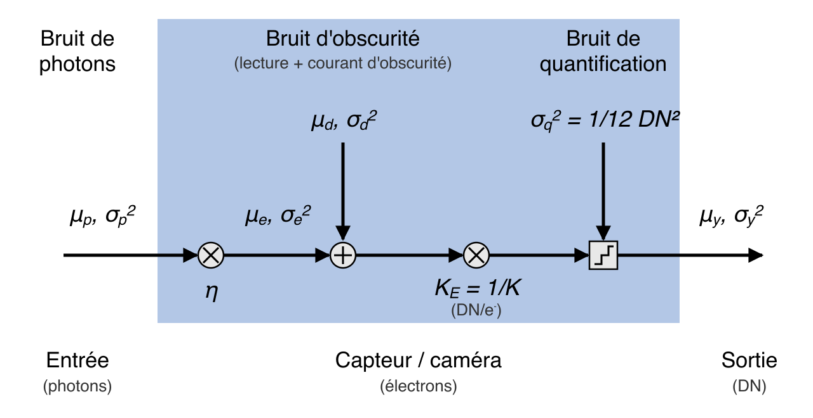

# 2. Fondements communs

Ce chapitre réunit ce que toutes les métriques partagent : le modèle de pixel, les sources de
bruit, la séparation du temporel et du spatial, l'incertitude des estimateurs et la
décomposition ligne / colonne / pixel. Le simulateur qui produit les données de validation est
décrit à part, dans le [simulateur de capteur](../simulateur/index.md).

## 2.1 Le modèle linéaire d'un pixel (EMVA 1288)

La norme EMVA 1288 (chap. 2) réduit le capteur à un pixel qui convertit un
nombre moyen de photons μ_p, reçus pendant la pose, en un signal numérique
y (DN) :

*Modèle linéaire d'un pixel (d'après EMVA 1288, chap. 2, et la figure de
K. Douglass). Chaque source de bruit entre à son étage : bruit de photons
à l'entrée (σ_p² = μ_p, poissonnien), bruit d'obscurité en électrons
(lecture et courant d'obscurité, §2.2), bruit de quantification au
convertisseur. La moyenne et la variance se propagent d'étage en étage
jusqu'au signal μ_y, σ_y² en DN.*

Hypothèses du **capteur idéal** :

1. le nombre de photons collectés est proportionnel au produit de
   l'éclairement E (W/m²) et du temps de pose t_exp ;
2. le capteur est linéaire : y croît linéairement avec le nombre de
   photons ;
3. toutes les sources de bruit sont stationnaires, dans le temps et dans
   l'espace (cette hypothèse est levée ici pour les motifs fixes, §2.5) ;
4. seul le rendement quantique η dépend de la longueur d'onde ;
5. seul le courant d'obscurité dépend de la température.

Moyenne du signal :

μ_y = μ_y,dark + K_E · η · μ_p

où K_E est le **gain système** en DN/e⁻ (convention EMVA).

> **Convention de ce projet** : K désigne le gain de conversion en
> **e⁻/DN** (convention de Janesick, plus courante en caractérisation
> spatiale). Donc K_E = 1/K, et la pente du modèle de bruit vaut b = 1/K.

## 2.2 Sources de bruit temporel

**Bruit de photons.** Les arrivées de photons suivent un processus de
Poisson : la variance du nombre de photons égale sa moyenne, σ_p² = μ_p.
Chaque photon est converti avec la probabilité η. Un processus de Poisson
aminci par un tirage de Bernoulli reste poissonnien : le nombre
d'électrons suit Poisson(η·μ_p), donc σ_e² = μ_e. Le bruit de photons est
un **bruit de comptage en électrons**. Sa variance en DN vaut
σ_e²/K² = μ_e/K² = μ/K, avec μ = μ_e/K le signal en DN : c'est l'origine
du terme b·μ.

**Courant d'obscurité.** Des électrons sont générés thermiquement dans le
silicium, indépendamment de la lumière, au taux I_d (e⁻/s/pixel). Pendant
t_exp, on en collecte d_e = I_d·t_exp en moyenne, et leur nombre est lui
aussi poissonnien (bruit d'obscurité, variance d_e). I_d dépend fortement
de la température. En règle pratique, il double tous les 7 à 8 °C. Plus
précisément, I_d ∝ T³·exp(−E_g / (2kT)), avec E_g la largeur de bande
interdite du silicium. Ordres de grandeur : 0,01 à 0,1 e⁻/s pour un
capteur refroidi par effet Peltier, quasi nul pour un capteur
cryogénique. Simulé par la famille S1 du simulateur.

**Bruit de lecture.** Il regroupe les bruits de la conversion
charge → tension (amplificateur de sortie surtout) et de la chaîne
analogique jusqu'au convertisseur. On le modélise par un bruit gaussien
additif σ_lect, en e⁻, indépendant du signal. Le **bruit de remise à zéro**
(kTC, σ = √(kTC)/q au nœud de détection) est en principe supprimé par le
double échantillonnage corrélé. S'il ne l'est pas, il s'ajoute au bruit de
lecture.

**Bruit de quantification.** Le convertisseur arrondit le signal au code
entier le plus proche. Si le signal varie de plus d'environ un demi-pas
autour du code (σ ≳ 0,5 DN), l'erreur d'arrondi est quasi uniforme sur
[−½, ½] et indépendante du signal : sa variance vaut Δ²/12, soit 1/12 DN²
pour un pas Δ = 1 DN. En dessous de ce seuil, l'erreur dépend du signal et
le modèle additif ne tient plus ([simulateur, §7](../simulateur/validation.md#7-limites-et-choix-de-modélisation)).

**Variance totale.** Les sources étant indépendantes, les variances
s'ajoutent. En DN, et en notant μ = (μ_e)/K le signal au-dessus de l'offset :

σ_y² = (σ_lect² + σ_d²)/K² + σ_q² + μ/K = **a + b·μ**

avec a = σ_y,dark² = (σ_lect² + σ_d²)/K² + 1/12 et b = 1/K. C'est la
**courbe de transfert photonique** (PTC) : la variance temporelle est
affine en le signal, de pente 1/K. Mesurer cette pente donne le gain sans
aucune référence radiométrique (Janesick 2007). En S0, σ_d = 0.

## 2.3 Écrêtages : puits et convertisseur

Deux limites hautes coexistent :

- la **capacité du puits** (full well), en e⁻. Au-delà, les charges ne
  sont plus collectées (et débordent vers les voisins, ou *blooming*, non
  simulé). Le signal plafonne à offset + FW/K ;
- le **code maximal** du convertisseur, 2ⁿ − 1 DN.

La première atteinte détermine la saturation. Dans les deux cas, la
variance s'effondre près du plafond : la PTC s'infléchit puis chute, d'où
l'exclusion des niveaux proches de la saturation dans l'ajustement (voir
[Non-linéarité aux extrêmes de luminance](../bruit-estimateurs.md#non-linéarité-aux-extrêmes-de-luminance)). En bas, le
convertisseur écrête à 0, ce que l'offset évite en pratique.

## 2.4 Offset

Un offset positif (offset, *bias*, *baseline*) est ajouté avant le
convertisseur pour que le bruit autour de zéro ne soit pas replié par
l'écrêtage bas. Il ne dépend pas du temps de pose. Il peut dériver d'une
pose à l'autre, ce que corrigent les colonnes d'overscan (S1).

## 2.5 Non-uniformités spatiales (bruit spatial fixe)

Le bruit spatial fixe est constant d'une pose à l'autre. On ne peut donc
pas le réduire en moyennant des images, mais on peut le corriger.

- **DSNU** (*Dark Signal Non-Uniformity*) : dispersion de l'offset (et, à
  partir de S1, du courant d'obscurité) d'un pixel à l'autre. Effet
  **additif**.
- **PRNU** (*Photo Response Non-Uniformity*) : dispersion du gain (η et
  conversion) d'un pixel à l'autre. Effet **multiplicatif sur le signal**
  (et seulement sur lui, pas sur l'offset). Le bruit spatial qu'elle
  produit croît linéairement avec le signal, alors que le bruit de photons
  croît en √μ. La PRNU domine donc à fort signal.
- **Transmission optique** (vignettage, poussières, S4) : multiplie la
  lumière avant le capteur. Elle est indiscernable de la PRNU dans un
  champ uniforme, mais se sépare par son échelle spatiale (vignettage
  lisse, poussières en anneaux de quelques pour cent).

**Structure ligne / colonne.** Les architectures réelles produisent des
défauts par colonne (amplificateur ou convertisseur de colonne d'un CMOS,
défaut de registre d'un CCD) et par ligne. On modélise une carte m comme

m_ij = p_ij + r_i + c_j

avec p (pixel), r (ligne) et c (colonne) indépendantes, centrées,
d'écarts-types σ_p, σ_r et σ_c. La variance spatiale totale vaut
σ_p² + σ_r² + σ_c². La moyenne de la ligne i vaut r_i + (moyenne des p
de la ligne), si bien que la variance des moyennes de lignes vaut
σ_r² + σ_p²/W. Il faut retirer ce biais en σ_p²/W pour retrouver σ_r (et
de même σ_c² + σ_p²/H pour les colonnes). C'est la base de la
décomposition de `dark_frame`, `spatial_noise` et `prnu`.

**Séparer le spatial du temporel.** La moyenne temporelle de K poses
d'un pixel contient sa valeur fixe plus un résidu temporel de variance
σ_temp²/K. La variance spatiale de la carte moyenne vaut donc

s²(moyenne) = σ_spatial² + σ_temp²/K

d'où σ_spatial² = s²(moyenne) − σ_temp²/K (EMVA 1288, chap. 8). La
différence de deux poses, x₁ − x₂, élimine au contraire tout motif fixe :
var(x₁ − x₂)/2 = σ_temp².

## 2.6 Incertitude des estimateurs

Ces résultats fixent les tolérances des tests et, plus tard, les barres
d'erreur des mesures.

- **Moyenne** de n échantillons indépendants de variance σ² : écart-type
  σ/√n.
- **Variance empirique** (estimateur en 1/(n − 1)) d'échantillons
  gaussiens : Var(s²) = 2σ⁴/(n − 1), soit une incertitude relative de
  √(2/(n − 1)). Pour un bruit de Poisson de moyenne μ, l'aplatissement
  en excès vaut 1/μ ; la correction est négligeable dès quelques dizaines
  d'électrons.
- **Moyenne sur N pixels de variances temporelles calculées sur K
  poses** : incertitude relative de √(2/((K − 1)·N)).
- **Écart-type estimé** : incertitude relative d'environ 1/√(2(n − 1)).

## 2.7 Décomposition ligne / colonne / pixel

Outil commun de `dark_frame`, `spatial_noise` et `prnu` (`eoqual.measure.radiometry.decomposition`).

Modèle d'une carte (§2.5) : M_ij = m + r_i + c_j + p_ij + e_ij,
avec e un résidu temporel de variance v connue. On définit :

- R_i = moyenne de la ligne i, C_j = moyenne de la colonne j ;
- P_ij = M_ij − R_i − C_j + moyenne(M), le résidu doublement centré.

Pour des termes indépendants de variance σ², on a
E[var(P)] = σ²·(H − 1)(W − 1)/(HW). Le terme p + e s'estime donc sans
biais par

s²_pe = var(P) · HW / ((H − 1)(W − 1)).

Les moyennes de lignes contiennent le résidu pixel moyenné sur W
colonnes : E[var(R)] = var(r) + (σ²_pe/W)·(H − 1)/H. D'où :

- σ_r² = var(R) − (s²_pe/W)·(H − 1)/H ;
- σ_c² = var(C) − (s²_pe/H)·(W − 1)/W ;
- σ_p² = s²_pe − v ;
- σ_tot² = var(M) − v.

Les variances spatiales sont en 1/n et les écarts-types sont ceux des
composantes *réalisées* de la carte, ce qui est la convention du
simulateur. Une estimation peut être négative quand la composante est
nulle ou noyée dans le bruit : l'écart-type est alors ramené à 0, et la
variance brute reste disponible (`row_var`…) pour les études de biais.

Incertitude d'une composante ligne : les termes dominants sont la
covariance croisée 2·cov(r, p̄_i), d'écart-type 2σ_r·√(s²_pe/W)/√H, et la
dispersion de var(p̄_i), d'écart-type √(2/H)·s²_pe/W. On en déduit
u(σ_r) ≈ √(somme des carrés) / (2σ_r). Même chose pour les colonnes, en
échangeant H et W.

Pour un push broom (une seule ligne moyenne de W détecteurs), lignes et
colonnes sont indiscernables : seule la dispersion totale entre détecteurs
est accessible.
